# Pac-Man (Atari 8-bit) - a faithful C port

A study and a port of the **Atari 8-bit (400/800/XL/XE) Pac-Man cartridge** (NTSC): the original 6502 program was disassembled and documented routine by routine, and then re-written in portable **C99** so that it runs on a modern machine **frame for frame as the original does** (59.92 frames a second), with a Windows front end that adds what a modern player expects (see **Modernization** below): any resolution, borderless fullscreen, frame rates up to uncapped, CRT shaders, Xbox / DualShock 4 / DualSense pads with rumble and light bar, a pause menu, saved settings and achievements.

> **No ROM is included, and none is needed to build.** To play you need **your own copy of the cartridge ROM** (the NTSC version, a file of exactly 8,192 bytes). The program asks for it the first time it starts, reads it once to make the game's data files, and never needs it again. See [NOTICE](NOTICE) for what the licence does and does not cover.

## Screenshots

All pictures are the program's own output (`python -I tools/make_screenshots.py`), the game's pictures enlarged three times without smoothing, or the CRT shaders' result on screen.

| The title, the game, the ghosts closing in |
|---|
| 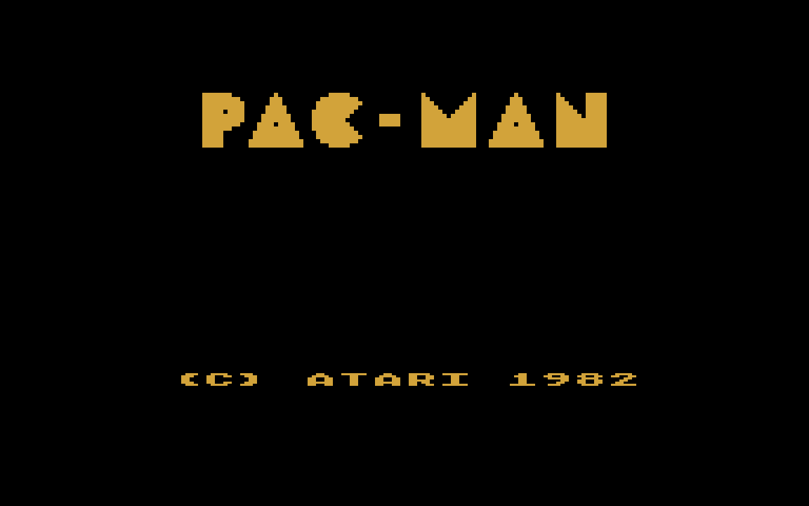 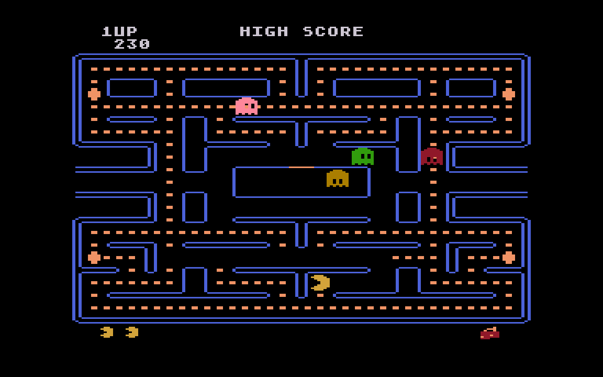 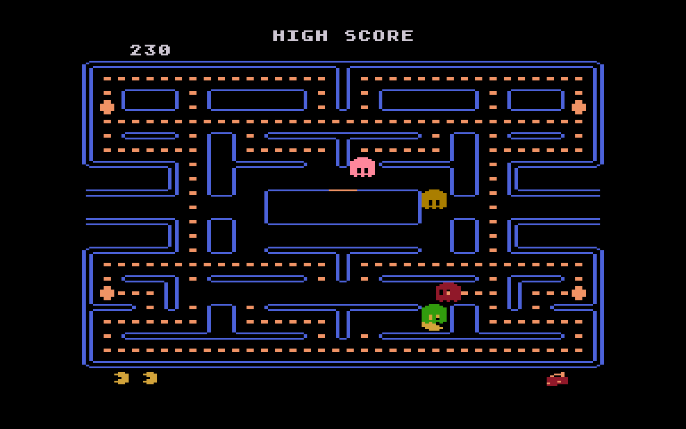 |

| CRT shaders: crt-guest-advanced-ntsc, zfast-crt-composite, crt-aperture |
|---|
| 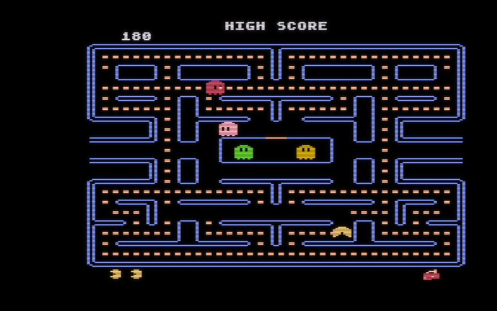 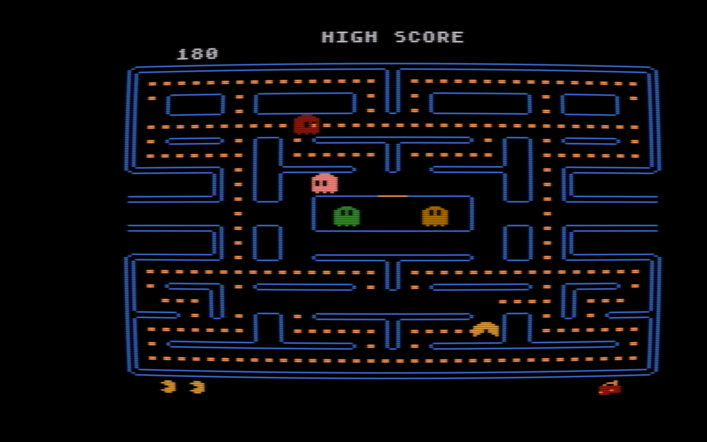 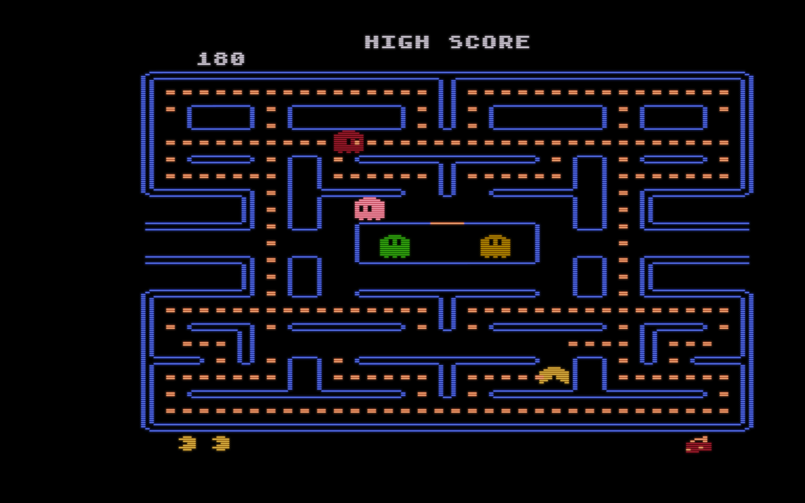 |

| The pause menu, the Graphics Options, the Sound page |
|---|
| 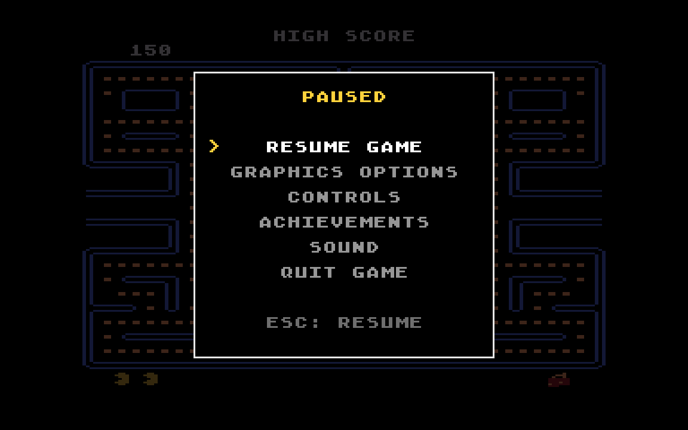 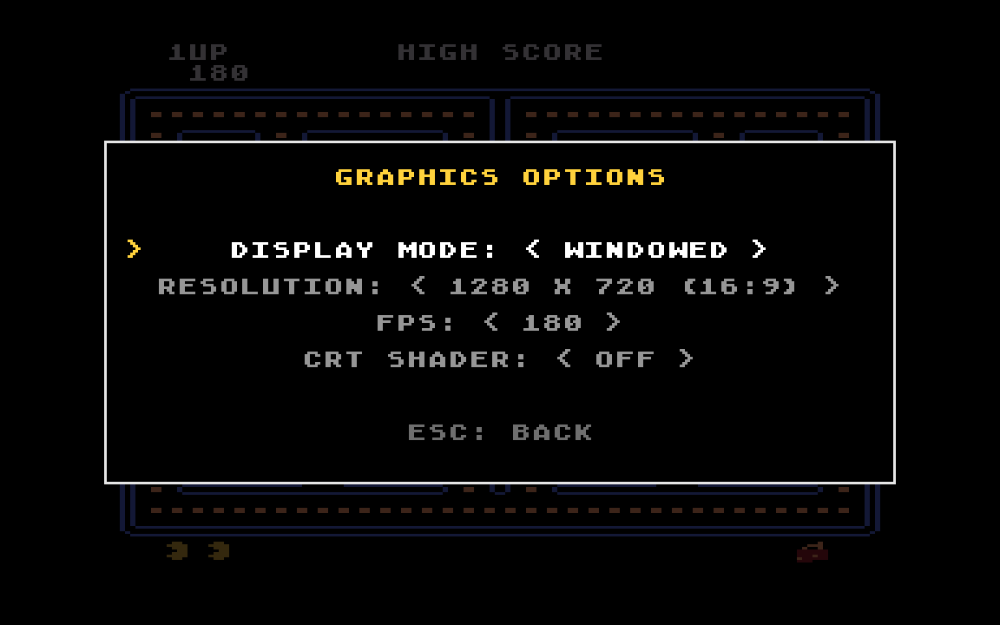 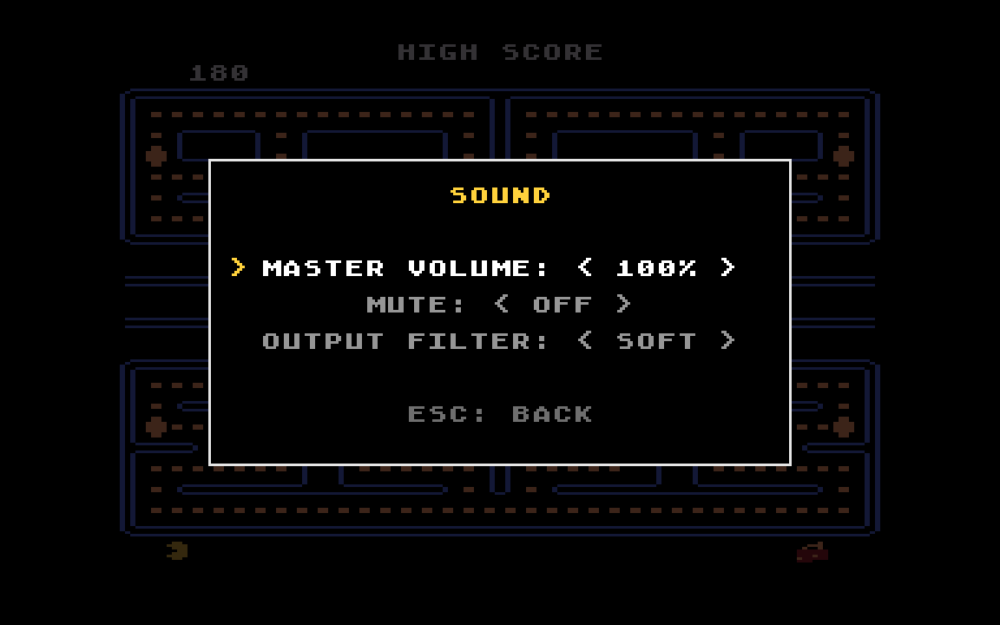 |

| The Controls page for the keyboard, an Xbox pad and a DualSense |
|---|
| 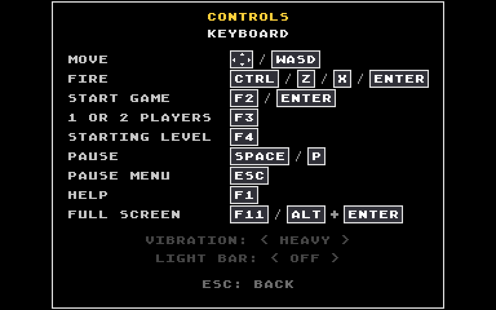 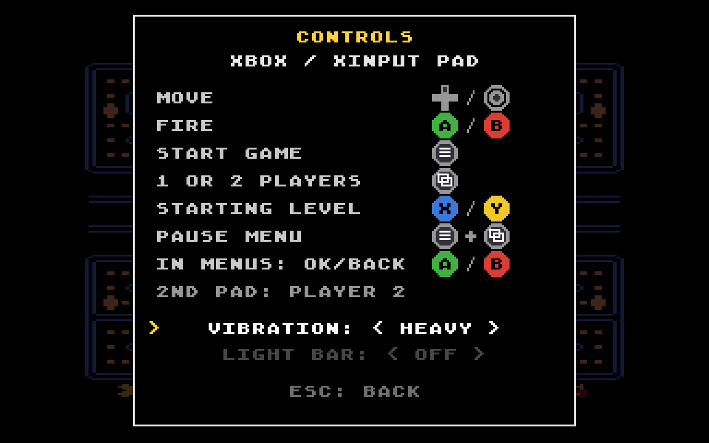 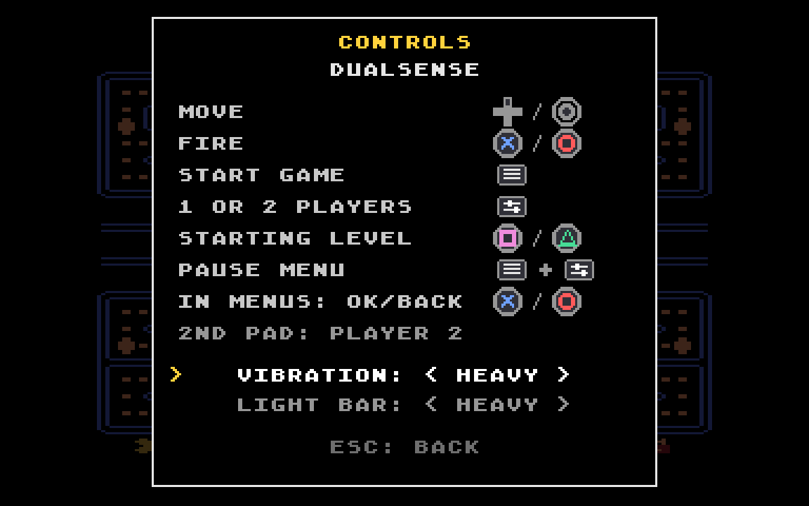 |

| The Achievements page (a prepared save file, to show the page), and the toast when one is earned (the first dot, with a CRT shader) |
|---|
| 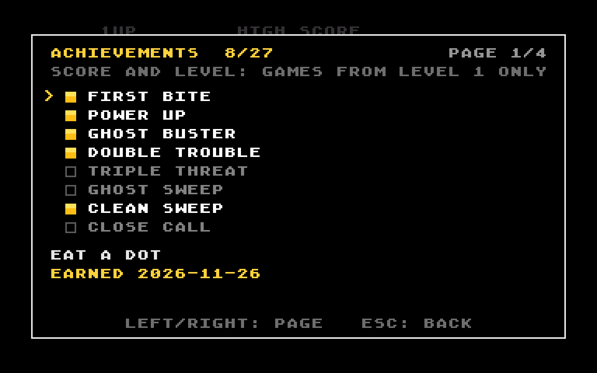 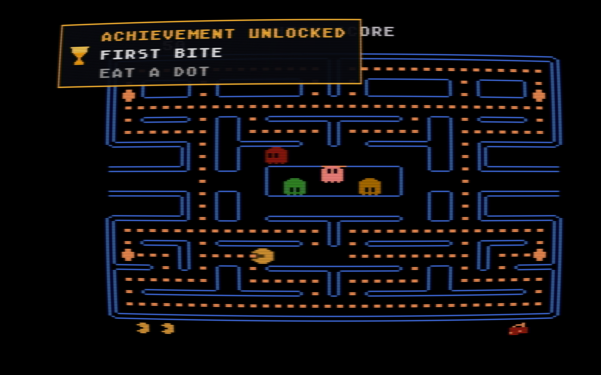 |

## Playing (Windows 10 version 1903 or later, or Windows 11; 64-bit)

1. Download the release zip `pacman-a8-port-<version>-win64.zip` and unpack it anywhere you can write to.
2. Run `pacman_a8_play.exe`. The first time, choose your ROM file. The program checks it (exact size and SHA-256), makes `resources/pack/assets.pmab` from the parts that are data, and does not copy or keep the ROM.
3. The first time Windows may say "Windows protected your PC" (the program is not code-signed): choose "More info", then "Run anyway"; compare the download's SHA-256 with the `.sha256` file if you want to be sure. No installation or administrator rights are needed, and the program writes only inside its own folder.
4. Play. Everything - settings, achievements, high score, log - stays in that folder: the game is **portable**. Delete `save/` to start afresh.

| | Keyboard | Pad (Xbox, DualShock 4, DualSense) |
|---|---|---|
| Move | arrows, WASD | D-pad, left stick |
| Fire | Ctrl, Z, X, Enter | A / B (Cross / Circle) |
| Start game | F2, Enter | Menu / Options |
| 1 or 2 players | F3 | View / Share / Create |
| Starting level | F4 | X / Y (Square / Triangle) |
| Pause | Space, P | |
| Pause menu | Esc | Menu + View together |
| Help / Full screen | F1 / F11, Alt+Enter | |

The **pause menu** (the game is paused while it is open): **Graphics Options** (windowed or borderless fullscreen, 20 resolutions, FPS from native 59.92 to uncapped with in-between pictures, three CRT shaders), **Controls** (the controls of the device you are using, with its icons; vibration and light bar settings: Off / Light / Heavy), **Achievements** (27, with a toast, a chime and a gold flash on the pad when one is earned), **Sound** (master volume, mute, output filter Off / Soft / Warm). The game itself - its rules, speed, sounds - is the original's; the Select / Option / Start choices work as on the real machine.

## Modernization

The game itself - its rules, speed, sounds, ghosts, levels - is the original's, frame for frame. Everything below is added **around** it, and none of it changes the game's own state (its digests are the same with or without any of it).

**Picture**
- Windowed or **borderless fullscreen**, 20 resolutions in 4:3, 16:9, 16:10 and 21:9; the picture is always 1.6:1, centred, and uses a whole-number scale when that fits well.
- **Frame rate from native (59.92) up to uncapped**, or 75 to 180 a second paced to the monitor's refresh: the pictures between two game frames show the places where the two differ as a mixture of both, so objects glide while the game itself still runs at its own speed.
- **Three CRT shaders** (crt-guest-advanced-ntsc, zfast-crt-composite, crt-aperture), run on OpenGL 4.5 and chosen live in the menu, or none.

**Controls**
- Keyboard and **Xbox pads**; **DualShock 4 and DualSense, over USB and Bluetooth** (read and written directly, so no extra software is needed), with a second pad as player 2; the pad drives the menu too.
- **Rumble** on every pad and the **light bar** of PlayStation pads follow the game: a power pellet (blue light), a ghost eaten, Pac-Man caught (red), an extra life, a board cleared. Vibration and light bar each have Off / Light / Heavy, and are grayed out when no pad that can do them is connected.
- A **Controls page** that lists the controls of the device you are using, with its icons (keycaps, D-pad, stick, Xbox and PlayStation buttons) drawn by the program.
- A button held down from the menu never reaches the game.

**Sound**
- The chip's sound is made at four times the rate and low-passed before it reaches the speaker, so the start tune's very high tone no longer folds down into an audible whine.
- A **Sound page**: master volume (an audio taper, in steps of 10 %), mute, and an output filter: Off (the raw chip), Soft (the default) or Warm (a small TV speaker).

**Around the game**
- A **pause menu** (Esc, or Menu + View on a pad; the game is paused while it is open) with Resume, Graphics Options, Controls, Achievements, Sound and Quit; F1 shows the function keys.
- **27 achievements** (three of them hidden) found by watching the game's state: firsts, ghost combos, a board cleared without dying, score and level tiers, a 15-minute game, lifetime totals. A toast, a chime and a gold flash on the pad's light bar tell you. Score and level achievements count only in games started at level 1. They are kept in a **sealed file**: one edited by hand is put aside.
- **Everything you set is remembered**, in text files in the game folder.

**Installing and running**
- **Portable**: no installer, no registry, nothing outside the folder; folders and ROM paths with any characters (accented letters, Japanese, emoji) work.
- **Only your ROM is needed**: it is read once to make the game's data files, and not copied or needed again. The program asks for it by itself; a wrong, missing or damaged file is explained, not a crash.
- The release zip is **reproducible**, and checked as a player meets it (see `docs/75`).

## Building from source

You need a C99 compiler (clang or gcc), CMake 3.16+ with Ninja, and - to run or to run the tests that play the game - your own ROM at `original/Pac-Man.rom`.

```
cmake -S src/c -B build/c -G Ninja -DCMAKE_BUILD_TYPE=Release
cmake --build build/c
ctest --test-dir build/c                 # 48 tests, strict C99 with -Werror
python -I tools/check_front_end.py       # the real window, the sound device, the pictures, the menus (Windows)
python -I tools/make_win_release.py      # the Windows release zip (build/release/)
python -I tools/check_win_release.py     # the zip as a player meets it: only a ROM given
```

`tools/build_test_posix.sh` builds and tests the portable part with only `cc`, `ar` and `sh` (also used on Linux under WSL). More in [docs/63-build-and-dependencies.md](docs/63-build-and-dependencies.md).

## How it is made, and how faithful it is

| Layer | What | Where |
|---|---|---|
| Analysis | the disassembly of the cartridge (made from your own ROM by `tools/make_asm.py`, never stored here), byte-exact rebuild, routine and variable catalogues, control flow, the sound chip, the original's architecture | `src/asm`, `docs/01`-`docs/66`, `tools/`, `analysis/` |
| Core | the game in C99, routine for routine: the world state, ghosts, Pac-Man, scoring, levels, sound | `src/c/core`, `src/c/app`, `src/c/audio`, `src/c/render` |
| Shell | what a front end needs: the menu, controls, achievements, settings, sound stage, pad protocol - portable, no system calls | `src/c/shell` |
| Windows front end | the window, OpenGL CRT shaders, WASAPI sound, XInput and raw HID pads | `src/c/platform/win32` |

Equivalence is checked by **whole state, every frame** against the original program run in an emulator (`docs/52`, `docs/53`, `docs/64`), plus the sound compared in the waveform domain. What is *not* fully verified is kept in one place, [docs/OPEN-VERIFICATION.md](docs/OPEN-VERIFICATION.md) - for example the PlayStation pads were tested by the owner but not against every connection, and the sound pages were measured, not listened to by the checks. Start with [docs/PROGRESS.md](docs/PROGRESS.md) and [docs/48-architecture.md](docs/48-architecture.md); the Windows front end is in [docs/67](docs/67-windows-front-end.md) to [docs/74](docs/74-achievements.md).

## Scope

- **NTSC only**, one player or two (alternating), as the cartridge. No PAL data.
- The Windows front end targets Windows 10/11 x64. The headless shell and the core are portable C99 (built and tested with clang and gcc, and on Linux).
- The pause menu, pads, CRT shaders, FPS option, sound page, saved settings and achievements are additions around the original game; nothing of them changes the game's own digests.

## Licence

The work of this project (the C port, the tools, the documentation) is under the **MIT licence** ([LICENSE](LICENSE)). It does **not** cover the original game, which belongs to its owners: neither the ROM nor its disassembly (`src/asm/pacman.s`, which `tools/make_asm.py` makes from your own ROM) is part of this repository or its releases. The CRT shaders in `third-party/crt-shaders` are GPL-licensed files by their authors, read by the program when a shader is chosen; the font in `third-party/EightBit-Atari-Fonts` is under the SIL OFL. Details and credits in [NOTICE](NOTICE).

"Pac-Man" and "Atari" are trademarks of their owners; this project is not affiliated with or endorsed by them.
