# 26 - The Control Flow Graphs (stage 33)

GENERATED by `python -I tools/analyze_cfg.py --write docs/26-control-flow-graphs.md` from the same trace as `src/asm/pacman.s` and the routines of `23-function-table.md`; do not edit by hand. Tests: `tests/test_cfg.py`.

## Method

Each of the 81 routines is cut into **basic blocks**: a block starts at the routine entry, at every branch or `JMP` target, after every branch, and at every join (an instruction with two or more predecessors); it ends at the next block start or at an `RTS`, `RTI` or `JMP`. A `JSR` is a call and does not end a block. Edges: **taken** / **not taken** for a conditional branch, **jump** for `JMP`, **fall** into the next block. A branch that the code itself decides (`lda #imm` / `bne`, `clc` / `bcc`, a branch after its complement) keeps only the edge that can happen. A `JMP` into another routine is a tail call: its code is part of the body, so a shared tail appears in each routine that jumps to it.

A **back edge** is an edge whose target dominates its source; each is one natural loop. **Cyclomatic complexity** = edges - blocks + 2. A graph is **reducible** when every retreating edge of a depth-first search is a back edge (the loops are properly nested single-entry loops).

## Totals

- 81 routines, **1703 basic blocks**, **2389 edges**, 5151 instructions in the bodies (shared tails counted once per routine).
- 142 back edges (natural loops); the loop count of `23-function-table.md` counts every backward branch, so it agrees on routines without a decided branch.
- 75 graphs are reducible and **6 are not** (FrameDispatch, FrightenedTick, FrightenedSound, MovePacMan, GhostBehaviour, SteerToTarget): each has a loop that can be entered at two places, through an always-taken `lda #imm / bne` used as a jump; the block pairs are listed under each routine. A port must keep these as a `goto` or duplicate a block; they cannot be written as nested `while` loops as they stand..
- Exit blocks: 171 (an RTS or RTI, or a `JMP` out of the routine); routines with no exit block: Start.
- Most complex routines (cyclomatic complexity): FrameDispatch 107, MovePacMan 44, Start 37, GhostBehaviour 33, GhostStartRoute 25, GhostSeesPacMan 25, GhostPatrol 23, GhostEaten 22, GhostSelectPatrol 21, GhostPatrolTravel 21.

## Summary table

| Routine | Entry | Blocks | Edges | Exits | Back edges | Complexity | Reducible |
|---|---|---|---|---|---|---|---|
| Start | `$A386` | 66 | 101 | 0 | 18 | 37 | yes |
| DliHandler1 | `$A573` | 12 | 19 | 1 | 1 | 9 | yes |
| DliHandler2 | `$A5CE` | 4 | 4 | 1 | 0 | 2 | yes |
| VbiHandler | `$A5FD` | 3 | 3 | 1 | 0 | 2 | yes |
| InitDisplay2 | `$A610` | 8 | 10 | 1 | 3 | 4 | yes |
| TitleClearScores1P | `$A632` | 3 | 3 | 1 | 1 | 2 | yes |
| TitleClearScores2P | `$A64E` | 4 | 4 | 1 | 1 | 2 | yes |
| ExpandData | `$A668` | 8 | 10 | 1 | 2 | 4 | yes |
| ReadSrcByte | `$A69C` | 3 | 3 | 1 | 0 | 2 | yes |
| AdvanceSrcPtr | `$A69E` | 3 | 3 | 1 | 0 | 2 | yes |
| WriteDstByte | `$A6A5` | 3 | 3 | 1 | 0 | 2 | yes |
| ReadSrcHighNibble | `$A6AE` | 1 | 0 | 1 | 0 | 1 | yes |
| Init | `$A6B4` | 1 | 0 | 1 | 0 | 1 | yes |
| SetDisplayList | `$A6B5` | 1 | 0 | 1 | 0 | 1 | yes |
| FrameDispatch | `$A6CC` | 249 | 354 | 27 | 23 | 107 | NO |
| GhostEaten | `$A886` | 47 | 67 | 3 | 4 | 22 | yes |
| TurnControl | `$AA2D` | 49 | 64 | 7 | 3 | 17 | yes |
| CompareHighScore | `$AB26` | 8 | 10 | 2 | 2 | 4 | yes |
| ClipEntitiesOnTunnelRow | `$AB48` | 5 | 6 | 1 | 1 | 3 | yes |
| ClipEntityAtTunnel | `$AB57` | 21 | 34 | 1 | 3 | 15 | yes |
| BonusSound | `$ABC9` | 13 | 20 | 1 | 0 | 9 | yes |
| ToggleLegPhase | `$AC05` | 5 | 6 | 1 | 0 | 3 | yes |
| AdvanceLevel | `$AC75` | 1 | 0 | 1 | 0 | 1 | yes |
| DrawLevelIndicator | `$AC93` | 15 | 22 | 1 | 3 | 9 | yes |
| DrawReadyScreen | `$AD0E` | 9 | 10 | 2 | 0 | 3 | yes |
| DrawLives | `$AD15` | 9 | 10 | 2 | 0 | 3 | yes |
| LifeIcon2 | `$AD42` | 1 | 0 | 1 | 0 | 1 | yes |
| LifeIcon1 | `$AD45` | 1 | 0 | 1 | 0 | 1 | yes |
| DrawAllInPlace | `$AD49` | 14 | 20 | 1 | 4 | 8 | yes |
| ClearReadyText | `$AD5E` | 3 | 3 | 1 | 1 | 2 | yes |
| BlinkPlayerLabel | `$AD69` | 14 | 20 | 2 | 0 | 8 | yes |
| DrawLabel2UP | `$AD87` | 1 | 0 | 1 | 0 | 1 | yes |
| DrawLabel1UP | `$AD9F` | 1 | 0 | 1 | 0 | 1 | yes |
| InitBoard | `$ADAF` | 9 | 12 | 1 | 3 | 5 | yes |
| NewGameInit | `$ADF1` | 5 | 7 | 1 | 0 | 4 | yes |
| NewBoardInit | `$AE02` | 5 | 7 | 1 | 0 | 4 | yes |
| ClearPlayerCounters | `$AE1E` | 1 | 0 | 1 | 0 | 1 | yes |
| SetReleaseTimers | `$AE2B` | 5 | 6 | 1 | 1 | 3 | yes |
| DeathSequence | `$AE3D` | 27 | 36 | 5 | 2 | 11 | yes |
| DeathAnimation | `$AEF7` | 18 | 23 | 4 | 3 | 7 | yes |
| FrightenedTick | `$AF54` | 44 | 60 | 4 | 3 | 18 | NO |
| FrightenedSound | `$AFD7` | 12 | 17 | 1 | 0 | 7 | NO |
| EyesReturningSound | `$B02C` | 6 | 7 | 1 | 0 | 3 | yes |
| GhostEatenPause | `$B049` | 28 | 38 | 5 | 1 | 12 | yes |
| DotSoundSweep | `$B0BC` | 9 | 11 | 1 | 0 | 4 | yes |
| ClearPokeyRegisters | `$B0E6` | 3 | 3 | 1 | 1 | 2 | yes |
| ClearPlayerMemory | `$B0F1` | 1 | 0 | 1 | 0 | 1 | yes |
| FillPlayerPages | `$B100` | 2 | 2 | 1 | 1 | 2 | yes |
| LoadShadowColors | `$B113` | 3 | 3 | 1 | 1 | 2 | yes |
| Copy0800To0C00 | `$B11F` | 3 | 3 | 1 | 1 | 2 | yes |
| Copy0C00To1000 | `$B13D` | 3 | 3 | 1 | 1 | 2 | yes |
| Copy0C00To1400 | `$B15B` | 3 | 3 | 1 | 1 | 2 | yes |
| MovePacMan | `$B179` | 75 | 117 | 2 | 3 | 44 | NO |
| EatDotAtPacMan | `$B33A` | 17 | 24 | 3 | 0 | 9 | yes |
| PowerPelletCheck | `$B39F` | 25 | 43 | 1 | 1 | 20 | yes |
| PowerPelletEaten | `$B3DE` | 13 | 19 | 1 | 1 | 8 | yes |
| AddToScore | `$B423` | 30 | 43 | 3 | 2 | 15 | yes |
| JunctionLookup | `$B48E` | 21 | 32 | 1 | 3 | 13 | yes |
| BlinkPowerPellets | `$B54F` | 13 | 16 | 3 | 0 | 5 | yes |
| ShowPowerPellets | `$B55A` | 9 | 11 | 2 | 0 | 4 | yes |
| MoveDelayTick | `$B590` | 10 | 13 | 2 | 0 | 5 | yes |
| ChaseTimerSirenSight | `$B5C7` | 18 | 26 | 1 | 1 | 10 | yes |
| ForceChase | `$B616` | 6 | 9 | 1 | 1 | 5 | yes |
| BonusItemUpdate | `$B62E` | 22 | 28 | 6 | 1 | 8 | yes |
| EyesAndHousePerFrame | `$B69E` | 29 | 45 | 1 | 2 | 18 | yes |
| HouseLeaveStep | `$B738` | 37 | 50 | 3 | 2 | 15 | yes |
| HouseLeaveGhost2 | `$B76D` | 40 | 54 | 3 | 2 | 16 | yes |
| HouseLeaveGhost3 | `$B777` | 40 | 54 | 3 | 2 | 16 | yes |
| HouseEnterStep | `$B781` | 42 | 57 | 3 | 2 | 17 | yes |
| HouseWaitingTick | `$B7A5` | 11 | 15 | 1 | 1 | 6 | yes |
| HouseBobStep | `$B7D6` | 36 | 50 | 2 | 2 | 16 | yes |
| GhostBehaviour | `$B7F5` | 72 | 103 | 4 | 2 | 33 | NO |
| GhostStartRoute | `$B827` | 53 | 76 | 2 | 3 | 25 | yes |
| GhostSelectPatrol | `$B851` | 44 | 63 | 2 | 3 | 21 | yes |
| GhostPatrolTravel | `$B878` | 44 | 63 | 2 | 3 | 21 | yes |
| GhostPatrol | `$B89A` | 47 | 68 | 2 | 3 | 23 | yes |
| GhostGoToCorner | `$B8C5` | 44 | 63 | 2 | 3 | 21 | yes |
| GhostChase | `$B8EF` | 31 | 43 | 2 | 2 | 14 | yes |
| StepAndDrawEntity | `$B902` | 29 | 40 | 2 | 2 | 13 | yes |
| SteerToTarget | `$B999` | 32 | 51 | 1 | 0 | 21 | NO |
| GhostSeesPacMan | `$BA19` | 40 | 63 | 7 | 6 | 25 | yes |

## The graphs

Each routine: a table of its blocks (`first-last` address, instruction count, last instruction, calls made inside the block, successors) and the graph as a Mermaid flowchart. Solid arrows: taken / jump / fall; dotted: not taken; thick: back edge.

### Start  `$A386`

66 blocks, 101 edges, 0 exits, 18 back edges, complexity 37.

| Block | Instr | Last | Calls | Successors |
|---|---|---|---|---|
| `$A386-$A386` (entry) | 1 | LDX | - | fall `$A388` |
| `$A388-$A38F` | 4 | BPL | - | taken `$A388`; not taken `$A391` |
| `$A391-$A393` | 2 | LDX | - | fall `$A395` |
| `$A395-$A398` | 3 | BPL | - | taken `$A395`; not taken `$A39A` |
| `$A39A-$A39A` | 1 | LDX | - | fall `$A39C` |
| `$A39C-$A39F` | 3 | BPL | - | taken `$A39C`; not taken `$A3A1` |
| `$A3A1-$A3B8` | 13 | LDY | - | fall `$A3BA` |
| `$A3BA-$A3BE` | 3 | BMI | - | taken `$A3C2`; not taken `$A3C0` |
| `$A3C0-$A3C0` | 1 | BPL | - | taken (always) `$A3ED` |
| `$A3C2-$A3C4` | 2 | BEQ | - | taken `$A3F6`; not taken `$A3C6` |
| `$A3C6-$A3C8` | 2 | BVS | - | taken `$A3DB`; not taken `$A3CA` |
| `$A3CA-$A3D0` | 4 | JSR | AdvanceSrcPtr, ReadSrcByte | fall `$A3D3` |
| `$A3D3-$A3D7` | 3 | BPL | WriteDstByte | taken `$A3D3`; not taken `$A3D9` |
| `$A3D9-$A3D9` | 1 | BMI | - | taken (always) `$A3BA` |
| `$A3DB-$A3EB` | 7 | AND | WriteDstByte, AdvanceSrcPtr, ReadSrcHighNibble, WriteDstByte | fall `$A3ED` |
| `$A3ED-$A3F3` | 3 | JMP | WriteDstByte, AdvanceSrcPtr | jump `$A3BA` |
| `$A3F6-$A408` | 10 | LDX | - | fall `$A40A` |
| `$A40A-$A419` | 7 | BNE | ReadSrcHighNibble, WriteDstByte, ReadSrcByte, WriteDstByte | taken `$A40A`; not taken `$A41B` |
| `$A41B-$A441` | 19 | LDX | ExpandData, ExpandData | fall `$A443` |
| `$A443-$A44A` | 4 | BPL | - | taken `$A443`; not taken `$A44C` |
| `$A44C-$A474` | 19 | STA | SETVBV | fall `$A477` |
| `$A477-$A479` | 2 | LDX | - | fall `$A47B` |
| `$A47B-$A47E` | 3 | BPL | - | taken `$A47B`; not taken `$A480` |
| `$A480-$A48F` | 7 | BNE | ClearPokeyRegisters, Copy0800To0C00, Copy0C00To1000, Copy0C00To1400 | taken `$A4BA`; not taken `$A491` |
| `$A491-$A491` | 1 | LDA | - | fall `$A493` |
| `$A493-$A495` | 2 | BEQ | - | taken `$A493`; not taken `$A497` |
| `$A497-$A4AB` | 9 | BEQ | SetDisplayList, InitBoard, NewGameInit | taken `$A4B3`; not taken `$A4AD` |
| `$A4AD-$A4B0` | 2 | JMP | TitleClearScores2P | jump `$A4B6` |
| `$A4B3-$A4B3` | 1 | JSR | TitleClearScores1P | fall `$A4B6` |
| `$A4B6-$A4B8` | 2 | STA | - | fall `$A4BA` |
| `$A4BA-$A4BA` | 1 | LDX | - | fall `$A4BC` |
| `$A4BC-$A4C6` | 6 | BPL | - | taken `$A4BC`; not taken `$A4C8` |
| `$A4C8-$A4CA` | 2 | BNE | - | taken `$A4F5`; not taken `$A4CC` |
| `$A4CC-$A4CF` | 2 | BNE | - | taken `$A4E9`; not taken `$A4D1` |
| `$A4D1-$A4D6` | 3 | BNE | - | taken `$A4E9`; not taken `$A4D8` |
| `$A4D8-$A4DA` | 2 | BEQ | - | taken `$A4E0`; not taken `$A4DC` |
| `$A4DC-$A4DE` | 2 | BEQ | - | taken (always) `$A4E2` |
| `$A4E0-$A4E0` | 1 | LDA | - | fall `$A4E2` |
| `$A4E2-$A4E6` | 3 | STA | - | fall `$A4E9` |
| `$A4E9-$A4EB` | 2 | BEQ | - | taken `$A504`; not taken `$A4ED` |
| `$A4ED-$A4EF` | 2 | BNE | - | taken `$A4F5`; not taken `$A4F1` |
| `$A4F1-$A4F3` | 2 | BNE | - | taken (always) `$A552` |
| `$A4F5-$A4FD` | 4 | BEQ | - | taken `$A537`; not taken `$A4FF` |
| `$A4FF-$A502` | 2 | BEQ | - | taken `$A537`; not taken `$A504` |
| `$A504-$A509` | 3 | BEQ | - | taken `$A4BA`; not taken `$A50B` |
| `$A50B-$A50F` | 3 | STX | - | fall `$A511` |
| `$A511-$A516` | 3 | BNE | - | taken `$A511`; not taken `$A518` |
| `$A518-$A51A` | 2 | BNE | - | taken `$A504`; not taken `$A51C` |
| `$A51C-$A51F` | 2 | BEQ | - | taken `$A51C`; not taken `$A521` |
| `$A521-$A525` | 3 | BEQ | - | taken `$A537`; not taken `$A527` |
| `$A527-$A52B` | 3 | BCC | - | taken `$A550`; not taken `$A52D` |
| `$A52D-$A52F` | 2 | BEQ | - | taken `$A559`; not taken `$A531` |
| `$A531-$A533` | 2 | BEQ | - | taken `$A544`; not taken `$A535` |
| `$A535-$A535` | 1 | BNE | - | taken (always) `$A4BA` |
| `$A537-$A541` | 6 | JMP | - | jump `$A477` |
| `$A544-$A546` | 2 | BNE | - | taken `$A54C`; not taken `$A548` |
| `$A548-$A54A` | 2 | BNE | - | taken (always) `$A54E` |
| `$A54C-$A54C` | 1 | LDA | - | fall `$A54E` |
| `$A54E-$A54E` | 1 | STA | - | fall `$A550` |
| `$A550-$A550` | 1 | LDA | - | fall `$A552` |
| `$A552-$A556` | 3 | JMP | - | jump `$A4BA` |
| `$A559-$A55D` | 3 | BCS | - | taken `$A563`; not taken `$A55F` |
| `$A55F-$A561` | 2 | BNE | - | taken `$A550`; not taken `$A563` |
| `$A563-$A565` | 2 | BEQ | - | taken `$A56D`; not taken `$A567` |
| `$A567-$A56B` | 3 | BNE | - | taken `$A550`; not taken `$A56D` |
| `$A56D-$A571` | 3 | BEQ | - | taken (always) `$A550` |

```mermaid
flowchart TD
  BA386["$A386<br/>1 instr, LDX"]
  BA388["$A388<br/>4 instr, BPL"]
  BA391["$A391<br/>2 instr, LDX"]
  BA395["$A395<br/>3 instr, BPL"]
  BA39A["$A39A<br/>1 instr, LDX"]
  BA39C["$A39C<br/>3 instr, BPL"]
  BA3A1["$A3A1<br/>13 instr, LDY"]
  BA3BA["$A3BA<br/>3 instr, BMI"]
  BA3C0["$A3C0<br/>1 instr, BPL"]
  BA3C2["$A3C2<br/>2 instr, BEQ"]
  BA3C6["$A3C6<br/>2 instr, BVS"]
  BA3CA["$A3CA<br/>4 instr, JSR"]
  BA3D3["$A3D3<br/>3 instr, BPL"]
  BA3D9["$A3D9<br/>1 instr, BMI"]
  BA3DB["$A3DB<br/>7 instr, AND"]
  BA3ED["$A3ED<br/>3 instr, JMP"]
  BA3F6["$A3F6<br/>10 instr, LDX"]
  BA40A["$A40A<br/>7 instr, BNE"]
  BA41B["$A41B<br/>19 instr, LDX"]
  BA443["$A443<br/>4 instr, BPL"]
  BA44C["$A44C<br/>19 instr, STA"]
  BA477["$A477<br/>2 instr, LDX"]
  BA47B["$A47B<br/>3 instr, BPL"]
  BA480["$A480<br/>7 instr, BNE"]
  BA491["$A491<br/>1 instr, LDA"]
  BA493["$A493<br/>2 instr, BEQ"]
  BA497["$A497<br/>9 instr, BEQ"]
  BA4AD["$A4AD<br/>2 instr, JMP"]
  BA4B3["$A4B3<br/>1 instr, JSR"]
  BA4B6["$A4B6<br/>2 instr, STA"]
  BA4BA["$A4BA<br/>1 instr, LDX"]
  BA4BC["$A4BC<br/>6 instr, BPL"]
  BA4C8["$A4C8<br/>2 instr, BNE"]
  BA4CC["$A4CC<br/>2 instr, BNE"]
  BA4D1["$A4D1<br/>3 instr, BNE"]
  BA4D8["$A4D8<br/>2 instr, BEQ"]
  BA4DC["$A4DC<br/>2 instr, BEQ"]
  BA4E0["$A4E0<br/>1 instr, LDA"]
  BA4E2["$A4E2<br/>3 instr, STA"]
  BA4E9["$A4E9<br/>2 instr, BEQ"]
  BA4ED["$A4ED<br/>2 instr, BNE"]
  BA4F1["$A4F1<br/>2 instr, BNE"]
  BA4F5["$A4F5<br/>4 instr, BEQ"]
  BA4FF["$A4FF<br/>2 instr, BEQ"]
  BA504["$A504<br/>3 instr, BEQ"]
  BA50B["$A50B<br/>3 instr, STX"]
  BA511["$A511<br/>3 instr, BNE"]
  BA518["$A518<br/>2 instr, BNE"]
  BA51C["$A51C<br/>2 instr, BEQ"]
  BA521["$A521<br/>3 instr, BEQ"]
  BA527["$A527<br/>3 instr, BCC"]
  BA52D["$A52D<br/>2 instr, BEQ"]
  BA531["$A531<br/>2 instr, BEQ"]
  BA535["$A535<br/>1 instr, BNE"]
  BA537["$A537<br/>6 instr, JMP"]
  BA544["$A544<br/>2 instr, BNE"]
  BA548["$A548<br/>2 instr, BNE"]
  BA54C["$A54C<br/>1 instr, LDA"]
  BA54E["$A54E<br/>1 instr, STA"]
  BA550["$A550<br/>1 instr, LDA"]
  BA552["$A552<br/>3 instr, JMP"]
  BA559["$A559<br/>3 instr, BCS"]
  BA55F["$A55F<br/>2 instr, BNE"]
  BA563["$A563<br/>2 instr, BEQ"]
  BA567["$A567<br/>3 instr, BNE"]
  BA56D["$A56D<br/>3 instr, BEQ"]
  BA386 --> BA388
  BA388 ==> BA388
  BA388 -.-> BA391
  BA391 --> BA395
  BA395 ==> BA395
  BA395 -.-> BA39A
  BA39A --> BA39C
  BA39C ==> BA39C
  BA39C -.-> BA3A1
  BA3A1 --> BA3BA
  BA3BA --> BA3C2
  BA3BA -.-> BA3C0
  BA3C0 --> BA3ED
  BA3C2 --> BA3F6
  BA3C2 -.-> BA3C6
  BA3C6 --> BA3DB
  BA3C6 -.-> BA3CA
  BA3CA --> BA3D3
  BA3D3 ==> BA3D3
  BA3D3 -.-> BA3D9
  BA3D9 ==> BA3BA
  BA3DB --> BA3ED
  BA3ED ==> BA3BA
  BA3F6 --> BA40A
  BA40A ==> BA40A
  BA40A -.-> BA41B
  BA41B --> BA443
  BA443 ==> BA443
  BA443 -.-> BA44C
  BA44C --> BA477
  BA477 --> BA47B
  BA47B ==> BA47B
  BA47B -.-> BA480
  BA480 --> BA4BA
  BA480 -.-> BA491
  BA491 --> BA493
  BA493 ==> BA493
  BA493 -.-> BA497
  BA497 --> BA4B3
  BA497 -.-> BA4AD
  BA4AD --> BA4B6
  BA4B3 --> BA4B6
  BA4B6 --> BA4BA
  BA4BA --> BA4BC
  BA4BC ==> BA4BC
  BA4BC -.-> BA4C8
  BA4C8 --> BA4F5
  BA4C8 -.-> BA4CC
  BA4CC --> BA4E9
  BA4CC -.-> BA4D1
  BA4D1 --> BA4E9
  BA4D1 -.-> BA4D8
  BA4D8 --> BA4E0
  BA4D8 -.-> BA4DC
  BA4DC --> BA4E2
  BA4E0 --> BA4E2
  BA4E2 --> BA4E9
  BA4E9 --> BA504
  BA4E9 -.-> BA4ED
  BA4ED --> BA4F5
  BA4ED -.-> BA4F1
  BA4F1 --> BA552
  BA4F5 --> BA537
  BA4F5 -.-> BA4FF
  BA4FF --> BA537
  BA4FF -.-> BA504
  BA504 ==> BA4BA
  BA504 -.-> BA50B
  BA50B --> BA511
  BA511 ==> BA511
  BA511 -.-> BA518
  BA518 ==> BA504
  BA518 -.-> BA51C
  BA51C ==> BA51C
  BA51C -.-> BA521
  BA521 --> BA537
  BA521 -.-> BA527
  BA527 --> BA550
  BA527 -.-> BA52D
  BA52D --> BA559
  BA52D -.-> BA531
  BA531 --> BA544
  BA531 -.-> BA535
  BA535 ==> BA4BA
  BA537 ==> BA477
  BA544 --> BA54C
  BA544 -.-> BA548
  BA548 --> BA54E
  BA54C --> BA54E
  BA54E --> BA550
  BA550 --> BA552
  BA552 ==> BA4BA
  BA559 --> BA563
  BA559 -.-> BA55F
  BA55F --> BA550
  BA55F -.-> BA563
  BA563 --> BA56D
  BA563 -.-> BA567
  BA567 --> BA550
  BA567 -.-> BA56D
  BA56D --> BA550
```

### DliHandler1  `$A573`

12 blocks, 19 edges, 1 exits, 1 back edges, complexity 9.

| Block | Instr | Last | Calls | Successors |
|---|---|---|---|---|
| `$A573-$A578` (entry) | 5 | BNE | - | taken `$A584`; not taken `$A57A` |
| `$A57A-$A582` | 4 | BNE | - | taken (always) `$A5C8` |
| `$A584-$A586` | 2 | BNE | - | taken `$A59B`; not taken `$A588` |
| `$A588-$A599` | 8 | BNE | - | taken `$A5C8`; not taken `$A59B` |
| `$A59B-$A59D` | 2 | BNE | - | taken `$A5A9`; not taken `$A59F` |
| `$A59F-$A5A7` | 4 | BNE | - | taken `$A5C8`; not taken `$A5A9` |
| `$A5A9-$A5AB` | 2 | BNE | - | taken `$A5BC`; not taken `$A5AD` |
| `$A5AD-$A5BA` | 6 | BNE | - | taken `$A5C8`; not taken `$A5BC` |
| `$A5BC-$A5BD` | 2 | LDA | - | fall `$A5BF` |
| `$A5BF-$A5C3` | 3 | BPL | - | taken `$A5BF`; not taken `$A5C5` |
| `$A5C5-$A5C5` | 1 | STA | - | fall `$A5C8` |
| `$A5C8-$A5CD` | 5 | RTI | - | **exit** (RTI) |

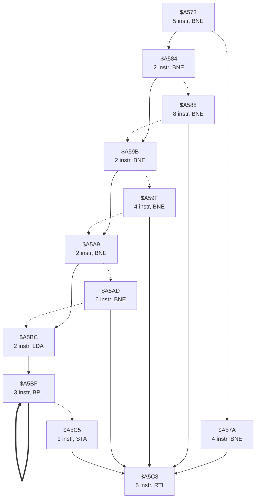

### DliHandler2  `$A5CE`

4 blocks, 4 edges, 1 exits, 0 back edges, complexity 2.

| Block | Instr | Last | Calls | Successors |
|---|---|---|---|---|
| `$A5CE-$A5D5` (entry) | 7 | BNE | - | taken `$A5EC`; not taken `$A5D7` |
| `$A5D7-$A5E9` | 8 | JMP | - | jump `$A5F5` |
| `$A5EC-$A5F2` | 3 | STA | - | fall `$A5F5` |
| `$A5F5-$A5FC` | 7 | RTI | - | **exit** (RTI) |

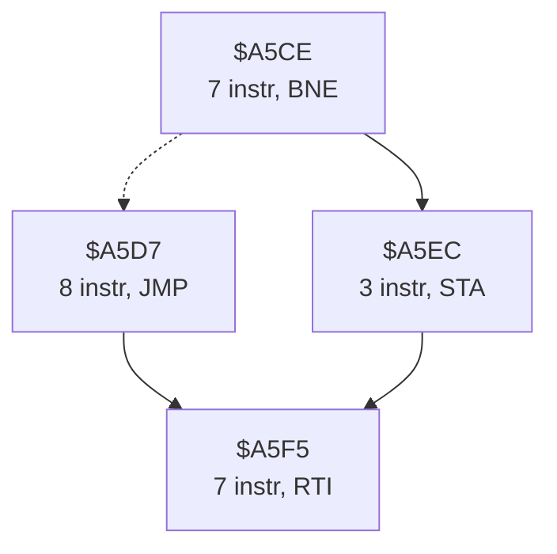

### VbiHandler  `$A5FD`

3 blocks, 3 edges, 1 exits, 0 back edges, complexity 2.

| Block | Instr | Last | Calls | Successors |
|---|---|---|---|---|
| `$A5FD-$A608` (entry) | 6 | BNE | FrameDispatch | taken `$A60D`; not taken `$A60A` |
| `$A60A-$A60A` | 1 | JSR | ClipEntitiesOnTunnelRow | fall `$A60D` |
| `$A60D-$A60D` | 1 | JMP | - | **exit** (JMP) |

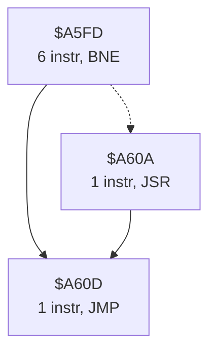

### InitDisplay2  `$A610`

8 blocks, 10 edges, 1 exits, 3 back edges, complexity 4.

| Block | Instr | Last | Calls | Successors |
|---|---|---|---|---|
| `$A610-$A612` (entry) | 2 | LDX | - | fall `$A614` |
| `$A614-$A61B` | 4 | BPL | - | taken `$A614`; not taken `$A61D` |
| `$A61D-$A624` | 4 | LDY | SetDisplayList | fall `$A626` |
| `$A626-$A62D` | 4 | BPL | - | taken `$A626`; not taken `$A62F` |
| `$A62F-$A62F` | 1 | JMP | - | jump `$B985` |
| `$B985-$B98F` | 7 | LDY | - | fall `$B991` |
| `$B991-$B996` | 4 | BPL | - | taken `$B991`; not taken `$B998` |
| `$B998-$B998` | 1 | RTS | - | **exit** (RTS) |

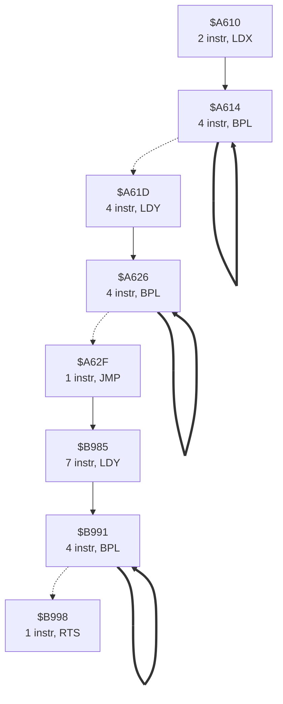

### TitleClearScores1P  `$A632`

3 blocks, 3 edges, 1 exits, 1 back edges, complexity 2.

| Block | Instr | Last | Calls | Successors |
|---|---|---|---|---|
| `$A632-$A634` (entry) | 2 | LDA | - | fall `$A636` |
| `$A636-$A640` | 5 | BPL | - | taken `$A636`; not taken `$A642` |
| `$A642-$A64D` | 5 | RTS | DrawLabel1UP | **exit** (RTS) |

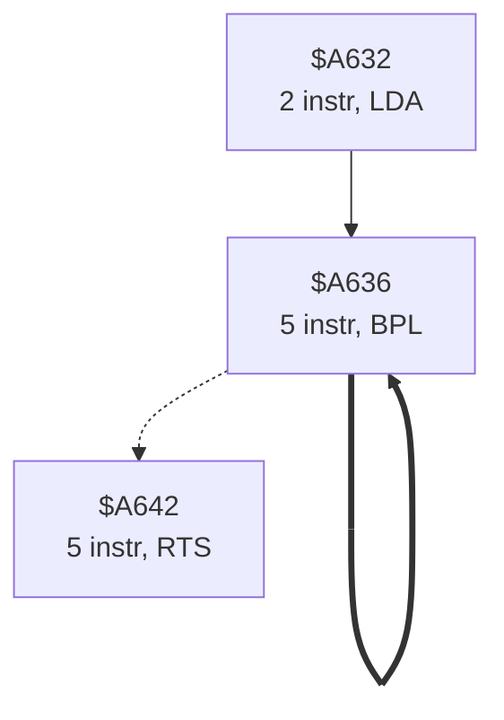

### TitleClearScores2P  `$A64E`

4 blocks, 4 edges, 1 exits, 1 back edges, complexity 2.

| Block | Instr | Last | Calls | Successors |
|---|---|---|---|---|
| `$A642-$A64D` | 5 | RTS | DrawLabel1UP | **exit** (RTS) |
| `$A64E-$A650` (entry) | 2 | LDA | - | fall `$A652` |
| `$A652-$A659` | 4 | BPL | - | taken `$A652`; not taken `$A65B` |
| `$A65B-$A666` | 5 | BNE | DrawLabel2UP | taken (always) `$A642` |

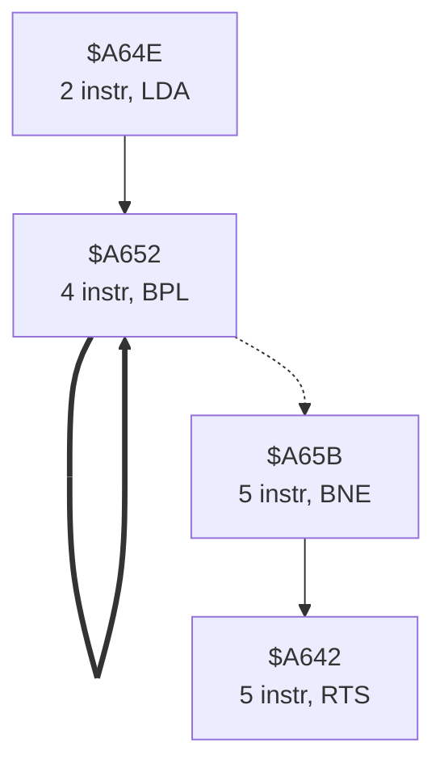

### ExpandData  `$A668`

8 blocks, 10 edges, 1 exits, 2 back edges, complexity 4.

| Block | Instr | Last | Calls | Successors |
|---|---|---|---|---|
| `$A668-$A66E` (entry) | 4 | BNE | - | taken `$A67F`; not taken `$A670` |
| `$A670-$A676` | 4 | JSR | WriteDstByte | fall `$A679` |
| `$A679-$A67C` | 2 | JMP | AdvanceSrcPtr | jump `$A668` |
| `$A67F-$A68B` | 10 | BEQ | - | taken `$A6A4`; not taken `$A68D` |
| `$A68D-$A690` | 3 | LDA | - | fall `$A693` |
| `$A693-$A698` | 3 | BPL | WriteDstByte | taken `$A693`; not taken `$A69A` |
| `$A69A-$A69A` | 1 | BMI | - | taken (always) `$A679` |
| `$A6A4-$A6A4` | 1 | RTS | - | **exit** (RTS) |

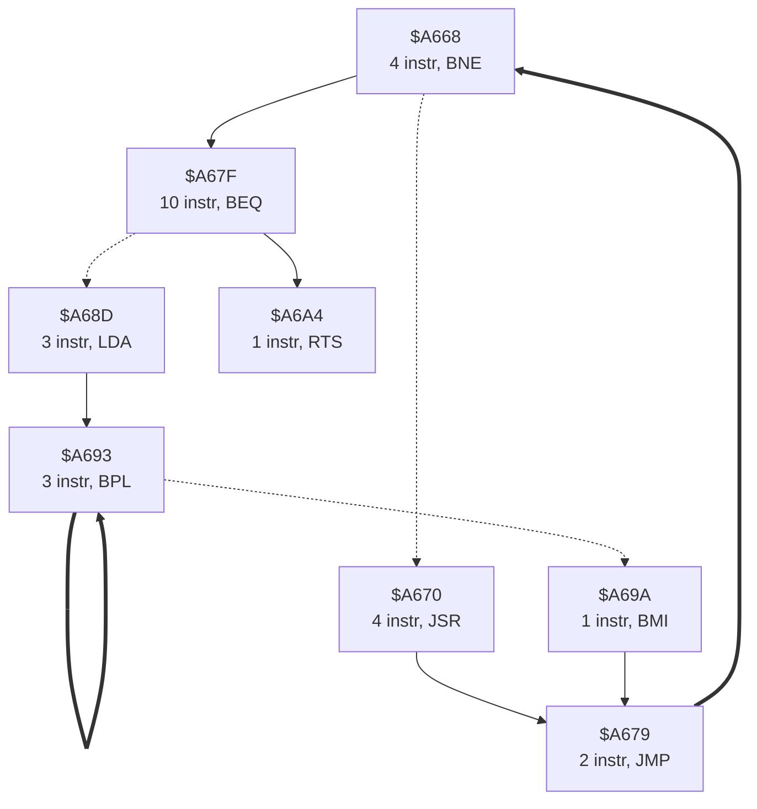

### ReadSrcByte  `$A69C`

3 blocks, 3 edges, 1 exits, 0 back edges, complexity 2.

| Block | Instr | Last | Calls | Successors |
|---|---|---|---|---|
| `$A69C-$A6A0` (entry) | 3 | BNE | - | taken `$A6A4`; not taken `$A6A2` |
| `$A6A2-$A6A2` | 1 | INC | - | fall `$A6A4` |
| `$A6A4-$A6A4` | 1 | RTS | - | **exit** (RTS) |

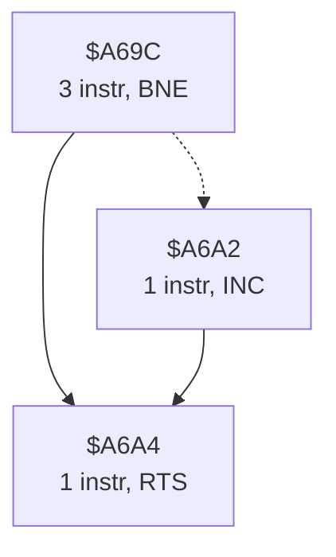

### AdvanceSrcPtr  `$A69E`

3 blocks, 3 edges, 1 exits, 0 back edges, complexity 2.

| Block | Instr | Last | Calls | Successors |
|---|---|---|---|---|
| `$A69E-$A6A0` (entry) | 2 | BNE | - | taken `$A6A4`; not taken `$A6A2` |
| `$A6A2-$A6A2` | 1 | INC | - | fall `$A6A4` |
| `$A6A4-$A6A4` | 1 | RTS | - | **exit** (RTS) |

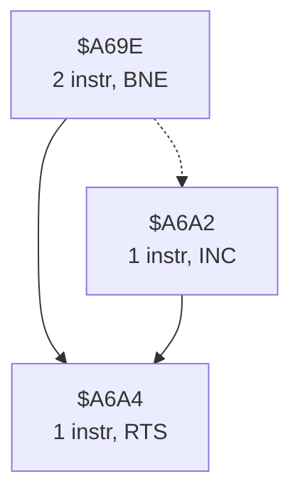

### WriteDstByte  `$A6A5`

3 blocks, 3 edges, 1 exits, 0 back edges, complexity 2.

| Block | Instr | Last | Calls | Successors |
|---|---|---|---|---|
| `$A6A5-$A6A9` (entry) | 3 | BNE | - | taken `$A6AD`; not taken `$A6AB` |
| `$A6AB-$A6AB` | 1 | INC | - | fall `$A6AD` |
| `$A6AD-$A6AD` | 1 | RTS | - | **exit** (RTS) |

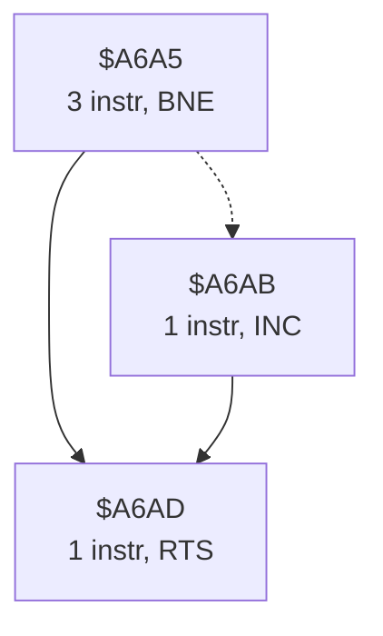

### ReadSrcHighNibble  `$A6AE`

1 blocks, 0 edges, 1 exits, 0 back edges, complexity 1.

| Block | Instr | Last | Calls | Successors |
|---|---|---|---|---|
| `$A6AE-$A6B4` (entry) | 6 | RTS | - | **exit** (RTS) |


### Init  `$A6B4`

1 blocks, 0 edges, 1 exits, 0 back edges, complexity 1.

| Block | Instr | Last | Calls | Successors |
|---|---|---|---|---|
| `$A6B4-$A6B4` (entry) | 1 | RTS | - | **exit** (RTS) |


### SetDisplayList  `$A6B5`

1 blocks, 0 edges, 1 exits, 0 back edges, complexity 1.

| Block | Instr | Last | Calls | Successors |
|---|---|---|---|---|
| `$A6B5-$A6CB` (entry) | 9 | RTS | - | **exit** (RTS) |

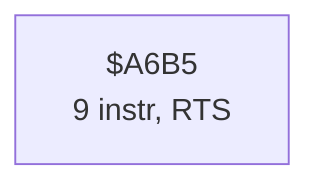

### FrameDispatch  `$A6CC`

249 blocks, 354 edges, 27 exits, 23 back edges, complexity 107, IRREDUCIBLE.

**Irreducible**: the retreating edge `$A800` -> `$A805` enters a loop at a block that does not dominate the edge's source (a second entry into the loop).

| Block | Instr | Last | Calls | Successors |
|---|---|---|---|---|
| `$A6CC-$A6CE` (entry) | 2 | BNE | - | taken `$A6D3`; not taken `$A6D0` |
| `$A6D0-$A6D0` | 1 | JMP | - | jump `$A78C` |
| `$A6D3-$A6D5` | 2 | BNE | - | taken `$A70D`; not taken `$A6D7` |
| `$A6D7-$A6DC` | 3 | TXA | InitDisplay2 | fall `$A6DD` |
| `$A6DD-$A6E7` | 5 | BNE | - | taken `$A6DD`; not taken `$A6E9` |
| `$A6E9-$A6EC` | 2 | LDX | - | fall `$A6EE` |
| `$A6EE-$A6F5` | 4 | BPL | - | taken `$A6EE`; not taken `$A6F7` |
| `$A6F7-$A6F7` | 1 | INX | - | fall `$A6F8` |
| `$A6F8-$A708` | 10 | BNE | - | taken `$A6F8`; not taken `$A70A` |
| `$A70A-$A70A` | 1 | INC | - | fall `$A70C` |
| `$A70C-$A70C` | 1 | RTS | - | **exit** (RTS) |
| `$A70D-$A70F` | 2 | BNE | - | taken `$A719`; not taken `$A711` |
| `$A711-$A715` | 3 | BNE | - | taken `$A70C`; not taken `$A717` |
| `$A717-$A717` | 1 | BEQ | - | taken (always) `$A70A` |
| `$A719-$A724` | 7 | BNE | - | taken `$A731`; not taken `$A726` |
| `$A726-$A728` | 2 | BNE | - | taken `$A72D`; not taken `$A72A` |
| `$A72A-$A72A` | 1 | JSR | TitleClearScores1P | fall `$A72D` |
| `$A72D-$A72F` | 2 | BNE | - | taken (always) `$A73A` |
| `$A731-$A733` | 2 | BNE | - | taken `$A738`; not taken `$A735` |
| `$A735-$A735` | 1 | JSR | TitleClearScores2P | fall `$A738` |
| `$A738-$A738` | 1 | LDA | - | fall `$A73A` |
| `$A73A-$A73D` | 2 | LDX | - | fall `$A73F` |
| `$A73F-$A74B` | 6 | BPL | - | taken `$A73F`; not taken `$A74D` |
| `$A74D-$A750` | 2 | LDX | InitDisplay2 | fall `$A752` |
| `$A752-$A765` | 8 | BPL | - | taken `$A752`; not taken `$A767` |
| `$A767-$A775` | 7 | LDX | - | fall `$A777` |
| `$A777-$A77E` | 4 | BPL | - | taken `$A777`; not taken `$A780` |
| `$A780-$A780` | 1 | LDX | - | fall `$A782` |
| `$A782-$A789` | 4 | BPL | - | taken `$A782`; not taken `$A78B` |
| `$A78B-$A78B` | 1 | RTS | - | **exit** (RTS) |
| `$A78C-$A78E` | 2 | BEQ | - | taken `$A798`; not taken `$A790` |
| `$A790-$A794` | 3 | BNE | - | taken `$A798`; not taken `$A796` |
| `$A796-$A796` | 1 | DEC | - | fall `$A798` |
| `$A798-$A79A` | 2 | BEQ | - | taken `$A79F`; not taken `$A79C` |
| `$A79C-$A79C` | 1 | JMP | - | jump `$B0E6` |
| `$A79F-$A7A4` | 3 | BEQ | BlinkPlayerLabel | taken `$A7AA`; not taken `$A7A6` |
| `$A7A6-$A7A8` | 2 | BEQ | - | taken `$A7C8`; not taken `$A7AA` |
| `$A7AA-$A7AC` | 2 | BEQ | - | taken `$A7B8`; not taken `$A7AE` |
| `$A7AE-$A7B0` | 2 | BEQ | - | taken `$A7B5`; not taken `$A7B2` |
| `$A7B2-$A7B2` | 1 | JSR | DrawLabel2UP | fall `$A7B5` |
| `$A7B5-$A7B5` | 1 | JMP | - | jump `$AD9F` |
| `$A7B8-$A7BA` | 2 | BEQ | - | taken `$A7BF`; not taken `$A7BC` |
| `$A7BC-$A7BC` | 1 | JMP | - | jump `$AC18` |
| `$A7BF-$A7C1` | 2 | BNE | - | taken `$A805`; not taken `$A7C3` |
| `$A7C3-$A7C5` | 2 | BNE | - | taken `$A7D3`; not taken `$A7C7` |
| `$A7C7-$A7C7` | 1 | RTS | - | **exit** (RTS) |
| `$A7C8-$A7D0` | 5 | JMP | - | jump `$AC93` |
| `$A7D3-$A7D7` | 3 | BNE | - | taken `$A7C7`; not taken `$A7D9` |
| `$A7D9-$A7DD` | 3 | BEQ | - | taken `$A7FE`; not taken `$A7DF` |
| `$A7DF-$A7F9` | 11 | BNE | - | taken `$A7C7`; not taken `$A7FB` |
| `$A7FB-$A7FB` | 1 | JMP | - | jump `$AD0E` |
| `$A7FE-$A7FE` | 1 | INC | - | fall `$A800` |
| `$A800-$A802` | 2 | JSR | ClearReadyText | fall `$A805` |
| `$A805-$A807` | 2 | BEQ | - | taken `$A82C`; not taken `$A809` |
| `$A809-$A80B` | 2 | BNE | - | taken `$A81F`; not taken `$A80D` |
| `$A80D-$A812` | 3 | BNE | TurnControl | taken `$A7C7`; not taken `$A814` |
| `$A814-$A816` | 2 | BNE | - | taken `$A7C7`; not taken `$A818` |
| `$A818-$A81E` | 4 | RTS | - | **exit** (RTS) |
| `$A81F-$A821` | 2 | BEQ | - | taken `$A826`; not taken `$A823` |
| `$A823-$A825` | 2 | RTS | - | **exit** (RTS) |
| `$A826-$A82A` | 3 | BEQ | - | taken (always) `$A800` |
| `$A82C-$A831` | 3 | BEQ | BlinkPowerPellets | taken `$A839`; not taken `$A833` |
| `$A833-$A836` | 2 | JMP | DeathSequence | jump `$AEF7` |
| `$A839-$A83E` | 3 | BEQ | EyesAndHousePerFrame | taken `$A843`; not taken `$A840` |
| `$A840-$A840` | 1 | JMP | - | jump `$B049` |
| `$A843-$A84B` | 4 | BNE | BonusItemUpdate, PowerPelletCheck | taken `$A87C`; not taken `$A84D` |
| `$A84D-$A84F` | 2 | LDY | - | fall `$A851` |
| `$A851-$A854` | 3 | BMI | - | taken `$A874`; not taken `$A856` |
| `$A856-$A85A` | 3 | BEQ | - | taken `$A874`; not taken `$A85C` |
| `$A85C-$A85F` | 2 | BEQ | - | taken `$A874`; not taken `$A861` |
| `$A861-$A865` | 3 | BCS | - | taken `$A86E`; not taken `$A867` |
| `$A867-$A86C` | 4 | BNE | - | taken `$A870`; not taken `$A86E` |
| `$A86E-$A86E` | 1 | SBC | - | fall `$A870` |
| `$A870-$A872` | 2 | BCC | - | taken `$A87F`; not taken `$A874` |
| `$A874-$A87A` | 6 | BNE | - | taken `$A851`; not taken `$A87C` |
| `$A87C-$A87C` | 1 | JMP | - | jump `$A936` |
| `$A87F-$A881` | 2 | BMI | - | taken `$A886`; not taken `$A883` |
| `$A883-$A883` | 1 | JMP | - | jump `$A923` |
| `$A886-$A897` | 10 | LDY | - | fall `$A899` |
| `$A899-$A89F` | 4 | BPL | - | taken `$A899`; not taken `$A8A1` |
| `$A8A1-$A8B2` | 8 | BEQ | - | taken `$A8BF`; not taken `$A8B4` |
| `$A8B4-$A8B4` | 1 | BCC | - | taken `$A8BA`; not taken `$A8B6` |
| `$A8B6-$A8B8` | 2 | BMI | - | taken (always) `$A8BC` |
| `$A8BA-$A8BA` | 1 | LDA | - | fall `$A8BC` |
| `$A8BC-$A8BD` | 2 | ADC | - | fall `$A8BF` |
| `$A8BF-$A8DE` | 18 | LDY | - | fall `$A8E0` |
| `$A8E0-$A8EA` | 6 | BPL | - | taken `$A8E0`; not taken `$A8EC` |
| `$A8EC-$A902` | 11 | BNE | - | taken `$A908`; not taken `$A904` |
| `$A904-$A906` | 2 | BNE | - | taken (always) `$A91E` |
| `$A908-$A90A` | 2 | BNE | - | taken `$A910`; not taken `$A90C` |
| `$A90C-$A90E` | 2 | BNE | - | taken (always) `$A91E` |
| `$A910-$A912` | 2 | BNE | - | taken `$A918`; not taken `$A914` |
| `$A914-$A916` | 2 | BNE | - | taken (always) `$A91E` |
| `$A918-$A91C` | 3 | LDA | - | fall `$A91E` |
| `$A91E-$A920` | 2 | JMP | - | jump `$B423` |
| `$A923-$A934` | 9 | STA | ClearPokeyRegisters | fall `$A936` |
| `$A936-$A93B` | 3 | BEQ | - | taken `$A98C`; not taken `$A93D` |
| `$A93D-$A943` | 4 | BCC | - | taken `$A947`; not taken `$A945` |
| `$A945-$A945` | 1 | LDA | - | fall `$A947` |
| `$A947-$A94C` | 4 | LDY | - | fall `$A94E` |
| `$A94E-$A958` | 6 | BNE | - | taken `$A94E`; not taken `$A95A` |
| `$A95A-$A978` | 16 | BCC | - | taken `$A97C`; not taken `$A97A` |
| `$A97A-$A97A` | 1 | LDA | - | fall `$A97C` |
| `$A97C-$A989` | 8 | JSR | AddToScore | fall `$A98C` |
| `$A98C-$A991` | 3 | BEQ | - | taken `$A994`; not taken `$A993` |
| `$A993-$A993` | 1 | RTS | - | **exit** (RTS) |
| `$A994-$A999` | 3 | BNE | FrightenedTick | taken `$A993`; not taken `$A99B` |
| `$A99B-$A9A6` | 5 | BEQ | DotSoundSweep, BonusSound, ToggleLegPhase | taken `$A9AC`; not taken `$A9A8` |
| `$A9A8-$A9AA` | 2 | BEQ | - | taken (always) `$A9B5` |
| `$A9AC-$A9AE` | 2 | BNE | - | taken `$A9B5`; not taken `$A9B0` |
| `$A9B0-$A9B2` | 2 | JSR | MoveDelayTick | fall `$A9B5` |
| `$A9B5-$A9C9` | 10 | BNE | MovePacMan, EatDotAtPacMan | taken `$A9CE`; not taken `$A9CB` |
| `$A9CB-$A9CB` | 1 | JSR | HouseWaitingTick | fall `$A9CE` |
| `$A9CE-$A9D3` | 3 | BNE | ChaseTimerSirenSight | taken `$AA2C`; not taken `$A9D5` |
| `$A9D5-$A9D5` | 1 | LDX | - | fall `$A9D7` |
| `$A9D7-$A9DB` | 3 | BEQ | - | taken `$AA29`; not taken `$A9DD` |
| `$A9DD-$A9E1` | 3 | BNE | - | taken `$A9E9`; not taken `$A9E3` |
| `$A9E3-$A9E5` | 2 | BEQ | - | taken `$A9E9`; not taken `$A9E7` |
| `$A9E7-$A9E7` | 1 | DEC | - | fall `$A9E9` |
| `$A9E9-$A9ED` | 3 | BEQ | - | taken `$AA29`; not taken `$A9EF` |
| `$A9EF-$A9F2` | 3 | BMI | - | taken `$AA29`; not taken `$A9F4` |
| `$A9F4-$A9F8` | 3 | BNE | - | taken `$AA04`; not taken `$A9FA` |
| `$A9FA-$A9FE` | 3 | BCS | - | taken `$AA08`; not taken `$AA00` |
| `$AA00-$AA02` | 2 | BCC | - | taken `$AA08`; not taken `$AA04` |
| `$AA04-$AA06` | 2 | BPL | - | taken `$AA1F`; not taken `$AA08` |
| `$AA08-$AA0D` | 3 | BNE | MoveDelayTick | taken `$AA29`; not taken `$AA0F` |
| `$AA0F-$AA13` | 3 | BNE | - | taken `$AA19`; not taken `$AA15` |
| `$AA15-$AA17` | 2 | BEQ | - | taken `$AA26`; not taken `$AA19` |
| `$AA19-$AA1D` | 3 | BNE | - | taken (always) `$AA29` |
| `$AA1F-$AA24` | 3 | BNE | MoveDelayTick | taken `$AA29`; not taken `$AA26` |
| `$AA26-$AA26` | 1 | JSR | GhostBehaviour | fall `$AA29` |
| `$AA29-$AA2A` | 2 | BPL | - | taken `$A9D7`; not taken `$AA2C` |
| `$AA2C-$AA2C` | 1 | RTS | - | **exit** (RTS) |
| `$AC18-$AC1A` | 2 | BNE | - | taken `$AC29`; not taken `$AC1C` |
| `$AC1C-$AC22` | 3 | LDA | ClearPokeyRegisters, DrawAllInPlace | fall `$AC24` |
| `$AC24-$AC24` | 1 | STA | - | fall `$AC26` |
| `$AC26-$AC28` | 2 | RTS | - | **exit** (RTS) |
| `$AC29-$AC2B` | 2 | BNE | - | taken `$AC4B`; not taken `$AC2D` |
| `$AC2D-$AC2F` | 2 | BNE | - | taken `$AC48`; not taken `$AC31` |
| `$AC31-$AC33` | 2 | LDX | - | fall `$AC35` |
| `$AC35-$AC39` | 3 | BPL | - | taken `$AC35`; not taken `$AC3B` |
| `$AC3B-$AC46` | 6 | BNE | - | taken (always) `$AC24` |
| `$AC48-$AC4A` | 2 | RTS | - | **exit** (RTS) |
| `$AC4B-$AC4D` | 2 | BNE | - | taken `$AC6B`; not taken `$AC4F` |
| `$AC4F-$AC51` | 2 | BNE | - | taken `$AC48`; not taken `$AC53` |
| `$AC53-$AC55` | 2 | BEQ | - | taken `$AC26`; not taken `$AC57` |
| `$AC57-$AC5B` | 4 | BCC | - | taken `$AC61`; not taken `$AC5D` |
| `$AC5D-$AC5F` | 2 | BNE | - | taken (always) `$AC63` |
| `$AC61-$AC61` | 1 | LDA | - | fall `$AC63` |
| `$AC63-$AC6A` | 4 | RTS | - | **exit** (RTS) |
| `$AC6B-$AC6D` | 2 | BNE | - | taken `$AC75`; not taken `$AC6F` |
| `$AC6F-$AC74` | 3 | RTS | InitBoard | **exit** (RTS) |
| `$AC75-$AC92` | 14 | RTS | NewBoardInit, DrawLevelIndicator, DrawReadyScreen | **exit** (RTS) |
| `$AC93-$AC95` | 2 | LDX | - | fall `$AC97` |
| `$AC97-$ACA0` | 6 | BNE | - | taken `$AC97`; not taken `$ACA2` |
| `$ACA2-$ACA8` | 4 | BCC | - | taken `$ACB2`; not taken `$ACAA` |
| `$ACAA-$ACAC` | 2 | BCS | - | taken `$ACB2`; not taken `$ACAE` |
| `$ACAE-$ACB0` | 2 | BNE | - | taken (always) `$ACB4` |
| `$ACB2-$ACB2` | 1 | LDY | - | fall `$ACB4` |
| `$ACB4-$ACBA` | 4 | BCS | - | taken `$ACE1`; not taken `$ACBC` |
| `$ACBC-$ACC6` | 6 | LDX | - | fall `$ACC8` |
| `$ACC8-$ACD6` | 8 | BEQ | - | taken `$AD0D`; not taken `$ACD8` |
| `$ACD8-$ACDF` | 5 | BNE | - | taken `$ACC8`; not taken `$ACE1` |
| `$ACE1-$ACE3` | 2 | BCC | - | taken `$ACE7`; not taken `$ACE5` |
| `$ACE5-$ACE5` | 1 | LDA | - | fall `$ACE7` |
| `$ACE7-$ACF9` | 11 | LDX | - | fall `$ACFB` |
| `$ACFB-$AD0B` | 10 | BNE | - | taken `$ACFB`; not taken `$AD0D` |
| `$AD0D-$AD0D` | 1 | RTS | - | **exit** (RTS) |
| `$AD0E-$AD13` | 3 | DEC | DrawAllInPlace | fall `$AD15` |
| `$AD15-$AD1F` | 6 | BNE | - | taken `$AD2B`; not taken `$AD21` |
| `$AD21-$AD21` | 1 | STY | - | fall `$AD24` |
| `$AD24-$AD24` | 1 | STY | - | fall `$AD27` |
| `$AD27-$AD2A` | 2 | RTS | - | **exit** (RTS) |
| `$AD2B-$AD2D` | 2 | BNE | - | taken `$AD35`; not taken `$AD2F` |
| `$AD2F-$AD32` | 2 | JMP | LifeIcon1 | jump `$AD24` |
| `$AD35-$AD37` | 2 | BNE | - | taken `$AD3F`; not taken `$AD39` |
| `$AD39-$AD3C` | 2 | JMP | LifeIcon2 | jump `$AD27` |
| `$AD3F-$AD48` | 4 | RTS | - | **exit** (RTS) |
| `$AD9F-$ADAE` | 7 | RTS | - | **exit** (RTS) |
| `$AEF7-$AEF9` | 2 | BEQ | - | taken `$AF53`; not taken `$AEFB` |
| `$AEFB-$AF05` | 6 | BEQ | - | taken `$AF0B`; not taken `$AF07` |
| `$AF07-$AF09` | 2 | BPL | - | taken `$AF17`; not taken `$AF0B` |
| `$AF0B-$AF0F` | 3 | BEQ | - | taken `$AF48`; not taken `$AF11` |
| `$AF11-$AF15` | 3 | STA | - | fall `$AF17` |
| `$AF17-$AF19` | 2 | BEQ | - | taken `$AF2C`; not taken `$AF1B` |
| `$AF1B-$AF1D` | 2 | BEQ | - | taken `$AF3A`; not taken `$AF1F` |
| `$AF1F-$AF2B` | 8 | RTS | - | **exit** (RTS) |
| `$AF2C-$AF2E` | 2 | LDX | - | fall `$AF30` |
| `$AF30-$AF37` | 5 | BPL | - | taken `$AF30`; not taken `$AF39` |
| `$AF39-$AF39` | 1 | RTS | - | **exit** (RTS) |
| `$AF3A-$AF3C` | 2 | LDX | - | fall `$AF3E` |
| `$AF3E-$AF45` | 5 | BPL | - | taken `$AF3E`; not taken `$AF47` |
| `$AF47-$AF47` | 1 | RTS | - | **exit** (RTS) |
| `$AF48-$AF4A` | 2 | LDA | - | fall `$AF4C` |
| `$AF4C-$AF4F` | 3 | BPL | - | taken `$AF4C`; not taken `$AF51` |
| `$AF51-$AF51` | 1 | STA | - | fall `$AF53` |
| `$AF53-$AF53` | 1 | RTS | - | **exit** (RTS) |
| `$B049-$B04B` | 2 | BEQ | - | taken `$B067`; not taken `$B04D` |
| `$B04D-$B056` | 6 | BEQ | - | taken `$B085`; not taken `$B058` |
| `$B058-$B065` | 6 | BNE | - | taken (always) `$B080` |
| `$B067-$B07D` | 11 | STA | - | fall `$B080` |
| `$B080-$B083` | 2 | BNE | - | taken `$B0E2`; not taken `$B085` |
| `$B085-$B09B` | 10 | LDX | ClearPokeyRegisters | fall `$B09D` |
| `$B09D-$B0A2` | 3 | BEQ | - | taken `$B0A8`; not taken `$B0A4` |
| `$B0A4-$B0A5` | 2 | BPL | - | taken `$B09D`; not taken `$B0A7` |
| `$B0A7-$B0A7` | 1 | RTS | - | **exit** (RTS) |
| `$B0A8-$B0B9` | 8 | JMP | MovePacMan | jump `$B33A` |
| `$B0E2-$B0E5` | 2 | RTS | - | **exit** (RTS) |
| `$B0E6-$B0E8` | 2 | LDA | - | fall `$B0EA` |
| `$B0EA-$B0EE` | 3 | BPL | - | taken `$B0EA`; not taken `$B0F0` |
| `$B0F0-$B0F0` | 1 | RTS | - | **exit** (RTS) |
| `$B339-$B339` | 1 | RTS | - | **exit** (RTS) |
| `$B33A-$B33C` | 2 | BNE | - | taken `$B39E`; not taken `$B33E` |
| `$B33E-$B340` | 2 | BNE | - | taken `$B39E`; not taken `$B342` |
| `$B342-$B346` | 3 | BNE | - | taken `$B34E`; not taken `$B348` |
| `$B348-$B34C` | 3 | BEQ | - | taken `$B339`; not taken `$B34E` |
| `$B34E-$B35C` | 8 | BEQ | - | taken `$B366`; not taken `$B35E` |
| `$B35E-$B360` | 2 | BNE | - | taken `$B39E`; not taken `$B362` |
| `$B362-$B365` | 3 | RTS | - | **exit** (RTS) |
| `$B366-$B377` | 9 | BNE | AddToScore | taken `$B37D`; not taken `$B379` |
| `$B379-$B37B` | 2 | BNE | - | taken (always) `$B37F` |
| `$B37D-$B37D` | 1 | LDA | - | fall `$B37F` |
| `$B37F-$B38A` | 7 | BNE | - | taken `$B38E`; not taken `$B38C` |
| `$B38C-$B38C` | 1 | INC | - | fall `$B38E` |
| `$B38E-$B392` | 3 | BEQ | - | taken `$B39E`; not taken `$B394` |
| `$B394-$B398` | 3 | BNE | - | taken `$B39E`; not taken `$B39A` |
| `$B39A-$B39C` | 2 | STA | - | fall `$B39E` |
| `$B39E-$B39E` | 1 | RTS | - | **exit** (RTS) |
| `$B423-$B42A` | 5 | BEQ | - | taken `$B430`; not taken `$B42C` |
| `$B42C-$B42E` | 2 | BNE | - | taken (always) `$B432` |
| `$B430-$B430` | 1 | LDX | - | fall `$B432` |
| `$B432-$B432` | 1 | LDY | - | fall `$B434` |
| `$B434-$B442` | 8 | BEQ | - | taken `$B446`; not taken `$B444` |
| `$B444-$B444` | 1 | LDA | - | fall `$B446` |
| `$B446-$B44D` | 5 | BNE | - | taken `$B461`; not taken `$B44F` |
| `$B44F-$B451` | 2 | BNE | - | taken `$B456`; not taken `$B453` |
| `$B453-$B454` | 2 | BEQ | - | taken `$B461`; not taken `$B456` |
| `$B456-$B459` | 2 | BNE | - | taken `$B45F`; not taken `$B45B` |
| `$B45B-$B45D` | 2 | BEQ | - | taken `$B461`; not taken `$B45F` |
| `$B45F-$B45F` | 1 | LDA | - | fall `$B461` |
| `$B461-$B466` | 4 | BPL | - | taken `$B434`; not taken `$B468` |
| `$B468-$B46B` | 3 | LDA | - | fall `$B46D` |
| `$B46D-$B470` | 3 | BPL | - | taken `$B46D`; not taken `$B472` |
| `$B472-$B476` | 3 | BNE | - | taken `$B481`; not taken `$B478` |
| `$B478-$B47A` | 2 | BNE | - | taken `$B482`; not taken `$B47C` |
| `$B47C-$B47F` | 2 | BNE | - | taken `$B487`; not taken `$B481` |
| `$B481-$B481` | 1 | RTS | - | **exit** (RTS) |
| `$B482-$B485` | 2 | BEQ | - | taken `$B481`; not taken `$B487` |
| `$B487-$B48B` | 3 | JMP | - | jump `$AD15` |

```mermaid
flowchart TD
  BA6CC["$A6CC<br/>2 instr, BNE"]
  BA6D0["$A6D0<br/>1 instr, JMP"]
  BA6D3["$A6D3<br/>2 instr, BNE"]
  BA6D7["$A6D7<br/>3 instr, TXA"]
  BA6DD["$A6DD<br/>5 instr, BNE"]
  BA6E9["$A6E9<br/>2 instr, LDX"]
  BA6EE["$A6EE<br/>4 instr, BPL"]
  BA6F7["$A6F7<br/>1 instr, INX"]
  BA6F8["$A6F8<br/>10 instr, BNE"]
  BA70A["$A70A<br/>1 instr, INC"]
  BA70C["$A70C<br/>1 instr, RTS"]
  BA70D["$A70D<br/>2 instr, BNE"]
  BA711["$A711<br/>3 instr, BNE"]
  BA717["$A717<br/>1 instr, BEQ"]
  BA719["$A719<br/>7 instr, BNE"]
  BA726["$A726<br/>2 instr, BNE"]
  BA72A["$A72A<br/>1 instr, JSR"]
  BA72D["$A72D<br/>2 instr, BNE"]
  BA731["$A731<br/>2 instr, BNE"]
  BA735["$A735<br/>1 instr, JSR"]
  BA738["$A738<br/>1 instr, LDA"]
  BA73A["$A73A<br/>2 instr, LDX"]
  BA73F["$A73F<br/>6 instr, BPL"]
  BA74D["$A74D<br/>2 instr, LDX"]
  BA752["$A752<br/>8 instr, BPL"]
  BA767["$A767<br/>7 instr, LDX"]
  BA777["$A777<br/>4 instr, BPL"]
  BA780["$A780<br/>1 instr, LDX"]
  BA782["$A782<br/>4 instr, BPL"]
  BA78B["$A78B<br/>1 instr, RTS"]
  BA78C["$A78C<br/>2 instr, BEQ"]
  BA790["$A790<br/>3 instr, BNE"]
  BA796["$A796<br/>1 instr, DEC"]
  BA798["$A798<br/>2 instr, BEQ"]
  BA79C["$A79C<br/>1 instr, JMP"]
  BA79F["$A79F<br/>3 instr, BEQ"]
  BA7A6["$A7A6<br/>2 instr, BEQ"]
  BA7AA["$A7AA<br/>2 instr, BEQ"]
  BA7AE["$A7AE<br/>2 instr, BEQ"]
  BA7B2["$A7B2<br/>1 instr, JSR"]
  BA7B5["$A7B5<br/>1 instr, JMP"]
  BA7B8["$A7B8<br/>2 instr, BEQ"]
  BA7BC["$A7BC<br/>1 instr, JMP"]
  BA7BF["$A7BF<br/>2 instr, BNE"]
  BA7C3["$A7C3<br/>2 instr, BNE"]
  BA7C7["$A7C7<br/>1 instr, RTS"]
  BA7C8["$A7C8<br/>5 instr, JMP"]
  BA7D3["$A7D3<br/>3 instr, BNE"]
  BA7D9["$A7D9<br/>3 instr, BEQ"]
  BA7DF["$A7DF<br/>11 instr, BNE"]
  BA7FB["$A7FB<br/>1 instr, JMP"]
  BA7FE["$A7FE<br/>1 instr, INC"]
  BA800["$A800<br/>2 instr, JSR"]
  BA805["$A805<br/>2 instr, BEQ"]
  BA809["$A809<br/>2 instr, BNE"]
  BA80D["$A80D<br/>3 instr, BNE"]
  BA814["$A814<br/>2 instr, BNE"]
  BA818["$A818<br/>4 instr, RTS"]
  BA81F["$A81F<br/>2 instr, BEQ"]
  BA823["$A823<br/>2 instr, RTS"]
  BA826["$A826<br/>3 instr, BEQ"]
  BA82C["$A82C<br/>3 instr, BEQ"]
  BA833["$A833<br/>2 instr, JMP"]
  BA839["$A839<br/>3 instr, BEQ"]
  BA840["$A840<br/>1 instr, JMP"]
  BA843["$A843<br/>4 instr, BNE"]
  BA84D["$A84D<br/>2 instr, LDY"]
  BA851["$A851<br/>3 instr, BMI"]
  BA856["$A856<br/>3 instr, BEQ"]
  BA85C["$A85C<br/>2 instr, BEQ"]
  BA861["$A861<br/>3 instr, BCS"]
  BA867["$A867<br/>4 instr, BNE"]
  BA86E["$A86E<br/>1 instr, SBC"]
  BA870["$A870<br/>2 instr, BCC"]
  BA874["$A874<br/>6 instr, BNE"]
  BA87C["$A87C<br/>1 instr, JMP"]
  BA87F["$A87F<br/>2 instr, BMI"]
  BA883["$A883<br/>1 instr, JMP"]
  BA886["$A886<br/>10 instr, LDY"]
  BA899["$A899<br/>4 instr, BPL"]
  BA8A1["$A8A1<br/>8 instr, BEQ"]
  BA8B4["$A8B4<br/>1 instr, BCC"]
  BA8B6["$A8B6<br/>2 instr, BMI"]
  BA8BA["$A8BA<br/>1 instr, LDA"]
  BA8BC["$A8BC<br/>2 instr, ADC"]
  BA8BF["$A8BF<br/>18 instr, LDY"]
  BA8E0["$A8E0<br/>6 instr, BPL"]
  BA8EC["$A8EC<br/>11 instr, BNE"]
  BA904["$A904<br/>2 instr, BNE"]
  BA908["$A908<br/>2 instr, BNE"]
  BA90C["$A90C<br/>2 instr, BNE"]
  BA910["$A910<br/>2 instr, BNE"]
  BA914["$A914<br/>2 instr, BNE"]
  BA918["$A918<br/>3 instr, LDA"]
  BA91E["$A91E<br/>2 instr, JMP"]
  BA923["$A923<br/>9 instr, STA"]
  BA936["$A936<br/>3 instr, BEQ"]
  BA93D["$A93D<br/>4 instr, BCC"]
  BA945["$A945<br/>1 instr, LDA"]
  BA947["$A947<br/>4 instr, LDY"]
  BA94E["$A94E<br/>6 instr, BNE"]
  BA95A["$A95A<br/>16 instr, BCC"]
  BA97A["$A97A<br/>1 instr, LDA"]
  BA97C["$A97C<br/>8 instr, JSR"]
  BA98C["$A98C<br/>3 instr, BEQ"]
  BA993["$A993<br/>1 instr, RTS"]
  BA994["$A994<br/>3 instr, BNE"]
  BA99B["$A99B<br/>5 instr, BEQ"]
  BA9A8["$A9A8<br/>2 instr, BEQ"]
  BA9AC["$A9AC<br/>2 instr, BNE"]
  BA9B0["$A9B0<br/>2 instr, JSR"]
  BA9B5["$A9B5<br/>10 instr, BNE"]
  BA9CB["$A9CB<br/>1 instr, JSR"]
  BA9CE["$A9CE<br/>3 instr, BNE"]
  BA9D5["$A9D5<br/>1 instr, LDX"]
  BA9D7["$A9D7<br/>3 instr, BEQ"]
  BA9DD["$A9DD<br/>3 instr, BNE"]
  BA9E3["$A9E3<br/>2 instr, BEQ"]
  BA9E7["$A9E7<br/>1 instr, DEC"]
  BA9E9["$A9E9<br/>3 instr, BEQ"]
  BA9EF["$A9EF<br/>3 instr, BMI"]
  BA9F4["$A9F4<br/>3 instr, BNE"]
  BA9FA["$A9FA<br/>3 instr, BCS"]
  BAA00["$AA00<br/>2 instr, BCC"]
  BAA04["$AA04<br/>2 instr, BPL"]
  BAA08["$AA08<br/>3 instr, BNE"]
  BAA0F["$AA0F<br/>3 instr, BNE"]
  BAA15["$AA15<br/>2 instr, BEQ"]
  BAA19["$AA19<br/>3 instr, BNE"]
  BAA1F["$AA1F<br/>3 instr, BNE"]
  BAA26["$AA26<br/>1 instr, JSR"]
  BAA29["$AA29<br/>2 instr, BPL"]
  BAA2C["$AA2C<br/>1 instr, RTS"]
  BAC18["$AC18<br/>2 instr, BNE"]
  BAC1C["$AC1C<br/>3 instr, LDA"]
  BAC24["$AC24<br/>1 instr, STA"]
  BAC26["$AC26<br/>2 instr, RTS"]
  BAC29["$AC29<br/>2 instr, BNE"]
  BAC2D["$AC2D<br/>2 instr, BNE"]
  BAC31["$AC31<br/>2 instr, LDX"]
  BAC35["$AC35<br/>3 instr, BPL"]
  BAC3B["$AC3B<br/>6 instr, BNE"]
  BAC48["$AC48<br/>2 instr, RTS"]
  BAC4B["$AC4B<br/>2 instr, BNE"]
  BAC4F["$AC4F<br/>2 instr, BNE"]
  BAC53["$AC53<br/>2 instr, BEQ"]
  BAC57["$AC57<br/>4 instr, BCC"]
  BAC5D["$AC5D<br/>2 instr, BNE"]
  BAC61["$AC61<br/>1 instr, LDA"]
  BAC63["$AC63<br/>4 instr, RTS"]
  BAC6B["$AC6B<br/>2 instr, BNE"]
  BAC6F["$AC6F<br/>3 instr, RTS"]
  BAC75["$AC75<br/>14 instr, RTS"]
  BAC93["$AC93<br/>2 instr, LDX"]
  BAC97["$AC97<br/>6 instr, BNE"]
  BACA2["$ACA2<br/>4 instr, BCC"]
  BACAA["$ACAA<br/>2 instr, BCS"]
  BACAE["$ACAE<br/>2 instr, BNE"]
  BACB2["$ACB2<br/>1 instr, LDY"]
  BACB4["$ACB4<br/>4 instr, BCS"]
  BACBC["$ACBC<br/>6 instr, LDX"]
  BACC8["$ACC8<br/>8 instr, BEQ"]
  BACD8["$ACD8<br/>5 instr, BNE"]
  BACE1["$ACE1<br/>2 instr, BCC"]
  BACE5["$ACE5<br/>1 instr, LDA"]
  BACE7["$ACE7<br/>11 instr, LDX"]
  BACFB["$ACFB<br/>10 instr, BNE"]
  BAD0D["$AD0D<br/>1 instr, RTS"]
  BAD0E["$AD0E<br/>3 instr, DEC"]
  BAD15["$AD15<br/>6 instr, BNE"]
  BAD21["$AD21<br/>1 instr, STY"]
  BAD24["$AD24<br/>1 instr, STY"]
  BAD27["$AD27<br/>2 instr, RTS"]
  BAD2B["$AD2B<br/>2 instr, BNE"]
  BAD2F["$AD2F<br/>2 instr, JMP"]
  BAD35["$AD35<br/>2 instr, BNE"]
  BAD39["$AD39<br/>2 instr, JMP"]
  BAD3F["$AD3F<br/>4 instr, RTS"]
  BAD9F["$AD9F<br/>7 instr, RTS"]
  BAEF7["$AEF7<br/>2 instr, BEQ"]
  BAEFB["$AEFB<br/>6 instr, BEQ"]
  BAF07["$AF07<br/>2 instr, BPL"]
  BAF0B["$AF0B<br/>3 instr, BEQ"]
  BAF11["$AF11<br/>3 instr, STA"]
  BAF17["$AF17<br/>2 instr, BEQ"]
  BAF1B["$AF1B<br/>2 instr, BEQ"]
  BAF1F["$AF1F<br/>8 instr, RTS"]
  BAF2C["$AF2C<br/>2 instr, LDX"]
  BAF30["$AF30<br/>5 instr, BPL"]
  BAF39["$AF39<br/>1 instr, RTS"]
  BAF3A["$AF3A<br/>2 instr, LDX"]
  BAF3E["$AF3E<br/>5 instr, BPL"]
  BAF47["$AF47<br/>1 instr, RTS"]
  BAF48["$AF48<br/>2 instr, LDA"]
  BAF4C["$AF4C<br/>3 instr, BPL"]
  BAF51["$AF51<br/>1 instr, STA"]
  BAF53["$AF53<br/>1 instr, RTS"]
  BB049["$B049<br/>2 instr, BEQ"]
  BB04D["$B04D<br/>6 instr, BEQ"]
  BB058["$B058<br/>6 instr, BNE"]
  BB067["$B067<br/>11 instr, STA"]
  BB080["$B080<br/>2 instr, BNE"]
  BB085["$B085<br/>10 instr, LDX"]
  BB09D["$B09D<br/>3 instr, BEQ"]
  BB0A4["$B0A4<br/>2 instr, BPL"]
  BB0A7["$B0A7<br/>1 instr, RTS"]
  BB0A8["$B0A8<br/>8 instr, JMP"]
  BB0E2["$B0E2<br/>2 instr, RTS"]
  BB0E6["$B0E6<br/>2 instr, LDA"]
  BB0EA["$B0EA<br/>3 instr, BPL"]
  BB0F0["$B0F0<br/>1 instr, RTS"]
  BB339["$B339<br/>1 instr, RTS"]
  BB33A["$B33A<br/>2 instr, BNE"]
  BB33E["$B33E<br/>2 instr, BNE"]
  BB342["$B342<br/>3 instr, BNE"]
  BB348["$B348<br/>3 instr, BEQ"]
  BB34E["$B34E<br/>8 instr, BEQ"]
  BB35E["$B35E<br/>2 instr, BNE"]
  BB362["$B362<br/>3 instr, RTS"]
  BB366["$B366<br/>9 instr, BNE"]
  BB379["$B379<br/>2 instr, BNE"]
  BB37D["$B37D<br/>1 instr, LDA"]
  BB37F["$B37F<br/>7 instr, BNE"]
  BB38C["$B38C<br/>1 instr, INC"]
  BB38E["$B38E<br/>3 instr, BEQ"]
  BB394["$B394<br/>3 instr, BNE"]
  BB39A["$B39A<br/>2 instr, STA"]
  BB39E["$B39E<br/>1 instr, RTS"]
  BB423["$B423<br/>5 instr, BEQ"]
  BB42C["$B42C<br/>2 instr, BNE"]
  BB430["$B430<br/>1 instr, LDX"]
  BB432["$B432<br/>1 instr, LDY"]
  BB434["$B434<br/>8 instr, BEQ"]
  BB444["$B444<br/>1 instr, LDA"]
  BB446["$B446<br/>5 instr, BNE"]
  BB44F["$B44F<br/>2 instr, BNE"]
  BB453["$B453<br/>2 instr, BEQ"]
  BB456["$B456<br/>2 instr, BNE"]
  BB45B["$B45B<br/>2 instr, BEQ"]
  BB45F["$B45F<br/>1 instr, LDA"]
  BB461["$B461<br/>4 instr, BPL"]
  BB468["$B468<br/>3 instr, LDA"]
  BB46D["$B46D<br/>3 instr, BPL"]
  BB472["$B472<br/>3 instr, BNE"]
  BB478["$B478<br/>2 instr, BNE"]
  BB47C["$B47C<br/>2 instr, BNE"]
  BB481["$B481<br/>1 instr, RTS"]
  BB482["$B482<br/>2 instr, BEQ"]
  BB487["$B487<br/>3 instr, JMP"]
  BA6CC --> BA6D3
  BA6CC -.-> BA6D0
  BA6D0 --> BA78C
  BA6D3 --> BA70D
  BA6D3 -.-> BA6D7
  BA6D7 --> BA6DD
  BA6DD ==> BA6DD
  BA6DD -.-> BA6E9
  BA6E9 --> BA6EE
  BA6EE ==> BA6EE
  BA6EE -.-> BA6F7
  BA6F7 --> BA6F8
  BA6F8 ==> BA6F8
  BA6F8 -.-> BA70A
  BA70A --> BA70C
  BA70D --> BA719
  BA70D -.-> BA711
  BA711 --> BA70C
  BA711 -.-> BA717
  BA717 --> BA70A
  BA719 --> BA731
  BA719 -.-> BA726
  BA726 --> BA72D
  BA726 -.-> BA72A
  BA72A --> BA72D
  BA72D --> BA73A
  BA731 --> BA738
  BA731 -.-> BA735
  BA735 --> BA738
  BA738 --> BA73A
  BA73A --> BA73F
  BA73F ==> BA73F
  BA73F -.-> BA74D
  BA74D --> BA752
  BA752 ==> BA752
  BA752 -.-> BA767
  BA767 --> BA777
  BA777 ==> BA777
  BA777 -.-> BA780
  BA780 --> BA782
  BA782 ==> BA782
  BA782 -.-> BA78B
  BA78C --> BA798
  BA78C -.-> BA790
  BA790 --> BA798
  BA790 -.-> BA796
  BA796 --> BA798
  BA798 --> BA79F
  BA798 -.-> BA79C
  BA79C --> BB0E6
  BA79F --> BA7AA
  BA79F -.-> BA7A6
  BA7A6 --> BA7C8
  BA7A6 -.-> BA7AA
  BA7AA --> BA7B8
  BA7AA -.-> BA7AE
  BA7AE --> BA7B5
  BA7AE -.-> BA7B2
  BA7B2 --> BA7B5
  BA7B5 --> BAD9F
  BA7B8 --> BA7BF
  BA7B8 -.-> BA7BC
  BA7BC --> BAC18
  BA7BF --> BA805
  BA7BF -.-> BA7C3
  BA7C3 --> BA7D3
  BA7C3 -.-> BA7C7
  BA7C8 --> BAC93
  BA7D3 --> BA7C7
  BA7D3 -.-> BA7D9
  BA7D9 --> BA7FE
  BA7D9 -.-> BA7DF
  BA7DF --> BA7C7
  BA7DF -.-> BA7FB
  BA7FB --> BAD0E
  BA7FE --> BA800
  BA800 --> BA805
  BA805 --> BA82C
  BA805 -.-> BA809
  BA809 --> BA81F
  BA809 -.-> BA80D
  BA80D --> BA7C7
  BA80D -.-> BA814
  BA814 --> BA7C7
  BA814 -.-> BA818
  BA81F --> BA826
  BA81F -.-> BA823
  BA826 --> BA800
  BA82C --> BA839
  BA82C -.-> BA833
  BA833 --> BAEF7
  BA839 --> BA843
  BA839 -.-> BA840
  BA840 --> BB049
  BA843 --> BA87C
  BA843 -.-> BA84D
  BA84D --> BA851
  BA851 --> BA874
  BA851 -.-> BA856
  BA856 --> BA874
  BA856 -.-> BA85C
  BA85C --> BA874
  BA85C -.-> BA861
  BA861 --> BA86E
  BA861 -.-> BA867
  BA867 --> BA870
  BA867 -.-> BA86E
  BA86E --> BA870
  BA870 --> BA87F
  BA870 -.-> BA874
  BA874 ==> BA851
  BA874 -.-> BA87C
  BA87C --> BA936
  BA87F --> BA886
  BA87F -.-> BA883
  BA883 --> BA923
  BA886 --> BA899
  BA899 ==> BA899
  BA899 -.-> BA8A1
  BA8A1 --> BA8BF
  BA8A1 -.-> BA8B4
  BA8B4 --> BA8BA
  BA8B4 -.-> BA8B6
  BA8B6 --> BA8BC
  BA8BA --> BA8BC
  BA8BC --> BA8BF
  BA8BF --> BA8E0
  BA8E0 ==> BA8E0
  BA8E0 -.-> BA8EC
  BA8EC --> BA908
  BA8EC -.-> BA904
  BA904 --> BA91E
  BA908 --> BA910
  BA908 -.-> BA90C
  BA90C --> BA91E
  BA910 --> BA918
  BA910 -.-> BA914
  BA914 --> BA91E
  BA918 --> BA91E
  BA91E --> BB423
  BA923 --> BA936
  BA936 --> BA98C
  BA936 -.-> BA93D
  BA93D --> BA947
  BA93D -.-> BA945
  BA945 --> BA947
  BA947 --> BA94E
  BA94E ==> BA94E
  BA94E -.-> BA95A
  BA95A --> BA97C
  BA95A -.-> BA97A
  BA97A --> BA97C
  BA97C --> BA98C
  BA98C --> BA994
  BA98C -.-> BA993
  BA994 --> BA993
  BA994 -.-> BA99B
  BA99B --> BA9AC
  BA99B -.-> BA9A8
  BA9A8 --> BA9B5
  BA9AC --> BA9B5
  BA9AC -.-> BA9B0
  BA9B0 --> BA9B5
  BA9B5 --> BA9CE
  BA9B5 -.-> BA9CB
  BA9CB --> BA9CE
  BA9CE --> BAA2C
  BA9CE -.-> BA9D5
  BA9D5 --> BA9D7
  BA9D7 --> BAA29
  BA9D7 -.-> BA9DD
  BA9DD --> BA9E9
  BA9DD -.-> BA9E3
  BA9E3 --> BA9E9
  BA9E3 -.-> BA9E7
  BA9E7 --> BA9E9
  BA9E9 --> BAA29
  BA9E9 -.-> BA9EF
  BA9EF --> BAA29
  BA9EF -.-> BA9F4
  BA9F4 --> BAA04
  BA9F4 -.-> BA9FA
  BA9FA --> BAA08
  BA9FA -.-> BAA00
  BAA00 --> BAA08
  BAA00 -.-> BAA04
  BAA04 --> BAA1F
  BAA04 -.-> BAA08
  BAA08 --> BAA29
  BAA08 -.-> BAA0F
  BAA0F --> BAA19
  BAA0F -.-> BAA15
  BAA15 --> BAA26
  BAA15 -.-> BAA19
  BAA19 --> BAA29
  BAA1F --> BAA29
  BAA1F -.-> BAA26
  BAA26 --> BAA29
  BAA29 ==> BA9D7
  BAA29 -.-> BAA2C
  BAC18 --> BAC29
  BAC18 -.-> BAC1C
  BAC1C --> BAC24
  BAC24 --> BAC26
  BAC29 --> BAC4B
  BAC29 -.-> BAC2D
  BAC2D --> BAC48
  BAC2D -.-> BAC31
  BAC31 --> BAC35
  BAC35 ==> BAC35
  BAC35 -.-> BAC3B
  BAC3B --> BAC24
  BAC4B --> BAC6B
  BAC4B -.-> BAC4F
  BAC4F --> BAC48
  BAC4F -.-> BAC53
  BAC53 --> BAC26
  BAC53 -.-> BAC57
  BAC57 --> BAC61
  BAC57 -.-> BAC5D
  BAC5D --> BAC63
  BAC61 --> BAC63
  BAC6B --> BAC75
  BAC6B -.-> BAC6F
  BAC93 --> BAC97
  BAC97 ==> BAC97
  BAC97 -.-> BACA2
  BACA2 --> BACB2
  BACA2 -.-> BACAA
  BACAA --> BACB2
  BACAA -.-> BACAE
  BACAE --> BACB4
  BACB2 --> BACB4
  BACB4 --> BACE1
  BACB4 -.-> BACBC
  BACBC --> BACC8
  BACC8 --> BAD0D
  BACC8 -.-> BACD8
  BACD8 ==> BACC8
  BACD8 -.-> BACE1
  BACE1 --> BACE7
  BACE1 -.-> BACE5
  BACE5 --> BACE7
  BACE7 --> BACFB
  BACFB ==> BACFB
  BACFB -.-> BAD0D
  BAD0E --> BAD15
  BAD15 --> BAD2B
  BAD15 -.-> BAD21
  BAD21 --> BAD24
  BAD24 --> BAD27
  BAD2B --> BAD35
  BAD2B -.-> BAD2F
  BAD2F --> BAD24
  BAD35 --> BAD3F
  BAD35 -.-> BAD39
  BAD39 --> BAD27
  BAEF7 --> BAF53
  BAEF7 -.-> BAEFB
  BAEFB --> BAF0B
  BAEFB -.-> BAF07
  BAF07 --> BAF17
  BAF07 -.-> BAF0B
  BAF0B --> BAF48
  BAF0B -.-> BAF11
  BAF11 --> BAF17
  BAF17 --> BAF2C
  BAF17 -.-> BAF1B
  BAF1B --> BAF3A
  BAF1B -.-> BAF1F
  BAF2C --> BAF30
  BAF30 ==> BAF30
  BAF30 -.-> BAF39
  BAF3A --> BAF3E
  BAF3E ==> BAF3E
  BAF3E -.-> BAF47
  BAF48 --> BAF4C
  BAF4C ==> BAF4C
  BAF4C -.-> BAF51
  BAF51 --> BAF53
  BB049 --> BB067
  BB049 -.-> BB04D
  BB04D --> BB085
  BB04D -.-> BB058
  BB058 --> BB080
  BB067 --> BB080
  BB080 --> BB0E2
  BB080 -.-> BB085
  BB085 --> BB09D
  BB09D --> BB0A8
  BB09D -.-> BB0A4
  BB0A4 ==> BB09D
  BB0A4 -.-> BB0A7
  BB0A8 --> BB33A
  BB0E6 --> BB0EA
  BB0EA ==> BB0EA
  BB0EA -.-> BB0F0
  BB33A --> BB39E
  BB33A -.-> BB33E
  BB33E --> BB39E
  BB33E -.-> BB342
  BB342 --> BB34E
  BB342 -.-> BB348
  BB348 --> BB339
  BB348 -.-> BB34E
  BB34E --> BB366
  BB34E -.-> BB35E
  BB35E --> BB39E
  BB35E -.-> BB362
  BB366 --> BB37D
  BB366 -.-> BB379
  BB379 --> BB37F
  BB37D --> BB37F
  BB37F --> BB38E
  BB37F -.-> BB38C
  BB38C --> BB38E
  BB38E --> BB39E
  BB38E -.-> BB394
  BB394 --> BB39E
  BB394 -.-> BB39A
  BB39A --> BB39E
  BB423 --> BB430
  BB423 -.-> BB42C
  BB42C --> BB432
  BB430 --> BB432
  BB432 --> BB434
  BB434 --> BB446
  BB434 -.-> BB444
  BB444 --> BB446
  BB446 --> BB461
  BB446 -.-> BB44F
  BB44F --> BB456
  BB44F -.-> BB453
  BB453 --> BB461
  BB453 -.-> BB456
  BB456 --> BB45F
  BB456 -.-> BB45B
  BB45B --> BB461
  BB45B -.-> BB45F
  BB45F --> BB461
  BB461 ==> BB434
  BB461 -.-> BB468
  BB468 --> BB46D
  BB46D ==> BB46D
  BB46D -.-> BB472
  BB472 --> BB481
  BB472 -.-> BB478
  BB478 --> BB482
  BB478 -.-> BB47C
  BB47C --> BB487
  BB47C -.-> BB481
  BB482 --> BB481
  BB482 -.-> BB487
  BB487 --> BAD15
```

### GhostEaten  `$A886`

47 blocks, 67 edges, 3 exits, 4 back edges, complexity 22.

| Block | Instr | Last | Calls | Successors |
|---|---|---|---|---|
| `$A886-$A897` (entry) | 10 | LDY | - | fall `$A899` |
| `$A899-$A89F` | 4 | BPL | - | taken `$A899`; not taken `$A8A1` |
| `$A8A1-$A8B2` | 8 | BEQ | - | taken `$A8BF`; not taken `$A8B4` |
| `$A8B4-$A8B4` | 1 | BCC | - | taken `$A8BA`; not taken `$A8B6` |
| `$A8B6-$A8B8` | 2 | BMI | - | taken (always) `$A8BC` |
| `$A8BA-$A8BA` | 1 | LDA | - | fall `$A8BC` |
| `$A8BC-$A8BD` | 2 | ADC | - | fall `$A8BF` |
| `$A8BF-$A8DE` | 18 | LDY | - | fall `$A8E0` |
| `$A8E0-$A8EA` | 6 | BPL | - | taken `$A8E0`; not taken `$A8EC` |
| `$A8EC-$A902` | 11 | BNE | - | taken `$A908`; not taken `$A904` |
| `$A904-$A906` | 2 | BNE | - | taken (always) `$A91E` |
| `$A908-$A90A` | 2 | BNE | - | taken `$A910`; not taken `$A90C` |
| `$A90C-$A90E` | 2 | BNE | - | taken (always) `$A91E` |
| `$A910-$A912` | 2 | BNE | - | taken `$A918`; not taken `$A914` |
| `$A914-$A916` | 2 | BNE | - | taken (always) `$A91E` |
| `$A918-$A91C` | 3 | LDA | - | fall `$A91E` |
| `$A91E-$A920` | 2 | JMP | - | jump `$B423` |
| `$AD15-$AD1F` | 6 | BNE | - | taken `$AD2B`; not taken `$AD21` |
| `$AD21-$AD21` | 1 | STY | - | fall `$AD24` |
| `$AD24-$AD24` | 1 | STY | - | fall `$AD27` |
| `$AD27-$AD2A` | 2 | RTS | - | **exit** (RTS) |
| `$AD2B-$AD2D` | 2 | BNE | - | taken `$AD35`; not taken `$AD2F` |
| `$AD2F-$AD32` | 2 | JMP | LifeIcon1 | jump `$AD24` |
| `$AD35-$AD37` | 2 | BNE | - | taken `$AD3F`; not taken `$AD39` |
| `$AD39-$AD3C` | 2 | JMP | LifeIcon2 | jump `$AD27` |
| `$AD3F-$AD48` | 4 | RTS | - | **exit** (RTS) |
| `$B423-$B42A` | 5 | BEQ | - | taken `$B430`; not taken `$B42C` |
| `$B42C-$B42E` | 2 | BNE | - | taken (always) `$B432` |
| `$B430-$B430` | 1 | LDX | - | fall `$B432` |
| `$B432-$B432` | 1 | LDY | - | fall `$B434` |
| `$B434-$B442` | 8 | BEQ | - | taken `$B446`; not taken `$B444` |
| `$B444-$B444` | 1 | LDA | - | fall `$B446` |
| `$B446-$B44D` | 5 | BNE | - | taken `$B461`; not taken `$B44F` |
| `$B44F-$B451` | 2 | BNE | - | taken `$B456`; not taken `$B453` |
| `$B453-$B454` | 2 | BEQ | - | taken `$B461`; not taken `$B456` |
| `$B456-$B459` | 2 | BNE | - | taken `$B45F`; not taken `$B45B` |
| `$B45B-$B45D` | 2 | BEQ | - | taken `$B461`; not taken `$B45F` |
| `$B45F-$B45F` | 1 | LDA | - | fall `$B461` |
| `$B461-$B466` | 4 | BPL | - | taken `$B434`; not taken `$B468` |
| `$B468-$B46B` | 3 | LDA | - | fall `$B46D` |
| `$B46D-$B470` | 3 | BPL | - | taken `$B46D`; not taken `$B472` |
| `$B472-$B476` | 3 | BNE | - | taken `$B481`; not taken `$B478` |
| `$B478-$B47A` | 2 | BNE | - | taken `$B482`; not taken `$B47C` |
| `$B47C-$B47F` | 2 | BNE | - | taken `$B487`; not taken `$B481` |
| `$B481-$B481` | 1 | RTS | - | **exit** (RTS) |
| `$B482-$B485` | 2 | BEQ | - | taken `$B481`; not taken `$B487` |
| `$B487-$B48B` | 3 | JMP | - | jump `$AD15` |

```mermaid
flowchart TD
  BA886["$A886<br/>10 instr, LDY"]
  BA899["$A899<br/>4 instr, BPL"]
  BA8A1["$A8A1<br/>8 instr, BEQ"]
  BA8B4["$A8B4<br/>1 instr, BCC"]
  BA8B6["$A8B6<br/>2 instr, BMI"]
  BA8BA["$A8BA<br/>1 instr, LDA"]
  BA8BC["$A8BC<br/>2 instr, ADC"]
  BA8BF["$A8BF<br/>18 instr, LDY"]
  BA8E0["$A8E0<br/>6 instr, BPL"]
  BA8EC["$A8EC<br/>11 instr, BNE"]
  BA904["$A904<br/>2 instr, BNE"]
  BA908["$A908<br/>2 instr, BNE"]
  BA90C["$A90C<br/>2 instr, BNE"]
  BA910["$A910<br/>2 instr, BNE"]
  BA914["$A914<br/>2 instr, BNE"]
  BA918["$A918<br/>3 instr, LDA"]
  BA91E["$A91E<br/>2 instr, JMP"]
  BAD15["$AD15<br/>6 instr, BNE"]
  BAD21["$AD21<br/>1 instr, STY"]
  BAD24["$AD24<br/>1 instr, STY"]
  BAD27["$AD27<br/>2 instr, RTS"]
  BAD2B["$AD2B<br/>2 instr, BNE"]
  BAD2F["$AD2F<br/>2 instr, JMP"]
  BAD35["$AD35<br/>2 instr, BNE"]
  BAD39["$AD39<br/>2 instr, JMP"]
  BAD3F["$AD3F<br/>4 instr, RTS"]
  BB423["$B423<br/>5 instr, BEQ"]
  BB42C["$B42C<br/>2 instr, BNE"]
  BB430["$B430<br/>1 instr, LDX"]
  BB432["$B432<br/>1 instr, LDY"]
  BB434["$B434<br/>8 instr, BEQ"]
  BB444["$B444<br/>1 instr, LDA"]
  BB446["$B446<br/>5 instr, BNE"]
  BB44F["$B44F<br/>2 instr, BNE"]
  BB453["$B453<br/>2 instr, BEQ"]
  BB456["$B456<br/>2 instr, BNE"]
  BB45B["$B45B<br/>2 instr, BEQ"]
  BB45F["$B45F<br/>1 instr, LDA"]
  BB461["$B461<br/>4 instr, BPL"]
  BB468["$B468<br/>3 instr, LDA"]
  BB46D["$B46D<br/>3 instr, BPL"]
  BB472["$B472<br/>3 instr, BNE"]
  BB478["$B478<br/>2 instr, BNE"]
  BB47C["$B47C<br/>2 instr, BNE"]
  BB481["$B481<br/>1 instr, RTS"]
  BB482["$B482<br/>2 instr, BEQ"]
  BB487["$B487<br/>3 instr, JMP"]
  BA886 --> BA899
  BA899 ==> BA899
  BA899 -.-> BA8A1
  BA8A1 --> BA8BF
  BA8A1 -.-> BA8B4
  BA8B4 --> BA8BA
  BA8B4 -.-> BA8B6
  BA8B6 --> BA8BC
  BA8BA --> BA8BC
  BA8BC --> BA8BF
  BA8BF --> BA8E0
  BA8E0 ==> BA8E0
  BA8E0 -.-> BA8EC
  BA8EC --> BA908
  BA8EC -.-> BA904
  BA904 --> BA91E
  BA908 --> BA910
  BA908 -.-> BA90C
  BA90C --> BA91E
  BA910 --> BA918
  BA910 -.-> BA914
  BA914 --> BA91E
  BA918 --> BA91E
  BA91E --> BB423
  BAD15 --> BAD2B
  BAD15 -.-> BAD21
  BAD21 --> BAD24
  BAD24 --> BAD27
  BAD2B --> BAD35
  BAD2B -.-> BAD2F
  BAD2F --> BAD24
  BAD35 --> BAD3F
  BAD35 -.-> BAD39
  BAD39 --> BAD27
  BB423 --> BB430
  BB423 -.-> BB42C
  BB42C --> BB432
  BB430 --> BB432
  BB432 --> BB434
  BB434 --> BB446
  BB434 -.-> BB444
  BB444 --> BB446
  BB446 --> BB461
  BB446 -.-> BB44F
  BB44F --> BB456
  BB44F -.-> BB453
  BB453 --> BB461
  BB453 -.-> BB456
  BB456 --> BB45F
  BB456 -.-> BB45B
  BB45B --> BB461
  BB45B -.-> BB45F
  BB45F --> BB461
  BB461 ==> BB434
  BB461 -.-> BB468
  BB468 --> BB46D
  BB46D ==> BB46D
  BB46D -.-> BB472
  BB472 --> BB481
  BB472 -.-> BB478
  BB478 --> BB482
  BB478 -.-> BB47C
  BB47C --> BB487
  BB47C -.-> BB481
  BB482 --> BB481
  BB482 -.-> BB487
  BB487 --> BAD15
```

### TurnControl  `$AA2D`

49 blocks, 64 edges, 7 exits, 3 back edges, complexity 17.

| Block | Instr | Last | Calls | Successors |
|---|---|---|---|---|
| `$AA2D-$AA32` (entry) | 3 | BEQ | ShowPowerPellets | taken `$AA9D`; not taken `$AA34` |
| `$AA34-$AA36` | 2 | BEQ | - | taken `$AA3B`; not taken `$AA38` |
| `$AA38-$AA3A` | 2 | RTS | - | **exit** (RTS) |
| `$AA3B-$AA3D` | 2 | BNE | - | taken `$AA65`; not taken `$AA3F` |
| `$AA3F-$AA3F` | 1 | LDX | - | fall `$AA41` |
| `$AA41-$AA5A` | 10 | BNE | - | taken `$AA41`; not taken `$AA5C` |
| `$AA5C-$AA63` | 4 | BEQ | DrawLabel2UP | taken (always) `$AA98` |
| `$AA65-$AA67` | 2 | BNE | - | taken `$AA8F`; not taken `$AA69` |
| `$AA69-$AA69` | 1 | LDX | - | fall `$AA6B` |
| `$AA6B-$AA84` | 10 | BNE | - | taken `$AA6B`; not taken `$AA86` |
| `$AA86-$AA8D` | 4 | BNE | DrawLabel1UP | taken (always) `$AA98` |
| `$AA8F-$AA96` | 4 | BEQ | ShowPowerPellets | taken (always) `$AAE0` |
| `$AA98-$AA98` | 1 | LDA | - | fall `$AA9A` |
| `$AA9A-$AA9C` | 2 | RTS | - | **exit** (RTS) |
| `$AA9D-$AA9F` | 2 | BEQ | - | taken `$AAE0`; not taken `$AAA1` |
| `$AAA1-$AAA3` | 2 | BNE | - | taken `$AAC2`; not taken `$AAA5` |
| `$AAA5-$AAA7` | 2 | BEQ | - | taken `$AAE0`; not taken `$AAA9` |
| `$AAA9-$AAAB` | 2 | BNE | - | taken `$AAB7`; not taken `$AAAD` |
| `$AAAD-$AAB5` | 5 | BNE | - | taken (always) `$AAEF` |
| `$AAB7-$AAC0` | 5 | BNE | Copy0C00To1000 | taken (always) `$AA9A` |
| `$AAC2-$AAC4` | 2 | BEQ | - | taken `$AAE0`; not taken `$AAC6` |
| `$AAC6-$AAC8` | 2 | BNE | - | taken `$AAD4`; not taken `$AACA` |
| `$AACA-$AAD2` | 5 | BNE | - | taken (always) `$AAEF` |
| `$AAD4-$AADD` | 5 | STA | Copy0C00To1400 | fall `$AADF` |
| `$AADF-$AADF` | 1 | RTS | - | **exit** (RTS) |
| `$AAE0-$AAE4` | 3 | BEQ | - | taken `$AAEF`; not taken `$AAE6` |
| `$AAE6-$AAEC` | 3 | JMP | InitBoard, DrawLevelIndicator | jump `$AD0E` |
| `$AAEF-$AAF1` | 2 | LDX | - | fall `$AAF3` |
| `$AAF3-$AAFC` | 6 | BNE | - | taken `$AAF3`; not taken `$AAFE` |
| `$AAFE-$AB08` | 5 | BNE | - | taken `$AADF`; not taken `$AB0A` |
| `$AB0A-$AB23` | 12 | JMP | CompareHighScore, CompareHighScore, DrawLabel1UP | jump `$B55A` |
| `$AD0E-$AD1F` | 9 | BNE | DrawAllInPlace | taken `$AD2B`; not taken `$AD21` |
| `$AD21-$AD21` | 1 | STY | - | fall `$AD24` |
| `$AD24-$AD24` | 1 | STY | - | fall `$AD27` |
| `$AD27-$AD2A` | 2 | RTS | - | **exit** (RTS) |
| `$AD2B-$AD2D` | 2 | BNE | - | taken `$AD35`; not taken `$AD2F` |
| `$AD2F-$AD32` | 2 | JMP | LifeIcon1 | jump `$AD24` |
| `$AD35-$AD37` | 2 | BNE | - | taken `$AD3F`; not taken `$AD39` |
| `$AD39-$AD3C` | 2 | JMP | LifeIcon2 | jump `$AD27` |
| `$AD3F-$AD48` | 4 | RTS | - | **exit** (RTS) |
| `$B55A-$B566` | 7 | BEQ | - | taken `$B56B`; not taken `$B568` |
| `$B568-$B568` | 1 | STY | - | fall `$B56B` |
| `$B56B-$B56E` | 3 | BEQ | - | taken `$B573`; not taken `$B570` |
| `$B570-$B570` | 1 | STY | - | fall `$B573` |
| `$B573-$B576` | 3 | BEQ | - | taken `$B57B`; not taken `$B578` |
| `$B578-$B578` | 1 | STY | - | fall `$B57B` |
| `$B57B-$B57E` | 3 | BNE | - | taken `$B58C`; not taken `$B580` |
| `$B580-$B580` | 1 | RTS | - | **exit** (RTS) |
| `$B58C-$B58F` | 2 | RTS | - | **exit** (RTS) |

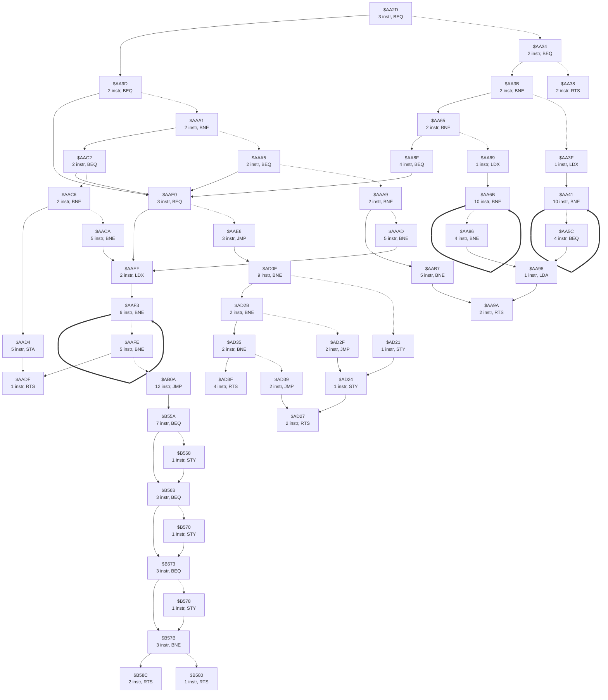

### CompareHighScore  `$AB26`

8 blocks, 10 edges, 2 exits, 2 back edges, complexity 4.

| Block | Instr | Last | Calls | Successors |
|---|---|---|---|---|
| `$AB26-$AB26` (entry) | 1 | LDY | - | fall `$AB28` |
| `$AB28-$AB2E` | 3 | BEQ | - | taken `$AB34`; not taken `$AB30` |
| `$AB30-$AB30` | 1 | BCC | - | taken `$AB47`; not taken `$AB32` |
| `$AB32-$AB32` | 1 | BCS | - | taken (always) `$AB3B` |
| `$AB34-$AB38` | 4 | BNE | - | taken `$AB28`; not taken `$AB3A` |
| `$AB3A-$AB3A` | 1 | RTS | - | **exit** (RTS) |
| `$AB3B-$AB45` | 6 | BNE | - | taken `$AB3B`; not taken `$AB47` |
| `$AB47-$AB47` | 1 | RTS | - | **exit** (RTS) |

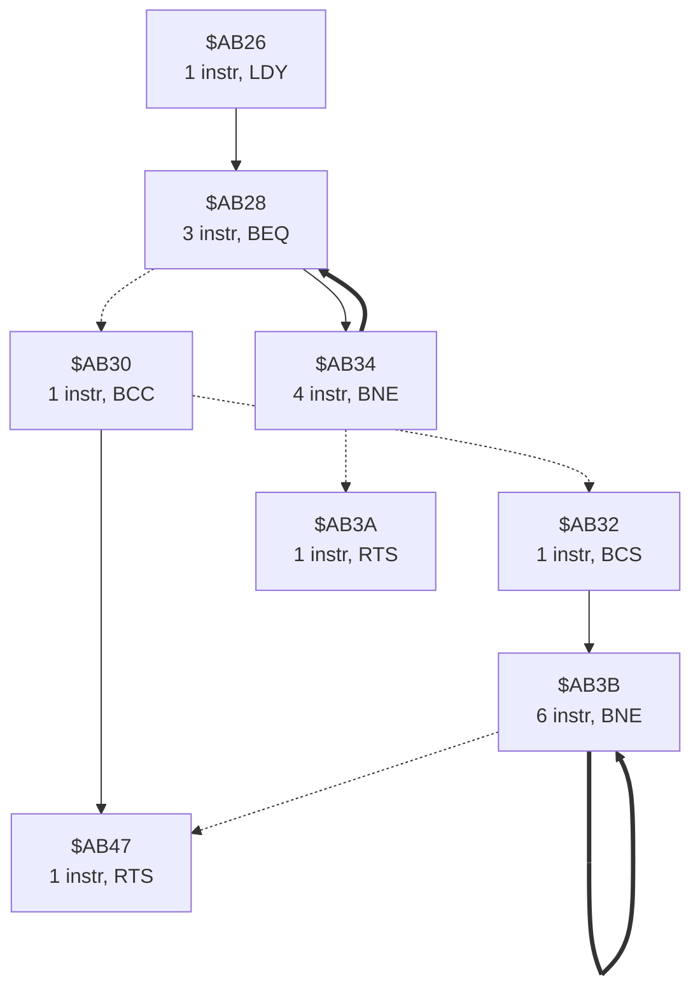

### ClipEntitiesOnTunnelRow  `$AB48`

5 blocks, 6 edges, 1 exits, 1 back edges, complexity 3.

| Block | Instr | Last | Calls | Successors |
|---|---|---|---|---|
| `$AB48-$AB48` (entry) | 1 | LDX | - | fall `$AB4A` |
| `$AB4A-$AB4E` | 3 | BNE | - | taken `$AB53`; not taken `$AB50` |
| `$AB50-$AB50` | 1 | JSR | ClipEntityAtTunnel | fall `$AB53` |
| `$AB53-$AB54` | 2 | BPL | - | taken `$AB4A`; not taken `$AB56` |
| `$AB56-$AB56` | 1 | RTS | - | **exit** (RTS) |

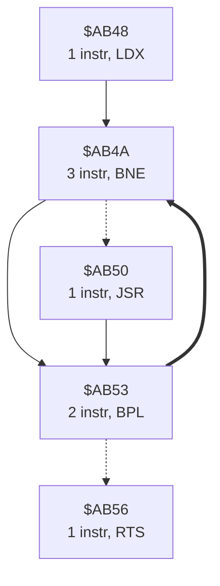

### ClipEntityAtTunnel  `$AB57`

21 blocks, 34 edges, 1 exits, 3 back edges, complexity 15.

| Block | Instr | Last | Calls | Successors |
|---|---|---|---|---|
| `$AB57-$AB5C` (entry) | 4 | BNE | - | taken `$AB60`; not taken `$AB5E` |
| `$AB5E-$AB5E` | 1 | LDA | - | fall `$AB60` |
| `$AB60-$AB6F` | 9 | BCC | - | taken `$AB95`; not taken `$AB71` |
| `$AB71-$AB71` | 1 | LDA | - | fall `$AB73` |
| `$AB73-$AB75` | 2 | BEQ | - | taken `$ABBD`; not taken `$AB77` |
| `$AB77-$AB7B` | 3 | BCS | - | taken `$AB73`; not taken `$AB7D` |
| `$AB7D-$AB81` | 3 | BCC | - | taken `$ABBD`; not taken `$AB83` |
| `$AB83-$AB87` | 3 | BNE | - | taken `$ABBD`; not taken `$AB89` |
| `$AB89-$AB8F` | 4 | BNE | - | taken `$ABBD`; not taken `$AB91` |
| `$AB91-$AB93` | 2 | BNE | - | taken (always) `$ABBB` |
| `$AB95-$AB97` | 2 | BCS | - | taken `$ABC8`; not taken `$AB99` |
| `$AB99-$AB9D` | 3 | BEQ | - | taken `$ABBD`; not taken `$AB9F` |
| `$AB9F-$ABA3` | 3 | BCS | - | taken `$AB99`; not taken `$ABA5` |
| `$ABA5-$ABA9` | 3 | BNE | - | taken `$ABBD`; not taken `$ABAB` |
| `$ABAB-$ABAF` | 3 | BNE | - | taken `$ABBD`; not taken `$ABB1` |
| `$ABB1-$ABB7` | 4 | BNE | - | taken `$ABBD`; not taken `$ABB9` |
| `$ABB9-$ABB9` | 1 | LDA | - | fall `$ABBB` |
| `$ABBB-$ABBB` | 1 | STA | - | fall `$ABBD` |
| `$ABBD-$ABBD` | 1 | LDY | - | fall `$ABBF` |
| `$ABBF-$ABC6` | 5 | BPL | - | taken `$ABBF`; not taken `$ABC8` |
| `$ABC8-$ABC8` | 1 | RTS | - | **exit** (RTS) |

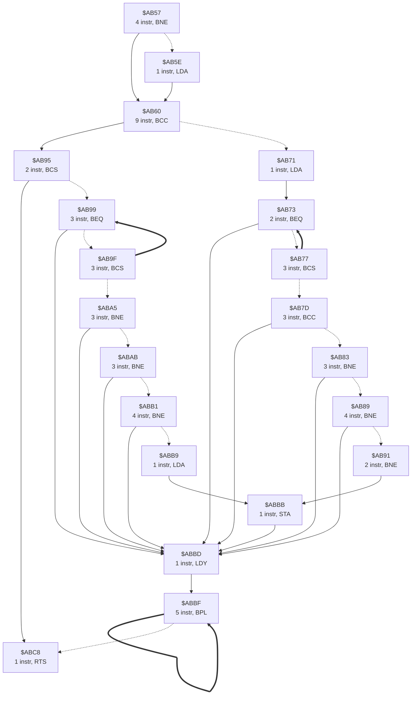

### BonusSound  `$ABC9`

13 blocks, 20 edges, 1 exits, 0 back edges, complexity 9.

| Block | Instr | Last | Calls | Successors |
|---|---|---|---|---|
| `$ABC9-$ABCB` (entry) | 2 | BEQ | - | taken `$AC04`; not taken `$ABCD` |
| `$ABCD-$ABD3` | 4 | BCS | - | taken `$ABE4`; not taken `$ABD5` |
| `$ABD5-$ABD7` | 2 | BEQ | - | taken `$ABDE`; not taken `$ABD9` |
| `$ABD9-$ABDC` | 3 | BNE | - | taken `$ABFC`; not taken `$ABDE` |
| `$ABDE-$ABE2` | 3 | BNE | - | taken (always) `$ABFC` |
| `$ABE4-$ABE6` | 2 | BNE | - | taken `$ABEC`; not taken `$ABE8` |
| `$ABE8-$ABEA` | 2 | BNE | - | taken `$ABEE`; not taken `$ABEC` |
| `$ABEC-$ABEC` | 1 | LDY | - | fall `$ABEE` |
| `$ABEE-$ABF1` | 3 | BNE | - | taken `$ABFA`; not taken `$ABF3` |
| `$ABF3-$ABF8` | 4 | BEQ | - | taken `$ABFC`; not taken `$ABFA` |
| `$ABFA-$ABFA` | 1 | SBC | - | fall `$ABFC` |
| `$ABFC-$AC01` | 3 | STY | - | fall `$AC04` |
| `$AC04-$AC04` | 1 | RTS | - | **exit** (RTS) |

```mermaid
flowchart TD
  BABC9["$ABC9<br/>2 instr, BEQ"]
  BABCD["$ABCD<br/>4 instr, BCS"]
  BABD5["$ABD5<br/>2 instr, BEQ"]
  BABD9["$ABD9<br/>3 instr, BNE"]
  BABDE["$ABDE<br/>3 instr, BNE"]
  BABE4["$ABE4<br/>2 instr, BNE"]
  BABE8["$ABE8<br/>2 instr, BNE"]
  BABEC["$ABEC<br/>1 instr, LDY"]
  BABEE["$ABEE<br/>3 instr, BNE"]
  BABF3["$ABF3<br/>4 instr, BEQ"]
  BABFA["$ABFA<br/>1 instr, SBC"]
  BABFC["$ABFC<br/>3 instr, STY"]
  BAC04["$AC04<br/>1 instr, RTS"]
  BABC9 --> BAC04
  BABC9 -.-> BABCD
  BABCD --> BABE4
  BABCD -.-> BABD5
  BABD5 --> BABDE
  BABD5 -.-> BABD9
  BABD9 --> BABFC
  BABD9 -.-> BABDE
  BABDE --> BABFC
  BABE4 --> BABEC
  BABE4 -.-> BABE8
  BABE8 --> BABEE
  BABE8 -.-> BABEC
  BABEC --> BABEE
  BABEE --> BABFA
  BABEE -.-> BABF3
  BABF3 --> BABFC
  BABF3 -.-> BABFA
  BABFA --> BABFC
  BABFC --> BAC04
```

### ToggleLegPhase  `$AC05`

5 blocks, 6 edges, 1 exits, 0 back edges, complexity 3.

| Block | Instr | Last | Calls | Successors |
|---|---|---|---|---|
| `$AC05-$AC09` (entry) | 3 | BNE | - | taken `$AC17`; not taken `$AC0B` |
| `$AC0B-$AC0D` | 2 | BEQ | - | taken `$AC15`; not taken `$AC0F` |
| `$AC0F-$AC13` | 3 | BEQ | - | taken (always) `$AC17` |
| `$AC15-$AC15` | 1 | INC | - | fall `$AC17` |
| `$AC17-$AC17` | 1 | RTS | - | **exit** (RTS) |

```mermaid
flowchart TD
  BAC05["$AC05<br/>3 instr, BNE"]
  BAC0B["$AC0B<br/>2 instr, BEQ"]
  BAC0F["$AC0F<br/>3 instr, BEQ"]
  BAC15["$AC15<br/>1 instr, INC"]
  BAC17["$AC17<br/>1 instr, RTS"]
  BAC05 --> BAC17
  BAC05 -.-> BAC0B
  BAC0B --> BAC15
  BAC0B -.-> BAC0F
  BAC0F --> BAC17
  BAC15 --> BAC17
```

### AdvanceLevel  `$AC75`

1 blocks, 0 edges, 1 exits, 0 back edges, complexity 1.

| Block | Instr | Last | Calls | Successors |
|---|---|---|---|---|
| `$AC75-$AC92` (entry) | 14 | RTS | NewBoardInit, DrawLevelIndicator, DrawReadyScreen | **exit** (RTS) |

```mermaid
flowchart TD
  BAC75["$AC75<br/>14 instr, RTS"]
```

### DrawLevelIndicator  `$AC93`

15 blocks, 22 edges, 1 exits, 3 back edges, complexity 9.

| Block | Instr | Last | Calls | Successors |
|---|---|---|---|---|
| `$AC93-$AC95` (entry) | 2 | LDX | - | fall `$AC97` |
| `$AC97-$ACA0` | 6 | BNE | - | taken `$AC97`; not taken `$ACA2` |
| `$ACA2-$ACA8` | 4 | BCC | - | taken `$ACB2`; not taken `$ACAA` |
| `$ACAA-$ACAC` | 2 | BCS | - | taken `$ACB2`; not taken `$ACAE` |
| `$ACAE-$ACB0` | 2 | BNE | - | taken (always) `$ACB4` |
| `$ACB2-$ACB2` | 1 | LDY | - | fall `$ACB4` |
| `$ACB4-$ACBA` | 4 | BCS | - | taken `$ACE1`; not taken `$ACBC` |
| `$ACBC-$ACC6` | 6 | LDX | - | fall `$ACC8` |
| `$ACC8-$ACD6` | 8 | BEQ | - | taken `$AD0D`; not taken `$ACD8` |
| `$ACD8-$ACDF` | 5 | BNE | - | taken `$ACC8`; not taken `$ACE1` |
| `$ACE1-$ACE3` | 2 | BCC | - | taken `$ACE7`; not taken `$ACE5` |
| `$ACE5-$ACE5` | 1 | LDA | - | fall `$ACE7` |
| `$ACE7-$ACF9` | 11 | LDX | - | fall `$ACFB` |
| `$ACFB-$AD0B` | 10 | BNE | - | taken `$ACFB`; not taken `$AD0D` |
| `$AD0D-$AD0D` | 1 | RTS | - | **exit** (RTS) |

```mermaid
flowchart TD
  BAC93["$AC93<br/>2 instr, LDX"]
  BAC97["$AC97<br/>6 instr, BNE"]
  BACA2["$ACA2<br/>4 instr, BCC"]
  BACAA["$ACAA<br/>2 instr, BCS"]
  BACAE["$ACAE<br/>2 instr, BNE"]
  BACB2["$ACB2<br/>1 instr, LDY"]
  BACB4["$ACB4<br/>4 instr, BCS"]
  BACBC["$ACBC<br/>6 instr, LDX"]
  BACC8["$ACC8<br/>8 instr, BEQ"]
  BACD8["$ACD8<br/>5 instr, BNE"]
  BACE1["$ACE1<br/>2 instr, BCC"]
  BACE5["$ACE5<br/>1 instr, LDA"]
  BACE7["$ACE7<br/>11 instr, LDX"]
  BACFB["$ACFB<br/>10 instr, BNE"]
  BAD0D["$AD0D<br/>1 instr, RTS"]
  BAC93 --> BAC97
  BAC97 ==> BAC97
  BAC97 -.-> BACA2
  BACA2 --> BACB2
  BACA2 -.-> BACAA
  BACAA --> BACB2
  BACAA -.-> BACAE
  BACAE --> BACB4
  BACB2 --> BACB4
  BACB4 --> BACE1
  BACB4 -.-> BACBC
  BACBC --> BACC8
  BACC8 --> BAD0D
  BACC8 -.-> BACD8
  BACD8 ==> BACC8
  BACD8 -.-> BACE1
  BACE1 --> BACE7
  BACE1 -.-> BACE5
  BACE5 --> BACE7
  BACE7 --> BACFB
  BACFB ==> BACFB
  BACFB -.-> BAD0D
```

### DrawReadyScreen  `$AD0E`

9 blocks, 10 edges, 2 exits, 0 back edges, complexity 3.

| Block | Instr | Last | Calls | Successors |
|---|---|---|---|---|
| `$AD0E-$AD1F` (entry) | 9 | BNE | DrawAllInPlace | taken `$AD2B`; not taken `$AD21` |
| `$AD21-$AD21` | 1 | STY | - | fall `$AD24` |
| `$AD24-$AD24` | 1 | STY | - | fall `$AD27` |
| `$AD27-$AD2A` | 2 | RTS | - | **exit** (RTS) |
| `$AD2B-$AD2D` | 2 | BNE | - | taken `$AD35`; not taken `$AD2F` |
| `$AD2F-$AD32` | 2 | JMP | LifeIcon1 | jump `$AD24` |
| `$AD35-$AD37` | 2 | BNE | - | taken `$AD3F`; not taken `$AD39` |
| `$AD39-$AD3C` | 2 | JMP | LifeIcon2 | jump `$AD27` |
| `$AD3F-$AD48` | 4 | RTS | - | **exit** (RTS) |

```mermaid
flowchart TD
  BAD0E["$AD0E<br/>9 instr, BNE"]
  BAD21["$AD21<br/>1 instr, STY"]
  BAD24["$AD24<br/>1 instr, STY"]
  BAD27["$AD27<br/>2 instr, RTS"]
  BAD2B["$AD2B<br/>2 instr, BNE"]
  BAD2F["$AD2F<br/>2 instr, JMP"]
  BAD35["$AD35<br/>2 instr, BNE"]
  BAD39["$AD39<br/>2 instr, JMP"]
  BAD3F["$AD3F<br/>4 instr, RTS"]
  BAD0E --> BAD2B
  BAD0E -.-> BAD21
  BAD21 --> BAD24
  BAD24 --> BAD27
  BAD2B --> BAD35
  BAD2B -.-> BAD2F
  BAD2F --> BAD24
  BAD35 --> BAD3F
  BAD35 -.-> BAD39
  BAD39 --> BAD27
```

### DrawLives  `$AD15`

9 blocks, 10 edges, 2 exits, 0 back edges, complexity 3.

| Block | Instr | Last | Calls | Successors |
|---|---|---|---|---|
| `$AD15-$AD1F` (entry) | 6 | BNE | - | taken `$AD2B`; not taken `$AD21` |
| `$AD21-$AD21` | 1 | STY | - | fall `$AD24` |
| `$AD24-$AD24` | 1 | STY | - | fall `$AD27` |
| `$AD27-$AD2A` | 2 | RTS | - | **exit** (RTS) |
| `$AD2B-$AD2D` | 2 | BNE | - | taken `$AD35`; not taken `$AD2F` |
| `$AD2F-$AD32` | 2 | JMP | LifeIcon1 | jump `$AD24` |
| `$AD35-$AD37` | 2 | BNE | - | taken `$AD3F`; not taken `$AD39` |
| `$AD39-$AD3C` | 2 | JMP | LifeIcon2 | jump `$AD27` |
| `$AD3F-$AD48` | 4 | RTS | - | **exit** (RTS) |

```mermaid
flowchart TD
  BAD15["$AD15<br/>6 instr, BNE"]
  BAD21["$AD21<br/>1 instr, STY"]
  BAD24["$AD24<br/>1 instr, STY"]
  BAD27["$AD27<br/>2 instr, RTS"]
  BAD2B["$AD2B<br/>2 instr, BNE"]
  BAD2F["$AD2F<br/>2 instr, JMP"]
  BAD35["$AD35<br/>2 instr, BNE"]
  BAD39["$AD39<br/>2 instr, JMP"]
  BAD3F["$AD3F<br/>4 instr, RTS"]
  BAD15 --> BAD2B
  BAD15 -.-> BAD21
  BAD21 --> BAD24
  BAD24 --> BAD27
  BAD2B --> BAD35
  BAD2B -.-> BAD2F
  BAD2F --> BAD24
  BAD35 --> BAD3F
  BAD35 -.-> BAD39
  BAD39 --> BAD27
```

### LifeIcon2  `$AD42`

1 blocks, 0 edges, 1 exits, 0 back edges, complexity 1.

| Block | Instr | Last | Calls | Successors |
|---|---|---|---|---|
| `$AD42-$AD48` (entry) | 3 | RTS | - | **exit** (RTS) |

```mermaid
flowchart TD
  BAD42["$AD42<br/>3 instr, RTS"]
```

### LifeIcon1  `$AD45`

1 blocks, 0 edges, 1 exits, 0 back edges, complexity 1.

| Block | Instr | Last | Calls | Successors |
|---|---|---|---|---|
| `$AD45-$AD48` (entry) | 2 | RTS | - | **exit** (RTS) |

```mermaid
flowchart TD
  BAD45["$AD45<br/>2 instr, RTS"]
```

### DrawAllInPlace  `$AD49`

14 blocks, 20 edges, 1 exits, 4 back edges, complexity 8.

| Block | Instr | Last | Calls | Successors |
|---|---|---|---|---|
| `$AD49-$AD4D` (entry) | 3 | LDX | - | fall `$AD4F` |
| `$AD4F-$AD55` | 4 | BPL | StepAndDrawEntity | taken `$AD4F`; not taken `$AD57` |
| `$AD57-$AD5B` | 3 | JMP | - | jump `$B2CE` |
| `$B2CE-$B2D1` | 3 | BEQ | - | taken `$B2E9`; not taken `$B2D3` |
| `$B2D3-$B2D5` | 2 | BNE | - | taken `$B2DB`; not taken `$B2D7` |
| `$B2D7-$B2D9` | 2 | BNE | - | taken `$B2CE`; not taken `$B2DB` |
| `$B2DB-$B2E1` | 4 | BNE | - | taken `$B2E7`; not taken `$B2E3` |
| `$B2E3-$B2E5` | 2 | STX | - | fall `$B2E7` |
| `$B2E7-$B2E7` | 1 | INC | - | fall `$B2E9` |
| `$B2E9-$B301` | 14 | LDY | - | fall `$B303` |
| `$B303-$B309` | 4 | BPL | - | taken `$B303`; not taken `$B30B` |
| `$B30B-$B330` | 18 | LDY | - | fall `$B332` |
| `$B332-$B337` | 4 | BPL | - | taken `$B332`; not taken `$B339` |
| `$B339-$B339` | 1 | RTS | - | **exit** (RTS) |

```mermaid
flowchart TD
  BAD49["$AD49<br/>3 instr, LDX"]
  BAD4F["$AD4F<br/>4 instr, BPL"]
  BAD57["$AD57<br/>3 instr, JMP"]
  BB2CE["$B2CE<br/>3 instr, BEQ"]
  BB2D3["$B2D3<br/>2 instr, BNE"]
  BB2D7["$B2D7<br/>2 instr, BNE"]
  BB2DB["$B2DB<br/>4 instr, BNE"]
  BB2E3["$B2E3<br/>2 instr, STX"]
  BB2E7["$B2E7<br/>1 instr, INC"]
  BB2E9["$B2E9<br/>14 instr, LDY"]
  BB303["$B303<br/>4 instr, BPL"]
  BB30B["$B30B<br/>18 instr, LDY"]
  BB332["$B332<br/>4 instr, BPL"]
  BB339["$B339<br/>1 instr, RTS"]
  BAD49 --> BAD4F
  BAD4F ==> BAD4F
  BAD4F -.-> BAD57
  BAD57 --> BB2CE
  BB2CE --> BB2E9
  BB2CE -.-> BB2D3
  BB2D3 --> BB2DB
  BB2D3 -.-> BB2D7
  BB2D7 ==> BB2CE
  BB2D7 -.-> BB2DB
  BB2DB --> BB2E7
  BB2DB -.-> BB2E3
  BB2E3 --> BB2E7
  BB2E7 --> BB2E9
  BB2E9 --> BB303
  BB303 ==> BB303
  BB303 -.-> BB30B
  BB30B --> BB332
  BB332 ==> BB332
  BB332 -.-> BB339
```

### ClearReadyText  `$AD5E`

3 blocks, 3 edges, 1 exits, 1 back edges, complexity 2.

| Block | Instr | Last | Calls | Successors |
|---|---|---|---|---|
| `$AD5E-$AD60` (entry) | 2 | LDA | - | fall `$AD62` |
| `$AD62-$AD66` | 3 | BPL | - | taken `$AD62`; not taken `$AD68` |
| `$AD68-$AD68` | 1 | RTS | - | **exit** (RTS) |

```mermaid
flowchart TD
  BAD5E["$AD5E<br/>2 instr, LDA"]
  BAD62["$AD62<br/>3 instr, BPL"]
  BAD68["$AD68<br/>1 instr, RTS"]
  BAD5E --> BAD62
  BAD62 ==> BAD62
  BAD62 -.-> BAD68
```

### BlinkPlayerLabel  `$AD69`

14 blocks, 20 edges, 2 exits, 0 back edges, complexity 8.

| Block | Instr | Last | Calls | Successors |
|---|---|---|---|---|
| `$AD69-$AD6D` (entry) | 3 | BNE | - | taken `$ADAE`; not taken `$AD6F` |
| `$AD6F-$AD71` | 2 | BNE | - | taken `$AD77`; not taken `$AD73` |
| `$AD73-$AD75` | 2 | BNE | - | taken `$AD7B`; not taken `$AD77` |
| `$AD77-$AD79` | 2 | STA | - | fall `$AD7B` |
| `$AD7B-$AD7D` | 2 | BEQ | - | taken `$AD97`; not taken `$AD7F` |
| `$AD7F-$AD81` | 2 | BNE | - | taken `$AD87`; not taken `$AD83` |
| `$AD83-$AD85` | 3 | BEQ | - | taken `$AD8D`; not taken `$AD87` |
| `$AD87-$AD8B` | 3 | LDY | - | fall `$AD8D` |
| `$AD8D-$AD96` | 4 | RTS | - | **exit** (RTS) |
| `$AD97-$AD99` | 2 | BNE | - | taken `$AD9F`; not taken `$AD9B` |
| `$AD9B-$AD9D` | 3 | BEQ | - | taken `$ADA5`; not taken `$AD9F` |
| `$AD9F-$ADA3` | 3 | LDY | - | fall `$ADA5` |
| `$ADA5-$ADAB` | 3 | STY | - | fall `$ADAE` |
| `$ADAE-$ADAE` | 1 | RTS | - | **exit** (RTS) |

```mermaid
flowchart TD
  BAD69["$AD69<br/>3 instr, BNE"]
  BAD6F["$AD6F<br/>2 instr, BNE"]
  BAD73["$AD73<br/>2 instr, BNE"]
  BAD77["$AD77<br/>2 instr, STA"]
  BAD7B["$AD7B<br/>2 instr, BEQ"]
  BAD7F["$AD7F<br/>2 instr, BNE"]
  BAD83["$AD83<br/>3 instr, BEQ"]
  BAD87["$AD87<br/>3 instr, LDY"]
  BAD8D["$AD8D<br/>4 instr, RTS"]
  BAD97["$AD97<br/>2 instr, BNE"]
  BAD9B["$AD9B<br/>3 instr, BEQ"]
  BAD9F["$AD9F<br/>3 instr, LDY"]
  BADA5["$ADA5<br/>3 instr, STY"]
  BADAE["$ADAE<br/>1 instr, RTS"]
  BAD69 --> BADAE
  BAD69 -.-> BAD6F
  BAD6F --> BAD77
  BAD6F -.-> BAD73
  BAD73 --> BAD7B
  BAD73 -.-> BAD77
  BAD77 --> BAD7B
  BAD7B --> BAD97
  BAD7B -.-> BAD7F
  BAD7F --> BAD87
  BAD7F -.-> BAD83
  BAD83 --> BAD8D
  BAD83 -.-> BAD87
  BAD87 --> BAD8D
  BAD97 --> BAD9F
  BAD97 -.-> BAD9B
  BAD9B --> BADA5
  BAD9B -.-> BAD9F
  BAD9F --> BADA5
  BADA5 --> BADAE
```

### DrawLabel2UP  `$AD87`

1 blocks, 0 edges, 1 exits, 0 back edges, complexity 1.

| Block | Instr | Last | Calls | Successors |
|---|---|---|---|---|
| `$AD87-$AD96` (entry) | 7 | RTS | - | **exit** (RTS) |

```mermaid
flowchart TD
  BAD87["$AD87<br/>7 instr, RTS"]
```

### DrawLabel1UP  `$AD9F`

1 blocks, 0 edges, 1 exits, 0 back edges, complexity 1.

| Block | Instr | Last | Calls | Successors |
|---|---|---|---|---|
| `$AD9F-$ADAE` (entry) | 7 | RTS | - | **exit** (RTS) |

```mermaid
flowchart TD
  BAD9F["$AD9F<br/>7 instr, RTS"]
```

### InitBoard  `$ADAF`

9 blocks, 12 edges, 1 exits, 3 back edges, complexity 5.

| Block | Instr | Last | Calls | Successors |
|---|---|---|---|---|
| `$ADAF-$ADB2` (entry) | 2 | LDX | ClearPlayerMemory | fall `$ADB4` |
| `$ADB4-$ADB7` | 3 | BPL | - | taken `$ADB4`; not taken `$ADB9` |
| `$ADB9-$ADC2` | 5 | BCC | LoadShadowColors | taken `$ADC6`; not taken `$ADC4` |
| `$ADC4-$ADC4` | 1 | LDA | - | fall `$ADC6` |
| `$ADC6-$ADD4` | 8 | LDX | - | fall `$ADD6` |
| `$ADD6-$ADDC` | 4 | BPL | - | taken `$ADD6`; not taken `$ADDE` |
| `$ADDE-$ADDE` | 1 | LDX | - | fall `$ADE0` |
| `$ADE0-$ADE6` | 4 | BPL | - | taken `$ADE0`; not taken `$ADE8` |
| `$ADE8-$ADF0` | 4 | RTS | SetReleaseTimers | **exit** (RTS) |

```mermaid
flowchart TD
  BADAF["$ADAF<br/>2 instr, LDX"]
  BADB4["$ADB4<br/>3 instr, BPL"]
  BADB9["$ADB9<br/>5 instr, BCC"]
  BADC4["$ADC4<br/>1 instr, LDA"]
  BADC6["$ADC6<br/>8 instr, LDX"]
  BADD6["$ADD6<br/>4 instr, BPL"]
  BADDE["$ADDE<br/>1 instr, LDX"]
  BADE0["$ADE0<br/>4 instr, BPL"]
  BADE8["$ADE8<br/>4 instr, RTS"]
  BADAF --> BADB4
  BADB4 ==> BADB4
  BADB4 -.-> BADB9
  BADB9 --> BADC6
  BADB9 -.-> BADC4
  BADC4 --> BADC6
  BADC6 --> BADD6
  BADD6 ==> BADD6
  BADD6 -.-> BADDE
  BADDE --> BADE0
  BADE0 ==> BADE0
  BADE0 -.-> BADE8
```

### NewGameInit  `$ADF1`

5 blocks, 7 edges, 1 exits, 0 back edges, complexity 4.

| Block | Instr | Last | Calls | Successors |
|---|---|---|---|---|
| `$ADF1-$AE0D` (entry) | 14 | BNE | ClearPlayerCounters, Copy0800To0C00, DrawLives | taken `$AE19`; not taken `$AE0F` |
| `$AE0F-$AE11` | 2 | BPL | - | taken `$AE19`; not taken `$AE13` |
| `$AE13-$AE16` | 2 | JMP | SetReleaseTimers | jump `$AE1C` |
| `$AE19-$AE1A` | 2 | BNE | - | taken `$AE13`; not taken `$AE1C` |
| `$AE1C-$AE2A` | 8 | RTS | - | **exit** (RTS) |

```mermaid
flowchart TD
  BADF1["$ADF1<br/>14 instr, BNE"]
  BAE0F["$AE0F<br/>2 instr, BPL"]
  BAE13["$AE13<br/>2 instr, JMP"]
  BAE19["$AE19<br/>2 instr, BNE"]
  BAE1C["$AE1C<br/>8 instr, RTS"]
  BADF1 --> BAE19
  BADF1 -.-> BAE0F
  BAE0F --> BAE19
  BAE0F -.-> BAE13
  BAE13 --> BAE1C
  BAE19 --> BAE13
  BAE19 -.-> BAE1C
```

### NewBoardInit  `$AE02`

5 blocks, 7 edges, 1 exits, 0 back edges, complexity 4.

| Block | Instr | Last | Calls | Successors |
|---|---|---|---|---|
| `$AE02-$AE0D` (entry) | 6 | BNE | Copy0800To0C00, DrawLives | taken `$AE19`; not taken `$AE0F` |
| `$AE0F-$AE11` | 2 | BPL | - | taken `$AE19`; not taken `$AE13` |
| `$AE13-$AE16` | 2 | JMP | SetReleaseTimers | jump `$AE1C` |
| `$AE19-$AE1A` | 2 | BNE | - | taken `$AE13`; not taken `$AE1C` |
| `$AE1C-$AE2A` | 8 | RTS | - | **exit** (RTS) |

```mermaid
flowchart TD
  BAE02["$AE02<br/>6 instr, BNE"]
  BAE0F["$AE0F<br/>2 instr, BPL"]
  BAE13["$AE13<br/>2 instr, JMP"]
  BAE19["$AE19<br/>2 instr, BNE"]
  BAE1C["$AE1C<br/>8 instr, RTS"]
  BAE02 --> BAE19
  BAE02 -.-> BAE0F
  BAE0F --> BAE19
  BAE0F -.-> BAE13
  BAE13 --> BAE1C
  BAE19 --> BAE13
  BAE19 -.-> BAE1C
```

### ClearPlayerCounters  `$AE1E`

1 blocks, 0 edges, 1 exits, 0 back edges, complexity 1.

| Block | Instr | Last | Calls | Successors |
|---|---|---|---|---|
| `$AE1E-$AE2A` (entry) | 7 | RTS | - | **exit** (RTS) |

```mermaid
flowchart TD
  BAE1E["$AE1E<br/>7 instr, RTS"]
```

### SetReleaseTimers  `$AE2B`

5 blocks, 6 edges, 1 exits, 1 back edges, complexity 3.

| Block | Instr | Last | Calls | Successors |
|---|---|---|---|---|
| `$AE2B-$AE2D` (entry) | 2 | BCC | - | taken `$AE31`; not taken `$AE2F` |
| `$AE2F-$AE2F` | 1 | LDY | - | fall `$AE31` |
| `$AE31-$AE31` | 1 | LDX | - | fall `$AE33` |
| `$AE33-$AE3A` | 5 | BPL | - | taken `$AE33`; not taken `$AE3C` |
| `$AE3C-$AE3C` | 1 | RTS | - | **exit** (RTS) |

```mermaid
flowchart TD
  BAE2B["$AE2B<br/>2 instr, BCC"]
  BAE2F["$AE2F<br/>1 instr, LDY"]
  BAE31["$AE31<br/>1 instr, LDX"]
  BAE33["$AE33<br/>5 instr, BPL"]
  BAE3C["$AE3C<br/>1 instr, RTS"]
  BAE2B --> BAE31
  BAE2B -.-> BAE2F
  BAE2F --> BAE31
  BAE31 --> BAE33
  BAE33 ==> BAE33
  BAE33 -.-> BAE3C
```

### DeathSequence  `$AE3D`

27 blocks, 36 edges, 5 exits, 2 back edges, complexity 11.

| Block | Instr | Last | Calls | Successors |
|---|---|---|---|---|
| `$AE3D-$AE41` (entry) | 3 | BNE | - | taken `$AE5B`; not taken `$AE43` |
| `$AE43-$AE45` | 2 | BEQ | - | taken `$AE57`; not taken `$AE47` |
| `$AE47-$AE4A` | 2 | LDX | ToggleLegPhase | fall `$AE4C` |
| `$AE4C-$AE52` | 4 | BPL | StepAndDrawEntity | taken `$AE4C`; not taken `$AE54` |
| `$AE54-$AE56` | 2 | RTS | - | **exit** (RTS) |
| `$AE57-$AE59` | 2 | LDA | - | fall `$AE5B` |
| `$AE5B-$AE5D` | 2 | BNE | - | taken `$AE82`; not taken `$AE5F` |
| `$AE5F-$AE61` | 2 | LDA | - | fall `$AE63` |
| `$AE63-$AE67` | 3 | BPL | - | taken `$AE63`; not taken `$AE69` |
| `$AE69-$AE80` | 12 | BNE | ClearPokeyRegisters | taken (always) `$AE92` |
| `$AE82-$AE84` | 2 | BEQ | - | taken `$AE92`; not taken `$AE86` |
| `$AE86-$AE88` | 2 | BEQ | - | taken `$AEAB`; not taken `$AE8A` |
| `$AE8A-$AE8C` | 2 | BEQ | - | taken `$AED0`; not taken `$AE8E` |
| `$AE8E-$AE90` | 2 | BEQ | - | taken `$AEED`; not taken `$AE92` |
| `$AE92-$AEA7` | 11 | BNE | - | taken `$AEEC`; not taken `$AEA9` |
| `$AEA9-$AEA9` | 1 | BEQ | - | taken (always) `$AECD` |
| `$AEAB-$AEBC` | 9 | BNE | - | taken `$AEEC`; not taken `$AEBE` |
| `$AEBE-$AEC2` | 3 | BEQ | - | taken `$AEEA`; not taken `$AEC4` |
| `$AEC4-$AECB` | 5 | LDA | - | fall `$AECD` |
| `$AECD-$AECF` | 2 | RTS | - | **exit** (RTS) |
| `$AED0-$AEE1` | 9 | BNE | - | taken `$AEEC`; not taken `$AEE3` |
| `$AEE3-$AEE8` | 3 | STA | ClearPokeyRegisters | fall `$AEEA` |
| `$AEEA-$AEEA` | 1 | INC | - | fall `$AEEC` |
| `$AEEC-$AEEC` | 1 | RTS | - | **exit** (RTS) |
| `$AEED-$AEEF` | 2 | BNE | - | taken `$AEF4`; not taken `$AEF1` |
| `$AEF1-$AEF3` | 2 | RTS | - | **exit** (RTS) |
| `$AEF4-$AEF6` | 2 | RTS | - | **exit** (RTS) |

```mermaid
flowchart TD
  BAE3D["$AE3D<br/>3 instr, BNE"]
  BAE43["$AE43<br/>2 instr, BEQ"]
  BAE47["$AE47<br/>2 instr, LDX"]
  BAE4C["$AE4C<br/>4 instr, BPL"]
  BAE54["$AE54<br/>2 instr, RTS"]
  BAE57["$AE57<br/>2 instr, LDA"]
  BAE5B["$AE5B<br/>2 instr, BNE"]
  BAE5F["$AE5F<br/>2 instr, LDA"]
  BAE63["$AE63<br/>3 instr, BPL"]
  BAE69["$AE69<br/>12 instr, BNE"]
  BAE82["$AE82<br/>2 instr, BEQ"]
  BAE86["$AE86<br/>2 instr, BEQ"]
  BAE8A["$AE8A<br/>2 instr, BEQ"]
  BAE8E["$AE8E<br/>2 instr, BEQ"]
  BAE92["$AE92<br/>11 instr, BNE"]
  BAEA9["$AEA9<br/>1 instr, BEQ"]
  BAEAB["$AEAB<br/>9 instr, BNE"]
  BAEBE["$AEBE<br/>3 instr, BEQ"]
  BAEC4["$AEC4<br/>5 instr, LDA"]
  BAECD["$AECD<br/>2 instr, RTS"]
  BAED0["$AED0<br/>9 instr, BNE"]
  BAEE3["$AEE3<br/>3 instr, STA"]
  BAEEA["$AEEA<br/>1 instr, INC"]
  BAEEC["$AEEC<br/>1 instr, RTS"]
  BAEED["$AEED<br/>2 instr, BNE"]
  BAEF1["$AEF1<br/>2 instr, RTS"]
  BAEF4["$AEF4<br/>2 instr, RTS"]
  BAE3D --> BAE5B
  BAE3D -.-> BAE43
  BAE43 --> BAE57
  BAE43 -.-> BAE47
  BAE47 --> BAE4C
  BAE4C ==> BAE4C
  BAE4C -.-> BAE54
  BAE57 --> BAE5B
  BAE5B --> BAE82
  BAE5B -.-> BAE5F
  BAE5F --> BAE63
  BAE63 ==> BAE63
  BAE63 -.-> BAE69
  BAE69 --> BAE92
  BAE82 --> BAE92
  BAE82 -.-> BAE86
  BAE86 --> BAEAB
  BAE86 -.-> BAE8A
  BAE8A --> BAED0
  BAE8A -.-> BAE8E
  BAE8E --> BAEED
  BAE8E -.-> BAE92
  BAE92 --> BAEEC
  BAE92 -.-> BAEA9
  BAEA9 --> BAECD
  BAEAB --> BAEEC
  BAEAB -.-> BAEBE
  BAEBE --> BAEEA
  BAEBE -.-> BAEC4
  BAEC4 --> BAECD
  BAED0 --> BAEEC
  BAED0 -.-> BAEE3
  BAEE3 --> BAEEA
  BAEEA --> BAEEC
  BAEED --> BAEF4
  BAEED -.-> BAEF1
```

### DeathAnimation  `$AEF7`

18 blocks, 23 edges, 4 exits, 3 back edges, complexity 7.

| Block | Instr | Last | Calls | Successors |
|---|---|---|---|---|
| `$AEF7-$AEF9` (entry) | 2 | BEQ | - | taken `$AF53`; not taken `$AEFB` |
| `$AEFB-$AF05` | 6 | BEQ | - | taken `$AF0B`; not taken `$AF07` |
| `$AF07-$AF09` | 2 | BPL | - | taken `$AF17`; not taken `$AF0B` |
| `$AF0B-$AF0F` | 3 | BEQ | - | taken `$AF48`; not taken `$AF11` |
| `$AF11-$AF15` | 3 | STA | - | fall `$AF17` |
| `$AF17-$AF19` | 2 | BEQ | - | taken `$AF2C`; not taken `$AF1B` |
| `$AF1B-$AF1D` | 2 | BEQ | - | taken `$AF3A`; not taken `$AF1F` |
| `$AF1F-$AF2B` | 8 | RTS | - | **exit** (RTS) |
| `$AF2C-$AF2E` | 2 | LDX | - | fall `$AF30` |
| `$AF30-$AF37` | 5 | BPL | - | taken `$AF30`; not taken `$AF39` |
| `$AF39-$AF39` | 1 | RTS | - | **exit** (RTS) |
| `$AF3A-$AF3C` | 2 | LDX | - | fall `$AF3E` |
| `$AF3E-$AF45` | 5 | BPL | - | taken `$AF3E`; not taken `$AF47` |
| `$AF47-$AF47` | 1 | RTS | - | **exit** (RTS) |
| `$AF48-$AF4A` | 2 | LDA | - | fall `$AF4C` |
| `$AF4C-$AF4F` | 3 | BPL | - | taken `$AF4C`; not taken `$AF51` |
| `$AF51-$AF51` | 1 | STA | - | fall `$AF53` |
| `$AF53-$AF53` | 1 | RTS | - | **exit** (RTS) |

```mermaid
flowchart TD
  BAEF7["$AEF7<br/>2 instr, BEQ"]
  BAEFB["$AEFB<br/>6 instr, BEQ"]
  BAF07["$AF07<br/>2 instr, BPL"]
  BAF0B["$AF0B<br/>3 instr, BEQ"]
  BAF11["$AF11<br/>3 instr, STA"]
  BAF17["$AF17<br/>2 instr, BEQ"]
  BAF1B["$AF1B<br/>2 instr, BEQ"]
  BAF1F["$AF1F<br/>8 instr, RTS"]
  BAF2C["$AF2C<br/>2 instr, LDX"]
  BAF30["$AF30<br/>5 instr, BPL"]
  BAF39["$AF39<br/>1 instr, RTS"]
  BAF3A["$AF3A<br/>2 instr, LDX"]
  BAF3E["$AF3E<br/>5 instr, BPL"]
  BAF47["$AF47<br/>1 instr, RTS"]
  BAF48["$AF48<br/>2 instr, LDA"]
  BAF4C["$AF4C<br/>3 instr, BPL"]
  BAF51["$AF51<br/>1 instr, STA"]
  BAF53["$AF53<br/>1 instr, RTS"]
  BAEF7 --> BAF53
  BAEF7 -.-> BAEFB
  BAEFB --> BAF0B
  BAEFB -.-> BAF07
  BAF07 --> BAF17
  BAF07 -.-> BAF0B
  BAF0B --> BAF48
  BAF0B -.-> BAF11
  BAF11 --> BAF17
  BAF17 --> BAF2C
  BAF17 -.-> BAF1B
  BAF1B --> BAF3A
  BAF1B -.-> BAF1F
  BAF2C --> BAF30
  BAF30 ==> BAF30
  BAF30 -.-> BAF39
  BAF3A --> BAF3E
  BAF3E ==> BAF3E
  BAF3E -.-> BAF47
  BAF48 --> BAF4C
  BAF4C ==> BAF4C
  BAF4C -.-> BAF51
  BAF51 --> BAF53
```

### FrightenedTick  `$AF54`

44 blocks, 60 edges, 4 exits, 3 back edges, complexity 18, IRREDUCIBLE.

**Irreducible**: the retreating edge `$B52C` -> `$B533` enters a loop at a block that does not dominate the edge's source (a second entry into the loop).

| Block | Instr | Last | Calls | Successors |
|---|---|---|---|---|
| `$AF53-$AF53` | 1 | RTS | - | **exit** (RTS) |
| `$AF54-$AF56` (entry) | 2 | BEQ | - | taken `$AF68`; not taken `$AF58` |
| `$AF58-$AF5A` | 2 | BNE | - | taken `$AF5F`; not taken `$AF5C` |
| `$AF5C-$AF5C` | 1 | JSR | FrightenedSound | fall `$AF5F` |
| `$AF5F-$AF61` | 2 | BEQ | - | taken `$AF6F`; not taken `$AF63` |
| `$AF63-$AF65` | 2 | JMP | - | jump `$AFBE` |
| `$AF68-$AF6A` | 2 | BNE | - | taken `$AF53`; not taken `$AF6C` |
| `$AF6C-$AF6C` | 1 | JMP | - | jump `$B508` |
| `$AF6F-$AF79` | 6 | BNE | - | taken `$AFB2`; not taken `$AF7B` |
| `$AF7B-$AF7B` | 1 | LDX | - | fall `$AF7D` |
| `$AF7D-$AF7F` | 2 | BPL | - | taken `$AF87`; not taken `$AF81` |
| `$AF81-$AF84` | 2 | STA | - | fall `$AF87` |
| `$AF87-$AF88` | 2 | BPL | - | taken `$AF7D`; not taken `$AF8A` |
| `$AF8A-$AF8A` | 1 | LDX | - | fall `$AF8C` |
| `$AF8C-$AF8E` | 2 | BPL | - | taken `$AFA2`; not taken `$AF90` |
| `$AF90-$AF92` | 2 | BEQ | - | taken `$AF9A`; not taken `$AF94` |
| `$AF94-$AF96` | 2 | BEQ | - | taken `$AFA2`; not taken `$AF98` |
| `$AF98-$AF98` | 1 | BNE | - | taken (always) `$AF9E` |
| `$AF9A-$AF9C` | 2 | BEQ | - | taken (always) `$AFA0` |
| `$AF9E-$AF9E` | 1 | LDA | - | fall `$AFA0` |
| `$AFA0-$AFA0` | 1 | STA | - | fall `$AFA2` |
| `$AFA2-$AFA3` | 2 | BPL | - | taken `$AF8C`; not taken `$AFA5` |
| `$AFA5-$AFB1` | 7 | RTS | - | **exit** (RTS) |
| `$AFB2-$AFB4` | 2 | BNE | - | taken `$AFBC`; not taken `$AFB6` |
| `$AFB6-$AFBA` | 3 | STA | - | fall `$AFBC` |
| `$AFBC-$AFBC` | 1 | DEC | - | fall `$AFBE` |
| `$AFBE-$AFC1` | 3 | BCC | - | taken `$AFC7`; not taken `$AFC3` |
| `$AFC3-$AFC5` | 2 | BNE | - | taken (always) `$AFC9` |
| `$AFC7-$AFC7` | 1 | LDY | - | fall `$AFC9` |
| `$AFC9-$AFC9` | 1 | LDX | - | fall `$AFCB` |
| `$AFCB-$AFCD` | 2 | BPL | - | taken `$AFD3`; not taken `$AFCF` |
| `$AFCF-$AFD0` | 2 | STA | - | fall `$AFD3` |
| `$AFD3-$AFD4` | 2 | BPL | - | taken `$AFCB`; not taken `$AFD6` |
| `$AFD6-$AFD6` | 1 | RTS | - | **exit** (RTS) |
| `$B508-$B50E` | 4 | BNE | - | taken `$B51A`; not taken `$B510` |
| `$B510-$B518` | 5 | STA | - | fall `$B51A` |
| `$B51A-$B51E` | 3 | BNE | - | taken `$B533`; not taken `$B520` |
| `$B520-$B524` | 3 | BCC | - | taken `$B52C`; not taken `$B526` |
| `$B526-$B52A` | 3 | BNE | - | taken (always) `$B53F` |
| `$B52C-$B531` | 4 | BNE | - | taken `$B544`; not taken `$B533` |
| `$B533-$B537` | 3 | BCS | - | taken `$B53F`; not taken `$B539` |
| `$B539-$B53D` | 3 | BNE | - | taken (always) `$B52C` |
| `$B53F-$B542` | 3 | SBC | - | fall `$B544` |
| `$B544-$B54E` | 5 | RTS | - | **exit** (RTS) |

```mermaid
flowchart TD
  BAF53["$AF53<br/>1 instr, RTS"]
  BAF54["$AF54<br/>2 instr, BEQ"]
  BAF58["$AF58<br/>2 instr, BNE"]
  BAF5C["$AF5C<br/>1 instr, JSR"]
  BAF5F["$AF5F<br/>2 instr, BEQ"]
  BAF63["$AF63<br/>2 instr, JMP"]
  BAF68["$AF68<br/>2 instr, BNE"]
  BAF6C["$AF6C<br/>1 instr, JMP"]
  BAF6F["$AF6F<br/>6 instr, BNE"]
  BAF7B["$AF7B<br/>1 instr, LDX"]
  BAF7D["$AF7D<br/>2 instr, BPL"]
  BAF81["$AF81<br/>2 instr, STA"]
  BAF87["$AF87<br/>2 instr, BPL"]
  BAF8A["$AF8A<br/>1 instr, LDX"]
  BAF8C["$AF8C<br/>2 instr, BPL"]
  BAF90["$AF90<br/>2 instr, BEQ"]
  BAF94["$AF94<br/>2 instr, BEQ"]
  BAF98["$AF98<br/>1 instr, BNE"]
  BAF9A["$AF9A<br/>2 instr, BEQ"]
  BAF9E["$AF9E<br/>1 instr, LDA"]
  BAFA0["$AFA0<br/>1 instr, STA"]
  BAFA2["$AFA2<br/>2 instr, BPL"]
  BAFA5["$AFA5<br/>7 instr, RTS"]
  BAFB2["$AFB2<br/>2 instr, BNE"]
  BAFB6["$AFB6<br/>3 instr, STA"]
  BAFBC["$AFBC<br/>1 instr, DEC"]
  BAFBE["$AFBE<br/>3 instr, BCC"]
  BAFC3["$AFC3<br/>2 instr, BNE"]
  BAFC7["$AFC7<br/>1 instr, LDY"]
  BAFC9["$AFC9<br/>1 instr, LDX"]
  BAFCB["$AFCB<br/>2 instr, BPL"]
  BAFCF["$AFCF<br/>2 instr, STA"]
  BAFD3["$AFD3<br/>2 instr, BPL"]
  BAFD6["$AFD6<br/>1 instr, RTS"]
  BB508["$B508<br/>4 instr, BNE"]
  BB510["$B510<br/>5 instr, STA"]
  BB51A["$B51A<br/>3 instr, BNE"]
  BB520["$B520<br/>3 instr, BCC"]
  BB526["$B526<br/>3 instr, BNE"]
  BB52C["$B52C<br/>4 instr, BNE"]
  BB533["$B533<br/>3 instr, BCS"]
  BB539["$B539<br/>3 instr, BNE"]
  BB53F["$B53F<br/>3 instr, SBC"]
  BB544["$B544<br/>5 instr, RTS"]
  BAF54 --> BAF68
  BAF54 -.-> BAF58
  BAF58 --> BAF5F
  BAF58 -.-> BAF5C
  BAF5C --> BAF5F
  BAF5F --> BAF6F
  BAF5F -.-> BAF63
  BAF63 --> BAFBE
  BAF68 --> BAF53
  BAF68 -.-> BAF6C
  BAF6C --> BB508
  BAF6F --> BAFB2
  BAF6F -.-> BAF7B
  BAF7B --> BAF7D
  BAF7D --> BAF87
  BAF7D -.-> BAF81
  BAF81 --> BAF87
  BAF87 ==> BAF7D
  BAF87 -.-> BAF8A
  BAF8A --> BAF8C
  BAF8C --> BAFA2
  BAF8C -.-> BAF90
  BAF90 --> BAF9A
  BAF90 -.-> BAF94
  BAF94 --> BAFA2
  BAF94 -.-> BAF98
  BAF98 --> BAF9E
  BAF9A --> BAFA0
  BAF9E --> BAFA0
  BAFA0 --> BAFA2
  BAFA2 ==> BAF8C
  BAFA2 -.-> BAFA5
  BAFB2 --> BAFBC
  BAFB2 -.-> BAFB6
  BAFB6 --> BAFBC
  BAFBC --> BAFBE
  BAFBE --> BAFC7
  BAFBE -.-> BAFC3
  BAFC3 --> BAFC9
  BAFC7 --> BAFC9
  BAFC9 --> BAFCB
  BAFCB --> BAFD3
  BAFCB -.-> BAFCF
  BAFCF --> BAFD3
  BAFD3 ==> BAFCB
  BAFD3 -.-> BAFD6
  BB508 --> BB51A
  BB508 -.-> BB510
  BB510 --> BB51A
  BB51A --> BB533
  BB51A -.-> BB520
  BB520 --> BB52C
  BB520 -.-> BB526
  BB526 --> BB53F
  BB52C --> BB544
  BB52C -.-> BB533
  BB533 --> BB53F
  BB533 -.-> BB539
  BB539 --> BB52C
  BB53F --> BB544
```

### FrightenedSound  `$AFD7`

12 blocks, 17 edges, 1 exits, 0 back edges, complexity 7, IRREDUCIBLE.

**Irreducible**: the retreating edge `$B007` -> `$B00E` enters a loop at a block that does not dominate the edge's source (a second entry into the loop).

| Block | Instr | Last | Calls | Successors |
|---|---|---|---|---|
| `$AFD7-$AFD9` (entry) | 2 | BNE | - | taken `$AFE9`; not taken `$AFDB` |
| `$AFDB-$AFE7` | 7 | STA | - | fall `$AFE9` |
| `$AFE9-$AFED` | 3 | BNE | - | taken `$B00E`; not taken `$AFEF` |
| `$AFEF-$AFF3` | 3 | BNE | - | taken `$B007`; not taken `$AFF5` |
| `$AFF5-$AFF9` | 3 | BNE | - | taken `$AFFF`; not taken `$AFFB` |
| `$AFFB-$AFFD` | 2 | STA | - | fall `$AFFF` |
| `$AFFF-$B005` | 4 | BNE | - | taken (always) `$B01A` |
| `$B007-$B00C` | 4 | BNE | - | taken `$B01F`; not taken `$B00E` |
| `$B00E-$B012` | 3 | BNE | - | taken `$B01A`; not taken `$B014` |
| `$B014-$B018` | 3 | BNE | - | taken (always) `$B007` |
| `$B01A-$B01D` | 3 | SBC | - | fall `$B01F` |
| `$B01F-$B02B` | 6 | RTS | - | **exit** (RTS) |

```mermaid
flowchart TD
  BAFD7["$AFD7<br/>2 instr, BNE"]
  BAFDB["$AFDB<br/>7 instr, STA"]
  BAFE9["$AFE9<br/>3 instr, BNE"]
  BAFEF["$AFEF<br/>3 instr, BNE"]
  BAFF5["$AFF5<br/>3 instr, BNE"]
  BAFFB["$AFFB<br/>2 instr, STA"]
  BAFFF["$AFFF<br/>4 instr, BNE"]
  BB007["$B007<br/>4 instr, BNE"]
  BB00E["$B00E<br/>3 instr, BNE"]
  BB014["$B014<br/>3 instr, BNE"]
  BB01A["$B01A<br/>3 instr, SBC"]
  BB01F["$B01F<br/>6 instr, RTS"]
  BAFD7 --> BAFE9
  BAFD7 -.-> BAFDB
  BAFDB --> BAFE9
  BAFE9 --> BB00E
  BAFE9 -.-> BAFEF
  BAFEF --> BB007
  BAFEF -.-> BAFF5
  BAFF5 --> BAFFF
  BAFF5 -.-> BAFFB
  BAFFB --> BAFFF
  BAFFF --> BB01A
  BB007 --> BB01F
  BB007 -.-> BB00E
  BB00E --> BB01A
  BB00E -.-> BB014
  BB014 --> BB007
  BB01A --> BB01F
```

### EyesReturningSound  `$B02C`

6 blocks, 7 edges, 1 exits, 0 back edges, complexity 3.

| Block | Instr | Last | Calls | Successors |
|---|---|---|---|---|
| `$B028-$B02B` | 2 | RTS | - | **exit** (RTS) |
| `$B02C-$B02E` (entry) | 2 | BNE | - | taken `$B036`; not taken `$B030` |
| `$B030-$B034` | 3 | BNE | - | taken (always) `$B03E` |
| `$B036-$B038` | 2 | BNE | - | taken `$B03E`; not taken `$B03A` |
| `$B03A-$B03C` | 2 | STA | - | fall `$B03E` |
| `$B03E-$B047` | 5 | BNE | - | taken (always) `$B028` |

```mermaid
flowchart TD
  BB028["$B028<br/>2 instr, RTS"]
  BB02C["$B02C<br/>2 instr, BNE"]
  BB030["$B030<br/>3 instr, BNE"]
  BB036["$B036<br/>2 instr, BNE"]
  BB03A["$B03A<br/>2 instr, STA"]
  BB03E["$B03E<br/>5 instr, BNE"]
  BB02C --> BB036
  BB02C -.-> BB030
  BB030 --> BB03E
  BB036 --> BB03E
  BB036 -.-> BB03A
  BB03A --> BB03E
  BB03E --> BB028
```

### GhostEatenPause  `$B049`

28 blocks, 38 edges, 5 exits, 1 back edges, complexity 12.

| Block | Instr | Last | Calls | Successors |
|---|---|---|---|---|
| `$B049-$B04B` (entry) | 2 | BEQ | - | taken `$B067`; not taken `$B04D` |
| `$B04D-$B056` | 6 | BEQ | - | taken `$B085`; not taken `$B058` |
| `$B058-$B065` | 6 | BNE | - | taken (always) `$B080` |
| `$B067-$B07D` | 11 | STA | - | fall `$B080` |
| `$B080-$B083` | 2 | BNE | - | taken `$B0E2`; not taken `$B085` |
| `$B085-$B09B` | 10 | LDX | ClearPokeyRegisters | fall `$B09D` |
| `$B09D-$B0A2` | 3 | BEQ | - | taken `$B0A8`; not taken `$B0A4` |
| `$B0A4-$B0A5` | 2 | BPL | - | taken `$B09D`; not taken `$B0A7` |
| `$B0A7-$B0A7` | 1 | RTS | - | **exit** (RTS) |
| `$B0A8-$B0B9` | 8 | JMP | MovePacMan | jump `$B33A` |
| `$B0E2-$B0E5` | 2 | RTS | - | **exit** (RTS) |
| `$B339-$B339` | 1 | RTS | - | **exit** (RTS) |
| `$B33A-$B33C` | 2 | BNE | - | taken `$B39E`; not taken `$B33E` |
| `$B33E-$B340` | 2 | BNE | - | taken `$B39E`; not taken `$B342` |
| `$B342-$B346` | 3 | BNE | - | taken `$B34E`; not taken `$B348` |
| `$B348-$B34C` | 3 | BEQ | - | taken `$B339`; not taken `$B34E` |
| `$B34E-$B35C` | 8 | BEQ | - | taken `$B366`; not taken `$B35E` |
| `$B35E-$B360` | 2 | BNE | - | taken `$B39E`; not taken `$B362` |
| `$B362-$B365` | 3 | RTS | - | **exit** (RTS) |
| `$B366-$B377` | 9 | BNE | AddToScore | taken `$B37D`; not taken `$B379` |
| `$B379-$B37B` | 2 | BNE | - | taken (always) `$B37F` |
| `$B37D-$B37D` | 1 | LDA | - | fall `$B37F` |
| `$B37F-$B38A` | 7 | BNE | - | taken `$B38E`; not taken `$B38C` |
| `$B38C-$B38C` | 1 | INC | - | fall `$B38E` |
| `$B38E-$B392` | 3 | BEQ | - | taken `$B39E`; not taken `$B394` |
| `$B394-$B398` | 3 | BNE | - | taken `$B39E`; not taken `$B39A` |
| `$B39A-$B39C` | 2 | STA | - | fall `$B39E` |
| `$B39E-$B39E` | 1 | RTS | - | **exit** (RTS) |

```mermaid
flowchart TD
  BB049["$B049<br/>2 instr, BEQ"]
  BB04D["$B04D<br/>6 instr, BEQ"]
  BB058["$B058<br/>6 instr, BNE"]
  BB067["$B067<br/>11 instr, STA"]
  BB080["$B080<br/>2 instr, BNE"]
  BB085["$B085<br/>10 instr, LDX"]
  BB09D["$B09D<br/>3 instr, BEQ"]
  BB0A4["$B0A4<br/>2 instr, BPL"]
  BB0A7["$B0A7<br/>1 instr, RTS"]
  BB0A8["$B0A8<br/>8 instr, JMP"]
  BB0E2["$B0E2<br/>2 instr, RTS"]
  BB339["$B339<br/>1 instr, RTS"]
  BB33A["$B33A<br/>2 instr, BNE"]
  BB33E["$B33E<br/>2 instr, BNE"]
  BB342["$B342<br/>3 instr, BNE"]
  BB348["$B348<br/>3 instr, BEQ"]
  BB34E["$B34E<br/>8 instr, BEQ"]
  BB35E["$B35E<br/>2 instr, BNE"]
  BB362["$B362<br/>3 instr, RTS"]
  BB366["$B366<br/>9 instr, BNE"]
  BB379["$B379<br/>2 instr, BNE"]
  BB37D["$B37D<br/>1 instr, LDA"]
  BB37F["$B37F<br/>7 instr, BNE"]
  BB38C["$B38C<br/>1 instr, INC"]
  BB38E["$B38E<br/>3 instr, BEQ"]
  BB394["$B394<br/>3 instr, BNE"]
  BB39A["$B39A<br/>2 instr, STA"]
  BB39E["$B39E<br/>1 instr, RTS"]
  BB049 --> BB067
  BB049 -.-> BB04D
  BB04D --> BB085
  BB04D -.-> BB058
  BB058 --> BB080
  BB067 --> BB080
  BB080 --> BB0E2
  BB080 -.-> BB085
  BB085 --> BB09D
  BB09D --> BB0A8
  BB09D -.-> BB0A4
  BB0A4 ==> BB09D
  BB0A4 -.-> BB0A7
  BB0A8 --> BB33A
  BB33A --> BB39E
  BB33A -.-> BB33E
  BB33E --> BB39E
  BB33E -.-> BB342
  BB342 --> BB34E
  BB342 -.-> BB348
  BB348 --> BB339
  BB348 -.-> BB34E
  BB34E --> BB366
  BB34E -.-> BB35E
  BB35E --> BB39E
  BB35E -.-> BB362
  BB366 --> BB37D
  BB366 -.-> BB379
  BB379 --> BB37F
  BB37D --> BB37F
  BB37F --> BB38E
  BB37F -.-> BB38C
  BB38C --> BB38E
  BB38E --> BB39E
  BB38E -.-> BB394
  BB394 --> BB39E
  BB394 -.-> BB39A
  BB39A --> BB39E
```

### DotSoundSweep  `$B0BC`

9 blocks, 11 edges, 1 exits, 0 back edges, complexity 4.

| Block | Instr | Last | Calls | Successors |
|---|---|---|---|---|
| `$B0BC-$B0BE` (entry) | 2 | BEQ | - | taken `$B0E5`; not taken `$B0C0` |
| `$B0C0-$B0C4` | 3 | BNE | - | taken `$B0CE`; not taken `$B0C6` |
| `$B0C6-$B0CC` | 4 | BEQ | - | taken (always) `$B0E2` |
| `$B0CE-$B0D0` | 2 | BNE | - | taken `$B0D8`; not taken `$B0D2` |
| `$B0D2-$B0D5` | 2 | JMP | - | jump `$B0DB` |
| `$B0D8-$B0D8` | 1 | LDA | - | fall `$B0DB` |
| `$B0DB-$B0E0` | 3 | LDA | - | fall `$B0E2` |
| `$B0E2-$B0E2` | 1 | STA | - | fall `$B0E5` |
| `$B0E5-$B0E5` | 1 | RTS | - | **exit** (RTS) |

```mermaid
flowchart TD
  BB0BC["$B0BC<br/>2 instr, BEQ"]
  BB0C0["$B0C0<br/>3 instr, BNE"]
  BB0C6["$B0C6<br/>4 instr, BEQ"]
  BB0CE["$B0CE<br/>2 instr, BNE"]
  BB0D2["$B0D2<br/>2 instr, JMP"]
  BB0D8["$B0D8<br/>1 instr, LDA"]
  BB0DB["$B0DB<br/>3 instr, LDA"]
  BB0E2["$B0E2<br/>1 instr, STA"]
  BB0E5["$B0E5<br/>1 instr, RTS"]
  BB0BC --> BB0E5
  BB0BC -.-> BB0C0
  BB0C0 --> BB0CE
  BB0C0 -.-> BB0C6
  BB0C6 --> BB0E2
  BB0CE --> BB0D8
  BB0CE -.-> BB0D2
  BB0D2 --> BB0DB
  BB0D8 --> BB0DB
  BB0DB --> BB0E2
  BB0E2 --> BB0E5
```

### ClearPokeyRegisters  `$B0E6`

3 blocks, 3 edges, 1 exits, 1 back edges, complexity 2.

| Block | Instr | Last | Calls | Successors |
|---|---|---|---|---|
| `$B0E6-$B0E8` (entry) | 2 | LDA | - | fall `$B0EA` |
| `$B0EA-$B0EE` | 3 | BPL | - | taken `$B0EA`; not taken `$B0F0` |
| `$B0F0-$B0F0` | 1 | RTS | - | **exit** (RTS) |

```mermaid
flowchart TD
  BB0E6["$B0E6<br/>2 instr, LDA"]
  BB0EA["$B0EA<br/>3 instr, BPL"]
  BB0F0["$B0F0<br/>1 instr, RTS"]
  BB0E6 --> BB0EA
  BB0EA ==> BB0EA
  BB0EA -.-> BB0F0
```

### ClearPlayerMemory  `$B0F1`

1 blocks, 0 edges, 1 exits, 0 back edges, complexity 1.

| Block | Instr | Last | Calls | Successors |
|---|---|---|---|---|
| `$B0F1-$B0FF` (entry) | 8 | RTS | FillPlayerPages, FillPlayerPages | **exit** (RTS) |

```mermaid
flowchart TD
  BB0F1["$B0F1<br/>8 instr, RTS"]
```

### FillPlayerPages  `$B100`

2 blocks, 2 edges, 1 exits, 1 back edges, complexity 2.

| Block | Instr | Last | Calls | Successors |
|---|---|---|---|---|
| `$B100-$B110` (entry) | 7 | BNE | - | taken `$B100`; not taken `$B112` |
| `$B112-$B112` | 1 | RTS | - | **exit** (RTS) |

```mermaid
flowchart TD
  BB100["$B100<br/>7 instr, BNE"]
  BB112["$B112<br/>1 instr, RTS"]
  BB100 ==> BB100
  BB100 -.-> BB112
```

### LoadShadowColors  `$B113`

3 blocks, 3 edges, 1 exits, 1 back edges, complexity 2.

| Block | Instr | Last | Calls | Successors |
|---|---|---|---|---|
| `$B113-$B113` (entry) | 1 | LDX | - | fall `$B115` |
| `$B115-$B11C` | 4 | BPL | - | taken `$B115`; not taken `$B11E` |
| `$B11E-$B11E` | 1 | RTS | - | **exit** (RTS) |

```mermaid
flowchart TD
  BB113["$B113<br/>1 instr, LDX"]
  BB115["$B115<br/>4 instr, BPL"]
  BB11E["$B11E<br/>1 instr, RTS"]
  BB113 --> BB115
  BB115 ==> BB115
  BB115 -.-> BB11E
```

### Copy0800To0C00  `$B11F`

3 blocks, 3 edges, 1 exits, 1 back edges, complexity 2.

| Block | Instr | Last | Calls | Successors |
|---|---|---|---|---|
| `$B11F-$B11F` (entry) | 1 | LDX | - | fall `$B121` |
| `$B121-$B13A` | 10 | BNE | - | taken `$B121`; not taken `$B13C` |
| `$B13C-$B13C` | 1 | RTS | - | **exit** (RTS) |

```mermaid
flowchart TD
  BB11F["$B11F<br/>1 instr, LDX"]
  BB121["$B121<br/>10 instr, BNE"]
  BB13C["$B13C<br/>1 instr, RTS"]
  BB11F --> BB121
  BB121 ==> BB121
  BB121 -.-> BB13C
```

### Copy0C00To1000  `$B13D`

3 blocks, 3 edges, 1 exits, 1 back edges, complexity 2.

| Block | Instr | Last | Calls | Successors |
|---|---|---|---|---|
| `$B13D-$B13D` (entry) | 1 | LDX | - | fall `$B13F` |
| `$B13F-$B158` | 10 | BNE | - | taken `$B13F`; not taken `$B15A` |
| `$B15A-$B15A` | 1 | RTS | - | **exit** (RTS) |

```mermaid
flowchart TD
  BB13D["$B13D<br/>1 instr, LDX"]
  BB13F["$B13F<br/>10 instr, BNE"]
  BB15A["$B15A<br/>1 instr, RTS"]
  BB13D --> BB13F
  BB13F ==> BB13F
  BB13F -.-> BB15A
```

### Copy0C00To1400  `$B15B`

3 blocks, 3 edges, 1 exits, 1 back edges, complexity 2.

| Block | Instr | Last | Calls | Successors |
|---|---|---|---|---|
| `$B15B-$B15B` (entry) | 1 | LDX | - | fall `$B15D` |
| `$B15D-$B176` | 10 | BNE | - | taken `$B15D`; not taken `$B178` |
| `$B178-$B178` | 1 | RTS | - | **exit** (RTS) |

```mermaid
flowchart TD
  BB15B["$B15B<br/>1 instr, LDX"]
  BB15D["$B15D<br/>10 instr, BNE"]
  BB178["$B178<br/>1 instr, RTS"]
  BB15B --> BB15D
  BB15D ==> BB15D
  BB15D -.-> BB178
```

### MovePacMan  `$B179`

75 blocks, 117 edges, 2 exits, 3 back edges, complexity 44, IRREDUCIBLE.

**Irreducible**: the retreating edge `$B2CE` -> `$B2D3` enters a loop at a block that does not dominate the edge's source (a second entry into the loop).

| Block | Instr | Last | Calls | Successors |
|---|---|---|---|---|
| `$B178-$B178` | 1 | RTS | - | **exit** (RTS) |
| `$B179-$B17B` (entry) | 2 | BMI | - | taken `$B178`; not taken `$B17D` |
| `$B17D-$B187` | 6 | BEQ | JunctionLookup | taken `$B19F`; not taken `$B189` |
| `$B189-$B18B` | 2 | BEQ | - | taken `$B19B`; not taken `$B18D` |
| `$B18D-$B192` | 4 | BEQ | - | taken `$B19B`; not taken `$B194` |
| `$B194-$B197` | 3 | BEQ | - | taken `$B19B`; not taken `$B199` |
| `$B199-$B199` | 1 | STY | - | fall `$B19B` |
| `$B19B-$B19D` | 2 | STA | - | fall `$B19F` |
| `$B19F-$B1A6` | 4 | BEQ | - | taken `$B1C4`; not taken `$B1A8` |
| `$B1A8-$B1AB` | 3 | LDY | - | fall `$B1AD` |
| `$B1AD-$B1AF` | 3 | BCC | - | taken `$B1B2`; not taken `$B1B1` |
| `$B1B1-$B1B1` | 1 | INY | - | fall `$B1B2` |
| `$B1B2-$B1B3` | 2 | BPL | - | taken `$B1AD`; not taken `$B1B5` |
| `$B1B5-$B1B8` | 3 | BEQ | - | taken `$B1C4`; not taken `$B1BA` |
| `$B1BA-$B1C0` | 4 | BEQ | - | taken `$B1C4`; not taken `$B1C2` |
| `$B1C2-$B1C2` | 1 | STA | - | fall `$B1C4` |
| `$B1C4-$B1C8` | 3 | BNE | - | taken `$B1CD`; not taken `$B1CA` |
| `$B1CA-$B1CA` | 1 | JMP | - | jump `$B2AA` |
| `$B1CD-$B1CF` | 2 | BEQ | - | taken `$B1E3`; not taken `$B1D1` |
| `$B1D1-$B1D3` | 2 | BEQ | - | taken `$B211`; not taken `$B1D5` |
| `$B1D5-$B1D7` | 2 | BNE | - | taken `$B1DC`; not taken `$B1D9` |
| `$B1D9-$B1D9` | 1 | JMP | - | jump `$B271` |
| `$B1DC-$B1DE` | 2 | BEQ | - | taken `$B23F`; not taken `$B1E0` |
| `$B1E0-$B1E0` | 1 | JMP | - | jump `$B2CE` |
| `$B1E3-$B1E5` | 2 | BNE | - | taken `$B20C`; not taken `$B1E7` |
| `$B1E7-$B1ED` | 4 | BNE | - | taken `$B1F5`; not taken `$B1EF` |
| `$B1EF-$B1F3` | 3 | BNE | - | taken (always) `$B20C` |
| `$B1F5-$B1F7` | 2 | BNE | - | taken `$B20C`; not taken `$B1F9` |
| `$B1F9-$B1FD` | 3 | BEQ | - | taken `$B20C`; not taken `$B1FF` |
| `$B1FF-$B20A` | 7 | STA | - | fall `$B20C` |
| `$B20C-$B20E` | 2 | JMP | - | jump `$B2D3` |
| `$B211-$B213` | 2 | BNE | - | taken `$B23A`; not taken `$B215` |
| `$B215-$B21D` | 5 | BNE | - | taken `$B238`; not taken `$B21F` |
| `$B21F-$B227` | 5 | BEQ | - | taken `$B23A`; not taken `$B229` |
| `$B229-$B236` | 8 | BNE | - | taken `$B23A`; not taken `$B238` |
| `$B238-$B238` | 1 | INC | - | fall `$B23A` |
| `$B23A-$B23C` | 2 | JMP | - | jump `$B2D3` |
| `$B23F-$B241` | 2 | BNE | - | taken `$B26D`; not taken `$B243` |
| `$B243-$B247` | 3 | BNE | - | taken `$B251`; not taken `$B249` |
| `$B249-$B24F` | 4 | STA | - | fall `$B251` |
| `$B251-$B257` | 4 | BNE | - | taken `$B26B`; not taken `$B259` |
| `$B259-$B261` | 5 | BEQ | - | taken `$B26D`; not taken `$B263` |
| `$B263-$B265` | 2 | BNE | - | taken `$B26D`; not taken `$B267` |
| `$B267-$B269` | 2 | BNE | - | taken `$B26D`; not taken `$B26B` |
| `$B26B-$B26B` | 1 | INC | - | fall `$B26D` |
| `$B26D-$B26F` | 2 | BNE | - | taken (always) `$B2D3` |
| `$B271-$B273` | 2 | BNE | - | taken `$B2A6`; not taken `$B275` |
| `$B275-$B279` | 3 | BNE | - | taken `$B283`; not taken `$B27B` |
| `$B27B-$B281` | 4 | STA | - | fall `$B283` |
| `$B283-$B287` | 3 | BNE | - | taken `$B28F`; not taken `$B289` |
| `$B289-$B28D` | 3 | BNE | - | taken (always) `$B2A6` |
| `$B28F-$B291` | 2 | BNE | - | taken `$B2A6`; not taken `$B293` |
| `$B293-$B297` | 3 | BEQ | - | taken `$B2A6`; not taken `$B299` |
| `$B299-$B2A4` | 7 | STA | - | fall `$B2A6` |
| `$B2A6-$B2A8` | 2 | BNE | - | taken (always) `$B2D3` |
| `$B2AA-$B2AE` | 3 | BNE | - | taken `$B2B4`; not taken `$B2B0` |
| `$B2B0-$B2B2` | 2 | BNE | - | taken (always) `$B2CA` |
| `$B2B4-$B2B6` | 2 | BNE | - | taken `$B2BC`; not taken `$B2B8` |
| `$B2B8-$B2BA` | 2 | BNE | - | taken (always) `$B2CA` |
| `$B2BC-$B2BE` | 2 | BNE | - | taken `$B2C4`; not taken `$B2C0` |
| `$B2C0-$B2C2` | 2 | BNE | - | taken (always) `$B2CA` |
| `$B2C4-$B2C6` | 2 | BNE | - | taken `$B2CE`; not taken `$B2C8` |
| `$B2C8-$B2C8` | 1 | LDY | - | fall `$B2CA` |
| `$B2CA-$B2CC` | 2 | BNE | - | taken (always) `$B2E9` |
| `$B2CE-$B2D1` | 3 | BEQ | - | taken `$B2E9`; not taken `$B2D3` |
| `$B2D3-$B2D5` | 2 | BNE | - | taken `$B2DB`; not taken `$B2D7` |
| `$B2D7-$B2D9` | 2 | BNE | - | taken `$B2CE`; not taken `$B2DB` |
| `$B2DB-$B2E1` | 4 | BNE | - | taken `$B2E7`; not taken `$B2E3` |
| `$B2E3-$B2E5` | 2 | STX | - | fall `$B2E7` |
| `$B2E7-$B2E7` | 1 | INC | - | fall `$B2E9` |
| `$B2E9-$B301` | 14 | LDY | - | fall `$B303` |
| `$B303-$B309` | 4 | BPL | - | taken `$B303`; not taken `$B30B` |
| `$B30B-$B330` | 18 | LDY | - | fall `$B332` |
| `$B332-$B337` | 4 | BPL | - | taken `$B332`; not taken `$B339` |
| `$B339-$B339` | 1 | RTS | - | **exit** (RTS) |

```mermaid
flowchart TD
  BB178["$B178<br/>1 instr, RTS"]
  BB179["$B179<br/>2 instr, BMI"]
  BB17D["$B17D<br/>6 instr, BEQ"]
  BB189["$B189<br/>2 instr, BEQ"]
  BB18D["$B18D<br/>4 instr, BEQ"]
  BB194["$B194<br/>3 instr, BEQ"]
  BB199["$B199<br/>1 instr, STY"]
  BB19B["$B19B<br/>2 instr, STA"]
  BB19F["$B19F<br/>4 instr, BEQ"]
  BB1A8["$B1A8<br/>3 instr, LDY"]
  BB1AD["$B1AD<br/>3 instr, BCC"]
  BB1B1["$B1B1<br/>1 instr, INY"]
  BB1B2["$B1B2<br/>2 instr, BPL"]
  BB1B5["$B1B5<br/>3 instr, BEQ"]
  BB1BA["$B1BA<br/>4 instr, BEQ"]
  BB1C2["$B1C2<br/>1 instr, STA"]
  BB1C4["$B1C4<br/>3 instr, BNE"]
  BB1CA["$B1CA<br/>1 instr, JMP"]
  BB1CD["$B1CD<br/>2 instr, BEQ"]
  BB1D1["$B1D1<br/>2 instr, BEQ"]
  BB1D5["$B1D5<br/>2 instr, BNE"]
  BB1D9["$B1D9<br/>1 instr, JMP"]
  BB1DC["$B1DC<br/>2 instr, BEQ"]
  BB1E0["$B1E0<br/>1 instr, JMP"]
  BB1E3["$B1E3<br/>2 instr, BNE"]
  BB1E7["$B1E7<br/>4 instr, BNE"]
  BB1EF["$B1EF<br/>3 instr, BNE"]
  BB1F5["$B1F5<br/>2 instr, BNE"]
  BB1F9["$B1F9<br/>3 instr, BEQ"]
  BB1FF["$B1FF<br/>7 instr, STA"]
  BB20C["$B20C<br/>2 instr, JMP"]
  BB211["$B211<br/>2 instr, BNE"]
  BB215["$B215<br/>5 instr, BNE"]
  BB21F["$B21F<br/>5 instr, BEQ"]
  BB229["$B229<br/>8 instr, BNE"]
  BB238["$B238<br/>1 instr, INC"]
  BB23A["$B23A<br/>2 instr, JMP"]
  BB23F["$B23F<br/>2 instr, BNE"]
  BB243["$B243<br/>3 instr, BNE"]
  BB249["$B249<br/>4 instr, STA"]
  BB251["$B251<br/>4 instr, BNE"]
  BB259["$B259<br/>5 instr, BEQ"]
  BB263["$B263<br/>2 instr, BNE"]
  BB267["$B267<br/>2 instr, BNE"]
  BB26B["$B26B<br/>1 instr, INC"]
  BB26D["$B26D<br/>2 instr, BNE"]
  BB271["$B271<br/>2 instr, BNE"]
  BB275["$B275<br/>3 instr, BNE"]
  BB27B["$B27B<br/>4 instr, STA"]
  BB283["$B283<br/>3 instr, BNE"]
  BB289["$B289<br/>3 instr, BNE"]
  BB28F["$B28F<br/>2 instr, BNE"]
  BB293["$B293<br/>3 instr, BEQ"]
  BB299["$B299<br/>7 instr, STA"]
  BB2A6["$B2A6<br/>2 instr, BNE"]
  BB2AA["$B2AA<br/>3 instr, BNE"]
  BB2B0["$B2B0<br/>2 instr, BNE"]
  BB2B4["$B2B4<br/>2 instr, BNE"]
  BB2B8["$B2B8<br/>2 instr, BNE"]
  BB2BC["$B2BC<br/>2 instr, BNE"]
  BB2C0["$B2C0<br/>2 instr, BNE"]
  BB2C4["$B2C4<br/>2 instr, BNE"]
  BB2C8["$B2C8<br/>1 instr, LDY"]
  BB2CA["$B2CA<br/>2 instr, BNE"]
  BB2CE["$B2CE<br/>3 instr, BEQ"]
  BB2D3["$B2D3<br/>2 instr, BNE"]
  BB2D7["$B2D7<br/>2 instr, BNE"]
  BB2DB["$B2DB<br/>4 instr, BNE"]
  BB2E3["$B2E3<br/>2 instr, STX"]
  BB2E7["$B2E7<br/>1 instr, INC"]
  BB2E9["$B2E9<br/>14 instr, LDY"]
  BB303["$B303<br/>4 instr, BPL"]
  BB30B["$B30B<br/>18 instr, LDY"]
  BB332["$B332<br/>4 instr, BPL"]
  BB339["$B339<br/>1 instr, RTS"]
  BB179 --> BB178
  BB179 -.-> BB17D
  BB17D --> BB19F
  BB17D -.-> BB189
  BB189 --> BB19B
  BB189 -.-> BB18D
  BB18D --> BB19B
  BB18D -.-> BB194
  BB194 --> BB19B
  BB194 -.-> BB199
  BB199 --> BB19B
  BB19B --> BB19F
  BB19F --> BB1C4
  BB19F -.-> BB1A8
  BB1A8 --> BB1AD
  BB1AD --> BB1B2
  BB1AD -.-> BB1B1
  BB1B1 --> BB1B2
  BB1B2 ==> BB1AD
  BB1B2 -.-> BB1B5
  BB1B5 --> BB1C4
  BB1B5 -.-> BB1BA
  BB1BA --> BB1C4
  BB1BA -.-> BB1C2
  BB1C2 --> BB1C4
  BB1C4 --> BB1CD
  BB1C4 -.-> BB1CA
  BB1CA --> BB2AA
  BB1CD --> BB1E3
  BB1CD -.-> BB1D1
  BB1D1 --> BB211
  BB1D1 -.-> BB1D5
  BB1D5 --> BB1DC
  BB1D5 -.-> BB1D9
  BB1D9 --> BB271
  BB1DC --> BB23F
  BB1DC -.-> BB1E0
  BB1E0 --> BB2CE
  BB1E3 --> BB20C
  BB1E3 -.-> BB1E7
  BB1E7 --> BB1F5
  BB1E7 -.-> BB1EF
  BB1EF --> BB20C
  BB1F5 --> BB20C
  BB1F5 -.-> BB1F9
  BB1F9 --> BB20C
  BB1F9 -.-> BB1FF
  BB1FF --> BB20C
  BB20C --> BB2D3
  BB211 --> BB23A
  BB211 -.-> BB215
  BB215 --> BB238
  BB215 -.-> BB21F
  BB21F --> BB23A
  BB21F -.-> BB229
  BB229 --> BB23A
  BB229 -.-> BB238
  BB238 --> BB23A
  BB23A --> BB2D3
  BB23F --> BB26D
  BB23F -.-> BB243
  BB243 --> BB251
  BB243 -.-> BB249
  BB249 --> BB251
  BB251 --> BB26B
  BB251 -.-> BB259
  BB259 --> BB26D
  BB259 -.-> BB263
  BB263 --> BB26D
  BB263 -.-> BB267
  BB267 --> BB26D
  BB267 -.-> BB26B
  BB26B --> BB26D
  BB26D --> BB2D3
  BB271 --> BB2A6
  BB271 -.-> BB275
  BB275 --> BB283
  BB275 -.-> BB27B
  BB27B --> BB283
  BB283 --> BB28F
  BB283 -.-> BB289
  BB289 --> BB2A6
  BB28F --> BB2A6
  BB28F -.-> BB293
  BB293 --> BB2A6
  BB293 -.-> BB299
  BB299 --> BB2A6
  BB2A6 --> BB2D3
  BB2AA --> BB2B4
  BB2AA -.-> BB2B0
  BB2B0 --> BB2CA
  BB2B4 --> BB2BC
  BB2B4 -.-> BB2B8
  BB2B8 --> BB2CA
  BB2BC --> BB2C4
  BB2BC -.-> BB2C0
  BB2C0 --> BB2CA
  BB2C4 --> BB2CE
  BB2C4 -.-> BB2C8
  BB2C8 --> BB2CA
  BB2CA --> BB2E9
  BB2CE --> BB2E9
  BB2CE -.-> BB2D3
  BB2D3 --> BB2DB
  BB2D3 -.-> BB2D7
  BB2D7 --> BB2CE
  BB2D7 -.-> BB2DB
  BB2DB --> BB2E7
  BB2DB -.-> BB2E3
  BB2E3 --> BB2E7
  BB2E7 --> BB2E9
  BB2E9 --> BB303
  BB303 ==> BB303
  BB303 -.-> BB30B
  BB30B --> BB332
  BB332 ==> BB332
  BB332 -.-> BB339
```

### EatDotAtPacMan  `$B33A`

17 blocks, 24 edges, 3 exits, 0 back edges, complexity 9.

| Block | Instr | Last | Calls | Successors |
|---|---|---|---|---|
| `$B339-$B339` | 1 | RTS | - | **exit** (RTS) |
| `$B33A-$B33C` (entry) | 2 | BNE | - | taken `$B39E`; not taken `$B33E` |
| `$B33E-$B340` | 2 | BNE | - | taken `$B39E`; not taken `$B342` |
| `$B342-$B346` | 3 | BNE | - | taken `$B34E`; not taken `$B348` |
| `$B348-$B34C` | 3 | BEQ | - | taken `$B339`; not taken `$B34E` |
| `$B34E-$B35C` | 8 | BEQ | - | taken `$B366`; not taken `$B35E` |
| `$B35E-$B360` | 2 | BNE | - | taken `$B39E`; not taken `$B362` |
| `$B362-$B365` | 3 | RTS | - | **exit** (RTS) |
| `$B366-$B377` | 9 | BNE | AddToScore | taken `$B37D`; not taken `$B379` |
| `$B379-$B37B` | 2 | BNE | - | taken (always) `$B37F` |
| `$B37D-$B37D` | 1 | LDA | - | fall `$B37F` |
| `$B37F-$B38A` | 7 | BNE | - | taken `$B38E`; not taken `$B38C` |
| `$B38C-$B38C` | 1 | INC | - | fall `$B38E` |
| `$B38E-$B392` | 3 | BEQ | - | taken `$B39E`; not taken `$B394` |
| `$B394-$B398` | 3 | BNE | - | taken `$B39E`; not taken `$B39A` |
| `$B39A-$B39C` | 2 | STA | - | fall `$B39E` |
| `$B39E-$B39E` | 1 | RTS | - | **exit** (RTS) |

```mermaid
flowchart TD
  BB339["$B339<br/>1 instr, RTS"]
  BB33A["$B33A<br/>2 instr, BNE"]
  BB33E["$B33E<br/>2 instr, BNE"]
  BB342["$B342<br/>3 instr, BNE"]
  BB348["$B348<br/>3 instr, BEQ"]
  BB34E["$B34E<br/>8 instr, BEQ"]
  BB35E["$B35E<br/>2 instr, BNE"]
  BB362["$B362<br/>3 instr, RTS"]
  BB366["$B366<br/>9 instr, BNE"]
  BB379["$B379<br/>2 instr, BNE"]
  BB37D["$B37D<br/>1 instr, LDA"]
  BB37F["$B37F<br/>7 instr, BNE"]
  BB38C["$B38C<br/>1 instr, INC"]
  BB38E["$B38E<br/>3 instr, BEQ"]
  BB394["$B394<br/>3 instr, BNE"]
  BB39A["$B39A<br/>2 instr, STA"]
  BB39E["$B39E<br/>1 instr, RTS"]
  BB33A --> BB39E
  BB33A -.-> BB33E
  BB33E --> BB39E
  BB33E -.-> BB342
  BB342 --> BB34E
  BB342 -.-> BB348
  BB348 --> BB339
  BB348 -.-> BB34E
  BB34E --> BB366
  BB34E -.-> BB35E
  BB35E --> BB39E
  BB35E -.-> BB362
  BB366 --> BB37D
  BB366 -.-> BB379
  BB379 --> BB37F
  BB37D --> BB37F
  BB37F --> BB38E
  BB37F -.-> BB38C
  BB38C --> BB38E
  BB38E --> BB39E
  BB38E -.-> BB394
  BB394 --> BB39E
  BB394 -.-> BB39A
  BB39A --> BB39E
```

### PowerPelletCheck  `$B39F`

25 blocks, 43 edges, 1 exits, 1 back edges, complexity 20.

| Block | Instr | Last | Calls | Successors |
|---|---|---|---|---|
| `$B386-$B38A` | 3 | BNE | - | taken `$B38E`; not taken `$B38C` |
| `$B38C-$B38C` | 1 | INC | - | fall `$B38E` |
| `$B38E-$B392` | 3 | BEQ | - | taken `$B39E`; not taken `$B394` |
| `$B394-$B398` | 3 | BNE | - | taken `$B39E`; not taken `$B39A` |
| `$B39A-$B39C` | 2 | STA | - | fall `$B39E` |
| `$B39E-$B39E` | 1 | RTS | - | **exit** (RTS) |
| `$B39F-$B3AD` (entry) | 8 | BEQ | - | taken `$B3B7`; not taken `$B3AF` |
| `$B3AF-$B3B1` | 2 | BNE | - | taken `$B3B7`; not taken `$B3B3` |
| `$B3B3-$B3B5` | 2 | BEQ | - | taken `$B3DE`; not taken `$B3B7` |
| `$B3B7-$B3BA` | 3 | BEQ | - | taken `$B3C4`; not taken `$B3BC` |
| `$B3BC-$B3BE` | 2 | BNE | - | taken `$B3C4`; not taken `$B3C0` |
| `$B3C0-$B3C2` | 2 | BEQ | - | taken `$B3DE`; not taken `$B3C4` |
| `$B3C4-$B3C7` | 3 | BEQ | - | taken `$B3D1`; not taken `$B3C9` |
| `$B3C9-$B3CB` | 2 | BNE | - | taken `$B3D1`; not taken `$B3CD` |
| `$B3CD-$B3CF` | 2 | BEQ | - | taken `$B3DE`; not taken `$B3D1` |
| `$B3D1-$B3D4` | 3 | BEQ | - | taken `$B39E`; not taken `$B3D6` |
| `$B3D6-$B3D8` | 2 | BNE | - | taken `$B39E`; not taken `$B3DA` |
| `$B3DA-$B3DC` | 2 | BNE | - | taken `$B39E`; not taken `$B3DE` |
| `$B3DE-$B3FF` | 17 | LDX | AddToScore | fall `$B401` |
| `$B401-$B404` | 3 | BMI | - | taken `$B41D`; not taken `$B406` |
| `$B406-$B40F` | 7 | BCS | - | taken `$B41D`; not taken `$B411` |
| `$B411-$B413` | 2 | BEQ | - | taken `$B41D`; not taken `$B415` |
| `$B415-$B41B` | 4 | STA | - | fall `$B41D` |
| `$B41D-$B41E` | 2 | BPL | - | taken `$B401`; not taken `$B420` |
| `$B420-$B420` | 1 | JMP | - | jump `$B386` |

```mermaid
flowchart TD
  BB386["$B386<br/>3 instr, BNE"]
  BB38C["$B38C<br/>1 instr, INC"]
  BB38E["$B38E<br/>3 instr, BEQ"]
  BB394["$B394<br/>3 instr, BNE"]
  BB39A["$B39A<br/>2 instr, STA"]
  BB39E["$B39E<br/>1 instr, RTS"]
  BB39F["$B39F<br/>8 instr, BEQ"]
  BB3AF["$B3AF<br/>2 instr, BNE"]
  BB3B3["$B3B3<br/>2 instr, BEQ"]
  BB3B7["$B3B7<br/>3 instr, BEQ"]
  BB3BC["$B3BC<br/>2 instr, BNE"]
  BB3C0["$B3C0<br/>2 instr, BEQ"]
  BB3C4["$B3C4<br/>3 instr, BEQ"]
  BB3C9["$B3C9<br/>2 instr, BNE"]
  BB3CD["$B3CD<br/>2 instr, BEQ"]
  BB3D1["$B3D1<br/>3 instr, BEQ"]
  BB3D6["$B3D6<br/>2 instr, BNE"]
  BB3DA["$B3DA<br/>2 instr, BNE"]
  BB3DE["$B3DE<br/>17 instr, LDX"]
  BB401["$B401<br/>3 instr, BMI"]
  BB406["$B406<br/>7 instr, BCS"]
  BB411["$B411<br/>2 instr, BEQ"]
  BB415["$B415<br/>4 instr, STA"]
  BB41D["$B41D<br/>2 instr, BPL"]
  BB420["$B420<br/>1 instr, JMP"]
  BB386 --> BB38E
  BB386 -.-> BB38C
  BB38C --> BB38E
  BB38E --> BB39E
  BB38E -.-> BB394
  BB394 --> BB39E
  BB394 -.-> BB39A
  BB39A --> BB39E
  BB39F --> BB3B7
  BB39F -.-> BB3AF
  BB3AF --> BB3B7
  BB3AF -.-> BB3B3
  BB3B3 --> BB3DE
  BB3B3 -.-> BB3B7
  BB3B7 --> BB3C4
  BB3B7 -.-> BB3BC
  BB3BC --> BB3C4
  BB3BC -.-> BB3C0
  BB3C0 --> BB3DE
  BB3C0 -.-> BB3C4
  BB3C4 --> BB3D1
  BB3C4 -.-> BB3C9
  BB3C9 --> BB3D1
  BB3C9 -.-> BB3CD
  BB3CD --> BB3DE
  BB3CD -.-> BB3D1
  BB3D1 --> BB39E
  BB3D1 -.-> BB3D6
  BB3D6 --> BB39E
  BB3D6 -.-> BB3DA
  BB3DA --> BB39E
  BB3DA -.-> BB3DE
  BB3DE --> BB401
  BB401 --> BB41D
  BB401 -.-> BB406
  BB406 --> BB41D
  BB406 -.-> BB411
  BB411 --> BB41D
  BB411 -.-> BB415
  BB415 --> BB41D
  BB41D ==> BB401
  BB41D -.-> BB420
  BB420 --> BB386
```

### PowerPelletEaten  `$B3DE`

13 blocks, 19 edges, 1 exits, 1 back edges, complexity 8.

| Block | Instr | Last | Calls | Successors |
|---|---|---|---|---|
| `$B386-$B38A` | 3 | BNE | - | taken `$B38E`; not taken `$B38C` |
| `$B38C-$B38C` | 1 | INC | - | fall `$B38E` |
| `$B38E-$B392` | 3 | BEQ | - | taken `$B39E`; not taken `$B394` |
| `$B394-$B398` | 3 | BNE | - | taken `$B39E`; not taken `$B39A` |
| `$B39A-$B39C` | 2 | STA | - | fall `$B39E` |
| `$B39E-$B39E` | 1 | RTS | - | **exit** (RTS) |
| `$B3DE-$B3FF` (entry) | 17 | LDX | AddToScore | fall `$B401` |
| `$B401-$B404` | 3 | BMI | - | taken `$B41D`; not taken `$B406` |
| `$B406-$B40F` | 7 | BCS | - | taken `$B41D`; not taken `$B411` |
| `$B411-$B413` | 2 | BEQ | - | taken `$B41D`; not taken `$B415` |
| `$B415-$B41B` | 4 | STA | - | fall `$B41D` |
| `$B41D-$B41E` | 2 | BPL | - | taken `$B401`; not taken `$B420` |
| `$B420-$B420` | 1 | JMP | - | jump `$B386` |

```mermaid
flowchart TD
  BB386["$B386<br/>3 instr, BNE"]
  BB38C["$B38C<br/>1 instr, INC"]
  BB38E["$B38E<br/>3 instr, BEQ"]
  BB394["$B394<br/>3 instr, BNE"]
  BB39A["$B39A<br/>2 instr, STA"]
  BB39E["$B39E<br/>1 instr, RTS"]
  BB3DE["$B3DE<br/>17 instr, LDX"]
  BB401["$B401<br/>3 instr, BMI"]
  BB406["$B406<br/>7 instr, BCS"]
  BB411["$B411<br/>2 instr, BEQ"]
  BB415["$B415<br/>4 instr, STA"]
  BB41D["$B41D<br/>2 instr, BPL"]
  BB420["$B420<br/>1 instr, JMP"]
  BB386 --> BB38E
  BB386 -.-> BB38C
  BB38C --> BB38E
  BB38E --> BB39E
  BB38E -.-> BB394
  BB394 --> BB39E
  BB394 -.-> BB39A
  BB39A --> BB39E
  BB3DE --> BB401
  BB401 --> BB41D
  BB401 -.-> BB406
  BB406 --> BB41D
  BB406 -.-> BB411
  BB411 --> BB41D
  BB411 -.-> BB415
  BB415 --> BB41D
  BB41D ==> BB401
  BB41D -.-> BB420
  BB420 --> BB386
```

### AddToScore  `$B423`

30 blocks, 43 edges, 3 exits, 2 back edges, complexity 15.

| Block | Instr | Last | Calls | Successors |
|---|---|---|---|---|
| `$AD15-$AD1F` | 6 | BNE | - | taken `$AD2B`; not taken `$AD21` |
| `$AD21-$AD21` | 1 | STY | - | fall `$AD24` |
| `$AD24-$AD24` | 1 | STY | - | fall `$AD27` |
| `$AD27-$AD2A` | 2 | RTS | - | **exit** (RTS) |
| `$AD2B-$AD2D` | 2 | BNE | - | taken `$AD35`; not taken `$AD2F` |
| `$AD2F-$AD32` | 2 | JMP | LifeIcon1 | jump `$AD24` |
| `$AD35-$AD37` | 2 | BNE | - | taken `$AD3F`; not taken `$AD39` |
| `$AD39-$AD3C` | 2 | JMP | LifeIcon2 | jump `$AD27` |
| `$AD3F-$AD48` | 4 | RTS | - | **exit** (RTS) |
| `$B423-$B42A` (entry) | 5 | BEQ | - | taken `$B430`; not taken `$B42C` |
| `$B42C-$B42E` | 2 | BNE | - | taken (always) `$B432` |
| `$B430-$B430` | 1 | LDX | - | fall `$B432` |
| `$B432-$B432` | 1 | LDY | - | fall `$B434` |
| `$B434-$B442` | 8 | BEQ | - | taken `$B446`; not taken `$B444` |
| `$B444-$B444` | 1 | LDA | - | fall `$B446` |
| `$B446-$B44D` | 5 | BNE | - | taken `$B461`; not taken `$B44F` |
| `$B44F-$B451` | 2 | BNE | - | taken `$B456`; not taken `$B453` |
| `$B453-$B454` | 2 | BEQ | - | taken `$B461`; not taken `$B456` |
| `$B456-$B459` | 2 | BNE | - | taken `$B45F`; not taken `$B45B` |
| `$B45B-$B45D` | 2 | BEQ | - | taken `$B461`; not taken `$B45F` |
| `$B45F-$B45F` | 1 | LDA | - | fall `$B461` |
| `$B461-$B466` | 4 | BPL | - | taken `$B434`; not taken `$B468` |
| `$B468-$B46B` | 3 | LDA | - | fall `$B46D` |
| `$B46D-$B470` | 3 | BPL | - | taken `$B46D`; not taken `$B472` |
| `$B472-$B476` | 3 | BNE | - | taken `$B481`; not taken `$B478` |
| `$B478-$B47A` | 2 | BNE | - | taken `$B482`; not taken `$B47C` |
| `$B47C-$B47F` | 2 | BNE | - | taken `$B487`; not taken `$B481` |
| `$B481-$B481` | 1 | RTS | - | **exit** (RTS) |
| `$B482-$B485` | 2 | BEQ | - | taken `$B481`; not taken `$B487` |
| `$B487-$B48B` | 3 | JMP | - | jump `$AD15` |

```mermaid
flowchart TD
  BAD15["$AD15<br/>6 instr, BNE"]
  BAD21["$AD21<br/>1 instr, STY"]
  BAD24["$AD24<br/>1 instr, STY"]
  BAD27["$AD27<br/>2 instr, RTS"]
  BAD2B["$AD2B<br/>2 instr, BNE"]
  BAD2F["$AD2F<br/>2 instr, JMP"]
  BAD35["$AD35<br/>2 instr, BNE"]
  BAD39["$AD39<br/>2 instr, JMP"]
  BAD3F["$AD3F<br/>4 instr, RTS"]
  BB423["$B423<br/>5 instr, BEQ"]
  BB42C["$B42C<br/>2 instr, BNE"]
  BB430["$B430<br/>1 instr, LDX"]
  BB432["$B432<br/>1 instr, LDY"]
  BB434["$B434<br/>8 instr, BEQ"]
  BB444["$B444<br/>1 instr, LDA"]
  BB446["$B446<br/>5 instr, BNE"]
  BB44F["$B44F<br/>2 instr, BNE"]
  BB453["$B453<br/>2 instr, BEQ"]
  BB456["$B456<br/>2 instr, BNE"]
  BB45B["$B45B<br/>2 instr, BEQ"]
  BB45F["$B45F<br/>1 instr, LDA"]
  BB461["$B461<br/>4 instr, BPL"]
  BB468["$B468<br/>3 instr, LDA"]
  BB46D["$B46D<br/>3 instr, BPL"]
  BB472["$B472<br/>3 instr, BNE"]
  BB478["$B478<br/>2 instr, BNE"]
  BB47C["$B47C<br/>2 instr, BNE"]
  BB481["$B481<br/>1 instr, RTS"]
  BB482["$B482<br/>2 instr, BEQ"]
  BB487["$B487<br/>3 instr, JMP"]
  BAD15 --> BAD2B
  BAD15 -.-> BAD21
  BAD21 --> BAD24
  BAD24 --> BAD27
  BAD2B --> BAD35
  BAD2B -.-> BAD2F
  BAD2F --> BAD24
  BAD35 --> BAD3F
  BAD35 -.-> BAD39
  BAD39 --> BAD27
  BB423 --> BB430
  BB423 -.-> BB42C
  BB42C --> BB432
  BB430 --> BB432
  BB432 --> BB434
  BB434 --> BB446
  BB434 -.-> BB444
  BB444 --> BB446
  BB446 --> BB461
  BB446 -.-> BB44F
  BB44F --> BB456
  BB44F -.-> BB453
  BB453 --> BB461
  BB453 -.-> BB456
  BB456 --> BB45F
  BB456 -.-> BB45B
  BB45B --> BB461
  BB45B -.-> BB45F
  BB45F --> BB461
  BB461 ==> BB434
  BB461 -.-> BB468
  BB468 --> BB46D
  BB46D ==> BB46D
  BB46D -.-> BB472
  BB472 --> BB481
  BB472 -.-> BB478
  BB478 --> BB482
  BB478 -.-> BB47C
  BB47C --> BB487
  BB47C -.-> BB481
  BB482 --> BB481
  BB482 -.-> BB487
  BB487 --> BAD15
```

### JunctionLookup  `$B48E`

21 blocks, 32 edges, 1 exits, 3 back edges, complexity 13.

| Block | Instr | Last | Calls | Successors |
|---|---|---|---|---|
| `$B48E-$B496` (entry) | 5 | LDX | - | fall `$B498` |
| `$B498-$B49B` | 2 | BEQ | - | taken `$B4AC`; not taken `$B49D` |
| `$B49D-$B49E` | 2 | BPL | - | taken `$B498`; not taken `$B4A0` |
| `$B4A0-$B4A2` | 2 | LDY | - | fall `$B4A4` |
| `$B4A4-$B4A7` | 2 | BEQ | - | taken `$B4BD`; not taken `$B4A9` |
| `$B4A9-$B4AA` | 2 | BPL | - | taken `$B4A4`; not taken `$B4AC` |
| `$B4AC-$B4AE` | 2 | LDA | - | fall `$B4B0` |
| `$B4B0-$B4B3` | 2 | BEQ | - | taken `$B4C2`; not taken `$B4B5` |
| `$B4B5-$B4B6` | 2 | BPL | - | taken `$B4B0`; not taken `$B4B8` |
| `$B4B8-$B4BB` | 3 | BCC | - | taken (always) `$B4D3` |
| `$B4BD-$B4C0` | 3 | BCC | - | taken (always) `$B4D3` |
| `$B4C2-$B4D2` | 10 | SEC | - | fall `$B4D3` |
| `$B4D3-$B4DA` | 5 | BEQ | - | taken `$B504`; not taken `$B4DC` |
| `$B4DC-$B4EA` | 8 | BNE | - | taken `$B504`; not taken `$B4EC` |
| `$B4EC-$B4F0` | 3 | BEQ | - | taken `$B4F6`; not taken `$B4F2` |
| `$B4F2-$B4F4` | 2 | BNE | - | taken `$B504`; not taken `$B4F6` |
| `$B4F6-$B4F8` | 2 | BMI | - | taken `$B500`; not taken `$B4FA` |
| `$B4FA-$B4FE` | 3 | BNE | - | taken `$B502`; not taken `$B500` |
| `$B500-$B500` | 1 | LDA | - | fall `$B502` |
| `$B502-$B502` | 1 | STA | - | fall `$B504` |
| `$B504-$B507` | 3 | RTS | - | **exit** (RTS) |

```mermaid
flowchart TD
  BB48E["$B48E<br/>5 instr, LDX"]
  BB498["$B498<br/>2 instr, BEQ"]
  BB49D["$B49D<br/>2 instr, BPL"]
  BB4A0["$B4A0<br/>2 instr, LDY"]
  BB4A4["$B4A4<br/>2 instr, BEQ"]
  BB4A9["$B4A9<br/>2 instr, BPL"]
  BB4AC["$B4AC<br/>2 instr, LDA"]
  BB4B0["$B4B0<br/>2 instr, BEQ"]
  BB4B5["$B4B5<br/>2 instr, BPL"]
  BB4B8["$B4B8<br/>3 instr, BCC"]
  BB4BD["$B4BD<br/>3 instr, BCC"]
  BB4C2["$B4C2<br/>10 instr, SEC"]
  BB4D3["$B4D3<br/>5 instr, BEQ"]
  BB4DC["$B4DC<br/>8 instr, BNE"]
  BB4EC["$B4EC<br/>3 instr, BEQ"]
  BB4F2["$B4F2<br/>2 instr, BNE"]
  BB4F6["$B4F6<br/>2 instr, BMI"]
  BB4FA["$B4FA<br/>3 instr, BNE"]
  BB500["$B500<br/>1 instr, LDA"]
  BB502["$B502<br/>1 instr, STA"]
  BB504["$B504<br/>3 instr, RTS"]
  BB48E --> BB498
  BB498 --> BB4AC
  BB498 -.-> BB49D
  BB49D ==> BB498
  BB49D -.-> BB4A0
  BB4A0 --> BB4A4
  BB4A4 --> BB4BD
  BB4A4 -.-> BB4A9
  BB4A9 ==> BB4A4
  BB4A9 -.-> BB4AC
  BB4AC --> BB4B0
  BB4B0 --> BB4C2
  BB4B0 -.-> BB4B5
  BB4B5 ==> BB4B0
  BB4B5 -.-> BB4B8
  BB4B8 --> BB4D3
  BB4BD --> BB4D3
  BB4C2 --> BB4D3
  BB4D3 --> BB504
  BB4D3 -.-> BB4DC
  BB4DC --> BB504
  BB4DC -.-> BB4EC
  BB4EC --> BB4F6
  BB4EC -.-> BB4F2
  BB4F2 --> BB504
  BB4F2 -.-> BB4F6
  BB4F6 --> BB500
  BB4F6 -.-> BB4FA
  BB4FA --> BB502
  BB4FA -.-> BB500
  BB500 --> BB502
  BB502 --> BB504
```

### BlinkPowerPellets  `$B54F`

13 blocks, 16 edges, 3 exits, 0 back edges, complexity 5.

| Block | Instr | Last | Calls | Successors |
|---|---|---|---|---|
| `$B54F-$B553` (entry) | 3 | BEQ | - | taken `$B55A`; not taken `$B555` |
| `$B555-$B557` | 2 | BEQ | - | taken `$B581`; not taken `$B559` |
| `$B559-$B559` | 1 | RTS | - | **exit** (RTS) |
| `$B55A-$B566` | 7 | BEQ | - | taken `$B56B`; not taken `$B568` |
| `$B568-$B568` | 1 | STY | - | fall `$B56B` |
| `$B56B-$B56E` | 3 | BEQ | - | taken `$B573`; not taken `$B570` |
| `$B570-$B570` | 1 | STY | - | fall `$B573` |
| `$B573-$B576` | 3 | BEQ | - | taken `$B57B`; not taken `$B578` |
| `$B578-$B578` | 1 | STY | - | fall `$B57B` |
| `$B57B-$B57E` | 3 | BNE | - | taken `$B58C`; not taken `$B580` |
| `$B580-$B580` | 1 | RTS | - | **exit** (RTS) |
| `$B581-$B589` | 4 | STY | - | fall `$B58C` |
| `$B58C-$B58F` | 2 | RTS | - | **exit** (RTS) |

```mermaid
flowchart TD
  BB54F["$B54F<br/>3 instr, BEQ"]
  BB555["$B555<br/>2 instr, BEQ"]
  BB559["$B559<br/>1 instr, RTS"]
  BB55A["$B55A<br/>7 instr, BEQ"]
  BB568["$B568<br/>1 instr, STY"]
  BB56B["$B56B<br/>3 instr, BEQ"]
  BB570["$B570<br/>1 instr, STY"]
  BB573["$B573<br/>3 instr, BEQ"]
  BB578["$B578<br/>1 instr, STY"]
  BB57B["$B57B<br/>3 instr, BNE"]
  BB580["$B580<br/>1 instr, RTS"]
  BB581["$B581<br/>4 instr, STY"]
  BB58C["$B58C<br/>2 instr, RTS"]
  BB54F --> BB55A
  BB54F -.-> BB555
  BB555 --> BB581
  BB555 -.-> BB559
  BB55A --> BB56B
  BB55A -.-> BB568
  BB568 --> BB56B
  BB56B --> BB573
  BB56B -.-> BB570
  BB570 --> BB573
  BB573 --> BB57B
  BB573 -.-> BB578
  BB578 --> BB57B
  BB57B --> BB58C
  BB57B -.-> BB580
  BB581 --> BB58C
```

### ShowPowerPellets  `$B55A`

9 blocks, 11 edges, 2 exits, 0 back edges, complexity 4.

| Block | Instr | Last | Calls | Successors |
|---|---|---|---|---|
| `$B55A-$B566` (entry) | 7 | BEQ | - | taken `$B56B`; not taken `$B568` |
| `$B568-$B568` | 1 | STY | - | fall `$B56B` |
| `$B56B-$B56E` | 3 | BEQ | - | taken `$B573`; not taken `$B570` |
| `$B570-$B570` | 1 | STY | - | fall `$B573` |
| `$B573-$B576` | 3 | BEQ | - | taken `$B57B`; not taken `$B578` |
| `$B578-$B578` | 1 | STY | - | fall `$B57B` |
| `$B57B-$B57E` | 3 | BNE | - | taken `$B58C`; not taken `$B580` |
| `$B580-$B580` | 1 | RTS | - | **exit** (RTS) |
| `$B58C-$B58F` | 2 | RTS | - | **exit** (RTS) |

```mermaid
flowchart TD
  BB55A["$B55A<br/>7 instr, BEQ"]
  BB568["$B568<br/>1 instr, STY"]
  BB56B["$B56B<br/>3 instr, BEQ"]
  BB570["$B570<br/>1 instr, STY"]
  BB573["$B573<br/>3 instr, BEQ"]
  BB578["$B578<br/>1 instr, STY"]
  BB57B["$B57B<br/>3 instr, BNE"]
  BB580["$B580<br/>1 instr, RTS"]
  BB58C["$B58C<br/>2 instr, RTS"]
  BB55A --> BB56B
  BB55A -.-> BB568
  BB568 --> BB56B
  BB56B --> BB573
  BB56B -.-> BB570
  BB570 --> BB573
  BB573 --> BB57B
  BB573 -.-> BB578
  BB578 --> BB57B
  BB57B --> BB58C
  BB57B -.-> BB580
```

### MoveDelayTick  `$B590`

10 blocks, 13 edges, 2 exits, 0 back edges, complexity 5.

| Block | Instr | Last | Calls | Successors |
|---|---|---|---|---|
| `$B590-$B592` (entry) | 2 | BEQ | - | taken `$B597`; not taken `$B594` |
| `$B594-$B596` | 2 | RTS | - | **exit** (RTS) |
| `$B597-$B59B` | 3 | BNE | - | taken `$B5A1`; not taken `$B59D` |
| `$B59D-$B59F` | 2 | STA | - | fall `$B5A1` |
| `$B5A1-$B5AA` | 5 | BCC | - | taken `$B5AE`; not taken `$B5AC` |
| `$B5AC-$B5AC` | 1 | LDA | - | fall `$B5AE` |
| `$B5AE-$B5B1` | 3 | BNE | - | taken `$B5B8`; not taken `$B5B3` |
| `$B5B3-$B5B6` | 2 | BPL | - | taken `$B5BB`; not taken `$B5B8` |
| `$B5B8-$B5B8` | 1 | LDA | - | fall `$B5BB` |
| `$B5BB-$B5C6` | 7 | RTS | - | **exit** (RTS) |

```mermaid
flowchart TD
  BB590["$B590<br/>2 instr, BEQ"]
  BB594["$B594<br/>2 instr, RTS"]
  BB597["$B597<br/>3 instr, BNE"]
  BB59D["$B59D<br/>2 instr, STA"]
  BB5A1["$B5A1<br/>5 instr, BCC"]
  BB5AC["$B5AC<br/>1 instr, LDA"]
  BB5AE["$B5AE<br/>3 instr, BNE"]
  BB5B3["$B5B3<br/>2 instr, BPL"]
  BB5B8["$B5B8<br/>1 instr, LDA"]
  BB5BB["$B5BB<br/>7 instr, RTS"]
  BB590 --> BB597
  BB590 -.-> BB594
  BB597 --> BB5A1
  BB597 -.-> BB59D
  BB59D --> BB5A1
  BB5A1 --> BB5AE
  BB5A1 -.-> BB5AC
  BB5AC --> BB5AE
  BB5AE --> BB5B8
  BB5AE -.-> BB5B3
  BB5B3 --> BB5BB
  BB5B3 -.-> BB5B8
  BB5B8 --> BB5BB
```

### ChaseTimerSirenSight  `$B5C7`

18 blocks, 26 edges, 1 exits, 1 back edges, complexity 10.

| Block | Instr | Last | Calls | Successors |
|---|---|---|---|---|
| `$B5C7-$B5CB` (entry) | 3 | BNE | - | taken `$B5D3`; not taken `$B5CD` |
| `$B5CD-$B5CF` | 2 | BEQ | - | taken `$B5D3`; not taken `$B5D1` |
| `$B5D1-$B5D1` | 1 | DEC | - | fall `$B5D3` |
| `$B5D3-$B5D7` | 3 | BEQ | - | taken `$B5E2`; not taken `$B5D9` |
| `$B5D9-$B5E0` | 4 | BNE | ForceChase | taken (always) `$B5FF` |
| `$B5E2-$B5E6` | 3 | BCS | - | taken `$B5D9`; not taken `$B5E8` |
| `$B5E8-$B5EA` | 2 | BCC | - | taken `$B5F5`; not taken `$B5EC` |
| `$B5EC-$B5F3` | 4 | BNE | ForceChase | taken (always) `$B5FF` |
| `$B5F5-$B5F7` | 2 | BCC | - | taken `$B5FD`; not taken `$B5F9` |
| `$B5F9-$B5FB` | 2 | BNE | - | taken (always) `$B5FF` |
| `$B5FD-$B5FD` | 1 | LDA | - | fall `$B5FF` |
| `$B5FF-$B601` | 2 | LDX | - | fall `$B603` |
| `$B603-$B607` | 3 | BEQ | - | taken `$B60F`; not taken `$B609` |
| `$B609-$B60B` | 2 | BEQ | - | taken `$B60F`; not taken `$B60D` |
| `$B60D-$B60D` | 1 | BNE | - | taken (always) `$B612` |
| `$B60F-$B60F` | 1 | JSR | GhostSeesPacMan | fall `$B612` |
| `$B612-$B613` | 2 | BPL | - | taken `$B603`; not taken `$B615` |
| `$B615-$B615` | 1 | RTS | - | **exit** (RTS) |

```mermaid
flowchart TD
  BB5C7["$B5C7<br/>3 instr, BNE"]
  BB5CD["$B5CD<br/>2 instr, BEQ"]
  BB5D1["$B5D1<br/>1 instr, DEC"]
  BB5D3["$B5D3<br/>3 instr, BEQ"]
  BB5D9["$B5D9<br/>4 instr, BNE"]
  BB5E2["$B5E2<br/>3 instr, BCS"]
  BB5E8["$B5E8<br/>2 instr, BCC"]
  BB5EC["$B5EC<br/>4 instr, BNE"]
  BB5F5["$B5F5<br/>2 instr, BCC"]
  BB5F9["$B5F9<br/>2 instr, BNE"]
  BB5FD["$B5FD<br/>1 instr, LDA"]
  BB5FF["$B5FF<br/>2 instr, LDX"]
  BB603["$B603<br/>3 instr, BEQ"]
  BB609["$B609<br/>2 instr, BEQ"]
  BB60D["$B60D<br/>1 instr, BNE"]
  BB60F["$B60F<br/>1 instr, JSR"]
  BB612["$B612<br/>2 instr, BPL"]
  BB615["$B615<br/>1 instr, RTS"]
  BB5C7 --> BB5D3
  BB5C7 -.-> BB5CD
  BB5CD --> BB5D3
  BB5CD -.-> BB5D1
  BB5D1 --> BB5D3
  BB5D3 --> BB5E2
  BB5D3 -.-> BB5D9
  BB5D9 --> BB5FF
  BB5E2 --> BB5D9
  BB5E2 -.-> BB5E8
  BB5E8 --> BB5F5
  BB5E8 -.-> BB5EC
  BB5EC --> BB5FF
  BB5F5 --> BB5FD
  BB5F5 -.-> BB5F9
  BB5F9 --> BB5FF
  BB5FD --> BB5FF
  BB5FF --> BB603
  BB603 --> BB60F
  BB603 -.-> BB609
  BB609 --> BB60F
  BB609 -.-> BB60D
  BB60D --> BB612
  BB60F --> BB612
  BB612 ==> BB603
  BB612 -.-> BB615
```

### ForceChase  `$B616`

6 blocks, 9 edges, 1 exits, 1 back edges, complexity 5.

| Block | Instr | Last | Calls | Successors |
|---|---|---|---|---|
| `$B616-$B61A` (entry) | 3 | BEQ | - | taken `$B624`; not taken `$B61C` |
| `$B61C-$B61E` | 2 | BEQ | - | taken `$B624`; not taken `$B620` |
| `$B620-$B622` | 2 | BNE | - | taken `$B628`; not taken `$B624` |
| `$B624-$B626` | 2 | STA | - | fall `$B628` |
| `$B628-$B629` | 2 | BPL | - | taken `$B616`; not taken `$B62B` |
| `$B62B-$B62D` | 2 | RTS | - | **exit** (RTS) |

```mermaid
flowchart TD
  BB616["$B616<br/>3 instr, BEQ"]
  BB61C["$B61C<br/>2 instr, BEQ"]
  BB620["$B620<br/>2 instr, BNE"]
  BB624["$B624<br/>2 instr, STA"]
  BB628["$B628<br/>2 instr, BPL"]
  BB62B["$B62B<br/>2 instr, RTS"]
  BB616 --> BB624
  BB616 -.-> BB61C
  BB61C --> BB624
  BB61C -.-> BB620
  BB620 --> BB628
  BB620 -.-> BB624
  BB624 --> BB628
  BB628 ==> BB616
  BB628 -.-> BB62B
```

### BonusItemUpdate  `$B62E`

22 blocks, 28 edges, 6 exits, 1 back edges, complexity 8.

| Block | Instr | Last | Calls | Successors |
|---|---|---|---|---|
| `$B62E-$B630` (entry) | 2 | BEQ | - | taken `$B646`; not taken `$B632` |
| `$B632-$B634` | 2 | BNE | - | taken `$B643`; not taken `$B636` |
| `$B636-$B63A` | 3 | LDX | - | fall `$B63C` |
| `$B63C-$B640` | 3 | BPL | - | taken `$B63C`; not taken `$B642` |
| `$B642-$B642` | 1 | RTS | - | **exit** (RTS) |
| `$B643-$B643` | 1 | DEC | - | fall `$B645` |
| `$B645-$B645` | 1 | RTS | - | **exit** (RTS) |
| `$B646-$B648` | 2 | BNE | - | taken `$B684`; not taken `$B64A` |
| `$B64A-$B651` | 5 | BEQ | - | taken `$B658`; not taken `$B653` |
| `$B653-$B655` | 2 | BEQ | - | taken `$B65C`; not taken `$B657` |
| `$B657-$B657` | 1 | RTS | - | **exit** (RTS) |
| `$B658-$B65A` | 2 | BEQ | - | taken `$B660`; not taken `$B65C` |
| `$B65C-$B65E` | 2 | BNE | - | taken `$B645`; not taken `$B660` |
| `$B660-$B666` | 4 | BCC | - | taken `$B66A`; not taken `$B668` |
| `$B668-$B668` | 1 | LDA | - | fall `$B66A` |
| `$B66A-$B683` | 13 | RTS | - | **exit** (RTS) |
| `$B684-$B686` | 2 | BNE | - | taken `$B697`; not taken `$B688` |
| `$B688-$B68A` | 2 | BNE | - | taken `$B697`; not taken `$B68C` |
| `$B68C-$B696` | 5 | RTS | - | **exit** (RTS) |
| `$B697-$B699` | 2 | BNE | - | taken `$B69D`; not taken `$B69B` |
| `$B69B-$B69B` | 1 | DEC | - | fall `$B69D` |
| `$B69D-$B69D` | 1 | RTS | - | **exit** (RTS) |

```mermaid
flowchart TD
  BB62E["$B62E<br/>2 instr, BEQ"]
  BB632["$B632<br/>2 instr, BNE"]
  BB636["$B636<br/>3 instr, LDX"]
  BB63C["$B63C<br/>3 instr, BPL"]
  BB642["$B642<br/>1 instr, RTS"]
  BB643["$B643<br/>1 instr, DEC"]
  BB645["$B645<br/>1 instr, RTS"]
  BB646["$B646<br/>2 instr, BNE"]
  BB64A["$B64A<br/>5 instr, BEQ"]
  BB653["$B653<br/>2 instr, BEQ"]
  BB657["$B657<br/>1 instr, RTS"]
  BB658["$B658<br/>2 instr, BEQ"]
  BB65C["$B65C<br/>2 instr, BNE"]
  BB660["$B660<br/>4 instr, BCC"]
  BB668["$B668<br/>1 instr, LDA"]
  BB66A["$B66A<br/>13 instr, RTS"]
  BB684["$B684<br/>2 instr, BNE"]
  BB688["$B688<br/>2 instr, BNE"]
  BB68C["$B68C<br/>5 instr, RTS"]
  BB697["$B697<br/>2 instr, BNE"]
  BB69B["$B69B<br/>1 instr, DEC"]
  BB69D["$B69D<br/>1 instr, RTS"]
  BB62E --> BB646
  BB62E -.-> BB632
  BB632 --> BB643
  BB632 -.-> BB636
  BB636 --> BB63C
  BB63C ==> BB63C
  BB63C -.-> BB642
  BB643 --> BB645
  BB646 --> BB684
  BB646 -.-> BB64A
  BB64A --> BB658
  BB64A -.-> BB653
  BB653 --> BB65C
  BB653 -.-> BB657
  BB658 --> BB660
  BB658 -.-> BB65C
  BB65C --> BB645
  BB65C -.-> BB660
  BB660 --> BB66A
  BB660 -.-> BB668
  BB668 --> BB66A
  BB684 --> BB697
  BB684 -.-> BB688
  BB688 --> BB697
  BB688 -.-> BB68C
  BB697 --> BB69D
  BB697 -.-> BB69B
  BB69B --> BB69D
```

### EyesAndHousePerFrame  `$B69E`

29 blocks, 45 edges, 1 exits, 2 back edges, complexity 18.

| Block | Instr | Last | Calls | Successors |
|---|---|---|---|---|
| `$B69E-$B6A2` (entry) | 3 | LDX | - | fall `$B6A4` |
| `$B6A4-$B6A8` | 3 | BEQ | - | taken `$B6EE`; not taken `$B6AA` |
| `$B6AA-$B6AB` | 2 | BPL | - | taken `$B6EE`; not taken `$B6AD` |
| `$B6AD-$B6AF` | 2 | BEQ | - | taken `$B6EE`; not taken `$B6B1` |
| `$B6B1-$B6BA` | 6 | BNE | - | taken `$B6D8`; not taken `$B6BC` |
| `$B6BC-$B6BE` | 2 | BNE | - | taken `$B6D8`; not taken `$B6C0` |
| `$B6C0-$B6C4` | 3 | BNE | - | taken `$B6CE`; not taken `$B6C6` |
| `$B6C6-$B6CC` | 4 | BNE | - | taken `$B6D8`; not taken `$B6CE` |
| `$B6CE-$B6D6` | 5 | BNE | - | taken (always) `$B6EE` |
| `$B6D8-$B6DB` | 2 | BCC | JunctionLookup | taken `$B6E9`; not taken `$B6DD` |
| `$B6DD-$B6E6` | 6 | JSR | SteerToTarget | fall `$B6E9` |
| `$B6E9-$B6EB` | 2 | JSR | StepAndDrawEntity | fall `$B6EE` |
| `$B6EE-$B6EF` | 2 | BPL | - | taken `$B6A4`; not taken `$B6F1` |
| `$B6F1-$B6F3` | 2 | BNE | - | taken `$B6FB`; not taken `$B6F5` |
| `$B6F5-$B6F9` | 3 | BEQ | - | taken (always) `$B702` |
| `$B6FB-$B6FD` | 2 | BNE | - | taken `$B702`; not taken `$B6FF` |
| `$B6FF-$B6FF` | 1 | JSR | EyesReturningSound | fall `$B702` |
| `$B702-$B702` | 1 | LDX | - | fall `$B704` |
| `$B704-$B70A` | 6 | BCC | - | taken `$B734`; not taken `$B70C` |
| `$B70C-$B70F` | 3 | BPL | - | taken `$B717`; not taken `$B711` |
| `$B711-$B714` | 2 | JMP | HouseEnterStep | jump `$B734` |
| `$B717-$B71B` | 3 | BNE | - | taken `$B734`; not taken `$B71D` |
| `$B71D-$B71F` | 2 | BNE | - | taken `$B727`; not taken `$B721` |
| `$B721-$B724` | 2 | JMP | HouseLeaveGhost3 | jump `$B734` |
| `$B727-$B729` | 2 | BNE | - | taken `$B731`; not taken `$B72B` |
| `$B72B-$B72E` | 2 | JMP | HouseLeaveGhost2 | jump `$B734` |
| `$B731-$B731` | 1 | JSR | HouseLeaveStep | fall `$B734` |
| `$B734-$B735` | 2 | BPL | - | taken `$B704`; not taken `$B737` |
| `$B737-$B737` | 1 | RTS | - | **exit** (RTS) |

```mermaid
flowchart TD
  BB69E["$B69E<br/>3 instr, LDX"]
  BB6A4["$B6A4<br/>3 instr, BEQ"]
  BB6AA["$B6AA<br/>2 instr, BPL"]
  BB6AD["$B6AD<br/>2 instr, BEQ"]
  BB6B1["$B6B1<br/>6 instr, BNE"]
  BB6BC["$B6BC<br/>2 instr, BNE"]
  BB6C0["$B6C0<br/>3 instr, BNE"]
  BB6C6["$B6C6<br/>4 instr, BNE"]
  BB6CE["$B6CE<br/>5 instr, BNE"]
  BB6D8["$B6D8<br/>2 instr, BCC"]
  BB6DD["$B6DD<br/>6 instr, JSR"]
  BB6E9["$B6E9<br/>2 instr, JSR"]
  BB6EE["$B6EE<br/>2 instr, BPL"]
  BB6F1["$B6F1<br/>2 instr, BNE"]
  BB6F5["$B6F5<br/>3 instr, BEQ"]
  BB6FB["$B6FB<br/>2 instr, BNE"]
  BB6FF["$B6FF<br/>1 instr, JSR"]
  BB702["$B702<br/>1 instr, LDX"]
  BB704["$B704<br/>6 instr, BCC"]
  BB70C["$B70C<br/>3 instr, BPL"]
  BB711["$B711<br/>2 instr, JMP"]
  BB717["$B717<br/>3 instr, BNE"]
  BB71D["$B71D<br/>2 instr, BNE"]
  BB721["$B721<br/>2 instr, JMP"]
  BB727["$B727<br/>2 instr, BNE"]
  BB72B["$B72B<br/>2 instr, JMP"]
  BB731["$B731<br/>1 instr, JSR"]
  BB734["$B734<br/>2 instr, BPL"]
  BB737["$B737<br/>1 instr, RTS"]
  BB69E --> BB6A4
  BB6A4 --> BB6EE
  BB6A4 -.-> BB6AA
  BB6AA --> BB6EE
  BB6AA -.-> BB6AD
  BB6AD --> BB6EE
  BB6AD -.-> BB6B1
  BB6B1 --> BB6D8
  BB6B1 -.-> BB6BC
  BB6BC --> BB6D8
  BB6BC -.-> BB6C0
  BB6C0 --> BB6CE
  BB6C0 -.-> BB6C6
  BB6C6 --> BB6D8
  BB6C6 -.-> BB6CE
  BB6CE --> BB6EE
  BB6D8 --> BB6E9
  BB6D8 -.-> BB6DD
  BB6DD --> BB6E9
  BB6E9 --> BB6EE
  BB6EE ==> BB6A4
  BB6EE -.-> BB6F1
  BB6F1 --> BB6FB
  BB6F1 -.-> BB6F5
  BB6F5 --> BB702
  BB6FB --> BB702
  BB6FB -.-> BB6FF
  BB6FF --> BB702
  BB702 --> BB704
  BB704 --> BB734
  BB704 -.-> BB70C
  BB70C --> BB717
  BB70C -.-> BB711
  BB711 --> BB734
  BB717 --> BB734
  BB717 -.-> BB71D
  BB71D --> BB727
  BB71D -.-> BB721
  BB721 --> BB734
  BB727 --> BB731
  BB727 -.-> BB72B
  BB72B --> BB734
  BB731 --> BB734
  BB734 ==> BB704
  BB734 -.-> BB737
```

### HouseLeaveStep  `$B738`

37 blocks, 50 edges, 3 exits, 2 back edges, complexity 15.

| Block | Instr | Last | Calls | Successors |
|---|---|---|---|---|
| `$B738-$B73C` (entry) | 3 | BNE | - | taken `$B759`; not taken `$B73E` |
| `$B73E-$B740` | 2 | BNE | - | taken `$B746`; not taken `$B742` |
| `$B742-$B744` | 2 | BNE | - | taken (always) `$B752` |
| `$B746-$B74A` | 3 | BPL | - | taken `$B752`; not taken `$B74C` |
| `$B74C-$B750` | 3 | BNE | - | taken (always) `$B754` |
| `$B752-$B752` | 1 | LDY | - | fall `$B754` |
| `$B754-$B758` | 3 | RTS | - | **exit** (RTS) |
| `$B759-$B75D` | 3 | JMP | - | jump `$B902` |
| `$B902-$B904` | 2 | BNE | - | taken `$B912`; not taken `$B906` |
| `$B906-$B908` | 2 | BNE | - | taken `$B90E`; not taken `$B90A` |
| `$B90A-$B90C` | 2 | DEC | - | fall `$B90E` |
| `$B90E-$B910` | 2 | BEQ | - | taken (always) `$B93F` |
| `$B912-$B914` | 2 | BNE | - | taken `$B922`; not taken `$B916` |
| `$B916-$B918` | 2 | BNE | - | taken `$B91E`; not taken `$B91A` |
| `$B91A-$B91C` | 2 | INC | - | fall `$B91E` |
| `$B91E-$B920` | 2 | BNE | - | taken (always) `$B93F` |
| `$B922-$B924` | 2 | BNE | - | taken `$B930`; not taken `$B926` |
| `$B926-$B928` | 2 | BNE | - | taken `$B92C`; not taken `$B92A` |
| `$B92A-$B92A` | 1 | DEC | - | fall `$B92C` |
| `$B92C-$B92E` | 2 | BNE | - | taken (always) `$B93F` |
| `$B930-$B932` | 2 | BNE | - | taken `$B93E`; not taken `$B934` |
| `$B934-$B936` | 2 | BNE | - | taken `$B93A`; not taken `$B938` |
| `$B938-$B938` | 1 | INC | - | fall `$B93A` |
| `$B93A-$B93C` | 2 | BNE | - | taken (always) `$B93F` |
| `$B93E-$B93E` | 1 | RTS | - | **exit** (RTS) |
| `$B93F-$B941` | 2 | BPL | - | taken `$B945`; not taken `$B943` |
| `$B943-$B943` | 1 | LDA | - | fall `$B945` |
| `$B945-$B949` | 4 | BMI | - | taken `$B958`; not taken `$B94B` |
| `$B94B-$B94E` | 3 | BEQ | - | taken `$B954`; not taken `$B950` |
| `$B950-$B952` | 2 | BNE | - | taken (always) `$B95C` |
| `$B954-$B956` | 2 | BNE | - | taken (always) `$B95C` |
| `$B958-$B95A` | 2 | LDY | - | fall `$B95C` |
| `$B95C-$B96A` | 8 | LDY | - | fall `$B96C` |
| `$B96C-$B972` | 4 | BPL | - | taken `$B96C`; not taken `$B974` |
| `$B974-$B98F` | 15 | LDY | - | fall `$B991` |
| `$B991-$B996` | 4 | BPL | - | taken `$B991`; not taken `$B998` |
| `$B998-$B998` | 1 | RTS | - | **exit** (RTS) |

```mermaid
flowchart TD
  BB738["$B738<br/>3 instr, BNE"]
  BB73E["$B73E<br/>2 instr, BNE"]
  BB742["$B742<br/>2 instr, BNE"]
  BB746["$B746<br/>3 instr, BPL"]
  BB74C["$B74C<br/>3 instr, BNE"]
  BB752["$B752<br/>1 instr, LDY"]
  BB754["$B754<br/>3 instr, RTS"]
  BB759["$B759<br/>3 instr, JMP"]
  BB902["$B902<br/>2 instr, BNE"]
  BB906["$B906<br/>2 instr, BNE"]
  BB90A["$B90A<br/>2 instr, DEC"]
  BB90E["$B90E<br/>2 instr, BEQ"]
  BB912["$B912<br/>2 instr, BNE"]
  BB916["$B916<br/>2 instr, BNE"]
  BB91A["$B91A<br/>2 instr, INC"]
  BB91E["$B91E<br/>2 instr, BNE"]
  BB922["$B922<br/>2 instr, BNE"]
  BB926["$B926<br/>2 instr, BNE"]
  BB92A["$B92A<br/>1 instr, DEC"]
  BB92C["$B92C<br/>2 instr, BNE"]
  BB930["$B930<br/>2 instr, BNE"]
  BB934["$B934<br/>2 instr, BNE"]
  BB938["$B938<br/>1 instr, INC"]
  BB93A["$B93A<br/>2 instr, BNE"]
  BB93E["$B93E<br/>1 instr, RTS"]
  BB93F["$B93F<br/>2 instr, BPL"]
  BB943["$B943<br/>1 instr, LDA"]
  BB945["$B945<br/>4 instr, BMI"]
  BB94B["$B94B<br/>3 instr, BEQ"]
  BB950["$B950<br/>2 instr, BNE"]
  BB954["$B954<br/>2 instr, BNE"]
  BB958["$B958<br/>2 instr, LDY"]
  BB95C["$B95C<br/>8 instr, LDY"]
  BB96C["$B96C<br/>4 instr, BPL"]
  BB974["$B974<br/>15 instr, LDY"]
  BB991["$B991<br/>4 instr, BPL"]
  BB998["$B998<br/>1 instr, RTS"]
  BB738 --> BB759
  BB738 -.-> BB73E
  BB73E --> BB746
  BB73E -.-> BB742
  BB742 --> BB752
  BB746 --> BB752
  BB746 -.-> BB74C
  BB74C --> BB754
  BB752 --> BB754
  BB759 --> BB902
  BB902 --> BB912
  BB902 -.-> BB906
  BB906 --> BB90E
  BB906 -.-> BB90A
  BB90A --> BB90E
  BB90E --> BB93F
  BB912 --> BB922
  BB912 -.-> BB916
  BB916 --> BB91E
  BB916 -.-> BB91A
  BB91A --> BB91E
  BB91E --> BB93F
  BB922 --> BB930
  BB922 -.-> BB926
  BB926 --> BB92C
  BB926 -.-> BB92A
  BB92A --> BB92C
  BB92C --> BB93F
  BB930 --> BB93E
  BB930 -.-> BB934
  BB934 --> BB93A
  BB934 -.-> BB938
  BB938 --> BB93A
  BB93A --> BB93F
  BB93F --> BB945
  BB93F -.-> BB943
  BB943 --> BB945
  BB945 --> BB958
  BB945 -.-> BB94B
  BB94B --> BB954
  BB94B -.-> BB950
  BB950 --> BB95C
  BB954 --> BB95C
  BB958 --> BB95C
  BB95C --> BB96C
  BB96C ==> BB96C
  BB96C -.-> BB974
  BB974 --> BB991
  BB991 ==> BB991
  BB991 -.-> BB998
```

### HouseLeaveGhost2  `$B76D`

40 blocks, 54 edges, 3 exits, 2 back edges, complexity 16.

| Block | Instr | Last | Calls | Successors |
|---|---|---|---|---|
| `$B738-$B73C` | 3 | BNE | - | taken `$B759`; not taken `$B73E` |
| `$B73E-$B740` | 2 | BNE | - | taken `$B746`; not taken `$B742` |
| `$B742-$B744` | 2 | BNE | - | taken (always) `$B752` |
| `$B746-$B74A` | 3 | BPL | - | taken `$B752`; not taken `$B74C` |
| `$B74C-$B750` | 3 | BNE | - | taken (always) `$B754` |
| `$B752-$B752` | 1 | LDY | - | fall `$B754` |
| `$B754-$B758` | 3 | RTS | - | **exit** (RTS) |
| `$B759-$B759` | 1 | LDA | - | fall `$B75B` |
| `$B75B-$B75D` | 2 | JMP | - | jump `$B902` |
| `$B76D-$B771` (entry) | 3 | BEQ | - | taken `$B738`; not taken `$B773` |
| `$B773-$B775` | 2 | BNE | - | taken (always) `$B75B` |
| `$B902-$B904` | 2 | BNE | - | taken `$B912`; not taken `$B906` |
| `$B906-$B908` | 2 | BNE | - | taken `$B90E`; not taken `$B90A` |
| `$B90A-$B90C` | 2 | DEC | - | fall `$B90E` |
| `$B90E-$B910` | 2 | BEQ | - | taken (always) `$B93F` |
| `$B912-$B914` | 2 | BNE | - | taken `$B922`; not taken `$B916` |
| `$B916-$B918` | 2 | BNE | - | taken `$B91E`; not taken `$B91A` |
| `$B91A-$B91C` | 2 | INC | - | fall `$B91E` |
| `$B91E-$B920` | 2 | BNE | - | taken (always) `$B93F` |
| `$B922-$B924` | 2 | BNE | - | taken `$B930`; not taken `$B926` |
| `$B926-$B928` | 2 | BNE | - | taken `$B92C`; not taken `$B92A` |
| `$B92A-$B92A` | 1 | DEC | - | fall `$B92C` |
| `$B92C-$B92E` | 2 | BNE | - | taken (always) `$B93F` |
| `$B930-$B932` | 2 | BNE | - | taken `$B93E`; not taken `$B934` |
| `$B934-$B936` | 2 | BNE | - | taken `$B93A`; not taken `$B938` |
| `$B938-$B938` | 1 | INC | - | fall `$B93A` |
| `$B93A-$B93C` | 2 | BNE | - | taken (always) `$B93F` |
| `$B93E-$B93E` | 1 | RTS | - | **exit** (RTS) |
| `$B93F-$B941` | 2 | BPL | - | taken `$B945`; not taken `$B943` |
| `$B943-$B943` | 1 | LDA | - | fall `$B945` |
| `$B945-$B949` | 4 | BMI | - | taken `$B958`; not taken `$B94B` |
| `$B94B-$B94E` | 3 | BEQ | - | taken `$B954`; not taken `$B950` |
| `$B950-$B952` | 2 | BNE | - | taken (always) `$B95C` |
| `$B954-$B956` | 2 | BNE | - | taken (always) `$B95C` |
| `$B958-$B95A` | 2 | LDY | - | fall `$B95C` |
| `$B95C-$B96A` | 8 | LDY | - | fall `$B96C` |
| `$B96C-$B972` | 4 | BPL | - | taken `$B96C`; not taken `$B974` |
| `$B974-$B98F` | 15 | LDY | - | fall `$B991` |
| `$B991-$B996` | 4 | BPL | - | taken `$B991`; not taken `$B998` |
| `$B998-$B998` | 1 | RTS | - | **exit** (RTS) |

```mermaid
flowchart TD
  BB738["$B738<br/>3 instr, BNE"]
  BB73E["$B73E<br/>2 instr, BNE"]
  BB742["$B742<br/>2 instr, BNE"]
  BB746["$B746<br/>3 instr, BPL"]
  BB74C["$B74C<br/>3 instr, BNE"]
  BB752["$B752<br/>1 instr, LDY"]
  BB754["$B754<br/>3 instr, RTS"]
  BB759["$B759<br/>1 instr, LDA"]
  BB75B["$B75B<br/>2 instr, JMP"]
  BB76D["$B76D<br/>3 instr, BEQ"]
  BB773["$B773<br/>2 instr, BNE"]
  BB902["$B902<br/>2 instr, BNE"]
  BB906["$B906<br/>2 instr, BNE"]
  BB90A["$B90A<br/>2 instr, DEC"]
  BB90E["$B90E<br/>2 instr, BEQ"]
  BB912["$B912<br/>2 instr, BNE"]
  BB916["$B916<br/>2 instr, BNE"]
  BB91A["$B91A<br/>2 instr, INC"]
  BB91E["$B91E<br/>2 instr, BNE"]
  BB922["$B922<br/>2 instr, BNE"]
  BB926["$B926<br/>2 instr, BNE"]
  BB92A["$B92A<br/>1 instr, DEC"]
  BB92C["$B92C<br/>2 instr, BNE"]
  BB930["$B930<br/>2 instr, BNE"]
  BB934["$B934<br/>2 instr, BNE"]
  BB938["$B938<br/>1 instr, INC"]
  BB93A["$B93A<br/>2 instr, BNE"]
  BB93E["$B93E<br/>1 instr, RTS"]
  BB93F["$B93F<br/>2 instr, BPL"]
  BB943["$B943<br/>1 instr, LDA"]
  BB945["$B945<br/>4 instr, BMI"]
  BB94B["$B94B<br/>3 instr, BEQ"]
  BB950["$B950<br/>2 instr, BNE"]
  BB954["$B954<br/>2 instr, BNE"]
  BB958["$B958<br/>2 instr, LDY"]
  BB95C["$B95C<br/>8 instr, LDY"]
  BB96C["$B96C<br/>4 instr, BPL"]
  BB974["$B974<br/>15 instr, LDY"]
  BB991["$B991<br/>4 instr, BPL"]
  BB998["$B998<br/>1 instr, RTS"]
  BB738 --> BB759
  BB738 -.-> BB73E
  BB73E --> BB746
  BB73E -.-> BB742
  BB742 --> BB752
  BB746 --> BB752
  BB746 -.-> BB74C
  BB74C --> BB754
  BB752 --> BB754
  BB759 --> BB75B
  BB75B --> BB902
  BB76D --> BB738
  BB76D -.-> BB773
  BB773 --> BB75B
  BB902 --> BB912
  BB902 -.-> BB906
  BB906 --> BB90E
  BB906 -.-> BB90A
  BB90A --> BB90E
  BB90E --> BB93F
  BB912 --> BB922
  BB912 -.-> BB916
  BB916 --> BB91E
  BB916 -.-> BB91A
  BB91A --> BB91E
  BB91E --> BB93F
  BB922 --> BB930
  BB922 -.-> BB926
  BB926 --> BB92C
  BB926 -.-> BB92A
  BB92A --> BB92C
  BB92C --> BB93F
  BB930 --> BB93E
  BB930 -.-> BB934
  BB934 --> BB93A
  BB934 -.-> BB938
  BB938 --> BB93A
  BB93A --> BB93F
  BB93F --> BB945
  BB93F -.-> BB943
  BB943 --> BB945
  BB945 --> BB958
  BB945 -.-> BB94B
  BB94B --> BB954
  BB94B -.-> BB950
  BB950 --> BB95C
  BB954 --> BB95C
  BB958 --> BB95C
  BB95C --> BB96C
  BB96C ==> BB96C
  BB96C -.-> BB974
  BB974 --> BB991
  BB991 ==> BB991
  BB991 -.-> BB998
```

### HouseLeaveGhost3  `$B777`

40 blocks, 54 edges, 3 exits, 2 back edges, complexity 16.

| Block | Instr | Last | Calls | Successors |
|---|---|---|---|---|
| `$B738-$B73C` | 3 | BNE | - | taken `$B759`; not taken `$B73E` |
| `$B73E-$B740` | 2 | BNE | - | taken `$B746`; not taken `$B742` |
| `$B742-$B744` | 2 | BNE | - | taken (always) `$B752` |
| `$B746-$B74A` | 3 | BPL | - | taken `$B752`; not taken `$B74C` |
| `$B74C-$B750` | 3 | BNE | - | taken (always) `$B754` |
| `$B752-$B752` | 1 | LDY | - | fall `$B754` |
| `$B754-$B758` | 3 | RTS | - | **exit** (RTS) |
| `$B759-$B759` | 1 | LDA | - | fall `$B75B` |
| `$B75B-$B75D` | 2 | JMP | - | jump `$B902` |
| `$B777-$B77B` (entry) | 3 | BEQ | - | taken `$B738`; not taken `$B77D` |
| `$B77D-$B77F` | 2 | BNE | - | taken (always) `$B75B` |
| `$B902-$B904` | 2 | BNE | - | taken `$B912`; not taken `$B906` |
| `$B906-$B908` | 2 | BNE | - | taken `$B90E`; not taken `$B90A` |
| `$B90A-$B90C` | 2 | DEC | - | fall `$B90E` |
| `$B90E-$B910` | 2 | BEQ | - | taken (always) `$B93F` |
| `$B912-$B914` | 2 | BNE | - | taken `$B922`; not taken `$B916` |
| `$B916-$B918` | 2 | BNE | - | taken `$B91E`; not taken `$B91A` |
| `$B91A-$B91C` | 2 | INC | - | fall `$B91E` |
| `$B91E-$B920` | 2 | BNE | - | taken (always) `$B93F` |
| `$B922-$B924` | 2 | BNE | - | taken `$B930`; not taken `$B926` |
| `$B926-$B928` | 2 | BNE | - | taken `$B92C`; not taken `$B92A` |
| `$B92A-$B92A` | 1 | DEC | - | fall `$B92C` |
| `$B92C-$B92E` | 2 | BNE | - | taken (always) `$B93F` |
| `$B930-$B932` | 2 | BNE | - | taken `$B93E`; not taken `$B934` |
| `$B934-$B936` | 2 | BNE | - | taken `$B93A`; not taken `$B938` |
| `$B938-$B938` | 1 | INC | - | fall `$B93A` |
| `$B93A-$B93C` | 2 | BNE | - | taken (always) `$B93F` |
| `$B93E-$B93E` | 1 | RTS | - | **exit** (RTS) |
| `$B93F-$B941` | 2 | BPL | - | taken `$B945`; not taken `$B943` |
| `$B943-$B943` | 1 | LDA | - | fall `$B945` |
| `$B945-$B949` | 4 | BMI | - | taken `$B958`; not taken `$B94B` |
| `$B94B-$B94E` | 3 | BEQ | - | taken `$B954`; not taken `$B950` |
| `$B950-$B952` | 2 | BNE | - | taken (always) `$B95C` |
| `$B954-$B956` | 2 | BNE | - | taken (always) `$B95C` |
| `$B958-$B95A` | 2 | LDY | - | fall `$B95C` |
| `$B95C-$B96A` | 8 | LDY | - | fall `$B96C` |
| `$B96C-$B972` | 4 | BPL | - | taken `$B96C`; not taken `$B974` |
| `$B974-$B98F` | 15 | LDY | - | fall `$B991` |
| `$B991-$B996` | 4 | BPL | - | taken `$B991`; not taken `$B998` |
| `$B998-$B998` | 1 | RTS | - | **exit** (RTS) |

```mermaid
flowchart TD
  BB738["$B738<br/>3 instr, BNE"]
  BB73E["$B73E<br/>2 instr, BNE"]
  BB742["$B742<br/>2 instr, BNE"]
  BB746["$B746<br/>3 instr, BPL"]
  BB74C["$B74C<br/>3 instr, BNE"]
  BB752["$B752<br/>1 instr, LDY"]
  BB754["$B754<br/>3 instr, RTS"]
  BB759["$B759<br/>1 instr, LDA"]
  BB75B["$B75B<br/>2 instr, JMP"]
  BB777["$B777<br/>3 instr, BEQ"]
  BB77D["$B77D<br/>2 instr, BNE"]
  BB902["$B902<br/>2 instr, BNE"]
  BB906["$B906<br/>2 instr, BNE"]
  BB90A["$B90A<br/>2 instr, DEC"]
  BB90E["$B90E<br/>2 instr, BEQ"]
  BB912["$B912<br/>2 instr, BNE"]
  BB916["$B916<br/>2 instr, BNE"]
  BB91A["$B91A<br/>2 instr, INC"]
  BB91E["$B91E<br/>2 instr, BNE"]
  BB922["$B922<br/>2 instr, BNE"]
  BB926["$B926<br/>2 instr, BNE"]
  BB92A["$B92A<br/>1 instr, DEC"]
  BB92C["$B92C<br/>2 instr, BNE"]
  BB930["$B930<br/>2 instr, BNE"]
  BB934["$B934<br/>2 instr, BNE"]
  BB938["$B938<br/>1 instr, INC"]
  BB93A["$B93A<br/>2 instr, BNE"]
  BB93E["$B93E<br/>1 instr, RTS"]
  BB93F["$B93F<br/>2 instr, BPL"]
  BB943["$B943<br/>1 instr, LDA"]
  BB945["$B945<br/>4 instr, BMI"]
  BB94B["$B94B<br/>3 instr, BEQ"]
  BB950["$B950<br/>2 instr, BNE"]
  BB954["$B954<br/>2 instr, BNE"]
  BB958["$B958<br/>2 instr, LDY"]
  BB95C["$B95C<br/>8 instr, LDY"]
  BB96C["$B96C<br/>4 instr, BPL"]
  BB974["$B974<br/>15 instr, LDY"]
  BB991["$B991<br/>4 instr, BPL"]
  BB998["$B998<br/>1 instr, RTS"]
  BB738 --> BB759
  BB738 -.-> BB73E
  BB73E --> BB746
  BB73E -.-> BB742
  BB742 --> BB752
  BB746 --> BB752
  BB746 -.-> BB74C
  BB74C --> BB754
  BB752 --> BB754
  BB759 --> BB75B
  BB75B --> BB902
  BB777 --> BB738
  BB777 -.-> BB77D
  BB77D --> BB75B
  BB902 --> BB912
  BB902 -.-> BB906
  BB906 --> BB90E
  BB906 -.-> BB90A
  BB90A --> BB90E
  BB90E --> BB93F
  BB912 --> BB922
  BB912 -.-> BB916
  BB916 --> BB91E
  BB916 -.-> BB91A
  BB91A --> BB91E
  BB91E --> BB93F
  BB922 --> BB930
  BB922 -.-> BB926
  BB926 --> BB92C
  BB926 -.-> BB92A
  BB92A --> BB92C
  BB92C --> BB93F
  BB930 --> BB93E
  BB930 -.-> BB934
  BB934 --> BB93A
  BB934 -.-> BB938
  BB938 --> BB93A
  BB93A --> BB93F
  BB93F --> BB945
  BB93F -.-> BB943
  BB943 --> BB945
  BB945 --> BB958
  BB945 -.-> BB94B
  BB94B --> BB954
  BB94B -.-> BB950
  BB950 --> BB95C
  BB954 --> BB95C
  BB958 --> BB95C
  BB95C --> BB96C
  BB96C ==> BB96C
  BB96C -.-> BB974
  BB974 --> BB991
  BB991 ==> BB991
  BB991 -.-> BB998
```

### HouseEnterStep  `$B781`

42 blocks, 57 edges, 3 exits, 2 back edges, complexity 17.

| Block | Instr | Last | Calls | Successors |
|---|---|---|---|---|
| `$B75B-$B75D` | 2 | JMP | - | jump `$B902` |
| `$B760-$B76C` | 6 | RTS | - | **exit** (RTS) |
| `$B773-$B775` | 2 | BNE | - | taken (always) `$B75B` |
| `$B77D-$B77F` | 2 | BNE | - | taken (always) `$B75B` |
| `$B781-$B785` (entry) | 3 | BNE | - | taken `$B791`; not taken `$B787` |
| `$B787-$B789` | 2 | BEQ | - | taken `$B795`; not taken `$B78B` |
| `$B78B-$B78D` | 2 | BEQ | - | taken `$B79D`; not taken `$B78F` |
| `$B78F-$B78F` | 1 | BNE | - | taken (always) `$B760` |
| `$B791-$B793` | 2 | BNE | - | taken (always) `$B75B` |
| `$B795-$B799` | 3 | BNE | - | taken `$B77D`; not taken `$B79B` |
| `$B79B-$B79B` | 1 | BEQ | - | taken (always) `$B760` |
| `$B79D-$B7A1` | 3 | BNE | - | taken `$B773`; not taken `$B7A3` |
| `$B7A3-$B7A3` | 1 | BEQ | - | taken (always) `$B760` |
| `$B902-$B904` | 2 | BNE | - | taken `$B912`; not taken `$B906` |
| `$B906-$B908` | 2 | BNE | - | taken `$B90E`; not taken `$B90A` |
| `$B90A-$B90C` | 2 | DEC | - | fall `$B90E` |
| `$B90E-$B910` | 2 | BEQ | - | taken (always) `$B93F` |
| `$B912-$B914` | 2 | BNE | - | taken `$B922`; not taken `$B916` |
| `$B916-$B918` | 2 | BNE | - | taken `$B91E`; not taken `$B91A` |
| `$B91A-$B91C` | 2 | INC | - | fall `$B91E` |
| `$B91E-$B920` | 2 | BNE | - | taken (always) `$B93F` |
| `$B922-$B924` | 2 | BNE | - | taken `$B930`; not taken `$B926` |
| `$B926-$B928` | 2 | BNE | - | taken `$B92C`; not taken `$B92A` |
| `$B92A-$B92A` | 1 | DEC | - | fall `$B92C` |
| `$B92C-$B92E` | 2 | BNE | - | taken (always) `$B93F` |
| `$B930-$B932` | 2 | BNE | - | taken `$B93E`; not taken `$B934` |
| `$B934-$B936` | 2 | BNE | - | taken `$B93A`; not taken `$B938` |
| `$B938-$B938` | 1 | INC | - | fall `$B93A` |
| `$B93A-$B93C` | 2 | BNE | - | taken (always) `$B93F` |
| `$B93E-$B93E` | 1 | RTS | - | **exit** (RTS) |
| `$B93F-$B941` | 2 | BPL | - | taken `$B945`; not taken `$B943` |
| `$B943-$B943` | 1 | LDA | - | fall `$B945` |
| `$B945-$B949` | 4 | BMI | - | taken `$B958`; not taken `$B94B` |
| `$B94B-$B94E` | 3 | BEQ | - | taken `$B954`; not taken `$B950` |
| `$B950-$B952` | 2 | BNE | - | taken (always) `$B95C` |
| `$B954-$B956` | 2 | BNE | - | taken (always) `$B95C` |
| `$B958-$B95A` | 2 | LDY | - | fall `$B95C` |
| `$B95C-$B96A` | 8 | LDY | - | fall `$B96C` |
| `$B96C-$B972` | 4 | BPL | - | taken `$B96C`; not taken `$B974` |
| `$B974-$B98F` | 15 | LDY | - | fall `$B991` |
| `$B991-$B996` | 4 | BPL | - | taken `$B991`; not taken `$B998` |
| `$B998-$B998` | 1 | RTS | - | **exit** (RTS) |

```mermaid
flowchart TD
  BB75B["$B75B<br/>2 instr, JMP"]
  BB760["$B760<br/>6 instr, RTS"]
  BB773["$B773<br/>2 instr, BNE"]
  BB77D["$B77D<br/>2 instr, BNE"]
  BB781["$B781<br/>3 instr, BNE"]
  BB787["$B787<br/>2 instr, BEQ"]
  BB78B["$B78B<br/>2 instr, BEQ"]
  BB78F["$B78F<br/>1 instr, BNE"]
  BB791["$B791<br/>2 instr, BNE"]
  BB795["$B795<br/>3 instr, BNE"]
  BB79B["$B79B<br/>1 instr, BEQ"]
  BB79D["$B79D<br/>3 instr, BNE"]
  BB7A3["$B7A3<br/>1 instr, BEQ"]
  BB902["$B902<br/>2 instr, BNE"]
  BB906["$B906<br/>2 instr, BNE"]
  BB90A["$B90A<br/>2 instr, DEC"]
  BB90E["$B90E<br/>2 instr, BEQ"]
  BB912["$B912<br/>2 instr, BNE"]
  BB916["$B916<br/>2 instr, BNE"]
  BB91A["$B91A<br/>2 instr, INC"]
  BB91E["$B91E<br/>2 instr, BNE"]
  BB922["$B922<br/>2 instr, BNE"]
  BB926["$B926<br/>2 instr, BNE"]
  BB92A["$B92A<br/>1 instr, DEC"]
  BB92C["$B92C<br/>2 instr, BNE"]
  BB930["$B930<br/>2 instr, BNE"]
  BB934["$B934<br/>2 instr, BNE"]
  BB938["$B938<br/>1 instr, INC"]
  BB93A["$B93A<br/>2 instr, BNE"]
  BB93E["$B93E<br/>1 instr, RTS"]
  BB93F["$B93F<br/>2 instr, BPL"]
  BB943["$B943<br/>1 instr, LDA"]
  BB945["$B945<br/>4 instr, BMI"]
  BB94B["$B94B<br/>3 instr, BEQ"]
  BB950["$B950<br/>2 instr, BNE"]
  BB954["$B954<br/>2 instr, BNE"]
  BB958["$B958<br/>2 instr, LDY"]
  BB95C["$B95C<br/>8 instr, LDY"]
  BB96C["$B96C<br/>4 instr, BPL"]
  BB974["$B974<br/>15 instr, LDY"]
  BB991["$B991<br/>4 instr, BPL"]
  BB998["$B998<br/>1 instr, RTS"]
  BB75B --> BB902
  BB773 --> BB75B
  BB77D --> BB75B
  BB781 --> BB791
  BB781 -.-> BB787
  BB787 --> BB795
  BB787 -.-> BB78B
  BB78B --> BB79D
  BB78B -.-> BB78F
  BB78F --> BB760
  BB791 --> BB75B
  BB795 --> BB77D
  BB795 -.-> BB79B
  BB79B --> BB760
  BB79D --> BB773
  BB79D -.-> BB7A3
  BB7A3 --> BB760
  BB902 --> BB912
  BB902 -.-> BB906
  BB906 --> BB90E
  BB906 -.-> BB90A
  BB90A --> BB90E
  BB90E --> BB93F
  BB912 --> BB922
  BB912 -.-> BB916
  BB916 --> BB91E
  BB916 -.-> BB91A
  BB91A --> BB91E
  BB91E --> BB93F
  BB922 --> BB930
  BB922 -.-> BB926
  BB926 --> BB92C
  BB926 -.-> BB92A
  BB92A --> BB92C
  BB92C --> BB93F
  BB930 --> BB93E
  BB930 -.-> BB934
  BB934 --> BB93A
  BB934 -.-> BB938
  BB938 --> BB93A
  BB93A --> BB93F
  BB93F --> BB945
  BB93F -.-> BB943
  BB943 --> BB945
  BB945 --> BB958
  BB945 -.-> BB94B
  BB94B --> BB954
  BB94B -.-> BB950
  BB950 --> BB95C
  BB954 --> BB95C
  BB958 --> BB95C
  BB95C --> BB96C
  BB96C ==> BB96C
  BB96C -.-> BB974
  BB974 --> BB991
  BB991 ==> BB991
  BB991 -.-> BB998
```

### HouseWaitingTick  `$B7A5`

11 blocks, 15 edges, 1 exits, 1 back edges, complexity 6.

| Block | Instr | Last | Calls | Successors |
|---|---|---|---|---|
| `$B7A5-$B7A5` (entry) | 1 | LDX | - | fall `$B7A7` |
| `$B7A7-$B7AB` | 3 | BNE | - | taken `$B7D0`; not taken `$B7AD` |
| `$B7AD-$B7AF` | 2 | BEQ | - | taken `$B7B9`; not taken `$B7B1` |
| `$B7B1-$B7B6` | 3 | JMP | HouseBobStep | jump `$B7D0` |
| `$B7B9-$B7BB` | 2 | BNE | - | taken `$B7C3`; not taken `$B7BD` |
| `$B7BD-$B7C0` | 2 | JMP | HouseLeaveGhost3 | jump `$B7D0` |
| `$B7C3-$B7C5` | 2 | BNE | - | taken `$B7CD`; not taken `$B7C7` |
| `$B7C7-$B7CA` | 2 | JMP | HouseLeaveGhost2 | jump `$B7D0` |
| `$B7CD-$B7CD` | 1 | JSR | HouseLeaveStep | fall `$B7D0` |
| `$B7D0-$B7D3` | 3 | BNE | - | taken `$B7A7`; not taken `$B7D5` |
| `$B7D5-$B7D5` | 1 | RTS | - | **exit** (RTS) |

```mermaid
flowchart TD
  BB7A5["$B7A5<br/>1 instr, LDX"]
  BB7A7["$B7A7<br/>3 instr, BNE"]
  BB7AD["$B7AD<br/>2 instr, BEQ"]
  BB7B1["$B7B1<br/>3 instr, JMP"]
  BB7B9["$B7B9<br/>2 instr, BNE"]
  BB7BD["$B7BD<br/>2 instr, JMP"]
  BB7C3["$B7C3<br/>2 instr, BNE"]
  BB7C7["$B7C7<br/>2 instr, JMP"]
  BB7CD["$B7CD<br/>1 instr, JSR"]
  BB7D0["$B7D0<br/>3 instr, BNE"]
  BB7D5["$B7D5<br/>1 instr, RTS"]
  BB7A5 --> BB7A7
  BB7A7 --> BB7D0
  BB7A7 -.-> BB7AD
  BB7AD --> BB7B9
  BB7AD -.-> BB7B1
  BB7B1 --> BB7D0
  BB7B9 --> BB7C3
  BB7B9 -.-> BB7BD
  BB7BD --> BB7D0
  BB7C3 --> BB7CD
  BB7C3 -.-> BB7C7
  BB7C7 --> BB7D0
  BB7CD --> BB7D0
  BB7D0 ==> BB7A7
  BB7D0 -.-> BB7D5
```

### HouseBobStep  `$B7D6`

36 blocks, 50 edges, 2 exits, 2 back edges, complexity 16.

| Block | Instr | Last | Calls | Successors |
|---|---|---|---|---|
| `$B7D6-$B7DA` (entry) | 3 | BNE | - | taken `$B7E6`; not taken `$B7DC` |
| `$B7DC-$B7E0` | 3 | BNE | - | taken `$B7F0`; not taken `$B7E2` |
| `$B7E2-$B7E4` | 2 | BNE | - | taken (always) `$B7EE` |
| `$B7E6-$B7EA` | 3 | BNE | - | taken `$B7F0`; not taken `$B7EC` |
| `$B7EC-$B7EC` | 1 | LDA | - | fall `$B7EE` |
| `$B7EE-$B7EE` | 1 | STA | - | fall `$B7F0` |
| `$B7F0-$B7F2` | 2 | JMP | - | jump `$B902` |
| `$B902-$B904` | 2 | BNE | - | taken `$B912`; not taken `$B906` |
| `$B906-$B908` | 2 | BNE | - | taken `$B90E`; not taken `$B90A` |
| `$B90A-$B90C` | 2 | DEC | - | fall `$B90E` |
| `$B90E-$B910` | 2 | BEQ | - | taken (always) `$B93F` |
| `$B912-$B914` | 2 | BNE | - | taken `$B922`; not taken `$B916` |
| `$B916-$B918` | 2 | BNE | - | taken `$B91E`; not taken `$B91A` |
| `$B91A-$B91C` | 2 | INC | - | fall `$B91E` |
| `$B91E-$B920` | 2 | BNE | - | taken (always) `$B93F` |
| `$B922-$B924` | 2 | BNE | - | taken `$B930`; not taken `$B926` |
| `$B926-$B928` | 2 | BNE | - | taken `$B92C`; not taken `$B92A` |
| `$B92A-$B92A` | 1 | DEC | - | fall `$B92C` |
| `$B92C-$B92E` | 2 | BNE | - | taken (always) `$B93F` |
| `$B930-$B932` | 2 | BNE | - | taken `$B93E`; not taken `$B934` |
| `$B934-$B936` | 2 | BNE | - | taken `$B93A`; not taken `$B938` |
| `$B938-$B938` | 1 | INC | - | fall `$B93A` |
| `$B93A-$B93C` | 2 | BNE | - | taken (always) `$B93F` |
| `$B93E-$B93E` | 1 | RTS | - | **exit** (RTS) |
| `$B93F-$B941` | 2 | BPL | - | taken `$B945`; not taken `$B943` |
| `$B943-$B943` | 1 | LDA | - | fall `$B945` |
| `$B945-$B949` | 4 | BMI | - | taken `$B958`; not taken `$B94B` |
| `$B94B-$B94E` | 3 | BEQ | - | taken `$B954`; not taken `$B950` |
| `$B950-$B952` | 2 | BNE | - | taken (always) `$B95C` |
| `$B954-$B956` | 2 | BNE | - | taken (always) `$B95C` |
| `$B958-$B95A` | 2 | LDY | - | fall `$B95C` |
| `$B95C-$B96A` | 8 | LDY | - | fall `$B96C` |
| `$B96C-$B972` | 4 | BPL | - | taken `$B96C`; not taken `$B974` |
| `$B974-$B98F` | 15 | LDY | - | fall `$B991` |
| `$B991-$B996` | 4 | BPL | - | taken `$B991`; not taken `$B998` |
| `$B998-$B998` | 1 | RTS | - | **exit** (RTS) |

```mermaid
flowchart TD
  BB7D6["$B7D6<br/>3 instr, BNE"]
  BB7DC["$B7DC<br/>3 instr, BNE"]
  BB7E2["$B7E2<br/>2 instr, BNE"]
  BB7E6["$B7E6<br/>3 instr, BNE"]
  BB7EC["$B7EC<br/>1 instr, LDA"]
  BB7EE["$B7EE<br/>1 instr, STA"]
  BB7F0["$B7F0<br/>2 instr, JMP"]
  BB902["$B902<br/>2 instr, BNE"]
  BB906["$B906<br/>2 instr, BNE"]
  BB90A["$B90A<br/>2 instr, DEC"]
  BB90E["$B90E<br/>2 instr, BEQ"]
  BB912["$B912<br/>2 instr, BNE"]
  BB916["$B916<br/>2 instr, BNE"]
  BB91A["$B91A<br/>2 instr, INC"]
  BB91E["$B91E<br/>2 instr, BNE"]
  BB922["$B922<br/>2 instr, BNE"]
  BB926["$B926<br/>2 instr, BNE"]
  BB92A["$B92A<br/>1 instr, DEC"]
  BB92C["$B92C<br/>2 instr, BNE"]
  BB930["$B930<br/>2 instr, BNE"]
  BB934["$B934<br/>2 instr, BNE"]
  BB938["$B938<br/>1 instr, INC"]
  BB93A["$B93A<br/>2 instr, BNE"]
  BB93E["$B93E<br/>1 instr, RTS"]
  BB93F["$B93F<br/>2 instr, BPL"]
  BB943["$B943<br/>1 instr, LDA"]
  BB945["$B945<br/>4 instr, BMI"]
  BB94B["$B94B<br/>3 instr, BEQ"]
  BB950["$B950<br/>2 instr, BNE"]
  BB954["$B954<br/>2 instr, BNE"]
  BB958["$B958<br/>2 instr, LDY"]
  BB95C["$B95C<br/>8 instr, LDY"]
  BB96C["$B96C<br/>4 instr, BPL"]
  BB974["$B974<br/>15 instr, LDY"]
  BB991["$B991<br/>4 instr, BPL"]
  BB998["$B998<br/>1 instr, RTS"]
  BB7D6 --> BB7E6
  BB7D6 -.-> BB7DC
  BB7DC --> BB7F0
  BB7DC -.-> BB7E2
  BB7E2 --> BB7EE
  BB7E6 --> BB7F0
  BB7E6 -.-> BB7EC
  BB7EC --> BB7EE
  BB7EE --> BB7F0
  BB7F0 --> BB902
  BB902 --> BB912
  BB902 -.-> BB906
  BB906 --> BB90E
  BB906 -.-> BB90A
  BB90A --> BB90E
  BB90E --> BB93F
  BB912 --> BB922
  BB912 -.-> BB916
  BB916 --> BB91E
  BB916 -.-> BB91A
  BB91A --> BB91E
  BB91E --> BB93F
  BB922 --> BB930
  BB922 -.-> BB926
  BB926 --> BB92C
  BB926 -.-> BB92A
  BB92A --> BB92C
  BB92C --> BB93F
  BB930 --> BB93E
  BB930 -.-> BB934
  BB934 --> BB93A
  BB934 -.-> BB938
  BB938 --> BB93A
  BB93A --> BB93F
  BB93F --> BB945
  BB93F -.-> BB943
  BB943 --> BB945
  BB945 --> BB958
  BB945 -.-> BB94B
  BB94B --> BB954
  BB94B -.-> BB950
  BB950 --> BB95C
  BB954 --> BB95C
  BB958 --> BB95C
  BB95C --> BB96C
  BB96C ==> BB96C
  BB96C -.-> BB974
  BB974 --> BB991
  BB991 ==> BB991
  BB991 -.-> BB998
```

### GhostBehaviour  `$B7F5`

72 blocks, 103 edges, 4 exits, 2 back edges, complexity 33, IRREDUCIBLE.

**Irreducible**: the retreating edge `$B8E8` -> `$B851` enters a loop at a block that does not dominate the edge's source (a second entry into the loop).

| Block | Instr | Last | Calls | Successors |
|---|---|---|---|---|
| `$B7F5-$B7F7` (entry) | 2 | BPL | - | taken `$B7FF`; not taken `$B7F9` |
| `$B7F9-$B7FC` | 4 | BCC | - | taken `$B80E`; not taken `$B7FE` |
| `$B7FE-$B7FE` | 1 | RTS | - | **exit** (RTS) |
| `$B7FF-$B801` | 2 | BEQ | - | taken `$B827`; not taken `$B803` |
| `$B803-$B805` | 2 | BNE | - | taken `$B811`; not taken `$B807` |
| `$B807-$B809` | 2 | BNE | - | taken `$B80E`; not taken `$B80B` |
| `$B80B-$B80B` | 1 | JMP | - | jump `$B8C5` |
| `$B80E-$B80E` | 1 | JMP | - | jump `$B8EF` |
| `$B811-$B813` | 2 | BNE | - | taken `$B818`; not taken `$B815` |
| `$B815-$B815` | 1 | JMP | - | jump `$B878` |
| `$B818-$B81A` | 2 | BNE | - | taken `$B81F`; not taken `$B81C` |
| `$B81C-$B81C` | 1 | JMP | - | jump `$B89A` |
| `$B81F-$B821` | 2 | BNE | - | taken `$B826`; not taken `$B823` |
| `$B823-$B823` | 1 | JMP | - | jump `$B8C5` |
| `$B826-$B826` | 1 | RTS | - | **exit** (RTS) |
| `$B827-$B82A` | 2 | BCC | JunctionLookup | taken `$B82F`; not taken `$B82C` |
| `$B82C-$B82D` | 2 | INC | - | fall `$B82F` |
| `$B82F-$B844` | 13 | BNE | - | taken `$B873`; not taken `$B846` |
| `$B846-$B848` | 2 | BNE | - | taken `$B851`; not taken `$B84A` |
| `$B84A-$B84E` | 3 | JMP | - | jump `$B8EB` |
| `$B851-$B871` | 17 | BNE | - | taken (always) `$B878` |
| `$B873-$B875` | 2 | JMP | - | jump `$B902` |
| `$B878-$B87A` | 2 | BNE | - | taken `$B87F`; not taken `$B87C` |
| `$B87C-$B87C` | 1 | JMP | - | jump `$B8C5` |
| `$B87F-$B882` | 2 | BCS | JunctionLookup | taken `$B887`; not taken `$B884` |
| `$B884-$B884` | 1 | JMP | - | jump `$B900` |
| `$B887-$B88D` | 4 | BNE | SteerToTarget | taken `$B884`; not taken `$B88F` |
| `$B88F-$B891` | 2 | BNE | - | taken `$B884`; not taken `$B893` |
| `$B893-$B898` | 4 | BCC | - | taken (always) `$B8A6` |
| `$B89A-$B89C` | 2 | BEQ | - | taken `$B8C5`; not taken `$B89E` |
| `$B89E-$B8A1` | 2 | BCC | JunctionLookup | taken `$B8A6`; not taken `$B8A3` |
| `$B8A3-$B8A4` | 2 | INC | - | fall `$B8A6` |
| `$B8A6-$B8B2` | 7 | BNE | - | taken `$B8C0`; not taken `$B8B4` |
| `$B8B4-$B8BD` | 6 | LDA | - | fall `$B8C0` |
| `$B8C0-$B8C2` | 2 | JMP | - | jump `$B900` |
| `$B8C5-$B8DA` | 12 | BCC | JunctionLookup | taken `$B900`; not taken `$B8DC` |
| `$B8DC-$B8E2` | 4 | BNE | SteerToTarget | taken `$B900`; not taken `$B8E4` |
| `$B8E4-$B8E6` | 2 | BNE | - | taken `$B900`; not taken `$B8E8` |
| `$B8E8-$B8E8` | 1 | JMP | - | jump `$B851` |
| `$B8EB-$B8ED` | 2 | STA | - | fall `$B8EF` |
| `$B8EF-$B8FA` | 6 | BCC | JunctionLookup | taken `$B900`; not taken `$B8FC` |
| `$B8FC-$B8FD` | 2 | JSR | SteerToTarget | fall `$B900` |
| `$B900-$B900` | 1 | LDA | - | fall `$B902` |
| `$B902-$B904` | 2 | BNE | - | taken `$B912`; not taken `$B906` |
| `$B906-$B908` | 2 | BNE | - | taken `$B90E`; not taken `$B90A` |
| `$B90A-$B90C` | 2 | DEC | - | fall `$B90E` |
| `$B90E-$B910` | 2 | BEQ | - | taken (always) `$B93F` |
| `$B912-$B914` | 2 | BNE | - | taken `$B922`; not taken `$B916` |
| `$B916-$B918` | 2 | BNE | - | taken `$B91E`; not taken `$B91A` |
| `$B91A-$B91C` | 2 | INC | - | fall `$B91E` |
| `$B91E-$B920` | 2 | BNE | - | taken (always) `$B93F` |
| `$B922-$B924` | 2 | BNE | - | taken `$B930`; not taken `$B926` |
| `$B926-$B928` | 2 | BNE | - | taken `$B92C`; not taken `$B92A` |
| `$B92A-$B92A` | 1 | DEC | - | fall `$B92C` |
| `$B92C-$B92E` | 2 | BNE | - | taken (always) `$B93F` |
| `$B930-$B932` | 2 | BNE | - | taken `$B93E`; not taken `$B934` |
| `$B934-$B936` | 2 | BNE | - | taken `$B93A`; not taken `$B938` |
| `$B938-$B938` | 1 | INC | - | fall `$B93A` |
| `$B93A-$B93C` | 2 | BNE | - | taken (always) `$B93F` |
| `$B93E-$B93E` | 1 | RTS | - | **exit** (RTS) |
| `$B93F-$B941` | 2 | BPL | - | taken `$B945`; not taken `$B943` |
| `$B943-$B943` | 1 | LDA | - | fall `$B945` |
| `$B945-$B949` | 4 | BMI | - | taken `$B958`; not taken `$B94B` |
| `$B94B-$B94E` | 3 | BEQ | - | taken `$B954`; not taken `$B950` |
| `$B950-$B952` | 2 | BNE | - | taken (always) `$B95C` |
| `$B954-$B956` | 2 | BNE | - | taken (always) `$B95C` |
| `$B958-$B95A` | 2 | LDY | - | fall `$B95C` |
| `$B95C-$B96A` | 8 | LDY | - | fall `$B96C` |
| `$B96C-$B972` | 4 | BPL | - | taken `$B96C`; not taken `$B974` |
| `$B974-$B98F` | 15 | LDY | - | fall `$B991` |
| `$B991-$B996` | 4 | BPL | - | taken `$B991`; not taken `$B998` |
| `$B998-$B998` | 1 | RTS | - | **exit** (RTS) |

```mermaid
flowchart TD
  BB7F5["$B7F5<br/>2 instr, BPL"]
  BB7F9["$B7F9<br/>4 instr, BCC"]
  BB7FE["$B7FE<br/>1 instr, RTS"]
  BB7FF["$B7FF<br/>2 instr, BEQ"]
  BB803["$B803<br/>2 instr, BNE"]
  BB807["$B807<br/>2 instr, BNE"]
  BB80B["$B80B<br/>1 instr, JMP"]
  BB80E["$B80E<br/>1 instr, JMP"]
  BB811["$B811<br/>2 instr, BNE"]
  BB815["$B815<br/>1 instr, JMP"]
  BB818["$B818<br/>2 instr, BNE"]
  BB81C["$B81C<br/>1 instr, JMP"]
  BB81F["$B81F<br/>2 instr, BNE"]
  BB823["$B823<br/>1 instr, JMP"]
  BB826["$B826<br/>1 instr, RTS"]
  BB827["$B827<br/>2 instr, BCC"]
  BB82C["$B82C<br/>2 instr, INC"]
  BB82F["$B82F<br/>13 instr, BNE"]
  BB846["$B846<br/>2 instr, BNE"]
  BB84A["$B84A<br/>3 instr, JMP"]
  BB851["$B851<br/>17 instr, BNE"]
  BB873["$B873<br/>2 instr, JMP"]
  BB878["$B878<br/>2 instr, BNE"]
  BB87C["$B87C<br/>1 instr, JMP"]
  BB87F["$B87F<br/>2 instr, BCS"]
  BB884["$B884<br/>1 instr, JMP"]
  BB887["$B887<br/>4 instr, BNE"]
  BB88F["$B88F<br/>2 instr, BNE"]
  BB893["$B893<br/>4 instr, BCC"]
  BB89A["$B89A<br/>2 instr, BEQ"]
  BB89E["$B89E<br/>2 instr, BCC"]
  BB8A3["$B8A3<br/>2 instr, INC"]
  BB8A6["$B8A6<br/>7 instr, BNE"]
  BB8B4["$B8B4<br/>6 instr, LDA"]
  BB8C0["$B8C0<br/>2 instr, JMP"]
  BB8C5["$B8C5<br/>12 instr, BCC"]
  BB8DC["$B8DC<br/>4 instr, BNE"]
  BB8E4["$B8E4<br/>2 instr, BNE"]
  BB8E8["$B8E8<br/>1 instr, JMP"]
  BB8EB["$B8EB<br/>2 instr, STA"]
  BB8EF["$B8EF<br/>6 instr, BCC"]
  BB8FC["$B8FC<br/>2 instr, JSR"]
  BB900["$B900<br/>1 instr, LDA"]
  BB902["$B902<br/>2 instr, BNE"]
  BB906["$B906<br/>2 instr, BNE"]
  BB90A["$B90A<br/>2 instr, DEC"]
  BB90E["$B90E<br/>2 instr, BEQ"]
  BB912["$B912<br/>2 instr, BNE"]
  BB916["$B916<br/>2 instr, BNE"]
  BB91A["$B91A<br/>2 instr, INC"]
  BB91E["$B91E<br/>2 instr, BNE"]
  BB922["$B922<br/>2 instr, BNE"]
  BB926["$B926<br/>2 instr, BNE"]
  BB92A["$B92A<br/>1 instr, DEC"]
  BB92C["$B92C<br/>2 instr, BNE"]
  BB930["$B930<br/>2 instr, BNE"]
  BB934["$B934<br/>2 instr, BNE"]
  BB938["$B938<br/>1 instr, INC"]
  BB93A["$B93A<br/>2 instr, BNE"]
  BB93E["$B93E<br/>1 instr, RTS"]
  BB93F["$B93F<br/>2 instr, BPL"]
  BB943["$B943<br/>1 instr, LDA"]
  BB945["$B945<br/>4 instr, BMI"]
  BB94B["$B94B<br/>3 instr, BEQ"]
  BB950["$B950<br/>2 instr, BNE"]
  BB954["$B954<br/>2 instr, BNE"]
  BB958["$B958<br/>2 instr, LDY"]
  BB95C["$B95C<br/>8 instr, LDY"]
  BB96C["$B96C<br/>4 instr, BPL"]
  BB974["$B974<br/>15 instr, LDY"]
  BB991["$B991<br/>4 instr, BPL"]
  BB998["$B998<br/>1 instr, RTS"]
  BB7F5 --> BB7FF
  BB7F5 -.-> BB7F9
  BB7F9 --> BB80E
  BB7F9 -.-> BB7FE
  BB7FF --> BB827
  BB7FF -.-> BB803
  BB803 --> BB811
  BB803 -.-> BB807
  BB807 --> BB80E
  BB807 -.-> BB80B
  BB80B --> BB8C5
  BB80E --> BB8EF
  BB811 --> BB818
  BB811 -.-> BB815
  BB815 --> BB878
  BB818 --> BB81F
  BB818 -.-> BB81C
  BB81C --> BB89A
  BB81F --> BB826
  BB81F -.-> BB823
  BB823 --> BB8C5
  BB827 --> BB82F
  BB827 -.-> BB82C
  BB82C --> BB82F
  BB82F --> BB873
  BB82F -.-> BB846
  BB846 --> BB851
  BB846 -.-> BB84A
  BB84A --> BB8EB
  BB851 --> BB878
  BB873 --> BB902
  BB878 --> BB87F
  BB878 -.-> BB87C
  BB87C --> BB8C5
  BB87F --> BB887
  BB87F -.-> BB884
  BB884 --> BB900
  BB887 --> BB884
  BB887 -.-> BB88F
  BB88F --> BB884
  BB88F -.-> BB893
  BB893 --> BB8A6
  BB89A --> BB8C5
  BB89A -.-> BB89E
  BB89E --> BB8A6
  BB89E -.-> BB8A3
  BB8A3 --> BB8A6
  BB8A6 --> BB8C0
  BB8A6 -.-> BB8B4
  BB8B4 --> BB8C0
  BB8C0 --> BB900
  BB8C5 --> BB900
  BB8C5 -.-> BB8DC
  BB8DC --> BB900
  BB8DC -.-> BB8E4
  BB8E4 --> BB900
  BB8E4 -.-> BB8E8
  BB8E8 --> BB851
  BB8EB --> BB8EF
  BB8EF --> BB900
  BB8EF -.-> BB8FC
  BB8FC --> BB900
  BB900 --> BB902
  BB902 --> BB912
  BB902 -.-> BB906
  BB906 --> BB90E
  BB906 -.-> BB90A
  BB90A --> BB90E
  BB90E --> BB93F
  BB912 --> BB922
  BB912 -.-> BB916
  BB916 --> BB91E
  BB916 -.-> BB91A
  BB91A --> BB91E
  BB91E --> BB93F
  BB922 --> BB930
  BB922 -.-> BB926
  BB926 --> BB92C
  BB926 -.-> BB92A
  BB92A --> BB92C
  BB92C --> BB93F
  BB930 --> BB93E
  BB930 -.-> BB934
  BB934 --> BB93A
  BB934 -.-> BB938
  BB938 --> BB93A
  BB93A --> BB93F
  BB93F --> BB945
  BB93F -.-> BB943
  BB943 --> BB945
  BB945 --> BB958
  BB945 -.-> BB94B
  BB94B --> BB954
  BB94B -.-> BB950
  BB950 --> BB95C
  BB954 --> BB95C
  BB958 --> BB95C
  BB95C --> BB96C
  BB96C ==> BB96C
  BB96C -.-> BB974
  BB974 --> BB991
  BB991 ==> BB991
  BB991 -.-> BB998
```

### GhostStartRoute  `$B827`

53 blocks, 76 edges, 2 exits, 3 back edges, complexity 25.

| Block | Instr | Last | Calls | Successors |
|---|---|---|---|---|
| `$B827-$B82A` (entry) | 2 | BCC | JunctionLookup | taken `$B82F`; not taken `$B82C` |
| `$B82C-$B82D` | 2 | INC | - | fall `$B82F` |
| `$B82F-$B844` | 13 | BNE | - | taken `$B873`; not taken `$B846` |
| `$B846-$B848` | 2 | BNE | - | taken `$B851`; not taken `$B84A` |
| `$B84A-$B84E` | 3 | JMP | - | jump `$B8EB` |
| `$B851-$B871` | 17 | BNE | - | taken (always) `$B878` |
| `$B873-$B875` | 2 | JMP | - | jump `$B902` |
| `$B878-$B87A` | 2 | BNE | - | taken `$B87F`; not taken `$B87C` |
| `$B87C-$B87C` | 1 | JMP | - | jump `$B8C5` |
| `$B87F-$B882` | 2 | BCS | JunctionLookup | taken `$B887`; not taken `$B884` |
| `$B884-$B884` | 1 | JMP | - | jump `$B900` |
| `$B887-$B88D` | 4 | BNE | SteerToTarget | taken `$B884`; not taken `$B88F` |
| `$B88F-$B891` | 2 | BNE | - | taken `$B884`; not taken `$B893` |
| `$B893-$B898` | 4 | BCC | - | taken (always) `$B8A6` |
| `$B8A6-$B8B2` | 7 | BNE | - | taken `$B8C0`; not taken `$B8B4` |
| `$B8B4-$B8BD` | 6 | LDA | - | fall `$B8C0` |
| `$B8C0-$B8C2` | 2 | JMP | - | jump `$B900` |
| `$B8C5-$B8DA` | 12 | BCC | JunctionLookup | taken `$B900`; not taken `$B8DC` |
| `$B8DC-$B8E2` | 4 | BNE | SteerToTarget | taken `$B900`; not taken `$B8E4` |
| `$B8E4-$B8E6` | 2 | BNE | - | taken `$B900`; not taken `$B8E8` |
| `$B8E8-$B8E8` | 1 | JMP | - | jump `$B851` |
| `$B8EB-$B8FA` | 8 | BCC | JunctionLookup | taken `$B900`; not taken `$B8FC` |
| `$B8FC-$B8FD` | 2 | JSR | SteerToTarget | fall `$B900` |
| `$B900-$B900` | 1 | LDA | - | fall `$B902` |
| `$B902-$B904` | 2 | BNE | - | taken `$B912`; not taken `$B906` |
| `$B906-$B908` | 2 | BNE | - | taken `$B90E`; not taken `$B90A` |
| `$B90A-$B90C` | 2 | DEC | - | fall `$B90E` |
| `$B90E-$B910` | 2 | BEQ | - | taken (always) `$B93F` |
| `$B912-$B914` | 2 | BNE | - | taken `$B922`; not taken `$B916` |
| `$B916-$B918` | 2 | BNE | - | taken `$B91E`; not taken `$B91A` |
| `$B91A-$B91C` | 2 | INC | - | fall `$B91E` |
| `$B91E-$B920` | 2 | BNE | - | taken (always) `$B93F` |
| `$B922-$B924` | 2 | BNE | - | taken `$B930`; not taken `$B926` |
| `$B926-$B928` | 2 | BNE | - | taken `$B92C`; not taken `$B92A` |
| `$B92A-$B92A` | 1 | DEC | - | fall `$B92C` |
| `$B92C-$B92E` | 2 | BNE | - | taken (always) `$B93F` |
| `$B930-$B932` | 2 | BNE | - | taken `$B93E`; not taken `$B934` |
| `$B934-$B936` | 2 | BNE | - | taken `$B93A`; not taken `$B938` |
| `$B938-$B938` | 1 | INC | - | fall `$B93A` |
| `$B93A-$B93C` | 2 | BNE | - | taken (always) `$B93F` |
| `$B93E-$B93E` | 1 | RTS | - | **exit** (RTS) |
| `$B93F-$B941` | 2 | BPL | - | taken `$B945`; not taken `$B943` |
| `$B943-$B943` | 1 | LDA | - | fall `$B945` |
| `$B945-$B949` | 4 | BMI | - | taken `$B958`; not taken `$B94B` |
| `$B94B-$B94E` | 3 | BEQ | - | taken `$B954`; not taken `$B950` |
| `$B950-$B952` | 2 | BNE | - | taken (always) `$B95C` |
| `$B954-$B956` | 2 | BNE | - | taken (always) `$B95C` |
| `$B958-$B95A` | 2 | LDY | - | fall `$B95C` |
| `$B95C-$B96A` | 8 | LDY | - | fall `$B96C` |
| `$B96C-$B972` | 4 | BPL | - | taken `$B96C`; not taken `$B974` |
| `$B974-$B98F` | 15 | LDY | - | fall `$B991` |
| `$B991-$B996` | 4 | BPL | - | taken `$B991`; not taken `$B998` |
| `$B998-$B998` | 1 | RTS | - | **exit** (RTS) |

```mermaid
flowchart TD
  BB827["$B827<br/>2 instr, BCC"]
  BB82C["$B82C<br/>2 instr, INC"]
  BB82F["$B82F<br/>13 instr, BNE"]
  BB846["$B846<br/>2 instr, BNE"]
  BB84A["$B84A<br/>3 instr, JMP"]
  BB851["$B851<br/>17 instr, BNE"]
  BB873["$B873<br/>2 instr, JMP"]
  BB878["$B878<br/>2 instr, BNE"]
  BB87C["$B87C<br/>1 instr, JMP"]
  BB87F["$B87F<br/>2 instr, BCS"]
  BB884["$B884<br/>1 instr, JMP"]
  BB887["$B887<br/>4 instr, BNE"]
  BB88F["$B88F<br/>2 instr, BNE"]
  BB893["$B893<br/>4 instr, BCC"]
  BB8A6["$B8A6<br/>7 instr, BNE"]
  BB8B4["$B8B4<br/>6 instr, LDA"]
  BB8C0["$B8C0<br/>2 instr, JMP"]
  BB8C5["$B8C5<br/>12 instr, BCC"]
  BB8DC["$B8DC<br/>4 instr, BNE"]
  BB8E4["$B8E4<br/>2 instr, BNE"]
  BB8E8["$B8E8<br/>1 instr, JMP"]
  BB8EB["$B8EB<br/>8 instr, BCC"]
  BB8FC["$B8FC<br/>2 instr, JSR"]
  BB900["$B900<br/>1 instr, LDA"]
  BB902["$B902<br/>2 instr, BNE"]
  BB906["$B906<br/>2 instr, BNE"]
  BB90A["$B90A<br/>2 instr, DEC"]
  BB90E["$B90E<br/>2 instr, BEQ"]
  BB912["$B912<br/>2 instr, BNE"]
  BB916["$B916<br/>2 instr, BNE"]
  BB91A["$B91A<br/>2 instr, INC"]
  BB91E["$B91E<br/>2 instr, BNE"]
  BB922["$B922<br/>2 instr, BNE"]
  BB926["$B926<br/>2 instr, BNE"]
  BB92A["$B92A<br/>1 instr, DEC"]
  BB92C["$B92C<br/>2 instr, BNE"]
  BB930["$B930<br/>2 instr, BNE"]
  BB934["$B934<br/>2 instr, BNE"]
  BB938["$B938<br/>1 instr, INC"]
  BB93A["$B93A<br/>2 instr, BNE"]
  BB93E["$B93E<br/>1 instr, RTS"]
  BB93F["$B93F<br/>2 instr, BPL"]
  BB943["$B943<br/>1 instr, LDA"]
  BB945["$B945<br/>4 instr, BMI"]
  BB94B["$B94B<br/>3 instr, BEQ"]
  BB950["$B950<br/>2 instr, BNE"]
  BB954["$B954<br/>2 instr, BNE"]
  BB958["$B958<br/>2 instr, LDY"]
  BB95C["$B95C<br/>8 instr, LDY"]
  BB96C["$B96C<br/>4 instr, BPL"]
  BB974["$B974<br/>15 instr, LDY"]
  BB991["$B991<br/>4 instr, BPL"]
  BB998["$B998<br/>1 instr, RTS"]
  BB827 --> BB82F
  BB827 -.-> BB82C
  BB82C --> BB82F
  BB82F --> BB873
  BB82F -.-> BB846
  BB846 --> BB851
  BB846 -.-> BB84A
  BB84A --> BB8EB
  BB851 --> BB878
  BB873 --> BB902
  BB878 --> BB87F
  BB878 -.-> BB87C
  BB87C --> BB8C5
  BB87F --> BB887
  BB87F -.-> BB884
  BB884 --> BB900
  BB887 --> BB884
  BB887 -.-> BB88F
  BB88F --> BB884
  BB88F -.-> BB893
  BB893 --> BB8A6
  BB8A6 --> BB8C0
  BB8A6 -.-> BB8B4
  BB8B4 --> BB8C0
  BB8C0 --> BB900
  BB8C5 --> BB900
  BB8C5 -.-> BB8DC
  BB8DC --> BB900
  BB8DC -.-> BB8E4
  BB8E4 --> BB900
  BB8E4 -.-> BB8E8
  BB8E8 ==> BB851
  BB8EB --> BB900
  BB8EB -.-> BB8FC
  BB8FC --> BB900
  BB900 --> BB902
  BB902 --> BB912
  BB902 -.-> BB906
  BB906 --> BB90E
  BB906 -.-> BB90A
  BB90A --> BB90E
  BB90E --> BB93F
  BB912 --> BB922
  BB912 -.-> BB916
  BB916 --> BB91E
  BB916 -.-> BB91A
  BB91A --> BB91E
  BB91E --> BB93F
  BB922 --> BB930
  BB922 -.-> BB926
  BB926 --> BB92C
  BB926 -.-> BB92A
  BB92A --> BB92C
  BB92C --> BB93F
  BB930 --> BB93E
  BB930 -.-> BB934
  BB934 --> BB93A
  BB934 -.-> BB938
  BB938 --> BB93A
  BB93A --> BB93F
  BB93F --> BB945
  BB93F -.-> BB943
  BB943 --> BB945
  BB945 --> BB958
  BB945 -.-> BB94B
  BB94B --> BB954
  BB94B -.-> BB950
  BB950 --> BB95C
  BB954 --> BB95C
  BB958 --> BB95C
  BB95C --> BB96C
  BB96C ==> BB96C
  BB96C -.-> BB974
  BB974 --> BB991
  BB991 ==> BB991
  BB991 -.-> BB998
```

### GhostSelectPatrol  `$B851`

44 blocks, 63 edges, 2 exits, 3 back edges, complexity 21.

| Block | Instr | Last | Calls | Successors |
|---|---|---|---|---|
| `$B851-$B871` (entry) | 17 | BNE | - | taken (always) `$B878` |
| `$B878-$B87A` | 2 | BNE | - | taken `$B87F`; not taken `$B87C` |
| `$B87C-$B87C` | 1 | JMP | - | jump `$B8C5` |
| `$B87F-$B882` | 2 | BCS | JunctionLookup | taken `$B887`; not taken `$B884` |
| `$B884-$B884` | 1 | JMP | - | jump `$B900` |
| `$B887-$B88D` | 4 | BNE | SteerToTarget | taken `$B884`; not taken `$B88F` |
| `$B88F-$B891` | 2 | BNE | - | taken `$B884`; not taken `$B893` |
| `$B893-$B898` | 4 | BCC | - | taken (always) `$B8A6` |
| `$B8A6-$B8B2` | 7 | BNE | - | taken `$B8C0`; not taken `$B8B4` |
| `$B8B4-$B8BD` | 6 | LDA | - | fall `$B8C0` |
| `$B8C0-$B8C2` | 2 | JMP | - | jump `$B900` |
| `$B8C5-$B8DA` | 12 | BCC | JunctionLookup | taken `$B900`; not taken `$B8DC` |
| `$B8DC-$B8E2` | 4 | BNE | SteerToTarget | taken `$B900`; not taken `$B8E4` |
| `$B8E4-$B8E6` | 2 | BNE | - | taken `$B900`; not taken `$B8E8` |
| `$B8E8-$B8E8` | 1 | JMP | - | jump `$B851` |
| `$B900-$B904` | 3 | BNE | - | taken `$B912`; not taken `$B906` |
| `$B906-$B908` | 2 | BNE | - | taken `$B90E`; not taken `$B90A` |
| `$B90A-$B90C` | 2 | DEC | - | fall `$B90E` |
| `$B90E-$B910` | 2 | BEQ | - | taken (always) `$B93F` |
| `$B912-$B914` | 2 | BNE | - | taken `$B922`; not taken `$B916` |
| `$B916-$B918` | 2 | BNE | - | taken `$B91E`; not taken `$B91A` |
| `$B91A-$B91C` | 2 | INC | - | fall `$B91E` |
| `$B91E-$B920` | 2 | BNE | - | taken (always) `$B93F` |
| `$B922-$B924` | 2 | BNE | - | taken `$B930`; not taken `$B926` |
| `$B926-$B928` | 2 | BNE | - | taken `$B92C`; not taken `$B92A` |
| `$B92A-$B92A` | 1 | DEC | - | fall `$B92C` |
| `$B92C-$B92E` | 2 | BNE | - | taken (always) `$B93F` |
| `$B930-$B932` | 2 | BNE | - | taken `$B93E`; not taken `$B934` |
| `$B934-$B936` | 2 | BNE | - | taken `$B93A`; not taken `$B938` |
| `$B938-$B938` | 1 | INC | - | fall `$B93A` |
| `$B93A-$B93C` | 2 | BNE | - | taken (always) `$B93F` |
| `$B93E-$B93E` | 1 | RTS | - | **exit** (RTS) |
| `$B93F-$B941` | 2 | BPL | - | taken `$B945`; not taken `$B943` |
| `$B943-$B943` | 1 | LDA | - | fall `$B945` |
| `$B945-$B949` | 4 | BMI | - | taken `$B958`; not taken `$B94B` |
| `$B94B-$B94E` | 3 | BEQ | - | taken `$B954`; not taken `$B950` |
| `$B950-$B952` | 2 | BNE | - | taken (always) `$B95C` |
| `$B954-$B956` | 2 | BNE | - | taken (always) `$B95C` |
| `$B958-$B95A` | 2 | LDY | - | fall `$B95C` |
| `$B95C-$B96A` | 8 | LDY | - | fall `$B96C` |
| `$B96C-$B972` | 4 | BPL | - | taken `$B96C`; not taken `$B974` |
| `$B974-$B98F` | 15 | LDY | - | fall `$B991` |
| `$B991-$B996` | 4 | BPL | - | taken `$B991`; not taken `$B998` |
| `$B998-$B998` | 1 | RTS | - | **exit** (RTS) |

```mermaid
flowchart TD
  BB851["$B851<br/>17 instr, BNE"]
  BB878["$B878<br/>2 instr, BNE"]
  BB87C["$B87C<br/>1 instr, JMP"]
  BB87F["$B87F<br/>2 instr, BCS"]
  BB884["$B884<br/>1 instr, JMP"]
  BB887["$B887<br/>4 instr, BNE"]
  BB88F["$B88F<br/>2 instr, BNE"]
  BB893["$B893<br/>4 instr, BCC"]
  BB8A6["$B8A6<br/>7 instr, BNE"]
  BB8B4["$B8B4<br/>6 instr, LDA"]
  BB8C0["$B8C0<br/>2 instr, JMP"]
  BB8C5["$B8C5<br/>12 instr, BCC"]
  BB8DC["$B8DC<br/>4 instr, BNE"]
  BB8E4["$B8E4<br/>2 instr, BNE"]
  BB8E8["$B8E8<br/>1 instr, JMP"]
  BB900["$B900<br/>3 instr, BNE"]
  BB906["$B906<br/>2 instr, BNE"]
  BB90A["$B90A<br/>2 instr, DEC"]
  BB90E["$B90E<br/>2 instr, BEQ"]
  BB912["$B912<br/>2 instr, BNE"]
  BB916["$B916<br/>2 instr, BNE"]
  BB91A["$B91A<br/>2 instr, INC"]
  BB91E["$B91E<br/>2 instr, BNE"]
  BB922["$B922<br/>2 instr, BNE"]
  BB926["$B926<br/>2 instr, BNE"]
  BB92A["$B92A<br/>1 instr, DEC"]
  BB92C["$B92C<br/>2 instr, BNE"]
  BB930["$B930<br/>2 instr, BNE"]
  BB934["$B934<br/>2 instr, BNE"]
  BB938["$B938<br/>1 instr, INC"]
  BB93A["$B93A<br/>2 instr, BNE"]
  BB93E["$B93E<br/>1 instr, RTS"]
  BB93F["$B93F<br/>2 instr, BPL"]
  BB943["$B943<br/>1 instr, LDA"]
  BB945["$B945<br/>4 instr, BMI"]
  BB94B["$B94B<br/>3 instr, BEQ"]
  BB950["$B950<br/>2 instr, BNE"]
  BB954["$B954<br/>2 instr, BNE"]
  BB958["$B958<br/>2 instr, LDY"]
  BB95C["$B95C<br/>8 instr, LDY"]
  BB96C["$B96C<br/>4 instr, BPL"]
  BB974["$B974<br/>15 instr, LDY"]
  BB991["$B991<br/>4 instr, BPL"]
  BB998["$B998<br/>1 instr, RTS"]
  BB851 --> BB878
  BB878 --> BB87F
  BB878 -.-> BB87C
  BB87C --> BB8C5
  BB87F --> BB887
  BB87F -.-> BB884
  BB884 --> BB900
  BB887 --> BB884
  BB887 -.-> BB88F
  BB88F --> BB884
  BB88F -.-> BB893
  BB893 --> BB8A6
  BB8A6 --> BB8C0
  BB8A6 -.-> BB8B4
  BB8B4 --> BB8C0
  BB8C0 --> BB900
  BB8C5 --> BB900
  BB8C5 -.-> BB8DC
  BB8DC --> BB900
  BB8DC -.-> BB8E4
  BB8E4 --> BB900
  BB8E4 -.-> BB8E8
  BB8E8 ==> BB851
  BB900 --> BB912
  BB900 -.-> BB906
  BB906 --> BB90E
  BB906 -.-> BB90A
  BB90A --> BB90E
  BB90E --> BB93F
  BB912 --> BB922
  BB912 -.-> BB916
  BB916 --> BB91E
  BB916 -.-> BB91A
  BB91A --> BB91E
  BB91E --> BB93F
  BB922 --> BB930
  BB922 -.-> BB926
  BB926 --> BB92C
  BB926 -.-> BB92A
  BB92A --> BB92C
  BB92C --> BB93F
  BB930 --> BB93E
  BB930 -.-> BB934
  BB934 --> BB93A
  BB934 -.-> BB938
  BB938 --> BB93A
  BB93A --> BB93F
  BB93F --> BB945
  BB93F -.-> BB943
  BB943 --> BB945
  BB945 --> BB958
  BB945 -.-> BB94B
  BB94B --> BB954
  BB94B -.-> BB950
  BB950 --> BB95C
  BB954 --> BB95C
  BB958 --> BB95C
  BB95C --> BB96C
  BB96C ==> BB96C
  BB96C -.-> BB974
  BB974 --> BB991
  BB991 ==> BB991
  BB991 -.-> BB998
```

### GhostPatrolTravel  `$B878`

44 blocks, 63 edges, 2 exits, 3 back edges, complexity 21.

| Block | Instr | Last | Calls | Successors |
|---|---|---|---|---|
| `$B851-$B871` | 17 | BNE | - | taken (always) `$B878` |
| `$B878-$B87A` (entry) | 2 | BNE | - | taken `$B87F`; not taken `$B87C` |
| `$B87C-$B87C` | 1 | JMP | - | jump `$B8C5` |
| `$B87F-$B882` | 2 | BCS | JunctionLookup | taken `$B887`; not taken `$B884` |
| `$B884-$B884` | 1 | JMP | - | jump `$B900` |
| `$B887-$B88D` | 4 | BNE | SteerToTarget | taken `$B884`; not taken `$B88F` |
| `$B88F-$B891` | 2 | BNE | - | taken `$B884`; not taken `$B893` |
| `$B893-$B898` | 4 | BCC | - | taken (always) `$B8A6` |
| `$B8A6-$B8B2` | 7 | BNE | - | taken `$B8C0`; not taken `$B8B4` |
| `$B8B4-$B8BD` | 6 | LDA | - | fall `$B8C0` |
| `$B8C0-$B8C2` | 2 | JMP | - | jump `$B900` |
| `$B8C5-$B8DA` | 12 | BCC | JunctionLookup | taken `$B900`; not taken `$B8DC` |
| `$B8DC-$B8E2` | 4 | BNE | SteerToTarget | taken `$B900`; not taken `$B8E4` |
| `$B8E4-$B8E6` | 2 | BNE | - | taken `$B900`; not taken `$B8E8` |
| `$B8E8-$B8E8` | 1 | JMP | - | jump `$B851` |
| `$B900-$B904` | 3 | BNE | - | taken `$B912`; not taken `$B906` |
| `$B906-$B908` | 2 | BNE | - | taken `$B90E`; not taken `$B90A` |
| `$B90A-$B90C` | 2 | DEC | - | fall `$B90E` |
| `$B90E-$B910` | 2 | BEQ | - | taken (always) `$B93F` |
| `$B912-$B914` | 2 | BNE | - | taken `$B922`; not taken `$B916` |
| `$B916-$B918` | 2 | BNE | - | taken `$B91E`; not taken `$B91A` |
| `$B91A-$B91C` | 2 | INC | - | fall `$B91E` |
| `$B91E-$B920` | 2 | BNE | - | taken (always) `$B93F` |
| `$B922-$B924` | 2 | BNE | - | taken `$B930`; not taken `$B926` |
| `$B926-$B928` | 2 | BNE | - | taken `$B92C`; not taken `$B92A` |
| `$B92A-$B92A` | 1 | DEC | - | fall `$B92C` |
| `$B92C-$B92E` | 2 | BNE | - | taken (always) `$B93F` |
| `$B930-$B932` | 2 | BNE | - | taken `$B93E`; not taken `$B934` |
| `$B934-$B936` | 2 | BNE | - | taken `$B93A`; not taken `$B938` |
| `$B938-$B938` | 1 | INC | - | fall `$B93A` |
| `$B93A-$B93C` | 2 | BNE | - | taken (always) `$B93F` |
| `$B93E-$B93E` | 1 | RTS | - | **exit** (RTS) |
| `$B93F-$B941` | 2 | BPL | - | taken `$B945`; not taken `$B943` |
| `$B943-$B943` | 1 | LDA | - | fall `$B945` |
| `$B945-$B949` | 4 | BMI | - | taken `$B958`; not taken `$B94B` |
| `$B94B-$B94E` | 3 | BEQ | - | taken `$B954`; not taken `$B950` |
| `$B950-$B952` | 2 | BNE | - | taken (always) `$B95C` |
| `$B954-$B956` | 2 | BNE | - | taken (always) `$B95C` |
| `$B958-$B95A` | 2 | LDY | - | fall `$B95C` |
| `$B95C-$B96A` | 8 | LDY | - | fall `$B96C` |
| `$B96C-$B972` | 4 | BPL | - | taken `$B96C`; not taken `$B974` |
| `$B974-$B98F` | 15 | LDY | - | fall `$B991` |
| `$B991-$B996` | 4 | BPL | - | taken `$B991`; not taken `$B998` |
| `$B998-$B998` | 1 | RTS | - | **exit** (RTS) |

```mermaid
flowchart TD
  BB851["$B851<br/>17 instr, BNE"]
  BB878["$B878<br/>2 instr, BNE"]
  BB87C["$B87C<br/>1 instr, JMP"]
  BB87F["$B87F<br/>2 instr, BCS"]
  BB884["$B884<br/>1 instr, JMP"]
  BB887["$B887<br/>4 instr, BNE"]
  BB88F["$B88F<br/>2 instr, BNE"]
  BB893["$B893<br/>4 instr, BCC"]
  BB8A6["$B8A6<br/>7 instr, BNE"]
  BB8B4["$B8B4<br/>6 instr, LDA"]
  BB8C0["$B8C0<br/>2 instr, JMP"]
  BB8C5["$B8C5<br/>12 instr, BCC"]
  BB8DC["$B8DC<br/>4 instr, BNE"]
  BB8E4["$B8E4<br/>2 instr, BNE"]
  BB8E8["$B8E8<br/>1 instr, JMP"]
  BB900["$B900<br/>3 instr, BNE"]
  BB906["$B906<br/>2 instr, BNE"]
  BB90A["$B90A<br/>2 instr, DEC"]
  BB90E["$B90E<br/>2 instr, BEQ"]
  BB912["$B912<br/>2 instr, BNE"]
  BB916["$B916<br/>2 instr, BNE"]
  BB91A["$B91A<br/>2 instr, INC"]
  BB91E["$B91E<br/>2 instr, BNE"]
  BB922["$B922<br/>2 instr, BNE"]
  BB926["$B926<br/>2 instr, BNE"]
  BB92A["$B92A<br/>1 instr, DEC"]
  BB92C["$B92C<br/>2 instr, BNE"]
  BB930["$B930<br/>2 instr, BNE"]
  BB934["$B934<br/>2 instr, BNE"]
  BB938["$B938<br/>1 instr, INC"]
  BB93A["$B93A<br/>2 instr, BNE"]
  BB93E["$B93E<br/>1 instr, RTS"]
  BB93F["$B93F<br/>2 instr, BPL"]
  BB943["$B943<br/>1 instr, LDA"]
  BB945["$B945<br/>4 instr, BMI"]
  BB94B["$B94B<br/>3 instr, BEQ"]
  BB950["$B950<br/>2 instr, BNE"]
  BB954["$B954<br/>2 instr, BNE"]
  BB958["$B958<br/>2 instr, LDY"]
  BB95C["$B95C<br/>8 instr, LDY"]
  BB96C["$B96C<br/>4 instr, BPL"]
  BB974["$B974<br/>15 instr, LDY"]
  BB991["$B991<br/>4 instr, BPL"]
  BB998["$B998<br/>1 instr, RTS"]
  BB851 ==> BB878
  BB878 --> BB87F
  BB878 -.-> BB87C
  BB87C --> BB8C5
  BB87F --> BB887
  BB87F -.-> BB884
  BB884 --> BB900
  BB887 --> BB884
  BB887 -.-> BB88F
  BB88F --> BB884
  BB88F -.-> BB893
  BB893 --> BB8A6
  BB8A6 --> BB8C0
  BB8A6 -.-> BB8B4
  BB8B4 --> BB8C0
  BB8C0 --> BB900
  BB8C5 --> BB900
  BB8C5 -.-> BB8DC
  BB8DC --> BB900
  BB8DC -.-> BB8E4
  BB8E4 --> BB900
  BB8E4 -.-> BB8E8
  BB8E8 --> BB851
  BB900 --> BB912
  BB900 -.-> BB906
  BB906 --> BB90E
  BB906 -.-> BB90A
  BB90A --> BB90E
  BB90E --> BB93F
  BB912 --> BB922
  BB912 -.-> BB916
  BB916 --> BB91E
  BB916 -.-> BB91A
  BB91A --> BB91E
  BB91E --> BB93F
  BB922 --> BB930
  BB922 -.-> BB926
  BB926 --> BB92C
  BB926 -.-> BB92A
  BB92A --> BB92C
  BB92C --> BB93F
  BB930 --> BB93E
  BB930 -.-> BB934
  BB934 --> BB93A
  BB934 -.-> BB938
  BB938 --> BB93A
  BB93A --> BB93F
  BB93F --> BB945
  BB93F -.-> BB943
  BB943 --> BB945
  BB945 --> BB958
  BB945 -.-> BB94B
  BB94B --> BB954
  BB94B -.-> BB950
  BB950 --> BB95C
  BB954 --> BB95C
  BB958 --> BB95C
  BB95C --> BB96C
  BB96C ==> BB96C
  BB96C -.-> BB974
  BB974 --> BB991
  BB991 ==> BB991
  BB991 -.-> BB998
```

### GhostPatrol  `$B89A`

47 blocks, 68 edges, 2 exits, 3 back edges, complexity 23.

| Block | Instr | Last | Calls | Successors |
|---|---|---|---|---|
| `$B851-$B871` | 17 | BNE | - | taken (always) `$B878` |
| `$B878-$B87A` | 2 | BNE | - | taken `$B87F`; not taken `$B87C` |
| `$B87C-$B87C` | 1 | JMP | - | jump `$B8C5` |
| `$B87F-$B882` | 2 | BCS | JunctionLookup | taken `$B887`; not taken `$B884` |
| `$B884-$B884` | 1 | JMP | - | jump `$B900` |
| `$B887-$B88D` | 4 | BNE | SteerToTarget | taken `$B884`; not taken `$B88F` |
| `$B88F-$B891` | 2 | BNE | - | taken `$B884`; not taken `$B893` |
| `$B893-$B898` | 4 | BCC | - | taken (always) `$B8A6` |
| `$B89A-$B89C` (entry) | 2 | BEQ | - | taken `$B8C5`; not taken `$B89E` |
| `$B89E-$B8A1` | 2 | BCC | JunctionLookup | taken `$B8A6`; not taken `$B8A3` |
| `$B8A3-$B8A4` | 2 | INC | - | fall `$B8A6` |
| `$B8A6-$B8B2` | 7 | BNE | - | taken `$B8C0`; not taken `$B8B4` |
| `$B8B4-$B8BD` | 6 | LDA | - | fall `$B8C0` |
| `$B8C0-$B8C2` | 2 | JMP | - | jump `$B900` |
| `$B8C5-$B8DA` | 12 | BCC | JunctionLookup | taken `$B900`; not taken `$B8DC` |
| `$B8DC-$B8E2` | 4 | BNE | SteerToTarget | taken `$B900`; not taken `$B8E4` |
| `$B8E4-$B8E6` | 2 | BNE | - | taken `$B900`; not taken `$B8E8` |
| `$B8E8-$B8E8` | 1 | JMP | - | jump `$B851` |
| `$B900-$B904` | 3 | BNE | - | taken `$B912`; not taken `$B906` |
| `$B906-$B908` | 2 | BNE | - | taken `$B90E`; not taken `$B90A` |
| `$B90A-$B90C` | 2 | DEC | - | fall `$B90E` |
| `$B90E-$B910` | 2 | BEQ | - | taken (always) `$B93F` |
| `$B912-$B914` | 2 | BNE | - | taken `$B922`; not taken `$B916` |
| `$B916-$B918` | 2 | BNE | - | taken `$B91E`; not taken `$B91A` |
| `$B91A-$B91C` | 2 | INC | - | fall `$B91E` |
| `$B91E-$B920` | 2 | BNE | - | taken (always) `$B93F` |
| `$B922-$B924` | 2 | BNE | - | taken `$B930`; not taken `$B926` |
| `$B926-$B928` | 2 | BNE | - | taken `$B92C`; not taken `$B92A` |
| `$B92A-$B92A` | 1 | DEC | - | fall `$B92C` |
| `$B92C-$B92E` | 2 | BNE | - | taken (always) `$B93F` |
| `$B930-$B932` | 2 | BNE | - | taken `$B93E`; not taken `$B934` |
| `$B934-$B936` | 2 | BNE | - | taken `$B93A`; not taken `$B938` |
| `$B938-$B938` | 1 | INC | - | fall `$B93A` |
| `$B93A-$B93C` | 2 | BNE | - | taken (always) `$B93F` |
| `$B93E-$B93E` | 1 | RTS | - | **exit** (RTS) |
| `$B93F-$B941` | 2 | BPL | - | taken `$B945`; not taken `$B943` |
| `$B943-$B943` | 1 | LDA | - | fall `$B945` |
| `$B945-$B949` | 4 | BMI | - | taken `$B958`; not taken `$B94B` |
| `$B94B-$B94E` | 3 | BEQ | - | taken `$B954`; not taken `$B950` |
| `$B950-$B952` | 2 | BNE | - | taken (always) `$B95C` |
| `$B954-$B956` | 2 | BNE | - | taken (always) `$B95C` |
| `$B958-$B95A` | 2 | LDY | - | fall `$B95C` |
| `$B95C-$B96A` | 8 | LDY | - | fall `$B96C` |
| `$B96C-$B972` | 4 | BPL | - | taken `$B96C`; not taken `$B974` |
| `$B974-$B98F` | 15 | LDY | - | fall `$B991` |
| `$B991-$B996` | 4 | BPL | - | taken `$B991`; not taken `$B998` |
| `$B998-$B998` | 1 | RTS | - | **exit** (RTS) |

```mermaid
flowchart TD
  BB851["$B851<br/>17 instr, BNE"]
  BB878["$B878<br/>2 instr, BNE"]
  BB87C["$B87C<br/>1 instr, JMP"]
  BB87F["$B87F<br/>2 instr, BCS"]
  BB884["$B884<br/>1 instr, JMP"]
  BB887["$B887<br/>4 instr, BNE"]
  BB88F["$B88F<br/>2 instr, BNE"]
  BB893["$B893<br/>4 instr, BCC"]
  BB89A["$B89A<br/>2 instr, BEQ"]
  BB89E["$B89E<br/>2 instr, BCC"]
  BB8A3["$B8A3<br/>2 instr, INC"]
  BB8A6["$B8A6<br/>7 instr, BNE"]
  BB8B4["$B8B4<br/>6 instr, LDA"]
  BB8C0["$B8C0<br/>2 instr, JMP"]
  BB8C5["$B8C5<br/>12 instr, BCC"]
  BB8DC["$B8DC<br/>4 instr, BNE"]
  BB8E4["$B8E4<br/>2 instr, BNE"]
  BB8E8["$B8E8<br/>1 instr, JMP"]
  BB900["$B900<br/>3 instr, BNE"]
  BB906["$B906<br/>2 instr, BNE"]
  BB90A["$B90A<br/>2 instr, DEC"]
  BB90E["$B90E<br/>2 instr, BEQ"]
  BB912["$B912<br/>2 instr, BNE"]
  BB916["$B916<br/>2 instr, BNE"]
  BB91A["$B91A<br/>2 instr, INC"]
  BB91E["$B91E<br/>2 instr, BNE"]
  BB922["$B922<br/>2 instr, BNE"]
  BB926["$B926<br/>2 instr, BNE"]
  BB92A["$B92A<br/>1 instr, DEC"]
  BB92C["$B92C<br/>2 instr, BNE"]
  BB930["$B930<br/>2 instr, BNE"]
  BB934["$B934<br/>2 instr, BNE"]
  BB938["$B938<br/>1 instr, INC"]
  BB93A["$B93A<br/>2 instr, BNE"]
  BB93E["$B93E<br/>1 instr, RTS"]
  BB93F["$B93F<br/>2 instr, BPL"]
  BB943["$B943<br/>1 instr, LDA"]
  BB945["$B945<br/>4 instr, BMI"]
  BB94B["$B94B<br/>3 instr, BEQ"]
  BB950["$B950<br/>2 instr, BNE"]
  BB954["$B954<br/>2 instr, BNE"]
  BB958["$B958<br/>2 instr, LDY"]
  BB95C["$B95C<br/>8 instr, LDY"]
  BB96C["$B96C<br/>4 instr, BPL"]
  BB974["$B974<br/>15 instr, LDY"]
  BB991["$B991<br/>4 instr, BPL"]
  BB998["$B998<br/>1 instr, RTS"]
  BB851 --> BB878
  BB878 --> BB87F
  BB878 -.-> BB87C
  BB87C ==> BB8C5
  BB87F --> BB887
  BB87F -.-> BB884
  BB884 --> BB900
  BB887 --> BB884
  BB887 -.-> BB88F
  BB88F --> BB884
  BB88F -.-> BB893
  BB893 --> BB8A6
  BB89A --> BB8C5
  BB89A -.-> BB89E
  BB89E --> BB8A6
  BB89E -.-> BB8A3
  BB8A3 --> BB8A6
  BB8A6 --> BB8C0
  BB8A6 -.-> BB8B4
  BB8B4 --> BB8C0
  BB8C0 --> BB900
  BB8C5 --> BB900
  BB8C5 -.-> BB8DC
  BB8DC --> BB900
  BB8DC -.-> BB8E4
  BB8E4 --> BB900
  BB8E4 -.-> BB8E8
  BB8E8 --> BB851
  BB900 --> BB912
  BB900 -.-> BB906
  BB906 --> BB90E
  BB906 -.-> BB90A
  BB90A --> BB90E
  BB90E --> BB93F
  BB912 --> BB922
  BB912 -.-> BB916
  BB916 --> BB91E
  BB916 -.-> BB91A
  BB91A --> BB91E
  BB91E --> BB93F
  BB922 --> BB930
  BB922 -.-> BB926
  BB926 --> BB92C
  BB926 -.-> BB92A
  BB92A --> BB92C
  BB92C --> BB93F
  BB930 --> BB93E
  BB930 -.-> BB934
  BB934 --> BB93A
  BB934 -.-> BB938
  BB938 --> BB93A
  BB93A --> BB93F
  BB93F --> BB945
  BB93F -.-> BB943
  BB943 --> BB945
  BB945 --> BB958
  BB945 -.-> BB94B
  BB94B --> BB954
  BB94B -.-> BB950
  BB950 --> BB95C
  BB954 --> BB95C
  BB958 --> BB95C
  BB95C --> BB96C
  BB96C ==> BB96C
  BB96C -.-> BB974
  BB974 --> BB991
  BB991 ==> BB991
  BB991 -.-> BB998
```

### GhostGoToCorner  `$B8C5`

44 blocks, 63 edges, 2 exits, 3 back edges, complexity 21.

| Block | Instr | Last | Calls | Successors |
|---|---|---|---|---|
| `$B851-$B871` | 17 | BNE | - | taken (always) `$B878` |
| `$B878-$B87A` | 2 | BNE | - | taken `$B87F`; not taken `$B87C` |
| `$B87C-$B87C` | 1 | JMP | - | jump `$B8C5` |
| `$B87F-$B882` | 2 | BCS | JunctionLookup | taken `$B887`; not taken `$B884` |
| `$B884-$B884` | 1 | JMP | - | jump `$B900` |
| `$B887-$B88D` | 4 | BNE | SteerToTarget | taken `$B884`; not taken `$B88F` |
| `$B88F-$B891` | 2 | BNE | - | taken `$B884`; not taken `$B893` |
| `$B893-$B898` | 4 | BCC | - | taken (always) `$B8A6` |
| `$B8A6-$B8B2` | 7 | BNE | - | taken `$B8C0`; not taken `$B8B4` |
| `$B8B4-$B8BD` | 6 | LDA | - | fall `$B8C0` |
| `$B8C0-$B8C2` | 2 | JMP | - | jump `$B900` |
| `$B8C5-$B8DA` (entry) | 12 | BCC | JunctionLookup | taken `$B900`; not taken `$B8DC` |
| `$B8DC-$B8E2` | 4 | BNE | SteerToTarget | taken `$B900`; not taken `$B8E4` |
| `$B8E4-$B8E6` | 2 | BNE | - | taken `$B900`; not taken `$B8E8` |
| `$B8E8-$B8E8` | 1 | JMP | - | jump `$B851` |
| `$B900-$B904` | 3 | BNE | - | taken `$B912`; not taken `$B906` |
| `$B906-$B908` | 2 | BNE | - | taken `$B90E`; not taken `$B90A` |
| `$B90A-$B90C` | 2 | DEC | - | fall `$B90E` |
| `$B90E-$B910` | 2 | BEQ | - | taken (always) `$B93F` |
| `$B912-$B914` | 2 | BNE | - | taken `$B922`; not taken `$B916` |
| `$B916-$B918` | 2 | BNE | - | taken `$B91E`; not taken `$B91A` |
| `$B91A-$B91C` | 2 | INC | - | fall `$B91E` |
| `$B91E-$B920` | 2 | BNE | - | taken (always) `$B93F` |
| `$B922-$B924` | 2 | BNE | - | taken `$B930`; not taken `$B926` |
| `$B926-$B928` | 2 | BNE | - | taken `$B92C`; not taken `$B92A` |
| `$B92A-$B92A` | 1 | DEC | - | fall `$B92C` |
| `$B92C-$B92E` | 2 | BNE | - | taken (always) `$B93F` |
| `$B930-$B932` | 2 | BNE | - | taken `$B93E`; not taken `$B934` |
| `$B934-$B936` | 2 | BNE | - | taken `$B93A`; not taken `$B938` |
| `$B938-$B938` | 1 | INC | - | fall `$B93A` |
| `$B93A-$B93C` | 2 | BNE | - | taken (always) `$B93F` |
| `$B93E-$B93E` | 1 | RTS | - | **exit** (RTS) |
| `$B93F-$B941` | 2 | BPL | - | taken `$B945`; not taken `$B943` |
| `$B943-$B943` | 1 | LDA | - | fall `$B945` |
| `$B945-$B949` | 4 | BMI | - | taken `$B958`; not taken `$B94B` |
| `$B94B-$B94E` | 3 | BEQ | - | taken `$B954`; not taken `$B950` |
| `$B950-$B952` | 2 | BNE | - | taken (always) `$B95C` |
| `$B954-$B956` | 2 | BNE | - | taken (always) `$B95C` |
| `$B958-$B95A` | 2 | LDY | - | fall `$B95C` |
| `$B95C-$B96A` | 8 | LDY | - | fall `$B96C` |
| `$B96C-$B972` | 4 | BPL | - | taken `$B96C`; not taken `$B974` |
| `$B974-$B98F` | 15 | LDY | - | fall `$B991` |
| `$B991-$B996` | 4 | BPL | - | taken `$B991`; not taken `$B998` |
| `$B998-$B998` | 1 | RTS | - | **exit** (RTS) |

```mermaid
flowchart TD
  BB851["$B851<br/>17 instr, BNE"]
  BB878["$B878<br/>2 instr, BNE"]
  BB87C["$B87C<br/>1 instr, JMP"]
  BB87F["$B87F<br/>2 instr, BCS"]
  BB884["$B884<br/>1 instr, JMP"]
  BB887["$B887<br/>4 instr, BNE"]
  BB88F["$B88F<br/>2 instr, BNE"]
  BB893["$B893<br/>4 instr, BCC"]
  BB8A6["$B8A6<br/>7 instr, BNE"]
  BB8B4["$B8B4<br/>6 instr, LDA"]
  BB8C0["$B8C0<br/>2 instr, JMP"]
  BB8C5["$B8C5<br/>12 instr, BCC"]
  BB8DC["$B8DC<br/>4 instr, BNE"]
  BB8E4["$B8E4<br/>2 instr, BNE"]
  BB8E8["$B8E8<br/>1 instr, JMP"]
  BB900["$B900<br/>3 instr, BNE"]
  BB906["$B906<br/>2 instr, BNE"]
  BB90A["$B90A<br/>2 instr, DEC"]
  BB90E["$B90E<br/>2 instr, BEQ"]
  BB912["$B912<br/>2 instr, BNE"]
  BB916["$B916<br/>2 instr, BNE"]
  BB91A["$B91A<br/>2 instr, INC"]
  BB91E["$B91E<br/>2 instr, BNE"]
  BB922["$B922<br/>2 instr, BNE"]
  BB926["$B926<br/>2 instr, BNE"]
  BB92A["$B92A<br/>1 instr, DEC"]
  BB92C["$B92C<br/>2 instr, BNE"]
  BB930["$B930<br/>2 instr, BNE"]
  BB934["$B934<br/>2 instr, BNE"]
  BB938["$B938<br/>1 instr, INC"]
  BB93A["$B93A<br/>2 instr, BNE"]
  BB93E["$B93E<br/>1 instr, RTS"]
  BB93F["$B93F<br/>2 instr, BPL"]
  BB943["$B943<br/>1 instr, LDA"]
  BB945["$B945<br/>4 instr, BMI"]
  BB94B["$B94B<br/>3 instr, BEQ"]
  BB950["$B950<br/>2 instr, BNE"]
  BB954["$B954<br/>2 instr, BNE"]
  BB958["$B958<br/>2 instr, LDY"]
  BB95C["$B95C<br/>8 instr, LDY"]
  BB96C["$B96C<br/>4 instr, BPL"]
  BB974["$B974<br/>15 instr, LDY"]
  BB991["$B991<br/>4 instr, BPL"]
  BB998["$B998<br/>1 instr, RTS"]
  BB851 --> BB878
  BB878 --> BB87F
  BB878 -.-> BB87C
  BB87C ==> BB8C5
  BB87F --> BB887
  BB87F -.-> BB884
  BB884 --> BB900
  BB887 --> BB884
  BB887 -.-> BB88F
  BB88F --> BB884
  BB88F -.-> BB893
  BB893 --> BB8A6
  BB8A6 --> BB8C0
  BB8A6 -.-> BB8B4
  BB8B4 --> BB8C0
  BB8C0 --> BB900
  BB8C5 --> BB900
  BB8C5 -.-> BB8DC
  BB8DC --> BB900
  BB8DC -.-> BB8E4
  BB8E4 --> BB900
  BB8E4 -.-> BB8E8
  BB8E8 --> BB851
  BB900 --> BB912
  BB900 -.-> BB906
  BB906 --> BB90E
  BB906 -.-> BB90A
  BB90A --> BB90E
  BB90E --> BB93F
  BB912 --> BB922
  BB912 -.-> BB916
  BB916 --> BB91E
  BB916 -.-> BB91A
  BB91A --> BB91E
  BB91E --> BB93F
  BB922 --> BB930
  BB922 -.-> BB926
  BB926 --> BB92C
  BB926 -.-> BB92A
  BB92A --> BB92C
  BB92C --> BB93F
  BB930 --> BB93E
  BB930 -.-> BB934
  BB934 --> BB93A
  BB934 -.-> BB938
  BB938 --> BB93A
  BB93A --> BB93F
  BB93F --> BB945
  BB93F -.-> BB943
  BB943 --> BB945
  BB945 --> BB958
  BB945 -.-> BB94B
  BB94B --> BB954
  BB94B -.-> BB950
  BB950 --> BB95C
  BB954 --> BB95C
  BB958 --> BB95C
  BB95C --> BB96C
  BB96C ==> BB96C
  BB96C -.-> BB974
  BB974 --> BB991
  BB991 ==> BB991
  BB991 -.-> BB998
```

### GhostChase  `$B8EF`

31 blocks, 43 edges, 2 exits, 2 back edges, complexity 14.

| Block | Instr | Last | Calls | Successors |
|---|---|---|---|---|
| `$B8EF-$B8FA` (entry) | 6 | BCC | JunctionLookup | taken `$B900`; not taken `$B8FC` |
| `$B8FC-$B8FD` | 2 | JSR | SteerToTarget | fall `$B900` |
| `$B900-$B904` | 3 | BNE | - | taken `$B912`; not taken `$B906` |
| `$B906-$B908` | 2 | BNE | - | taken `$B90E`; not taken `$B90A` |
| `$B90A-$B90C` | 2 | DEC | - | fall `$B90E` |
| `$B90E-$B910` | 2 | BEQ | - | taken (always) `$B93F` |
| `$B912-$B914` | 2 | BNE | - | taken `$B922`; not taken `$B916` |
| `$B916-$B918` | 2 | BNE | - | taken `$B91E`; not taken `$B91A` |
| `$B91A-$B91C` | 2 | INC | - | fall `$B91E` |
| `$B91E-$B920` | 2 | BNE | - | taken (always) `$B93F` |
| `$B922-$B924` | 2 | BNE | - | taken `$B930`; not taken `$B926` |
| `$B926-$B928` | 2 | BNE | - | taken `$B92C`; not taken `$B92A` |
| `$B92A-$B92A` | 1 | DEC | - | fall `$B92C` |
| `$B92C-$B92E` | 2 | BNE | - | taken (always) `$B93F` |
| `$B930-$B932` | 2 | BNE | - | taken `$B93E`; not taken `$B934` |
| `$B934-$B936` | 2 | BNE | - | taken `$B93A`; not taken `$B938` |
| `$B938-$B938` | 1 | INC | - | fall `$B93A` |
| `$B93A-$B93C` | 2 | BNE | - | taken (always) `$B93F` |
| `$B93E-$B93E` | 1 | RTS | - | **exit** (RTS) |
| `$B93F-$B941` | 2 | BPL | - | taken `$B945`; not taken `$B943` |
| `$B943-$B943` | 1 | LDA | - | fall `$B945` |
| `$B945-$B949` | 4 | BMI | - | taken `$B958`; not taken `$B94B` |
| `$B94B-$B94E` | 3 | BEQ | - | taken `$B954`; not taken `$B950` |
| `$B950-$B952` | 2 | BNE | - | taken (always) `$B95C` |
| `$B954-$B956` | 2 | BNE | - | taken (always) `$B95C` |
| `$B958-$B95A` | 2 | LDY | - | fall `$B95C` |
| `$B95C-$B96A` | 8 | LDY | - | fall `$B96C` |
| `$B96C-$B972` | 4 | BPL | - | taken `$B96C`; not taken `$B974` |
| `$B974-$B98F` | 15 | LDY | - | fall `$B991` |
| `$B991-$B996` | 4 | BPL | - | taken `$B991`; not taken `$B998` |
| `$B998-$B998` | 1 | RTS | - | **exit** (RTS) |

```mermaid
flowchart TD
  BB8EF["$B8EF<br/>6 instr, BCC"]
  BB8FC["$B8FC<br/>2 instr, JSR"]
  BB900["$B900<br/>3 instr, BNE"]
  BB906["$B906<br/>2 instr, BNE"]
  BB90A["$B90A<br/>2 instr, DEC"]
  BB90E["$B90E<br/>2 instr, BEQ"]
  BB912["$B912<br/>2 instr, BNE"]
  BB916["$B916<br/>2 instr, BNE"]
  BB91A["$B91A<br/>2 instr, INC"]
  BB91E["$B91E<br/>2 instr, BNE"]
  BB922["$B922<br/>2 instr, BNE"]
  BB926["$B926<br/>2 instr, BNE"]
  BB92A["$B92A<br/>1 instr, DEC"]
  BB92C["$B92C<br/>2 instr, BNE"]
  BB930["$B930<br/>2 instr, BNE"]
  BB934["$B934<br/>2 instr, BNE"]
  BB938["$B938<br/>1 instr, INC"]
  BB93A["$B93A<br/>2 instr, BNE"]
  BB93E["$B93E<br/>1 instr, RTS"]
  BB93F["$B93F<br/>2 instr, BPL"]
  BB943["$B943<br/>1 instr, LDA"]
  BB945["$B945<br/>4 instr, BMI"]
  BB94B["$B94B<br/>3 instr, BEQ"]
  BB950["$B950<br/>2 instr, BNE"]
  BB954["$B954<br/>2 instr, BNE"]
  BB958["$B958<br/>2 instr, LDY"]
  BB95C["$B95C<br/>8 instr, LDY"]
  BB96C["$B96C<br/>4 instr, BPL"]
  BB974["$B974<br/>15 instr, LDY"]
  BB991["$B991<br/>4 instr, BPL"]
  BB998["$B998<br/>1 instr, RTS"]
  BB8EF --> BB900
  BB8EF -.-> BB8FC
  BB8FC --> BB900
  BB900 --> BB912
  BB900 -.-> BB906
  BB906 --> BB90E
  BB906 -.-> BB90A
  BB90A --> BB90E
  BB90E --> BB93F
  BB912 --> BB922
  BB912 -.-> BB916
  BB916 --> BB91E
  BB916 -.-> BB91A
  BB91A --> BB91E
  BB91E --> BB93F
  BB922 --> BB930
  BB922 -.-> BB926
  BB926 --> BB92C
  BB926 -.-> BB92A
  BB92A --> BB92C
  BB92C --> BB93F
  BB930 --> BB93E
  BB930 -.-> BB934
  BB934 --> BB93A
  BB934 -.-> BB938
  BB938 --> BB93A
  BB93A --> BB93F
  BB93F --> BB945
  BB93F -.-> BB943
  BB943 --> BB945
  BB945 --> BB958
  BB945 -.-> BB94B
  BB94B --> BB954
  BB94B -.-> BB950
  BB950 --> BB95C
  BB954 --> BB95C
  BB958 --> BB95C
  BB95C --> BB96C
  BB96C ==> BB96C
  BB96C -.-> BB974
  BB974 --> BB991
  BB991 ==> BB991
  BB991 -.-> BB998
```

### StepAndDrawEntity  `$B902`

29 blocks, 40 edges, 2 exits, 2 back edges, complexity 13.

| Block | Instr | Last | Calls | Successors |
|---|---|---|---|---|
| `$B902-$B904` (entry) | 2 | BNE | - | taken `$B912`; not taken `$B906` |
| `$B906-$B908` | 2 | BNE | - | taken `$B90E`; not taken `$B90A` |
| `$B90A-$B90C` | 2 | DEC | - | fall `$B90E` |
| `$B90E-$B910` | 2 | BEQ | - | taken (always) `$B93F` |
| `$B912-$B914` | 2 | BNE | - | taken `$B922`; not taken `$B916` |
| `$B916-$B918` | 2 | BNE | - | taken `$B91E`; not taken `$B91A` |
| `$B91A-$B91C` | 2 | INC | - | fall `$B91E` |
| `$B91E-$B920` | 2 | BNE | - | taken (always) `$B93F` |
| `$B922-$B924` | 2 | BNE | - | taken `$B930`; not taken `$B926` |
| `$B926-$B928` | 2 | BNE | - | taken `$B92C`; not taken `$B92A` |
| `$B92A-$B92A` | 1 | DEC | - | fall `$B92C` |
| `$B92C-$B92E` | 2 | BNE | - | taken (always) `$B93F` |
| `$B930-$B932` | 2 | BNE | - | taken `$B93E`; not taken `$B934` |
| `$B934-$B936` | 2 | BNE | - | taken `$B93A`; not taken `$B938` |
| `$B938-$B938` | 1 | INC | - | fall `$B93A` |
| `$B93A-$B93C` | 2 | BNE | - | taken (always) `$B93F` |
| `$B93E-$B93E` | 1 | RTS | - | **exit** (RTS) |
| `$B93F-$B941` | 2 | BPL | - | taken `$B945`; not taken `$B943` |
| `$B943-$B943` | 1 | LDA | - | fall `$B945` |
| `$B945-$B949` | 4 | BMI | - | taken `$B958`; not taken `$B94B` |
| `$B94B-$B94E` | 3 | BEQ | - | taken `$B954`; not taken `$B950` |
| `$B950-$B952` | 2 | BNE | - | taken (always) `$B95C` |
| `$B954-$B956` | 2 | BNE | - | taken (always) `$B95C` |
| `$B958-$B95A` | 2 | LDY | - | fall `$B95C` |
| `$B95C-$B96A` | 8 | LDY | - | fall `$B96C` |
| `$B96C-$B972` | 4 | BPL | - | taken `$B96C`; not taken `$B974` |
| `$B974-$B98F` | 15 | LDY | - | fall `$B991` |
| `$B991-$B996` | 4 | BPL | - | taken `$B991`; not taken `$B998` |
| `$B998-$B998` | 1 | RTS | - | **exit** (RTS) |

```mermaid
flowchart TD
  BB902["$B902<br/>2 instr, BNE"]
  BB906["$B906<br/>2 instr, BNE"]
  BB90A["$B90A<br/>2 instr, DEC"]
  BB90E["$B90E<br/>2 instr, BEQ"]
  BB912["$B912<br/>2 instr, BNE"]
  BB916["$B916<br/>2 instr, BNE"]
  BB91A["$B91A<br/>2 instr, INC"]
  BB91E["$B91E<br/>2 instr, BNE"]
  BB922["$B922<br/>2 instr, BNE"]
  BB926["$B926<br/>2 instr, BNE"]
  BB92A["$B92A<br/>1 instr, DEC"]
  BB92C["$B92C<br/>2 instr, BNE"]
  BB930["$B930<br/>2 instr, BNE"]
  BB934["$B934<br/>2 instr, BNE"]
  BB938["$B938<br/>1 instr, INC"]
  BB93A["$B93A<br/>2 instr, BNE"]
  BB93E["$B93E<br/>1 instr, RTS"]
  BB93F["$B93F<br/>2 instr, BPL"]
  BB943["$B943<br/>1 instr, LDA"]
  BB945["$B945<br/>4 instr, BMI"]
  BB94B["$B94B<br/>3 instr, BEQ"]
  BB950["$B950<br/>2 instr, BNE"]
  BB954["$B954<br/>2 instr, BNE"]
  BB958["$B958<br/>2 instr, LDY"]
  BB95C["$B95C<br/>8 instr, LDY"]
  BB96C["$B96C<br/>4 instr, BPL"]
  BB974["$B974<br/>15 instr, LDY"]
  BB991["$B991<br/>4 instr, BPL"]
  BB998["$B998<br/>1 instr, RTS"]
  BB902 --> BB912
  BB902 -.-> BB906
  BB906 --> BB90E
  BB906 -.-> BB90A
  BB90A --> BB90E
  BB90E --> BB93F
  BB912 --> BB922
  BB912 -.-> BB916
  BB916 --> BB91E
  BB916 -.-> BB91A
  BB91A --> BB91E
  BB91E --> BB93F
  BB922 --> BB930
  BB922 -.-> BB926
  BB926 --> BB92C
  BB926 -.-> BB92A
  BB92A --> BB92C
  BB92C --> BB93F
  BB930 --> BB93E
  BB930 -.-> BB934
  BB934 --> BB93A
  BB934 -.-> BB938
  BB938 --> BB93A
  BB93A --> BB93F
  BB93F --> BB945
  BB93F -.-> BB943
  BB943 --> BB945
  BB945 --> BB958
  BB945 -.-> BB94B
  BB94B --> BB954
  BB94B -.-> BB950
  BB950 --> BB95C
  BB954 --> BB95C
  BB958 --> BB95C
  BB95C --> BB96C
  BB96C ==> BB96C
  BB96C -.-> BB974
  BB974 --> BB991
  BB991 ==> BB991
  BB991 -.-> BB998
```

### SteerToTarget  `$B999`

32 blocks, 51 edges, 1 exits, 0 back edges, complexity 21, IRREDUCIBLE.

**Irreducible**: the retreating edge `$B9EA` -> `$B9EE` enters a loop at a block that does not dominate the edge's source (a second entry into the loop).

| Block | Instr | Last | Calls | Successors |
|---|---|---|---|---|
| `$B999-$B99D` (entry) | 3 | BEQ | - | taken `$B9B1`; not taken `$B99F` |
| `$B99F-$B99F` | 1 | BCC | - | taken `$B9A9`; not taken `$B9A1` |
| `$B9A1-$B9A3` | 2 | BMI | - | taken `$B9AD`; not taken `$B9A5` |
| `$B9A5-$B9A7` | 2 | BNE | - | taken (always) `$B9B3` |
| `$B9A9-$B9AB` | 2 | BMI | - | taken `$B9A5`; not taken `$B9AD` |
| `$B9AD-$B9AF` | 2 | BNE | - | taken (always) `$B9B3` |
| `$B9B1-$B9B1` | 1 | LDA | - | fall `$B9B3` |
| `$B9B3-$B9B9` | 4 | BEQ | - | taken `$B9CD`; not taken `$B9BB` |
| `$B9BB-$B9BB` | 1 | BCS | - | taken `$B9C5`; not taken `$B9BD` |
| `$B9BD-$B9BF` | 2 | BMI | - | taken `$B9C9`; not taken `$B9C1` |
| `$B9C1-$B9C3` | 2 | BNE | - | taken (always) `$B9CF` |
| `$B9C5-$B9C7` | 2 | BMI | - | taken `$B9C1`; not taken `$B9C9` |
| `$B9C9-$B9CB` | 2 | BNE | - | taken (always) `$B9CF` |
| `$B9CD-$B9CD` | 1 | LDA | - | fall `$B9CF` |
| `$B9CF-$B9D3` | 3 | BEQ | - | taken `$B9EE`; not taken `$B9D5` |
| `$B9D5-$B9D7` | 2 | BEQ | - | taken `$B9EE`; not taken `$B9D9` |
| `$B9D9-$B9DB` | 2 | BEQ | - | taken `$B9E6`; not taken `$B9DD` |
| `$B9DD-$B9DF` | 2 | BEQ | - | taken `$B9E6`; not taken `$B9E1` |
| `$B9E1-$B9E4` | 2 | BMI | - | taken `$B9EA`; not taken `$B9E6` |
| `$B9E6-$B9E8` | 2 | BNE | - | taken `$BA14`; not taken `$B9EA` |
| `$B9EA-$B9EC` | 2 | BNE | - | taken `$BA14`; not taken `$B9EE` |
| `$B9EE-$B9F2` | 3 | BNE | - | taken `$B9EA`; not taken `$B9F4` |
| `$B9F4-$B9F9` | 3 | BNE | - | taken `$B9FD`; not taken `$B9FB` |
| `$B9FB-$B9FB` | 1 | LDA | - | fall `$B9FD` |
| `$B9FD-$B9FE` | 2 | BCC | - | taken `$BA04`; not taken `$BA00` |
| `$BA00-$BA02` | 2 | BNE | - | taken (always) `$BA14` |
| `$BA04-$BA05` | 2 | BCC | - | taken `$BA0B`; not taken `$BA07` |
| `$BA07-$BA09` | 2 | BNE | - | taken (always) `$BA14` |
| `$BA0B-$BA0C` | 2 | BCC | - | taken `$BA12`; not taken `$BA0E` |
| `$BA0E-$BA10` | 2 | BNE | - | taken (always) `$BA14` |
| `$BA12-$BA12` | 1 | LDA | - | fall `$BA14` |
| `$BA14-$BA18` | 3 | RTS | - | **exit** (RTS) |

```mermaid
flowchart TD
  BB999["$B999<br/>3 instr, BEQ"]
  BB99F["$B99F<br/>1 instr, BCC"]
  BB9A1["$B9A1<br/>2 instr, BMI"]
  BB9A5["$B9A5<br/>2 instr, BNE"]
  BB9A9["$B9A9<br/>2 instr, BMI"]
  BB9AD["$B9AD<br/>2 instr, BNE"]
  BB9B1["$B9B1<br/>1 instr, LDA"]
  BB9B3["$B9B3<br/>4 instr, BEQ"]
  BB9BB["$B9BB<br/>1 instr, BCS"]
  BB9BD["$B9BD<br/>2 instr, BMI"]
  BB9C1["$B9C1<br/>2 instr, BNE"]
  BB9C5["$B9C5<br/>2 instr, BMI"]
  BB9C9["$B9C9<br/>2 instr, BNE"]
  BB9CD["$B9CD<br/>1 instr, LDA"]
  BB9CF["$B9CF<br/>3 instr, BEQ"]
  BB9D5["$B9D5<br/>2 instr, BEQ"]
  BB9D9["$B9D9<br/>2 instr, BEQ"]
  BB9DD["$B9DD<br/>2 instr, BEQ"]
  BB9E1["$B9E1<br/>2 instr, BMI"]
  BB9E6["$B9E6<br/>2 instr, BNE"]
  BB9EA["$B9EA<br/>2 instr, BNE"]
  BB9EE["$B9EE<br/>3 instr, BNE"]
  BB9F4["$B9F4<br/>3 instr, BNE"]
  BB9FB["$B9FB<br/>1 instr, LDA"]
  BB9FD["$B9FD<br/>2 instr, BCC"]
  BBA00["$BA00<br/>2 instr, BNE"]
  BBA04["$BA04<br/>2 instr, BCC"]
  BBA07["$BA07<br/>2 instr, BNE"]
  BBA0B["$BA0B<br/>2 instr, BCC"]
  BBA0E["$BA0E<br/>2 instr, BNE"]
  BBA12["$BA12<br/>1 instr, LDA"]
  BBA14["$BA14<br/>3 instr, RTS"]
  BB999 --> BB9B1
  BB999 -.-> BB99F
  BB99F --> BB9A9
  BB99F -.-> BB9A1
  BB9A1 --> BB9AD
  BB9A1 -.-> BB9A5
  BB9A5 --> BB9B3
  BB9A9 --> BB9A5
  BB9A9 -.-> BB9AD
  BB9AD --> BB9B3
  BB9B1 --> BB9B3
  BB9B3 --> BB9CD
  BB9B3 -.-> BB9BB
  BB9BB --> BB9C5
  BB9BB -.-> BB9BD
  BB9BD --> BB9C9
  BB9BD -.-> BB9C1
  BB9C1 --> BB9CF
  BB9C5 --> BB9C1
  BB9C5 -.-> BB9C9
  BB9C9 --> BB9CF
  BB9CD --> BB9CF
  BB9CF --> BB9EE
  BB9CF -.-> BB9D5
  BB9D5 --> BB9EE
  BB9D5 -.-> BB9D9
  BB9D9 --> BB9E6
  BB9D9 -.-> BB9DD
  BB9DD --> BB9E6
  BB9DD -.-> BB9E1
  BB9E1 --> BB9EA
  BB9E1 -.-> BB9E6
  BB9E6 --> BBA14
  BB9E6 -.-> BB9EA
  BB9EA --> BBA14
  BB9EA -.-> BB9EE
  BB9EE --> BB9EA
  BB9EE -.-> BB9F4
  BB9F4 --> BB9FD
  BB9F4 -.-> BB9FB
  BB9FB --> BB9FD
  BB9FD --> BBA04
  BB9FD -.-> BBA00
  BBA00 --> BBA14
  BBA04 --> BBA0B
  BBA04 -.-> BBA07
  BBA07 --> BBA14
  BBA0B --> BBA12
  BBA0B -.-> BBA0E
  BBA0E --> BBA14
  BBA12 --> BBA14
```

### GhostSeesPacMan  `$BA19`

40 blocks, 63 edges, 7 exits, 6 back edges, complexity 25.

| Block | Instr | Last | Calls | Successors |
|---|---|---|---|---|
| `$BA19-$BA1D` (entry) | 3 | BEQ | - | taken `$BA26`; not taken `$BA1F` |
| `$BA1F-$BA23` | 3 | BEQ | - | taken `$BA6B`; not taken `$BA25` |
| `$BA25-$BA25` | 1 | RTS | - | **exit** (RTS) |
| `$BA26-$BA26` | 1 | LDY | - | fall `$BA28` |
| `$BA28-$BA2D` | 3 | BEQ | - | taken `$BA33`; not taken `$BA2F` |
| `$BA2F-$BA30` | 2 | BPL | - | taken `$BA28`; not taken `$BA32` |
| `$BA32-$BA32` | 1 | RTS | - | **exit** (RTS) |
| `$BA33-$BA37` | 3 | BCS | - | taken `$BA52`; not taken `$BA39` |
| `$BA39-$BA3D` | 3 | BNE | - | taken `$BA32`; not taken `$BA3F` |
| `$BA3F-$BA44` | 3 | BEQ | - | taken `$BAAF`; not taken `$BA46` |
| `$BA46-$BA48` | 2 | BCS | - | taken `$BA4D`; not taken `$BA4A` |
| `$BA4A-$BA4B` | 2 | BNE | - | taken `$BA3F`; not taken `$BA4D` |
| `$BA4D-$BA4F` | 2 | BCS | - | taken `$BAAF`; not taken `$BA51` |
| `$BA51-$BA51` | 1 | RTS | - | **exit** (RTS) |
| `$BA52-$BA56` | 3 | BNE | - | taken `$BA32`; not taken `$BA58` |
| `$BA58-$BA5D` | 3 | BEQ | - | taken `$BAAF`; not taken `$BA5F` |
| `$BA5F-$BA61` | 2 | BCS | - | taken `$BA66`; not taken `$BA63` |
| `$BA63-$BA64` | 2 | BNE | - | taken `$BA58`; not taken `$BA66` |
| `$BA66-$BA68` | 2 | BCS | - | taken `$BAAF`; not taken `$BA6A` |
| `$BA6A-$BA6A` | 1 | RTS | - | **exit** (RTS) |
| `$BA6B-$BA6B` | 1 | LDY | - | fall `$BA6D` |
| `$BA6D-$BA72` | 3 | BEQ | - | taken `$BA78`; not taken `$BA74` |
| `$BA74-$BA75` | 2 | BPL | - | taken `$BA6D`; not taken `$BA77` |
| `$BA77-$BA77` | 1 | RTS | - | **exit** (RTS) |
| `$BA78-$BA7C` | 3 | BCC | - | taken `$BA97`; not taken `$BA7E` |
| `$BA7E-$BA82` | 3 | BNE | - | taken `$BA77`; not taken `$BA84` |
| `$BA84-$BA89` | 3 | BEQ | - | taken `$BAAF`; not taken `$BA8B` |
| `$BA8B-$BA8D` | 2 | BCS | - | taken `$BA92`; not taken `$BA8F` |
| `$BA8F-$BA90` | 2 | BNE | - | taken `$BA84`; not taken `$BA92` |
| `$BA92-$BA94` | 2 | BCS | - | taken `$BAAF`; not taken `$BA96` |
| `$BA96-$BA96` | 1 | RTS | - | **exit** (RTS) |
| `$BA97-$BA9B` | 3 | BNE | - | taken `$BA77`; not taken `$BA9D` |
| `$BA9D-$BAA2` | 3 | BEQ | - | taken `$BAAF`; not taken `$BAA4` |
| `$BAA4-$BAA6` | 2 | BCS | - | taken `$BAAB`; not taken `$BAA8` |
| `$BAA8-$BAA9` | 2 | BNE | - | taken `$BA9D`; not taken `$BAAB` |
| `$BAAB-$BAAD` | 2 | BCC | - | taken `$BABF`; not taken `$BAAF` |
| `$BAAF-$BAB1` | 2 | BNE | - | taken `$BAB7`; not taken `$BAB3` |
| `$BAB3-$BAB5` | 2 | BMI | - | taken `$BABF`; not taken `$BAB7` |
| `$BAB7-$BABD` | 4 | STA | - | fall `$BABF` |
| `$BABF-$BABF` | 1 | RTS | - | **exit** (RTS) |

```mermaid
flowchart TD
  BBA19["$BA19<br/>3 instr, BEQ"]
  BBA1F["$BA1F<br/>3 instr, BEQ"]
  BBA25["$BA25<br/>1 instr, RTS"]
  BBA26["$BA26<br/>1 instr, LDY"]
  BBA28["$BA28<br/>3 instr, BEQ"]
  BBA2F["$BA2F<br/>2 instr, BPL"]
  BBA32["$BA32<br/>1 instr, RTS"]
  BBA33["$BA33<br/>3 instr, BCS"]
  BBA39["$BA39<br/>3 instr, BNE"]
  BBA3F["$BA3F<br/>3 instr, BEQ"]
  BBA46["$BA46<br/>2 instr, BCS"]
  BBA4A["$BA4A<br/>2 instr, BNE"]
  BBA4D["$BA4D<br/>2 instr, BCS"]
  BBA51["$BA51<br/>1 instr, RTS"]
  BBA52["$BA52<br/>3 instr, BNE"]
  BBA58["$BA58<br/>3 instr, BEQ"]
  BBA5F["$BA5F<br/>2 instr, BCS"]
  BBA63["$BA63<br/>2 instr, BNE"]
  BBA66["$BA66<br/>2 instr, BCS"]
  BBA6A["$BA6A<br/>1 instr, RTS"]
  BBA6B["$BA6B<br/>1 instr, LDY"]
  BBA6D["$BA6D<br/>3 instr, BEQ"]
  BBA74["$BA74<br/>2 instr, BPL"]
  BBA77["$BA77<br/>1 instr, RTS"]
  BBA78["$BA78<br/>3 instr, BCC"]
  BBA7E["$BA7E<br/>3 instr, BNE"]
  BBA84["$BA84<br/>3 instr, BEQ"]
  BBA8B["$BA8B<br/>2 instr, BCS"]
  BBA8F["$BA8F<br/>2 instr, BNE"]
  BBA92["$BA92<br/>2 instr, BCS"]
  BBA96["$BA96<br/>1 instr, RTS"]
  BBA97["$BA97<br/>3 instr, BNE"]
  BBA9D["$BA9D<br/>3 instr, BEQ"]
  BBAA4["$BAA4<br/>2 instr, BCS"]
  BBAA8["$BAA8<br/>2 instr, BNE"]
  BBAAB["$BAAB<br/>2 instr, BCC"]
  BBAAF["$BAAF<br/>2 instr, BNE"]
  BBAB3["$BAB3<br/>2 instr, BMI"]
  BBAB7["$BAB7<br/>4 instr, STA"]
  BBABF["$BABF<br/>1 instr, RTS"]
  BBA19 --> BBA26
  BBA19 -.-> BBA1F
  BBA1F --> BBA6B
  BBA1F -.-> BBA25
  BBA26 --> BBA28
  BBA28 --> BBA33
  BBA28 -.-> BBA2F
  BBA2F ==> BBA28
  BBA2F -.-> BBA32
  BBA33 --> BBA52
  BBA33 -.-> BBA39
  BBA39 --> BBA32
  BBA39 -.-> BBA3F
  BBA3F --> BBAAF
  BBA3F -.-> BBA46
  BBA46 --> BBA4D
  BBA46 -.-> BBA4A
  BBA4A ==> BBA3F
  BBA4A -.-> BBA4D
  BBA4D --> BBAAF
  BBA4D -.-> BBA51
  BBA52 --> BBA32
  BBA52 -.-> BBA58
  BBA58 --> BBAAF
  BBA58 -.-> BBA5F
  BBA5F --> BBA66
  BBA5F -.-> BBA63
  BBA63 ==> BBA58
  BBA63 -.-> BBA66
  BBA66 --> BBAAF
  BBA66 -.-> BBA6A
  BBA6B --> BBA6D
  BBA6D --> BBA78
  BBA6D -.-> BBA74
  BBA74 ==> BBA6D
  BBA74 -.-> BBA77
  BBA78 --> BBA97
  BBA78 -.-> BBA7E
  BBA7E --> BBA77
  BBA7E -.-> BBA84
  BBA84 --> BBAAF
  BBA84 -.-> BBA8B
  BBA8B --> BBA92
  BBA8B -.-> BBA8F
  BBA8F ==> BBA84
  BBA8F -.-> BBA92
  BBA92 --> BBAAF
  BBA92 -.-> BBA96
  BBA97 --> BBA77
  BBA97 -.-> BBA9D
  BBA9D --> BBAAF
  BBA9D -.-> BBAA4
  BBAA4 --> BBAAB
  BBAA4 -.-> BBAA8
  BBAA8 ==> BBA9D
  BBAA8 -.-> BBAAB
  BBAAB --> BBABF
  BBAAB -.-> BBAAF
  BBAAF --> BBAB7
  BBAAF -.-> BBAB3
  BBAB3 --> BBABF
  BBAB3 -.-> BBAB7
  BBAB7 --> BBABF
```

