# 34 - State Transitions (stage 58)

GENERATED by `python -I tools/analyze_states.py --doc docs/34-state-transitions.md` from the traced code (`tools/analyze_stack.py`), the rules of the code in `RULES` of the tool and `analysis/evidence-states-summary.txt` (`tools/run_state_audit.ps1`, 20 sessions of the real game). Tests: `tests/test_states.py`.

## 1. The result

- The game has **20 state variables** that form small state machines: the screen (`GameState`), the start of a game (`IntroRequest`, `StartTuneActive`, `PlayStarted`), the turn handling (`WaitState`, `TurnSwitchState`, `CurrentPlayer`, `TwoPlayers`, `CountdownActive`), the end of a level (`LevelComplete`, `LevelEndStep`), the pause, the death (`PacFrozen`, `DeathState`, `DeathAnimActive`), the eaten-ghost pause (`EatPause`), the frightened period (`FrightenPhase`), the bonus item (`BonusVisible`, `BonusScoreShown`) and the four ghosts (`GhostState`, the largest machine, 14 values).
- **68 transition rules** (section 4) describe every way the code changes these variables: the writing instruction, the values it can come from and the value it writes; each rule is checked against the code (the instruction exists, stores that value, is in that routine) and against the running game.
- In 20 sessions of the real game (243153 writes watched) **every change of every state variable is allowed by a rule** (0 transitions without a rule), and **every rule was seen at work at least once** (section 5).
- **Exactness** (section 5): the code itself was run with every variable forced to every value of its domain (about 100,000 calls in the 6502 interpreter) and every store logged: every pair of every rule is a pair the code makes; the code makes **more** at 12 instructions (an instruction that does not look at the old value), and section 5a **proves** by abstract search over every behaviour of the code that a game makes none of those pairs, except one race at `$A800` (ghost 0 incremented twice; a path of the search that no game can take, because the dot counter is zero there: OV-60 closed, C-66). In particular the code does make `04 -> 84` at `$B40A` (a pellet eaten while a ghost is in state `$04`); whether a game reaches it is argued from the timing (the state lasts until the next `HouseLeaveStep`, four jiffies), not seen.
- Two other ways change state variables at once: the **restart** at `$A477` (START clears `$20-$3F`) and the **board set-up** `InitBoard` (clears `$80-$FF`: the death, the eaten pause, the frightened phase, the bonus and every ghost go to 0); the clear of `Start` zeroes everything at the first start.

## 2. How it was found

1. **Static**: every instruction of the traced ROM code that stores to one of the variables (`sta`, `stx`, `sty`, `inc`, `dec`, shifts), with the constant it stores when the straight line before it loads one (section 3). The indexed clears are listed apart.
2. **Live**: `tools/run_state_audit.ps1` adds a write watch (`bta w <address> L<n> "SW ..."`) on each variable to 20 session harnesses (full games, two players, deaths, extra lives, pause, level sweeps, frightened and eaten ghosts, the input exercisers, the turn-switch paths); every write prints address, value, the writing instruction and the frame. `tools/analyze_states.py` rebuilds the sequence of values of each variable and its changes.
3. **Classify**: a write by the OS (`pc` >= `$C000`, at the cold start), by the clears of `Start`, or by a harness's own test aid (a `pc` that is no writing instruction of the game: for example the level sweep sets `LevelComplete`) is not a transition of the game; the game's next write starts from the value it left.
4. **Compare** with the rules written from the code (section 4).

## 3. The state variables and the instructions that write them

| Variable | Address | Values | Writing instructions (static) |
|---|---|---|---|
| `GameState` | `$19` | `00` game frame, or the game-over countdown; `01` title: copyright screen set up; `02` title: copyright screen shown (waits for the time); `03` title: menu; `04` title: menu, after a game / demo | `$A3A1` inc +1 (Start); `$A53B` sta $00 (Start); `$A552` sta computed (Start); `$A70A` inc +1 (FrameDispatch) |
| `TwoPlayers` | `$1A` | `00` one player; `01` two players | `$A54E` sta computed (Start) |
| `IntroRequest` | `$1C` | `00` none; `01` START pressed: the new game is being set up; `02` the board is set up: the frame routine starts the READY! intro | `$A4B8` sta $02 (Start); `$A53F` sta $01 (Start); `$A7CE` sta $00 (FrameDispatch) |
| `CountdownActive` | `$20` | `00` no countdown; `01` the 30 s game-over countdown runs | `$A47B` sta computed (Start); `$A539` sta $00 (Start); `$AB1A` sta $01 (TurnControl) |
| `PlayStarted` | `$21` | `00` the start tune is not finished; `01` the start tune has finished: play | `$A7FE` inc +1 (FrameDispatch) |
| `StartTuneActive` | `$22` | `00` no start tune; `01` the start tune plays | `$A7C8` inc +1 (FrameDispatch) |
| `TurnSwitchState` | `$23` | `00` no turn switch; `01` load player 1's maze; `02` load player 2's maze; `03` the load is done | `$AA94` sta $00 (TurnControl); `$AA9A` sta computed (TurnControl); `$AAAF` sta $02 (TurnControl); `$AACC` sta $01 (TurnControl); `$AADD` sta $01 (TurnControl) |
| `WaitState` | `$24` | `00` normal frame; `01` turn handling after a death; `02` the READY! wait | `$A818` inc +1 (FrameDispatch); `$A828` sta $00 (FrameDispatch); `$AB16` sta $00 (TurnControl); `$AC8C` sta $02 (AdvanceLevel); `$AEF1` inc +1 (DeathSequence) |
| `LevelComplete` | `$26` | `00` no; `01` the last dot was eaten: the level-end sequence | `$AC86` sta $00 (AdvanceLevel); `$B39C` sta $01 (PowerPelletEaten) |
| `LevelEndStep` | `$27` | `00` draw the frozen board; `01` wait; `02` flash the maze; `03` set up the new board; `04` advance to the next level (AdvanceLevel resets it to 0) | `$AC26` inc +1 (FrameDispatch); `$AC72` inc +1 (FrameDispatch); `$AC88` sta $00 (AdvanceLevel) |
| `CurrentPlayer` | `$2B` | `00` player 1; `01` player 2 | `$AA61` sta $00 (TurnControl); `$AA8B` sta $01 (TurnControl) |
| `Paused` | `$9B` | `00` playing; `01` paused (the space bar) | `$A4E2` sta computed (Start) |
| `BonusVisible` | `$9F` | `00` no bonus item; `01` the bonus item is on the screen | `$A964` sta $00 (FrameDispatch); `$B679` sta $01 (BonusItemUpdate); `$B694` sta $00 (BonusItemUpdate) |
| `BonusScoreShown` | `$A1` | `00` no; `01` the bonus score picture is shown | `$A95C` sta $01 (FrameDispatch); `$B638` sta $00 (BonusItemUpdate) |
| `PacFrozen` | `$AA` | `00` free; `80` frozen (death) | `$A927` sta computed (FrameDispatch) |
| `EatPause` | `$E5` | `00` no; `01` the pause after a ghost was eaten | `$A8F1` inc +1 (GhostEaten); `$B08B` sta computed (GhostEatenPause) |
| `DeathAnimActive` | `$EA` | `00` no; `01` the death animation runs | `$AE76` inc +1 (DeathSequence); `$AF51` sta computed (DeathAnimation) |
| `DeathState` | `$ED` | `00` alive; `01` freeze (97 frames); `02` start of the death sound; `03` sound glide up; `04` sound glide down; `05` sound glide, second part; `06` end: the turn handling follows | `$A930` sta $01 (FrameDispatch); `$AE57` inc +1 (DeathSequence); `$AE7E` sta $03 (DeathSequence); `$AECD` sta computed (DeathSequence); `$AEEA` inc +1 (DeathSequence) |
| `FrightenPhase` | `$FC` | `00` no frightened period; `01` solid blue; `02` flashing (phase 2 ...) | `$AFA7` sta $00 (FrightenedTick); `$AFB6` inc +1 (FrightenedTick); `$B3EF` sta $01 (PowerPelletEaten) |
| `GhostState` | `$CE-$D1` | `00` waits in the house; `01` start route; `02` chase; `08` walks to the patrol start; `10` patrols; `20` goes to its corner; `42` eyes returning (eaten); `44` eyes at the door; `80` frightened, waiting in the house; `81` frightened (bit 7 added); `82` frightened chase; `88` frightened, to the patrol start; `90` frightened patrol; `A0` frightened, to the corner | `$A800` inc +1 (FrameDispatch); `$A888` sta $42 (GhostEaten); `$AFA0` sta computed (FrightenedTick); `$B40A` sta computed (PowerPelletEaten); `$B626` sta $02 (ForceChase); `$B6D0` sta $44 (EyesAndHousePerFrame); `$B756` sta computed (HouseLeaveStep); `$B764` sta computed (HouseEnterStep); `$B853` sta $08 (GhostSelectPatrol); `$B895` sta $10 (GhostSelectPatrol); `$B8C7` sta $20 (GhostSelectPatrol); `$B8ED` sta $02 (GhostStartRoute); `$BAB9` sta $02 (GhostSeesPacMan) |

Indexed stores that clear or fill a range (so also state variables): `Start` `$A395` ($18-$3F) and `$A39C` ($80-$FF) at the first start, `$A47B` ($20-$3F, the restart), `InitBoard` `$ADB4` ($80-$FF) and the copy of `ZeroPageInit80` into `$80-$93` (`$ADE3`: no state variable). The tool's list of the other indexed stores: `$A395` (Start), `$A39C` (Start), `$A4C3` (Start), `$AA15` (FrameDispatch), `$AA1B` (FrameDispatch), `$AB8B` (ClipEntityAtTunnel), ...

## 4. The transition rules, and what the game did

A rule lists the values the code allows the variable to have before the write (the `From` column), the value it stores and the instruction; the last column counts the changes of the sessions that the rule covers. The diagram under each table shows only what was **seen** (the numbers are the changes). `InitBoard` and the restart clear every variable in their range to 0 from any value: the rows with `$ADB4` / `$A47B` show the values it was cleared from.

### GameState (`$19`)

| From | To | Writer | Rule | Seen |
|---|---|---|---|---|
| `00` | `01` | `$A3A1` | `Start` after clearing the zero page: the copyright screen is set up | 20 |
| `01` | `02` | `$A70A` | the copyright screen is drawn: wait for its time | 20 |
| `02` | `03` | `$A70A` | the copyright time is over (RTCLOK2 = CopyrightEnd): the title menu | 8 |
| `01` `02` `03` `04` | `00` | `$A53B` | START (released) or a trigger: a new game | 23 |
| `00` | `04` | `$A552` | the game-over countdown ended (`CountdownTimer` = 0): the title after a game | 8 |
| `00` `04` | `03` | `$A552` | SELECT or OPTION in play, in the countdown or in state 4: the title menu | 4 |
| `01` `02` | `03` | `$A552` | a console key other than START at the copyright screen: the title menu | 1 |

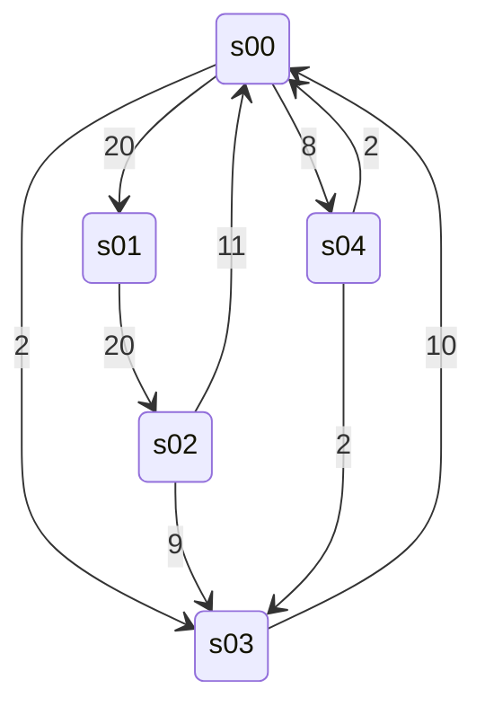

### TwoPlayers (`$1A`)

| From | To | Writer | Rule | Seen |
|---|---|---|---|---|
| `00` | `01` | `$A54E` | SELECT in the title menu: two players | 5 |
| `01` | `00` | `$A54E` | SELECT again: one player | 2 |

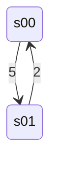

### IntroRequest (`$1C`)

| From | To | Writer | Rule | Seen |
|---|---|---|---|---|
| `00` `02` | `01` | `$A53F` | START / trigger: the new game is being set up (from 2 if START is pressed in the one frame between the board set-up and the intro) | 27 |
| `01` | `02` | `$A4B8` | the board and the status line are set up (`$A4B6`) | 27 |
| `02` | `00` | `$A7CE` | the frame routine starts the READY! intro (`$A7C8`) | 27 |

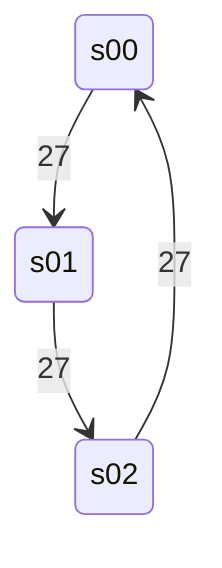

### CountdownActive (`$20`)

| From | To | Writer | Rule | Seen |
|---|---|---|---|---|
| `00` | `01` | `$AB1A` | no lives left for anybody: the game-over countdown starts | 13 |
| `01` | `00` | `$A539` | a new game while the countdown runs | 7 |

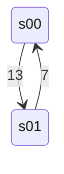

### PlayStarted (`$21`)

| From | To | Writer | Rule | Seen |
|---|---|---|---|---|
| `00` | `01` | `$A7FE` | the start tune has finished (index $40): play begins | 27 |
| `01` | `00` | `$A47B` | the restart at `$A477` (START): $20-$3F cleared | 9 |

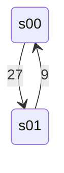

### StartTuneActive (`$22`)

| From | To | Writer | Rule | Seen |
|---|---|---|---|---|
| `00` | `01` | `$A7C8` | the intro: the start tune begins | 27 |
| `01` | `00` | `$A47B` | the restart at `$A477` (START): $20-$3F cleared | 9 |


### TurnSwitchState (`$23`)

| From | To | Writer | Rule | Seen |
|---|---|---|---|---|
| `00` | `01` | `$AACC` `$AADD` | two players: the player on turn is out of lives (or the turn ends) and the other one's maze has to be loaded: player 1's | 9 |
| `00` | `02` | `$AAAF` `$AA9A` | the same for player 2's maze | 14 |
| `01` `02` | `03` | `$AA9A` | the maze is loaded | 23 |
| `03` | `00` | `$AA94` | the load is done: the board of the next turn is set up | 23 |

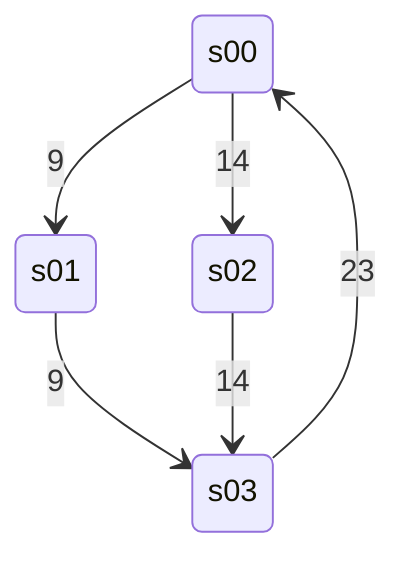

### WaitState (`$24`)

| From | To | Writer | Rule | Seen |
|---|---|---|---|---|
| `00` | `01` | `$AEF1` | the death sequence is over: the turn handling | 79 |
| `00` | `02` | `$AC8C` | `AdvanceLevel`: the READY! wait of the new board | 78 |
| `01` | `02` | `$A818` | the turn handling is done and play goes on: the READY! wait | 66 |
| `01` | `00` | `$AB16` | nobody has a life left: back to the normal frame (the countdown follows) | 13 |
| `02` | `00` | `$A828` | the wait is over ($25 frames): play | 144 |

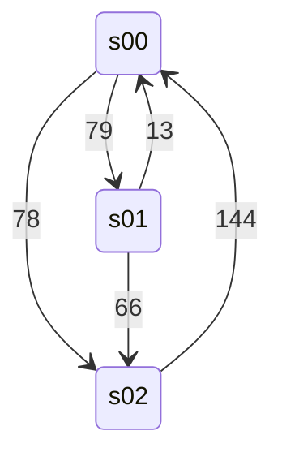

### LevelComplete (`$26`)

| From | To | Writer | Rule | Seen |
|---|---|---|---|---|
| `00` | `01` | `$B39C` | the last dot or pellet is eaten (dots eaten = $0104) | 1 |
| `01` | `00` | `$AC86` | `AdvanceLevel` | 78 |

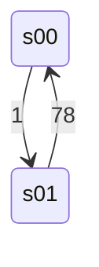

### LevelEndStep (`$27`)

| From | To | Writer | Rule | Seen |
|---|---|---|---|---|
| `00` `01` `02` | old + 1 | `$AC26` | the step is finished (`inc`): 0 -> 1 -> 2 -> 3 | 237 |
| `03` | `04` | `$AC72` | the board is set up: advance | 78 |
| `04` | `00` | `$AC88` | `AdvanceLevel` resets the sequence | 78 |

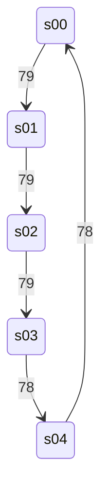

### CurrentPlayer (`$2B`)

| From | To | Writer | Rule | Seen |
|---|---|---|---|---|
| `00` | `01` | `$AA8B` | two players: the turn goes to player 2 | 14 |
| `01` | `00` | `$AA61` | two players: the turn goes to player 1 | 9 |
| `01` | `00` | `$A47B` | the restart at `$A477` (START): $20-$3F cleared | 1 |


### Paused (`$9B`)

| From | To | Writer | Rule | Seen |
|---|---|---|---|---|
| `00` | `01` | `$A4E2` | the space bar (CH = $21, KEYDEL = 0): pause | 3 |
| `01` | `00` | `$A4E2` | the space bar again: resume | 3 |


### BonusVisible (`$9F`)

| From | To | Writer | Rule | Seen |
|---|---|---|---|---|
| `00` | `01` | `$B679` | 80 or 160 dots eaten: the bonus item appears | 24 |
| `01` | `00` | `$B694` `$A964` | its time is over, or it was eaten | 24 |


### BonusScoreShown (`$A1`)

| From | To | Writer | Rule | Seen |
|---|---|---|---|---|
| `00` | `01` | `$A95C` | the bonus item was eaten: its score is shown | 19 |
| `01` | `00` | `$B638` | the score picture's time is over | 19 |

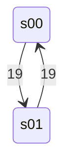

### PacFrozen (`$AA`)

| From | To | Writer | Rule | Seen |
|---|---|---|---|---|
| `00` | `80` | `$A927` | a ghost touched Pac-Man: frozen | 81 |
| `80` | `00` | `$ADB4` | `InitBoard` (a new board or a new life): $80-$FF cleared | 73 |


### EatPause (`$E5`)

| From | To | Writer | Rule | Seen |
|---|---|---|---|---|
| `00` | `01` | `$A8F1` | a frightened ghost was eaten: the pause | 75 |
| `01` | `00` | `$B08B` | the pause is over | 75 |


### DeathAnimActive (`$EA`)

| From | To | Writer | Rule | Seen |
|---|---|---|---|---|
| `00` | `01` | `$AE76` | the death animation begins | 80 |
| `01` | `00` | `$AF51` | its last picture | 79 |

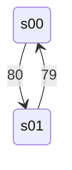

### DeathState (`$ED`)

| From | To | Writer | Rule | Seen |
|---|---|---|---|---|
| `00` | `01` | `$A930` | a ghost touched Pac-Man (not frightened, not eaten): the freeze | 81 |
| `01` | `02` | `$AE57` | the 97 frames of the freeze are over | 80 |
| `02` | `03` | `$AE7E` | the sound starts | 80 |
| `03` | `04` | `$AECD` | four steps up the glide ($AE92) | 1196 |
| `04` | `03` | `$AECD` | the glide comes down to the start of a phase and the next phase begins | 1116 |
| `04` | `05` | `$AEEA` | the last phase is done ($6D) | 79 |
| `05` | `06` | `$AEEA` | the glide ends at $25 | 79 |
| `06` | `00` | `$ADB4` | `InitBoard` (a new board or a new life): $80-$FF cleared | 73 |

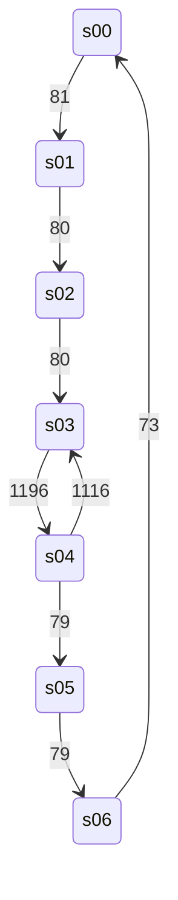

### FrightenPhase (`$FC`)

| From | To | Writer | Rule | Seen |
|---|---|---|---|---|
| `00` | `01` | `$B3EF` | a power pellet: the frightened period | 86 |
| any | `01` | `$B3EF` | another power pellet during the period: it starts again | 115 |
| `01` `02` `03` `04` `05` `06` `07` `08` `09` `0A` `0B` `0C` `0D` `0E` `0F` `10` `11` `12` `13` `14` `15` `16` `17` `18` `19` `1A` `1B` `1C` `1D` `1E` `1F` `20` `21` `22` `23` `24` `25` `26` `27` `28` `29` `2A` `2B` `2C` `2D` `2E` `2F` `30` `31` `32` `33` `34` `35` `36` `37` `38` `39` `3A` `3B` `3C` `3D` `3E` `3F` `40` `41` `42` `43` `44` `45` `46` `47` `48` `49` `4A` `4B` `4C` `4D` `4E` `4F` `50` `51` `52` `53` `54` `55` `56` `57` `58` `59` `5A` `5B` `5C` `5D` `5E` `5F` `60` `61` `62` `63` `64` `65` `66` `67` `68` `69` `6A` `6B` `6C` `6D` `6E` `6F` `70` `71` `72` `73` `74` `75` `76` `77` `78` `79` `7A` `7B` `7C` `7D` `7E` `7F` `80` `81` `82` `83` `84` `85` `86` `87` `88` `89` `8A` `8B` `8C` `8D` `8E` `8F` `90` `91` `92` `93` `94` `95` `96` `97` `98` `99` `9A` `9B` `9C` `9D` `9E` `9F` `A0` `A1` `A2` `A3` `A4` `A5` `A6` `A7` `A8` `A9` `AA` `AB` `AC` `AD` `AE` `AF` `B0` `B1` `B2` `B3` `B4` `B5` `B6` `B7` `B8` `B9` `BA` `BB` `BC` `BD` `BE` `BF` `C0` `C1` `C2` `C3` `C4` `C5` `C6` `C7` `C8` `C9` `CA` `CB` `CC` `CD` `CE` `CF` `D0` `D1` `D2` `D3` `D4` `D5` `D6` `D7` `D8` `D9` `DA` `DB` `DC` `DD` `DE` `DF` `E0` `E1` `E2` `E3` `E4` `E5` `E6` `E7` `E8` `E9` `EA` `EB` `EC` `ED` `EE` `EF` `F0` `F1` `F2` `F3` `F4` `F5` `F6` `F7` `F8` `F9` `FA` `FB` `FC` `FD` `FE` `FF` | old + 1 | `$AFB6` | the flash timer ran out: the next phase (an end phase of 0 is never reached, so on the levels whose table entry is 0 the phase counts on to $FF and wraps) | 1192 |
| `01` `02` `04` `07` `08` `0B` `0F` | `00` | `$AFA7` | the phase equals `FrightenEndPhase[Level]` (the values that table holds: 1, 2, 4, 7, 8, $0B, $0F): the period ends | 77 |
| `01` | `00` | `$ADB4` | `InitBoard` (a new board or a new life): $80-$FF cleared | 8 |
| `0F` | `00` | `$ADB4` | `InitBoard` (a new board or a new life): $80-$FF cleared | 1 |

Seen: 1393 changes; the phase rises by one from 1 to the end phase of the level (up to `53`) and falls to 0 at the end or at the board set-up; a new pellet sets it back to 1.

### GhostState (`$CE-$D1`)

| From | To | Writer | Rule | Seen |
|---|---|---|---|---|
| `00` | `01` | `$A800` | ghost 0 starts its route (`inc`) | 171 |
| `00` `04` `80` `84` | (computed) | `$B756` | `HouseLeaveStep`: 00 -> 01, 04 -> 02, 80 -> 82 (a frightened ghost keeps bit 7) | 507 |
| `01` | `08` | `$B853` | the start route ends (ghosts 1-3): walk to the patrol start | 303 |
| `20` | `08` | `$B853` | the corner is reached: choose a patrol | 397 |
| `08` | `10` | `$B895` | the patrol start is reached: patrol | 379 |
| `02` `08` `10` | `20` | `$B8C7` | the chase or patrol timer ran out: go to the corner | 260 |
| `01` | `02` | `$B8ED` | ghost 0's start route ends: chase | 122 |
| `08` `10` | `02` | `$BAB9` | the ghost sees Pac-Man: chase | 222 |
| `08` `10` `20` | `02` | `$B626` | late in the board (dots eaten >= $E0): forced chase | 2 |
| `00` `01` `02` `04` `08` `10` `20` `80` `81` `82` `84` `88` `90` `A0` | (computed) | `$B40A` | a power pellet: bit 7 is added to every ghost that is not eaten | 359 |
| `80` `81` `82` `84` `88` `90` `A0` | `42` | `$A888` | a frightened ghost is eaten: eyes | 75 |
| `80` `81` `82` `84` `88` `90` `A0` | (computed) | `$AFA0` | the frightened period ends: 80 -> 00 (house), the others -> 20 (corner) | 279 |
| `42` | `44` | `$B6D0` | the eyes reach the door square | 67 |
| `44` | `04` | `$B764` | the eyes are home (floor, or the side position of ghosts 2 and 3): bits 7 and 6 removed | 67 |
| `01` | `00` | `$ADB4` | `InitBoard` (a new board or a new life): $80-$FF cleared | 76 |
| `02` | `00` | `$ADB4` | `InitBoard` (a new board or a new life): $80-$FF cleared | 173 |
| `08` | `00` | `$ADB4` | `InitBoard` (a new board or a new life): $80-$FF cleared | 96 |
| `10` | `00` | `$ADB4` | `InitBoard` (a new board or a new life): $80-$FF cleared | 150 |
| `20` | `00` | `$ADB4` | `InitBoard` (a new board or a new life): $80-$FF cleared | 57 |
| `42` | `00` | `$ADB4` | `InitBoard` (a new board or a new life): $80-$FF cleared | 8 |
| `81` | `00` | `$ADB4` | `InitBoard` (a new board or a new life): $80-$FF cleared | 2 |
| `82` | `00` | `$ADB4` | `InitBoard` (a new board or a new life): $80-$FF cleared | 1 |
| `90` | `00` | `$ADB4` | `InitBoard` (a new board or a new life): $80-$FF cleared | 1 |
| `A0` | `00` | `$ADB4` | `InitBoard` (a new board or a new life): $80-$FF cleared | 1 |

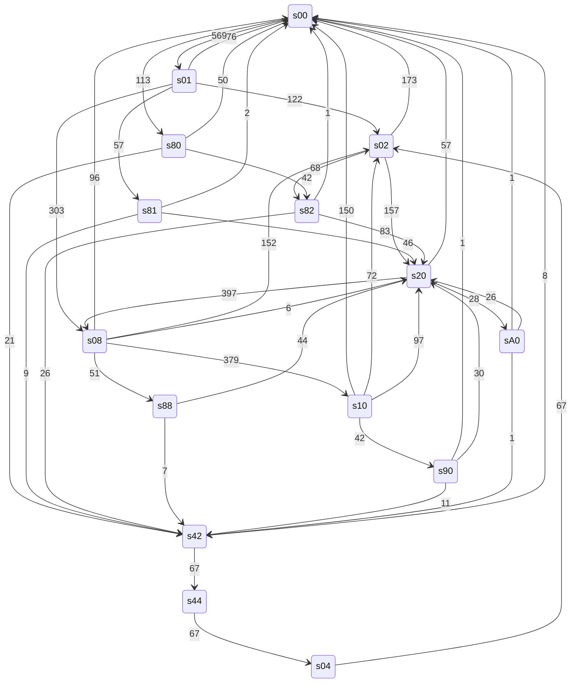

## 5. The exact relation of the code, and what is argued

The rules of section 4 say what a game does. Whether they are **complete and exact for the code** was checked by running the code (`tools/check_state_rules.py`, `analysis/evidence-state-rules-summary.txt`): in the 6502 interpreter, 99057 calls - the whole frame, the vertical-blank handler, the key loop with its restart, `InitBoard`, `Start`, the OV-58 comparisons (every instruction of the ROM, state variables random in each) and 17 routines called directly - with **every state variable forced to every value of its domain** in random contexts, every store to a state variable logged with the writing instruction, the old and the new value.

- Writing instructions examined: **97** (the 62 stores of section 3, the clears of `Start`, the restart and `InitBoard`, and the other indexed stores that reach a state variable).
- **Every pair of every rule was made by the code** in these runs (pairs a rule allows that no call made: **0**). Of the 619 pairs of the rules: **532** were made at the frame level (the guards of the callers inside), **33** only when the routine was called directly but were seen in the sessions, and **54** only by a direct call and not in the sessions: `FrightenPhase` `$AFA7`: 04/08 -> 00; `FrightenPhase` `$AFB6`: 5A -> 5B; 5B -> 5C; 5C -> 5D; 5F -> 60; 60 -> 61; 61 -> 62; 62 -> 63; 65 -> 66; 68 -> 69; 69 -> 6A; 6D -> 6E; 74 -> 75; 7F -> 80; 81 -> 82; 84 -> 85; 88 -> 89; 89 -> 8A; 8B -> 8C; 91 -> 92; 94 -> 95; 9B -> 9C; 9C -> 9D; A3 -> A4; A9 -> AA; B2 -> B3; B5 -> B6; C1 -> C2; C2 -> C3; C8 -> C9; C9 -> CA; CA -> CB; CB -> CC; CF -> D0; D8 -> D9; DC -> DD; EA -> EB; EB -> EC; F2 -> F3; FB -> FC; FC -> FD .... For these the code makes the pair (the instruction is exactly that), and what is not shown is that a game reaches the old value.
- **The code accepts more than the rules say at 12 instruction(s)** (18 pairs at the frame level, 32 more only when the routine is called directly): the instruction does not look at the old value, and the old value that would give the extra pair is kept away by a guard in the caller or by an invariant of the other variables. That no game makes these pairs is **machine-proved in section 5a** (the abstract search over every behaviour of the code: none of the extra pairs occurs, except the race at `$A800`); the arguments in the table below say why, read from the code.

| Variable | Writer | Level | Pairs the code makes with an old value outside the rules | Why a game does not make them |
|---|---|---|---|---|
| `DeathAnimActive` | `$AE76` | the frame | 01 -> 02 | `inc` in the state-2 branch of `DeathSequence`: the branch runs once per death (the same call moves `DeathState` to 3), and the flag is 0 until then because only `InitBoard` (which clears it) separates two deaths. |
| `DeathState` | `$AECD` | a direct call only | 00 -> 04 | `DeathSequence` is called only when `DeathState` is not 0 (`$A82F`); its fall-through for the other values ($AE92) would store 4 from 0. |
| `EatPause` | `$A8F1` | a direct call only | 01 -> 02 | `GhostEaten` runs in the contact test, which the frame reaches only with `EatPause` 0 (a non-zero value branches to `GhostEatenPause` at `$A83C`). |
| `GhostState` | `$A800` | the frame | 01 -> 02; 02 -> 03; 04 -> 05; 08 -> 09; 10 -> 11; 20 -> 21; 42 -> 43; 44 -> 45; 80 -> 81; 81 -> 82; 82 -> 83; 84 -> 85; 88 -> 89; 90 -> 91; A0 -> A1 | `inc GhostState` (ghost 0) at the end of the intro and of every READY! wait: at that moment ghost 0's state is 0 - `InitBoard` / the restart cleared it, and nothing writes it while the wait runs (the frame returns before the ghost loop); the code adds 1 to whatever is there. **Exception found by the abstract search (tools/prove_state_rules.py, slice R, witness in tools/absint_diag.py): a race.** If START is pressed and the vertical-blank handler runs inside the `$A47B` clear loop after `$26` has been cleared but before `$21` is, in the frame in which the last pellet is eaten, LevelComplete is set while PlayStarted ends up 0; the level advance (`$AC8C`) then sets WaitState = 2 with PlayStarted = 0, and ghost 0 is incremented twice (once at `$A7FE`->`$A800`, again at `$A826`->`$A800`): the pairs 01 -> 02 and 80 -> 81 at this site. It needs START and the last pellet in one frame and the interrupt inside a three-instruction window: possible in the code, not shown on a real run. |
| `GhostState` | `$A888` | a direct call only | 00/01/02/04/08/10/20/44 -> 42 | `GhostEaten` is entered only for a ghost with bit 7 set (`bmi` at `$A881`): the old values are the frightened ones. |
| `GhostState` | `$B756` | a direct call only | 01/08/10/20/42/44 -> 02; 88/A0 -> 82 | `HouseLeaveStep` is called for waiting ghosts (`GhostState` AND $7F = 0: $00, $80) and, in `EyesAndHousePerFrame`, for ghosts with bit 2 set and bit 6 clear ($04, $84). |
| `GhostState` | `$B764` | a direct call only | 10/20/80/A0 -> 00; 42/82 -> 02; 84 -> 04; 88 -> 08 | `HouseEnterStep` is called only for ghosts with bits 2 and 6 set (the eyes at the door, $44). |
| `LevelEndStep` | `$AC88` | a direct call only | 01/02/03 -> 00 | `AdvanceLevel` is reached only when `LevelEndStep` is not 0-3 (the dispatch at `$AC18-$AC6B`): the value is 4. |
| `StartTuneActive` | `$A7C8` | the frame | 01 -> 02 | `inc` in the intro branch: `IntroRequest` = 2 is set only after the restart cleared `$20-$3F` (which includes this flag), and the branch clears `IntroRequest`, so it runs once with the flag 0. |
| `WaitState` | `$AB16` | a direct call only | 02 -> 00 | `TurnControl` is called only with `WaitState` = 1 (`$A809`). |
| `WaitState` | `$AC8C` | the frame | 01 -> 02 | `sta WaitState := 2` in `AdvanceLevel`, after the level-end steps: the last dot is eaten in a play frame (`WaitState` 0), and a frame with `WaitState` 1 or 2 does not run the dot eating, so the old value is 0. |
| `WaitState` | `$AEF1` | a direct call only | 01 -> 02; 02 -> 03 | `inc WaitState` at the end of the death sequence: the death sequence runs only in the play frame, which needs `WaitState` = 0 (`$A805`). |

What this does not prove (see section 5a for the assumptions of the machine proof): that the pairs just listed as not seen are reached by a game (the phases above `$53` need a frightened period of more than 33 s on a level whose end phase is 0, the end phases 4 and 8 a level that has them); and that the domain of each variable is the only set of values it can ever hold (it is the closure of the rules plus the pairs argued away above: a store from an old value outside a domain was not examined).

## 5a. The proof by abstract search (every behaviour of the code, not only the runs)

The sessions and the forced runs (section 5) only show what happened in the contexts that were run. To close the question "can any other behaviour exist", `tools/absint6502.py` runs the ROM code **abstractly**: the key loop from `Start` on, with the vertical-blank handler entering between any two instructions of the main loop (never two within 100 instructions; the real distance is thousands), every branch on something not followed taken **both ways**, and every memory byte that is not followed an unknown value. What it finds is therefore a superset of everything the code can do, whatever the joystick, the timers, the random numbers and the other variables are. `tools/prove_state_rules.py` runs it for sets of followed variables (**slices**) and compares every store to a followed variable (writer, old value, new value) with the rules of section 4 (`analysis/evidence-state-proof-summary.txt`, `tests/test_absint.py`, `tests/test_states.py`).

| Slice | Followed (besides `CurrentPlayer`) | Search states | Combinations of values | Stores | Not allowed by a rule | Race only | Imprecision of the slice |
|---|---|---|---|---|---|---|---|
| R | $19 $1C $21 $22 $24 $ED $EA $20 $26 $27 $AA $E5 | 1189844 | 392 | 81 | **0** | 0 | 0 |
| TP | $1A | 269124 | 4 | 8 | **0** | 0 | 0 |
| TU | $23 | 401017 | 7 | 16 | **0** | 0 | 0 |
| PA | $9B | 175870 | 4 | 10 | **0** | 0 | 0 |
| BV | $9F | 259682 | 4 | 12 | **0** | 0 | 0 |
| BS | $A1 | 259718 | 4 | 11 | **0** | 0 | 0 |
| F | $FC | 4309135 | 512 | 780 | **0** | 0 | 0 |
| G0 | $19 $1C $21 $22 $24 $ED $26 $27 $E5 $CE | 29829347 | 16788 | 626 | **0** | 255 | 1 |
| G1 | $19 $1C $21 $22 $24 $ED $EA $20 $26 $27 $AA $E5 $CF | 8938108 | 4652 | 143 | **0** | 0 | 0 |
| G2 | $19 $1C $21 $22 $24 $ED $EA $20 $26 $27 $AA $E5 $D0 | 8897203 | 4652 | 143 | **0** | 0 | 0 |
| G3 | $19 $1C $21 $22 $24 $ED $EA $20 $26 $27 $AA $E5 $D1 | 8856298 | 4652 | 143 | **0** | 0 | 0 |

Totals over 11 slices: stores that no rule allows: 0; stores of an unknown value: 0; race-only stores: 255. All slices finished.

- **Proved**: no store to a state variable that a rule does not allow, apart from the race below. This closes 11 of the 12 instructions that accept more than the rules say: the pairs they could make with an old value outside the rules **never occur** in the code's behaviour (the arguments of the table above are right); the twelfth, `$A800`, is the race below, and the 'From' column of the rules is not only what the code allows but - up to the over-approximation of the search - what it can do; `04 -> 84` at `$B40A` is among the stores the search reaches in the ghost slices, so the code cannot be shown to exclude it, though no session saw it.
- **The race at `$A800`** (`tools/analyze_states.py` `RACE_ONLY`): ghost 0 can be incremented a second time (01 -> 02, 80 -> 81, and by repeating the race every n -> n+1 before `InitBoard` clears it). It needs START to be pressed and the vertical-blank handler to run inside the restart's clear loop (`$A47B`, between the clears of `$26` and `$21`) in the frame in which the last pellet is eaten: a path of the abstract search, which does not follow the dot counter; **it cannot happen in a game (OV-60, C-66)**: the same clear loop zeroes `DotsEaten` (`$34-$37`) at X = `$14-$17`, before it clears `$26` at X = 6, so in the window the counter is 0 and the frame cannot reach the end value `$0104` (LevelComplete is set only at `$B39C`); run in the interpreter with the interrupt forced at every instruction of the restart in states one dot from the end of the board: 0 races (`tools/check_ov60_race.py`, `analysis/evidence-ov60-race-summary.txt`). So the claim 'ghost 0 is always 0 at `$A800`' stays true in every game.
- **Imprecision of a slice** is a store that a slice with fewer variables allows but the flow slice R (which follows every flow variable together) rules out; the ghost-0 slice leaves out `DeathAnimActive`, `PacFrozen` and `CountdownActive` because the full set did not finish (4 h, 60 million states), and so allows `WaitState` 00 -> 01 at `$A818` (`TurnControl` clears `WaitState` and sets `CountdownActive` in the same call, so `$A816` returns before `$A818`).
- **The assumptions of the proof**: the vertical-blank handler and the display-list interrupt of the OS write no state variable (the OS code is not in the ROM); indirect stores `(zp),y` never aim at a state variable (docs/29 lists their pointers); the table area `$0600-$07FF` is never written after the expansion (`tests/test_absint.py`); the register sets that skipped routines preserve (docs/23, checked live over 5.5 million calls); the key loop's polling lets the handler enter at any pass. The abstract interpreter is tested against the concrete one (`tests/test_absint.py`: 160 handler runs and 120 key-loop passes from random memory, every concrete store and end value inside the abstract result).

## 6. Rules not seen, and the aids

Rules written from the code: 68; seen in the sessions: 68; **not seen: 0**.


Transitions that no rule allows: **0**.

Rules that needed a special session (the first sessions did not reach them): `GameState` 1/2 -> 3 by a console key at the copyright screen (`tools/altirra_copyright_key.cmd`), `TwoPlayers` 1 -> 0 (the second SELECT of `tools/altirra_inputs.cmd`), `GhostState` 08/10/20 -> 02 by `ForceChase` (`tools/altirra_forcechase.cmd`, test aid: the dot count is set to $DF once).

The writes that are not transitions of the game - the OS clearing its RAM at the cold start and a harness's own test aid (the level sweeps hold `LevelComplete`; two harnesses set `TwoPlayers`) - are counted in the summary and left out of the transitions.

## 7. The summary of the sessions

```
State audit (tools/run_state_audit.ps1, tools/analyze_states.py): 20 harness logs (catch, copyright_key, death, door_up, extra_life, forcechase, frightened_cases, fullgame, fullgame2, gameover, house_frightened, inputs, inputs1, itemshots, levels, p2win, pause, player1_survives, player2_lives, pregame), 243153 writes to 20 state variables printed

variable (address) | changes | transitions old -> new (count)
GameState ($19): 84 changes, 70 rewrites of the same value, 9 distinct transitions
    00 -> 01       20   by $A3A1
    00 -> 03        2   by $A552
    00 -> 04        8   by $A552
    01 -> 02       20   by $A70A
    02 -> 00       11   by $A53B
    02 -> 03        9   by $A552 $A70A
    03 -> 00       10   by $A53B
    04 -> 00        2   by $A53B
    04 -> 03        2   by $A552
TwoPlayers ($1A): 7 changes, 0 rewrites of the same value, 2 distinct transitions
    00 -> 01        5   by $A54E
    01 -> 00        2   by $A54E
IntroRequest ($1C): 81 changes, 0 rewrites of the same value, 3 distinct transitions
    00 -> 01       27   by $A53F
    01 -> 02       27   by $A4B8
    02 -> 00       27   by $A7CE
CountdownActive ($20): 20 changes, 67 rewrites of the same value, 2 distinct transitions
    00 -> 01       13   by $AB1A
    01 -> 00        7   by $A539
PlayStarted ($21): 36 changes, 65 rewrites of the same value, 2 distinct transitions
    00 -> 01       27   by $A7FE
    01 -> 00        9   by $A47B
StartTuneActive ($22): 36 changes, 65 rewrites of the same value, 2 distinct transitions
    00 -> 01       27   by $A7C8
    01 -> 00        9   by $A47B
TurnSwitchState ($23): 69 changes, 47 rewrites of the same value, 5 distinct transitions
    00 -> 01        9   by $AACC $AADD
    00 -> 02       14   by $AA9A $AAAF
    01 -> 03        9   by $AA9A
    02 -> 03       14   by $AA9A
    03 -> 00       23   by $AA94
WaitState ($24): 380 changes, 192 rewrites of the same value, 5 distinct transitions
    00 -> 01       79   by $AEF1
    00 -> 02       78   by $AC8C
    01 -> 00       13   by $AB16
    01 -> 02       66   by $A818
    02 -> 00      144   by $A828
LevelComplete ($26): 79 changes, 47 rewrites of the same value, 2 distinct transitions
    00 -> 01        1   by $B39C
    01 -> 00       78   by $AC86
LevelEndStep ($27): 393 changes, 362 rewrites of the same value, 5 distinct transitions
    00 -> 01       79   by $AC26
    01 -> 02       79   by $AC26
    02 -> 03       79   by $AC26
    03 -> 04       78   by $AC72
    04 -> 00       78   by $AC88
CurrentPlayer ($2B): 24 changes, 46 rewrites of the same value, 2 distinct transitions
    00 -> 01       14   by $AA8B
    01 -> 00       10   by $A47B $AA61
Paused ($9B): 6 changes, 171 rewrites of the same value, 2 distinct transitions
    00 -> 01        3   by $A4E2
    01 -> 00        3   by $A4E2
BonusVisible ($9F): 48 changes, 171 rewrites of the same value, 2 distinct transitions
    00 -> 01       24   by $B679
    01 -> 00       24   by $A964 $B694
BonusScoreShown ($A1): 38 changes, 171 rewrites of the same value, 2 distinct transitions
    00 -> 01       19   by $A95C
    01 -> 00       19   by $B638
PacFrozen ($AA): 154 changes, 98 rewrites of the same value, 2 distinct transitions
    00 -> 80       81   by $A927
    80 -> 00       73   by $ADB4
EatPause ($E5): 150 changes, 247 rewrites of the same value, 2 distinct transitions
    00 -> 01       75   by $A8F1
    01 -> 00       75   by $B08B
DeathAnimActive ($EA): 159 changes, 252 rewrites of the same value, 2 distinct transitions
    00 -> 01       80   by $AE76
    01 -> 00       79   by $AF51
DeathState ($ED): 2784 changes, 337 rewrites of the same value, 8 distinct transitions
    00 -> 01       81   by $A930
    01 -> 02       80   by $AE57
    02 -> 03       80   by $AE7E
    03 -> 04     1196   by $AECD
    04 -> 03     1116   by $AECD
    04 -> 05       79   by $AEEA
    05 -> 06       79   by $AEEA
    06 -> 00       73   by $ADB4
FrightenPhase ($FC): 1393 changes, 1895 rewrites of the same value, 96 distinct transitions
    00 -> 01       86   by $B3EF
    01 -> 00       34   by $ADB4 $AFA7
    01 -> 02       81   by $AFB6
    02 -> 01       18   by $B3EF
    02 -> 03       63   by $AFB6
    03 -> 01        1   by $B3EF
    03 -> 04       62   by $AFB6
    04 -> 05       62   by $AFB6
    05 -> 06       62   by $AFB6
    06 -> 07       62   by $AFB6
    07 -> 00       11   by $AFA7
    07 -> 08       51   by $AFB6
    08 -> 09       51   by $AFB6
    09 -> 0A       51   by $AFB6
    0A -> 0B       51   by $AFB6
    0B -> 00       40   by $AFA7
    0B -> 0C       11   by $AFB6
    0C -> 0D       11   by $AFB6
    0D -> 0E       11   by $AFB6
    0E -> 0F       11   by $AFB6
    0F -> 00        1   by $ADB4
    0F -> 10       10   by $AFB6
    10 -> 11       10   by $AFB6
    11 -> 12       10   by $AFB6
    12 -> 13       10   by $AFB6
    13 -> 14       10   by $AFB6
    14 -> 15       10   by $AFB6
    15 -> 16       10   by $AFB6
    16 -> 17       10   by $AFB6
    17 -> 18       10   by $AFB6
    18 -> 19       10   by $AFB6
    19 -> 1A       10   by $AFB6
    1A -> 1B       10   by $AFB6
    1B -> 1C       10   by $AFB6
    1C -> 1D       10   by $AFB6
    1D -> 1E       10   by $AFB6
    1E -> 1F       10   by $AFB6
    1F -> 20       10   by $AFB6
    20 -> 21       10   by $AFB6
    21 -> 22       10   by $AFB6
    22 -> 23       10   by $AFB6
    23 -> 01        1   by $B3EF
    23 -> 24        9   by $AFB6
    24 -> 25        9   by $AFB6
    25 -> 26        9   by $AFB6
    26 -> 27        9   by $AFB6
    27 -> 28        9   by $AFB6
    28 -> 29        9   by $AFB6
    29 -> 2A        9   by $AFB6
    2A -> 2B        9   by $AFB6
    2B -> 2C        9   by $AFB6
    2C -> 2D        9   by $AFB6
    2D -> 01        1   by $B3EF
    2D -> 2E        8   by $AFB6
    2E -> 2F        8   by $AFB6
    2F -> 30        8   by $AFB6
    30 -> 31        8   by $AFB6
    31 -> 32        8   by $AFB6
    32 -> 33        8   by $AFB6
    33 -> 34        8   by $AFB6
    34 -> 35        8   by $AFB6
    35 -> 36        8   by $AFB6
    36 -> 37        8   by $AFB6
    37 -> 38        8   by $AFB6
    38 -> 01        1   by $B3EF
    38 -> 39        7   by $AFB6
    39 -> 3A        7   by $AFB6
    3A -> 3B        7   by $AFB6
    3B -> 3C        7   by $AFB6
    3C -> 3D        7   by $AFB6
    3D -> 3E        7   by $AFB6
    3E -> 3F        7   by $AFB6
    3F -> 40        7   by $AFB6
    40 -> 41        7   by $AFB6
    41 -> 42        7   by $AFB6
    42 -> 43        7   by $AFB6
    43 -> 44        7   by $AFB6
    44 -> 45        7   by $AFB6
    45 -> 46        7   by $AFB6
    46 -> 47        7   by $AFB6
    47 -> 48        7   by $AFB6
    48 -> 49        7   by $AFB6
    49 -> 01        1   by $B3EF
    49 -> 4A        6   by $AFB6
    4A -> 4B        6   by $AFB6
    4B -> 4C        6   by $AFB6
    4C -> 4D        6   by $AFB6
    4D -> 4E        6   by $AFB6
    4E -> 4F        6   by $AFB6
    4F -> 50        6   by $AFB6
    50 -> 01        1   by $B3EF
    50 -> 51        5   by $AFB6
    51 -> 52        5   by $AFB6
    52 -> 01        2   by $B3EF
    52 -> 53        3   by $AFB6
    53 -> 01        3   by $B3EF
GhostState ($CE-$D1): 3775 changes, 95077 rewrites of the same value, 42 distinct transitions
    00 -> 01      569   by $A800 $B756
    00 -> 80      113   by $B40A
    01 -> 00       76   by $ADB4
    01 -> 02      122   by $B8ED
    01 -> 08      303   by $B853
    01 -> 81       57   by $B40A
    02 -> 00      173   by $ADB4
    02 -> 20      157   by $B8C7
    02 -> 82       68   by $B40A
    04 -> 02       67   by $B756
    08 -> 00       96   by $ADB4
    08 -> 02      152   by $B626 $BAB9
    08 -> 10      379   by $B895
    08 -> 20        6   by $B8C7
    08 -> 88       51   by $B40A
    10 -> 00      150   by $ADB4
    10 -> 02       72   by $BAB9
    10 -> 20       97   by $B8C7
    10 -> 90       42   by $B40A
    20 -> 00       57   by $ADB4
    20 -> 08      397   by $B853
    20 -> A0       28   by $B40A
    42 -> 00        8   by $ADB4
    42 -> 44       67   by $B6D0
    44 -> 04       67   by $B764
    80 -> 00       50   by $AFA0
    80 -> 42       21   by $A888
    80 -> 82       42   by $B756
    81 -> 00        2   by $ADB4
    81 -> 20       46   by $AFA0
    81 -> 42        9   by $A888
    82 -> 00        1   by $ADB4
    82 -> 20       83   by $AFA0
    82 -> 42       26   by $A888
    88 -> 20       44   by $AFA0
    88 -> 42        7   by $A888
    90 -> 00        1   by $ADB4
    90 -> 20       30   by $AFA0
    90 -> 42       11   by $A888
    A0 -> 00        1   by $ADB4
    A0 -> 20       26   by $AFA0
    A0 -> 42        1   by $A888

writes that are not transitions of the game (the game's next write starts from the value they left):
  the OS at the cold start (pc >= $C000): 760 writes in 20 sessions (the OS clears its RAM before the cartridge starts)
  LevelComplete by the harness's own test aid: door_up 26161, extra_life 28695, frightened_cases 26172, house_frightened 26160, levels 25647
  TwoPlayers by the harness's own test aid: player1_survives 1, player2_lives 1

transitions seen that no rule of the code allows: 0

rules of the code: 68, seen in the sessions: 68, not seen: 0

```

