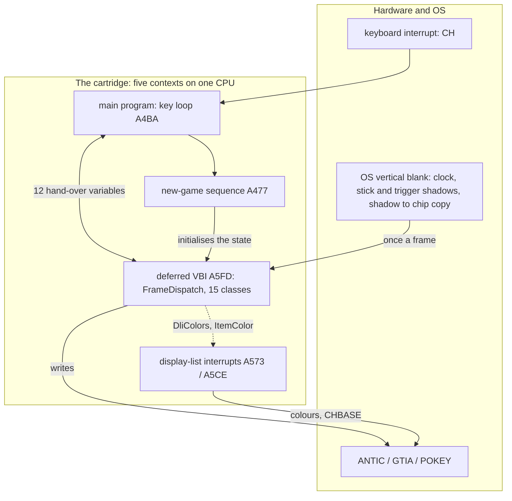
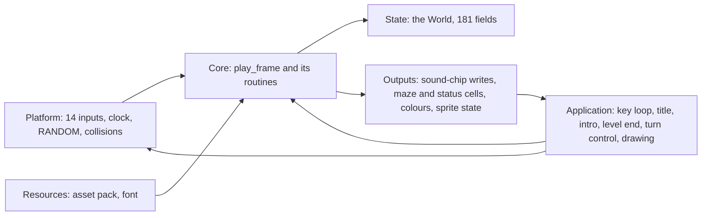

# 48 - Architecture (checklist stage 4: stages 61-68)

GENERATED by `python -I tools/analyze_architecture.py --doc docs/48-architecture.md` from the routines of the ROM (`23`, `24`), the port-form modules and the curated text of `tools/analyze_architecture.py`; tests: `tests/test_architecture.py`. This chapter **puts together** what stages 61-70 measured (`37`, `38`, `41`-`47`): how the original is built, how one frame runs, which part of it exists in port form and checked, and what a port is made of. The owner decisions of stages 71-74 (taken 2026-11-18, `49`) are section 9; sections 5-7 are written to them.

## 1. The result

- **The game is one frame function and a poll.** Everything the game does runs in **one deferred interrupt per video frame** (`FrameDispatch`, 15 frame classes, a play frame 37 scan lines of 262 at the median); the main program is a **key loop** that never returns and does no game logic; five display-list interrupts per frame only change colours and character-set pages (`38`, `46`).
- **The boundary is closed and small**: 14 inputs in, the chips out, two OS calls, nothing else (`45`); the inside shares a listed set of variables between its five contexts (`46`).
- **The core is already a port**: of the 81 routines of the ROM, **49 are in port form** (46 port functions, checked against the ROM: 0 differences) and **1 more partly**; the rest are the renderer, the platform layer, the asset pack and the application glue (section 4).
- **What is missing is specified, not just absent**: the title, intro, level-end, turn-control and countdown frame logic, the key loop and the drawing are the application layer (section 5); their effects on the state are measured (`43`), their timing is measured (`38`), their frames are the oracles.
- **A layered architecture follows from the evidence** (section 2): *Platform* (inputs, outputs, clock) - *Core* (`play_frame` over the World) - *State* (the World) - *Resources* (the asset pack) - *Application* (states and drawing). Section 6 proposes how `src/c` mirrors it; section 7 says how it is tested.

## 2. The program in one picture



The same program as a port is made of five layers (section 5). The thin line between them is the `Platform` of `45`:



## 3. How one frame runs

**Timeline of one NTSC frame** (262 scan lines; `35`, `38`):

1. **Vertical blank (line 248 on)**: the OS reads the joystick, triggers and clock into the shadows, copies the colour, DMA and display-list shadows to the chips, counts the attract mode, then jumps through `VVBLKD` to the game's handler. The handler is entered at line 256 in every frame (`38`).
2. **The handler** `VbiHandler` `$A5FD`: clears the band counter, steps the key-debounce counter, calls `FrameDispatch`, then (unless a ghost-eaten pause is on) the tunnel clip, then returns through `XITVBV`. A **play frame takes a median of 37 lines (maximum 103)**; the heaviest frame of all, a level end, 234 lines, which leaves 28 lines to the next vertical blank (PAL: 122 of 312 lines, OV-62).
3. **Five display-list interrupts** (game screen: lines 39, 47, 207, 215, 231; title: 47, 87, 127, 143, 215): each changes colours or `CHBASE` for the band that follows (`35`). They only read the four band colours, `ItemColor` and the attract values (`46`).
4. **The rest of the frame** belongs to the key loop: the colour refresh, the keys, the console, the pause, the game-over countdown (`38`).

**`FrameDispatch` decides in this order** and the first class that applies is the frame (`38`, section 4; frames seen in the 7 measured sessions):

| # | Frame class | Frames seen | In the port |
|---|---|---|---|
| 1 | copyright setup | 7 | not in port form |
| 2 | copyright wait | 745 | not in port form |
| 3 | title menu | 13,650 | not in port form |
| 4 | title after game | 9,232 | not in port form |
| 5 | paused | 300 | trivial: `clear_pokey` |
| 6 | board start | 17 | not in port form |
| 7 | game-over countdown | 13,444 | not in port form |
| 8 | level end | 7,480 | not in port form |
| 9 | start idle | 59 | trivial |
| 10 | start tune | 4,411 | partly: `core_sound.start_tune_step` |
| 11 | turn control | 822 | not in port form |
| 12 | ready wait | 6,630 | not in port form |
| 13 | death | 25,488 | **port form**: `death_sequence`, `death_animation` |
| 14 | eaten pause | 1,023 | **port form**: `ghost_eaten_pause` |
| 15 | play | 136,679 | **port form**: `play_frame` |

Classes 13-15 (death, eaten pause, play) are **163,190 of the 219,987 measured frames (74%)**: the frames in which the game is played; the rest is the title, the countdown, the intro and the level end. They are the ones `play_frame` covers and `44` checks.

**The play frame, in the order of the code** (from the call sites of `FrameDispatch` between `$A82C` and `$AA26`; the port function is what `core_play.play_frame` calls, in the same order: `tests/test_architecture.py` compares the two):

| Call site | ROM routine | Port function | Status |
|---|---|---|---|
| `$A82C` | BlinkPowerPellets | `core_play.blink_power_pellets` | port form |
| `$A833` | DeathSequence | `core_sound.death_sequence` | port form |
| `$A839` | EyesAndHousePerFrame | `core_frame.eyes_and_house_per_frame` | port form |
| `$A843` | BonusItemUpdate | `core_play.bonus_item_update` | port form |
| `$A846` | PowerPelletCheck | `core_score.power_pellet_check` | port form |
| `$A929` | ClearPokeyRegisters | `core_sound.clear_pokey` | port form |
| `$A989` | AddToScore | `core_score.add_to_score` | port form |
| `$A994` | FrightenedTick | `core_frame.frightened_tick` | port form |
| `$A99B` | DotSoundSweep | `core_sound.dot_sound_sweep` | port form |
| `$A99E` | BonusSound | `core_sound.bonus_sound` | port form |
| `$A9A1` | ToggleLegPhase | `core_sound.toggle_leg_phase` | port form |
| `$A9B2` | MoveDelayTick | `core_play.move_delay_tick` | port form |
| `$A9BB` | MovePacMan | `core_pacman.move_pacman` | port form |
| `$A9C2` | EatDotAtPacMan | `core_score.eat_dot` | port form |
| `$A9CB` | HouseWaitingTick | `core_ghost.house_waiting_tick` | port form |
| `$A9CE` | ChaseTimerSirenSight | `core_ghost.chase_timer_siren_sight` | port form |
| `$AA08` | MoveDelayTick (again) | `core_play.move_delay_tick` | port form |
| `$AA1F` | MoveDelayTick (again) | `core_play.move_delay_tick` | port form |
| `$AA26` | GhostBehaviour | `core_ghost.ghost_behaviour` | port form |

The branches between the calls (death, the eaten pause, the contact with a ghost, the bonus pick-up, Pac-Man's pacing and the corner that freezes the ghosts, each ghost's move) are in `play_frame` and are described in `44` (section 3) and `24` (section 4.3). A ghost-eaten pause and a death leave the frame early (`$A833`, `$A840`).

## 4. Subsystems and what is in port form

Each of the 81 routines is classified in `tools/analyze_architecture.py`; **49 in port form, 1 partly, 19 not** (7 platform / renderer, 5 asset pack):

| Subsystem | Routines | In port form | Partly | Not in port form | Platform / asset |
|---|---|---|---|---|---|
| BOOT | 2 | 0 | 0 | 1 | 1 |
| INT | 7 | 2 | 0 | 0 | 5 |
| DECOMP | 5 | 0 | 0 | 0 | 5 |
| FRAME | 1 | 0 | 1 | 0 | 0 |
| TITLE | 6 | 0 | 0 | 6 | 0 |
| BOARD | 20 | 7 | 0 | 12 | 1 |
| DEATH | 2 | 2 | 0 | 0 | 0 |
| FRIGHT | 4 | 4 | 0 | 0 | 0 |
| SOUND | 5 | 5 | 0 | 0 | 0 |
| PAC | 4 | 4 | 0 | 0 | 0 |
| SCORE | 1 | 1 | 0 | 0 | 0 |
| MAZE | 3 | 3 | 0 | 0 | 0 |
| GHOST | 14 | 14 | 0 | 0 | 0 |
| HOUSE | 7 | 7 | 0 | 0 | 0 |

What the routines **not** in port form are, and where each one goes:

| Routine | Status | What it becomes |
|---|---|---|
| Start | not in port form | the start-up expansion is the asset pack (`47`); the key loop and the new-game sequence are the application glue over the `Platform` (`45`, `46`) |
| Init | platform / renderer | a bare `RTS`: nothing |
| VbiHandler | platform / renderer | the once-per-frame call |
| DliHandler1 | platform / renderer | five colour / character-set changes per game frame at fixed lines (`35`): the renderer's band table |
| DliHandler2 | platform / renderer | the same on the title screen |
| InitDisplay2 | platform / renderer | the title screen's display set-up |
| SetDisplayList | platform / renderer | display-list and interrupt vector set-up |
| ExpandData | asset pack | done once, at build time: the pack's pictures and tables equal the RAM `Start` builds (`47`, check 4) |
| ReadSrcByte | asset pack | part of the decompression |
| AdvanceSrcPtr | asset pack | part of the decompression |
| WriteDstByte | asset pack | part of the decompression |
| ReadSrcHighNibble | asset pack | part of the decompression |
| FrameDispatch | partly | the running-game frame (class 15, with death and the eaten pause: classes 13, 14) is `play_frame`; the title, copyright, intro, countdown, level-end and turn-control classes are not in port form (`44`, section 7) |
| TitleClearScores1P | not in port form | status-row drawing |
| TitleClearScores2P | not in port form | status-row drawing |
| CompareHighScore | not in port form | the high-score rule (a status-row compare) |
| BlinkPlayerLabel | not in port form | status-row drawing: the 1UP / 2UP blink |
| DrawLabel1UP | not in port form | status-row drawing |
| DrawLabel2UP | not in port form | status-row drawing |
| TurnControl | not in port form | the two-player turn switch: effects measured in `43` (resets / keeps / computes) |
| AdvanceLevel | not in port form | the level-end step to the next board: effects measured in `43` |
| DrawLevelIndicator | not in port form | drawing the fruit row; its content is `core_ref.bonus_glyph` |
| DrawReadyScreen | not in port form | drawing READY! |
| ClearReadyText | not in port form | drawing |
| InitBoard | not in port form | state initialisation: `InitBoard` writes 114 constants (`43`, section 4) |
| NewGameInit | not in port form | state initialisation (`43`) |
| NewBoardInit | not in port form | state initialisation (`43`) |
| ClearPlayerCounters | not in port form | state initialisation (`43`) |
| LoadShadowColors | platform / renderer | colour set-up |
| Copy0800To0C00 | not in port form | new board: the maze of the asset pack into the working maze |
| Copy0C00To1000 | not in port form | two-player turn switch: save player 1's maze |
| Copy0C00To1400 | not in port form | two-player turn switch: save player 2's maze |

## 5. The layers of a port

| Layer | Where | What | Verified by |
|---|---|---|---|
| Platform | `tools/platform_iface.py` | the 14 declared inputs in, the frame's outputs out (`45`) | `tests/test_iface.py`; closure over 3,000 states (`45`) |
| Core | `tools/core_*.py` | `play_frame`, `vbi_play_frame` and the functions they compose: 18 pure functions, the World-form routines and the drawing (`44`) | 243,000 calls + 8,000 frames + 500 runs of 20 frames against the ROM, the drawing included: 0 differences (`44`) |
| State | `tools/core_world.py` | the `World`: 181 fields (the zero-page variables by name, the maze, the status rows, the shadows, the player-missile pages and positions, the inputs, the sound-chip writes) (`43`, `44`) | round trip with the memory image; a misspelt name is an error (`tests/test_core_world.py`) |
| Resources | `tools/asset_pack.py` | pictures, maze, text, tunes, tables, font in one schema (`47`) | equal to the RAM `Start` builds; all 2,246 non-code bytes (`47`) |
| Application | (to be written) | the key loop, the title / intro / level-end / turn-control / countdown states, the new-game sequence, the drawing | the oracles of `34`, `38`, `43` (measured sessions) |

- **Platform**: `Platform.stick / trigger / console / key / key_delay / clock / attract / random / collisions` and `run_frame(w, platform)`. The collision registers are the one input the port must *compute*: the geometry is built and checked against the hardware (OV-68 closed, `50`); it takes the scene the drawing leaves, which is in port form (OV-69 closed, `44`).
- **Core**: functions of the World, no I/O, no globals; a RANDOM iterator is the only source of randomness; the sound chip is a list of `(register, value)` writes. A function is a unit of test: `core_play.play_frame` is the whole frame.
- **State**: the 144 state bytes of the 256 (`43`), the maze (920 cells), the status rows, the colour shadows (**one byte of state lives there**: `PCOLR0-3` = `$DC` marks the eaten ghost, `45`). The per-player variables are the `Player[2]` structure (`30`, `43`).
- **Resources**: the asset pack (`47`): pictures, maze, text, tunes, tables, the font; schema 2.
- **Application**: what turns inputs and states into frames outside the running game. Its inputs and variables are specified (`46`: the 12 hand-over variables; `43`: what each event resets, keeps and computes); its drawing is the renderer's (`42`); its timing is measured (`38`).

## 6. The layout of `src/c` (decided, stage 74)

*Decided by the owner on 2026-11-18 (`49`): this layout, C99, clang and gcc, CMake.* One C module per Python module of the core, named alike, so that a C function and its Python twin can be compared one to one; the skeleton with its `CMakeLists.txt` and `tests/toolchain_check.c` is in `src/c`:

```
src/c/
  platform/   hal.h, hal_*.c         Platform: inputs, clock, RANDOM, collisions; audio and video sinks
  core/       world.h                the World: 181 fields generated from docs/25 (tools/make_core_world.py writes the Python one)
              tables.h / .c          the layout of the constant tables (tools/make_c_tables.py); the bytes are installed at start-up from the owner's ROM
              ref.c                  the 18 pure functions (core_ref.py)
              ghost.c  house.c  pacman.c  score.c  sound.c  frame.c  play.c
  assets/     pack loader (schema 2) and the pack builder
  app/        key loop, title, intro, level end, turn control, countdown, new game (to be written)
  render/     sprites, bands, colours, mode 4 / 6 drawing (to be written)
  tests/      differential tests against vectors written by the Python core and by the ROM
```

## 7. How a port is tested (the oracle chain)

```
ROM  --(concrete 6502 interpreter)-->  Python core  --(vectors)-->  C core
  \                                         |                          |
   \--(Altirra sessions: 34, 38, 43)-->      +-- frame-level traces ----+
```

1. **Unit level**: the 18 pure functions and each World routine, from random states: the Python core against the ROM is already 0 differences (`44`); the C core is compared with the Python core on the **same** state vectors (written by `tools/check_*.py`'s generators), which is exact and fast.
2. **Frame level**: `play_frame` over 8,000 random frames and 500 runs of 20 frames (`44`); the C core is compared on whole frames (zero page, maze, status rows, shadows, ordered sound-chip writes, RANDOM count).
3. **Session level**: the traces of the real game (`34`, `38`) - 20 sessions, 15 frame classes, the frame by frame story of a game (`38`, section 6) - are the oracle for the application layer.
4. **Platform level**: `ScriptedPlatform` (`45`): determinism, inputs through the platform only.

## 8. Not yet specified or checked (the gaps)

- **The application layer** is specified by measurement, not written: frame classes 1-4, 6-9, 11, 12 (`38`), the key loop (`40`), the new game (`43`), drawing (`42`).
- **The drawing of the maze, the status rows and the text** is not in port form (the cells the game writes are in the World; their pictures are the renderer's). **OV-69 is closed**: the sprite drawing (the player-missile pages, positions and picture buffers) and the tunnel clip are in port form and equal the ROM's (`44`), and the collision geometry turns that scene into the registers (`50`).
- **OV-02: no C code exists**, so no equivalence claim has been tested against a port; the oracle chain of section 7 is what the port will be tested against.
- **No race-freedom proof** for the key loop against the frame (`46`): a port that runs them in turn needs none.
- **PAL**: the data is the same, the frame is 312 lines; the colour hues differ and were not checked (`47`).
- **The font's provenance** (its glyphs equal the Atari OS font bit for bit) was **accepted as it is by the owner on 2026-11-18** (`49`, `47` section 6); the risk is known and recorded, not removed.

## 9. The owner decisions of stages 71-74 (taken 2026-11-18)

| Stage | Decision | Chosen | What follows |
|---|---|---|---|
| 71 | Faithful port or redesign | **faithful frame-by-frame port with a thin hardware layer** | one `play_frame` over the same state; the Python core and the measured sessions stay the oracle (`44`, `38`); the application layer is written to the measured behaviour of `38`, `40`, `43`, `46` |
| 72 | Equivalence level | **the whole state each frame** | zero page, maze, status rows, colour shadows, the ordered sound-chip writes and the RANDOM count equal the original's every frame: exactly what `44` compares |
| 73 | Language and toolchain | **C99, clang and gcc, CMake (Ninja)** | `-std=c99`, extensions off, `-Wall -Wextra -Wpedantic -Wconversion -Werror`; MSVC is not installed and not a target now; `tests/toolchain_check.c` builds and passes with clang 19.1 and gcc 14.2 |
| 74 | Layout of `src/c` | **the layout of section 6** | `platform/ core/ assets/ app/ render/ tests/`, core files named like the Python modules |

