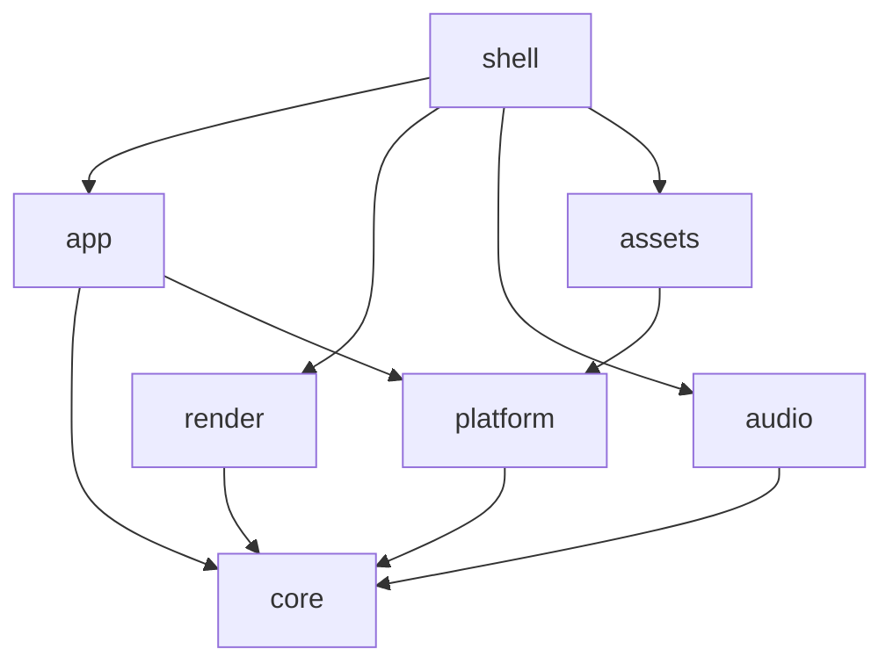

# 57 - Source code reference (checklist stage 91)

GENERATED by `python -I tools/analyze_source_docs.py --doc docs/57-source-code-reference.md` from `src/c` and `src/asm/pacman.s`; the curated parts (the purpose of each module, the algorithm table, the implementation decisions) are the tables at the top of the tool. Tests: `tests/test_source_docs.py` (the chapter is current; every file starts with a comment; every function declared in a header has a comment; every `Name $ADDR` comment is the address of that label in the assembly).

Checklist stage 91: "Document functions, variables, structures, algorithms, modules, and implementation decisions." This is the reference for the reconstructed source (the C port). The original (the ROM and its disassembly) is documented in `06`-`09`, `23`-`31`; this chapter says where each part of it lives in the C.

## 1. The source at a glance

- **102 files, 14278 lines** under `src/c` (41 headers, 61 implementation files), in 8 modules; plus the C-free build files (`CMakeLists.txt` in each folder). C99, clang / gcc, CMake (Ninja).
- **231 functions declared in headers** (without the tests), **43 structures and enumerations**; 71 of the functions are routines of the original and carry its name and ROM address in their comment.
- **Layers** (an arrow is "uses"): `shell` -> `app` -> `core`; `shell` -> `render`, `audio`, `assets`; `app`, `assets`, `core` -> `platform`; `render`, `audio` -> `core`. Nothing in `core` or `app` includes a system header or opens a file.

## 2. The modules

| Module | Purpose | Explained in |
|---|---|---|
| `platform/` | The one door to the outside: files (`fs`: relative paths under the main folder only, links and 44 kinds of escaping path refused), the clock (`timer`), the inputs of a frame as a table of functions (`hal.h`, the 14 inputs of `45`), the scripted platform used by the tests (`hal_scripted`), and the POKEY RANDOM model (`pokey_random`). | docs/45, docs/49, docs/51 section 2a |
| `core/` | The game, in port form: the `World` (all state, generated from the variable catalogue), the lookup tables (installed from the owner's ROM), the pure functions of levels, scoring and the ghosts' steering (`ref`), the ghosts, the ghost house, Pac-Man, scoring, drawing into the player-missile pages, the sound, the frame (`frame`, `play`), and the collision geometry (`gtia`). No file, no allocation, no global state, no system call. | docs/44, docs/48, docs/50 |
| `app/` | The application layer over the core: the state initialisation, the board, the turn, the level end, the READY! intro, the frame dispatcher with its 15 frame classes, the key loop as a machine with five places, the new game, start-up, and `app_frame` (one frame on a platform). | docs/38, docs/41 to docs/43, docs/46, docs/51 |
| `assets/` | The data of the game that is not code: the blob format and its loader, the installer that makes the blob from the owner's own NTSC ROM (SHA-256 checked), the layout of the 79 regions (no byte of the ROM is in the sources), and the open font. | docs/47, docs/49 |
| `render/` | The picture of the screen from the World: ANTIC's display lists, the character sets, GTIA's player-missile priority, the display-list interrupts' colour changes, and the measured NTSC palette. Pure C99, no state outside the `Renderer`. | docs/42, docs/35, docs/47 |
| `audio/` | The sound: a model of the POKEY from timed register writes to PCM, and the frame-level front end that gives the writes of a frame their cycles (a measured write clock). | docs/22, docs/35 |
| `shell/` | The headless shell: the frame loop over a replay of recorded inputs, a hash of the state after every frame, the picture and the sound on request, the high score and options under `save/`, a log under `logs/`, the `--states` and `--time` options. | docs/51, docs/49 D3, docs/52, docs/54 |
| `tests/` | The C tests: the toolchain facts, the World, the vector runner (the recorded calls of the original's routines, replayed), the file sandbox, the portability scan, and the self tests of the platform, assets, audio and shell. | docs/51, docs/52, docs/55 |

### `platform/`

| File | Lines | What it is |
|---|---|---|
| `fs.c` | 293 | see fs.h. |
| `fs.h` | 54 | the only door to files (docs/49, docs/51 section 2a). |
| `hal.h` | 36 | what the game takes from the outside: |
| `hal_scripted.c` | 153 | the scripted platform, see hal_scripted.h. |
| `hal_scripted.h` | 49 | a scripted platform for tests and the headless build (twin of tools/platform_iface.ScriptedPlatform and GtiaCollisions). |
| `pokey_random.c` | 43 | the POKEY RANDOM model, see pokey_random.h. |
| `pokey_random.h` | 29 | the POKEY RANDOM register as a model (owner decision D1, 2026-11-18: |
| `timer.c` | 32 | see timer.h. |
| `timer.h` | 10 | a monotonic clock in nanoseconds (stage 88): |

### `core/`

| File | Lines | What it is |
|---|---|---|
| `constants.h` | 61 | the named constants of the original (docs/31 section 2). |
| `draw.c` | 293 | the drawing (stage 76b: |
| `draw.h` | 42 | the drawing in port form (docs/44, tools/core_draw.py): |
| `frame.c` | 155 | the ghost logic that runs every frame (stage 76d). |
| `frame.h` | 15 | the ghost logic that runs every frame, in C (stage 76d, docs/44). |
| `ghost.c` | 318 | the ghost state machine (stage 76b). |
| `ghost.h` | 48 | the ghost state machine and the ghost house in C (stage 76b, docs/44). |
| `gtia.c` | 153 | the collision geometry of the GTIA (stage 77a). |
| `gtia.h` | 50 | the collision geometry of the GTIA in C (stage 77a, docs/50). |
| `house.c` | 112 | the ghost house (stage 76b). |
| `pacman.c` | 154 | Pac-Man's movement (stage 76c). |
| `pacman.h` | 18 | Pac-Man's movement in C (stage 76c, docs/44). |
| `play.c` | 251 | one frame of play (stage 76d). |
| `play.h` | 23 | one frame of play in C (stage 76d, docs/44). |
| `random_feed.h` | 53 | the RANDOM values handed to a core function (docs/45: |
| `ref.c` | 249 | the pure functions of the game (stage 76a). |
| `ref.h` | 52 | the pure functions of the game in C (stage 76a, docs/44 section 2): |
| `score.c` | 139 | scoring, dots and power pellets (stage 76c). |
| `score.h` | 19 | scoring, dots and power pellets in C (stage 76c, docs/44). |
| `sound.c` | 389 | the sound and the death (stage 76d). |
| `sound.h` | 37 | the sound and the death in C (stage 76d, docs/44). |
| `tables.c` | 76 | GENERATED by tools/make_c_tables.py (stage 75a, reworked 2026-11-22). |
| `tables.h` | 70 | where the data tables of the core are. |
| `world.c` | 263 | GENERATED by tools/make_c_world.py (stage 75a). |
| `world.h` | 237 | the World of the port-form core (docs/44, docs/51). |

### `app/`

| File | Lines | What it is |
|---|---|---|
| `app.c` | 43 | one frame of the whole program on a platform (stage 79d). |
| `board.c` | 69 | the level indicator and the high score (stage 79b). |
| `board.h` | 30 | the board, the turn, the end of a level, the READY! intro and the labels in C (stage 79b, docs/51). |
| `dispatch.c` | 236 | the frame dispatcher (stage 79c). |
| `dispatch.h` | 23 | the frame dispatcher in C (stage 79c, docs/51). |
| `init.c` | 136 | the state initialisation (stage 79a). |
| `init.h` | 28 | the state initialisation in C (stage 79a, docs/51). |
| `intro.c` | 60 | the labels and the READY! intro (stage 79b). |
| `keyloop.c` | 179 | the main program (stage 79d). |
| `keyloop.h` | 48 | the main program (the key loop `$A4BA-$A572`), the new game and the start-up in C (stage 79d, docs/51). |
| `levelend.c` | 70 | the end of a level (stage 79b). |
| `newgame.c` | 44 | the restart and the new game (stage 79d). |
| `run_frame.c` | 36 | one frame of the running game on a platform (stage 77b). |
| `run_frame.h` | 20 | one frame of the running game on a platform (stage 77b; |
| `start.c` | 44 | the power-on state and Start (stage 79d). |
| `turn.c` | 100 | TurnControl (stage 79b). |

### `assets/`

| File | Lines | What it is |
|---|---|---|
| `assets.c` | 226 | see assets.h. |
| `assets.h` | 81 | the asset blob (stage 80a, docs/47, docs/51). |
| `install_assets.c` | 27 | the installer as a program (stage 80a): |
| `rom_install.c` | 313 | see rom_install.h. |
| `rom_install.h` | 38 | install the port's assets from the owner's own cartridge image (stage 80a). |
| `rom_layout.c` | 130 | GENERATED by tools/make_c_rom_layout.py (stage 80a). |
| `rom_layout.h` | 28 | the layout of the data in the NTSC cartridge. |
| `sha256.c` | 73 | see sha256.h. |
| `sha256.h` | 11 | SHA-256 (FIPS 180-4), portable C99, used to recognise the cartridge image. |

### `render/`

| File | Lines | What it is |
|---|---|---|
| `interp.c` | 469 | the in-between pictures of the FPS option; |
| `interp.h` | 99 | the in-between pictures of the FPS option (docs/69). |
| `palette.c` | 262 | GENERATED by tools/make_c_palette.py (stage 80b). |
| `palette.h` | 11 | the NTSC palette as measured from Altirra 4.40 (analysis/palette-ntsc-measured.txt). |
| `render.c` | 444 | see render.h. |
| `render.h` | 68 | the picture of the screen from the World (stage 80b, docs/42, docs/35, docs/47). |

### `audio/`

| File | Lines | What it is |
|---|---|---|
| `audio.c` | 52 | see audio.h. |
| `audio.h` | 38 | the sound of the game as a function of the World, frame by frame (stage 80c, docs/22, docs/44). |
| `pokey.c` | 388 | see pokey.h. |
| `pokey.h` | 98 | the POKEY sound chip as the game uses it, from timed register writes to PCM (stage 80c, docs/22). |
| `write_clock.c` | 12 | see write_clock.h. |
| `write_clock.h` | 19 | the cycle of each sound-register write inside a frame (stage 80c). |

### `shell/`

| File | Lines | What it is |
|---|---|---|
| `frontend.c` | 71 | see frontend.h. |
| `frontend.h` | 43 | what any interactive front end does between the player and the game (stage J, docs/67): |
| `main.c` | 343 | the headless shell of the Pac-Man (Atari 8-bit) port (stage 80d). |
| `menu.c` | 301 | the pause menu and the graphics options (docs/68); |
| `menu.h` | 90 | the pause menu and the graphics options of the interactive front end (docs/68). |
| `replay.c` | 269 | see replay.h. |
| `replay.h` | 82 | recorded inputs of a game, one record a frame (stage 80d, docs/51, docs/49 D3). |
| `shell.c` | 325 | see shell.h. |
| `shell.h` | 58 | the headless shell of the port (stage 80d, docs/51, docs/49 D3): |

### `tests/`

| File | Lines | What it is |
|---|---|---|
| `assets_check.c` | 159 | Stage 80a: |
| `audio_check.c` | 197 | Stage 80c: |
| `audio_selftest.c` | 220 | Stage 80c: |
| `boot_tables.h` | 24 | what every test program that uses the core's tables does first (stage 80a): |
| `constants_check.c` | 44 | stage 94: |
| `frontend_check.c` | 167 | Stage J: |
| `fs_sandbox.c` | 191 | The file sandbox test (docs/51 section 2a, stage 75b): |
| `interp_audit.c` | 250 | The audit of the in-between pictures (docs/69), run over whole games by tools/check_interp.py: |
| `interp_check.c` | 499 | The in-between pictures of the FPS option (src/c/render/interp.c, docs/69): |
| `menu_check.c` | 336 | The pause menu and the graphics options (src/c/shell/menu.c, docs/68): |
| `platform_check.c` | 294 | Stage 77b: |
| `pure_functions.c` | 373 | The table of the pure functions for the vector runner (stage 76a): |
| `pure_functions.h` | 25 | The table of the pure functions for the vector runner (stage 76a). |
| `render_check.c` | 76 | Stage 80b: |
| `shell_selftest.c` | 242 | Stage 80d: |
| `toolchain_check.c` | 31 | What the port relies on from the C implementation: |
| `vector.c` | 294 | The vector file reader (see vector.h for the format). |
| `vector.h` | 95 | Vector files (docs/51 section 2): |
| `vector_runner.c` | 386 | The vector runner (docs/51 section 2, stage 75b). |
| `world_check.c` | 193 | Stage 75a: |
| `world_functions.c` | 556 | The World functions of the vector runner: |
| `world_functions.h` | 15 | The table of the World functions for the vector runner (stage 75b: |

## 3. Structures and enumerations

| Name | Kind | In | Entries | What it is |
|---|---|---|---|---|
| `PmFsError` | enum | `platform/fs.h` | 13 | why a path or a file call is refused or fails (see pm_fs_error) |
| `Platform` | struct | `platform/hal.h` | 11 | the 14 inputs of the game and the frame hook as a table of functions over a context (docs/45); the comment at the top of this file says what each returns |
| `ScriptedCollisions` | enum | `platform/hal_scripted.h` | 3 | where the scripted platform's collision registers come from |
| `ScriptedPlatform` | struct | `platform/hal_scripted.h` | 12 | a platform that plays a script: a stick sequence, the clock counting frames, RANDOM from the model or an injected stream, collisions none / fixed / from the GTIA model; it counts every call to an inpu |
| `PokeyRandom` | struct | `platform/pokey_random.h` | 1 | the POKEY RANDOM model: the 17-bit polynomial counter |
| `GtiaScene` | struct | `core/gtia.h` | 5 | a scene: hpos = [P0, P1, P2, P3, M0, M1, M2, M3]; the five pages are 256 bytes each (the missile page, then players 0-3); cells = 920 screen codes; charset = 1,024 bytes |
| `GtiaLatch` | struct | `core/gtia.h` | 1 | the latch (platform_iface.GtiaCollisions): the registers hold every overlap shown since the last HITCLR ($D01E). `latch` is what the game reads at the start of a frame; after the frame, gtia_latch_fra |
| `RandomFeed` | struct | `core/random_feed.h` | 6 | the RANDOM values a core function reads: a recorded list or a pull function, with the number used and the overrun |
| `TableInfo` | struct | `core/tables.h` | 5 | one data table of the core: its name, where its bytes are, and the 6502 address they were read from |
| `World` | struct | `core/world.h` | 198 | the state of the game by name: every zero-page variable of docs/25 (a byte, or an array for a multi-byte one; the original address is in the comment) plus the regions of the original's memory that the |
| `WorldRegion` | struct | `core/world.h` | 6 | a region of the 64 KB memory image that is a member of World |
| `KeyLoopPc` | enum | `app/keyloop.h` |  | the five places of the main program (the key loop) where it can wait between frames |
| `KeyLoop` | struct | `app/keyloop.h` | 3 | the key loop's machine: where it is, the console accumulator, the clock it waits for |
| `AssetKind` | enum | `assets/assets.h` | 5 | what an entry of the asset blob is |
| `AssetsError` | enum | `assets/assets.h` | 13 | why a blob is refused or cannot be loaded |
| `AssetEntry` | struct | `assets/assets.h` | 5 | one named entry of the blob: kind, address in the original's memory, size, and its bytes |
| `Assets` | struct | `assets/assets.h` | 3 | a parsed blob: the SHA-256 of the ROM it was made from, and its entries |
| `RomError` | enum | `assets/rom_install.h` | 7 | why the ROM is refused or the blob cannot be made |
| `RomRegion` | struct | `assets/rom_layout.h` | 4 | one non-code region of the ROM: name, address, size and kind (generated by tools/make_c_rom_layout.py) |
| `InterpObject` | struct | `render/interp.h` | 3 | where an object is in a frame |
| `InterpFrame` | struct | `render/interp.h` | 6 | a game frame with what the in-between pictures need |
| `InterpPair` | struct | `render/interp.h` | 3 | how each object moved from one frame to the next one: `ok` is 0 for an object that is in one frame only, jumped, or did not match |
| `InterpOut` | struct | `render/interp.h` | 9 | the picture shown: BGRA, ow x oh, made of the nearest frame's picture with the moving objects drawn again |
| `InterpDirty` | struct | `render/interp.h` | 3 | what changed on `work` since the previous picture: all of it (`full`), or the rectangles r[i] = x0, y0, x1, y1 (x1 and y1 not included) |
| `Renderer` | struct | `render/render.h` | 6 | the renderer's state: the three character sets and the colour registers latched for the next frame |
| `RenderLayers` | struct | `render/render.h` | 5 | what a frame is made of before the players and missiles are put over the playfield (docs/69: the in-between pictures of the FPS option are made from it) |
| `Audio` | struct | `audio/audio.h` | 2 | the audio front end: the POKEY model and the number of the next frame |
| `PokeyEvent` | struct | `audio/pokey.h` | 4 | one timed change of the POKEY model: the time, the kind (mode, AUDF or level), the channel or AUDCTL, and the value |
| `FrontPad` | struct | `shell/frontend.h` | 1 | the five switches of one joystick: 1 = pressed |
| `FrontKeys` | struct | `shell/frontend.h` | 3 | what is pressed at the moment of the frame; `pause` is 1 for exactly one frame per press (the edge) |
| `Frontend` | struct | `shell/frontend.h` | 2 | the front end's state between frames: the OS clock and the key delay |
| `MenuResolution` | struct | `shell/menu.h` | 2 | one entry of the resolution list: the size of the area the picture may use, and the aspect ratio it is filed under |
| `Menu` | enum | `shell/menu.h` | 15 | which screen of the menu is shown (closed: the game runs) |
| `Menu` | enum | `shell/menu.h` | 13 | the keys the menu understands (the front end maps keyboard and pad onto them) |
| `Menu` | struct | `shell/menu.h` | 11 | the menu's whole state: the screen shown, the cursor, and the two display settings |
| `MenuLine` | struct | `shell/menu.h` | 4 | one line of the menu as the front end draws it |
| `DisplayRect` | struct | `shell/menu.h` | 3 | where the picture goes in a client area, and at what scale |
| `FrameInput` | struct | `shell/replay.h` | 3 | the inputs of one frame: sticks, triggers, console, key, key delay, clock, the attract values and, when the replay carries them, the frame's RANDOM bytes |
| `ReplayError` | enum | `shell/replay.h` | 12 | why a replay is refused |
| `Replay` | struct | `shell/replay.h` | 8 | a replay held in memory and the place in it |
| `ReplayWriter` | struct | `shell/replay.h` | 6 | writing |
| `ShellOptions` | struct | `shell/shell.h` | 2 | what the shell keeps between runs besides the high score: the RANDOM seed and the power-on clock |
| `Shell` | struct | `shell/shell.h` | 11 | the whole program on a replay's platform: the World, the key loop, the collision latch, the RANDOM model and the digest of the run |

The `World` (`core/world.h`, generated by `tools/make_c_world.py`) holds, by name, every zero-page variable of `25` that the game uses (an array for a multi-byte variable), the bytes of the zero page the game does not use as `zp_XX`, and the regions: the maze `$0C00`, the status rows `$2000`, the OS shadows `$0200`, the stick shadows, the collision registers, the player-missile pages `$2300`, the eight positions, the picture buffers `$0400`, the stored maze `$0800`, the two saved mazes and the title screen, and the log of sound-chip writes. `PM_STATE_SIZE` bytes of it are the packed state that the comparisons use (`docs/43`).

## 4. The functions

Every function declared in a header, by module. **ROM** is the routine of the original it is the port of (the address of its label in `src/asm/pacman.s`, checked by a test); a function without one is a helper, a table access or part of the platform. **Defined** is where the body is.

### `platform/fs.h`

| Function | ROM | Defined | What it does |
|---|---|---|---|
| `pm_fs_set_root` |  | `platform/fs.c:54` | the main folder; NULL or "" = the current folder. Set once at start-up from an option, never from the environment. |
| `pm_fs_open` |  | `platform/fs.c:262` | mode: "rb", "wb" or "ab" (text modes are refused: the formats are binary) |
| `pm_fs_open_n` |  | `platform/fs.c:188` | pm_fs_open for a path that is not NUL-terminated: `len` bytes |
| `pm_fs_error` |  | `platform/fs.c:49` | the reason of the last refusal or failure |
| `pm_fs_error_text` |  | `platform/fs.c:29` | the text of a PmFsError |
| `pm_fs_check` |  | `platform/fs.c:116` | the check alone: the rules above, and a look for links |
| `pm_fs_mkdir` |  | `platform/fs.c:228` | make the folder `path` (one level: its parent must exist) under the main folder; the same rules as pm_fs_open (a path outside it is refused). 0 when the folder exists afterwards (made now or already there), -1 otherwise (pm_fs_error says why). The shell makes `save/` and `logs/` with it. |
| `pm_fs_read` |  | `platform/fs.c:267` | reads up to `n` bytes; returns the count |
| `pm_fs_write` |  | `platform/fs.c:272` | writes `n` bytes; returns the count |
| `pm_fs_printf` |  | `platform/fs.c:277` | a formatted write; returns the characters written, or a negative number |
| `pm_fs_close` |  | `platform/fs.c:287` | closes the file; 0 on success |

### `platform/hal_scripted.h`

| Function | ROM | Defined | What it does |
|---|---|---|---|
| `scripted_init` |  | `platform/hal_scripted.c:105` | a scripted platform: the RANDOM model seeded with `seed`, the OS clock at `start_clock` |
| `scripted_set_sticks` |  | `platform/hal_scripted.c:124` | a stick script: the stick of port p at frame t is sticks[(t + p) % n] |
| `scripted_inject_random` |  | `platform/hal_scripted.c:133` | RANDOM from a recorded stream instead of the model |
| `scripted_set_fixed_collisions` |  | `platform/hal_scripted.c:141` | void scripted_init(ScriptedPlatform *s, uint32_t seed, uint32_t start_clock); /* a scripted platform: the RANDOM model seeded with `seed`, the OS clock at `start_clock` void scripted_set_sticks(ScriptedPlatform *s, const uint8_t *sticks, uint32_t n); /* a stick script: the stick of port p at frame t is sticks[(t + p) % n] void scripted_inject_random(ScriptedPlatform *s, const uint8_t *values, uint32_t n); /* RANDOM from a recorded stream instead of the model |
| `scripted_use_gtia` |  | `platform/hal_scripted.c:147` | the collision registers come from the GTIA model (docs/50) with this character set |

### `platform/pokey_random.h`

| Function | ROM | Defined | What it does |
|---|---|---|---|
| `pokey_random_init` |  | `platform/pokey_random.c:6` | the seed's low 17 bits; the all-ones state is replaced by 0 |
| `pokey_random_step` |  | `platform/pokey_random.c:19` | advance by `cycles` steps |
| `pokey_random_peek` |  | `platform/pokey_random.c:28` | bits 16..9 |
| `pokey_random_read` |  | `platform/pokey_random.c:33` | advance by PM_POKEY_READ_STRIDE, then peek |
| `pokey_poly17_bit8` |  | `platform/pokey_random.c:39` | bit 8 of the counter: the bit the sound model uses (tools/pokey_noise.py S17) |

### `platform/timer.h`

| Function | ROM | Defined | What it does |
|---|---|---|---|
| `pm_time_ns` |  | `platform/timer.c:10` | nanoseconds since an arbitrary start; never goes back |

### `core/draw.h`

| Function | ROM | Defined | What it does |
|---|---|---|---|
| `draw_rom` |  | `core/draw.c:9` | a byte of the ROM tables ($BA00-$BFFF); an address outside them reads 0 (as core_draw.rom) |
| `draw_rom_word` |  | `core/draw.c:15` | a little-endian word of the ROM tables (as draw_rom) |
| `draw_put` | outside `$2300` | `core/draw.c:20` | a store into / a read of the player-missile pages at a 16-bit address; outside $2300-$27FF nothing is modelled (store ignored, read 0) |
| `draw_get` |  | `core/draw.c:28` | the read of draw_put's pair |
| `draw_ghost` | StepAndDrawEntity `$B902` | `core/draw.c:34` | StepAndDrawEntity $B902: `d` is the direction (1 up, 2 down, 4 left, 8 right); any other value does nothing at all. The step is skipped while DrawOnly is set. |
| `step_and_draw_entity` |  | `core/draw.c:62` | see above |
| `draw_pacman` | MovePacMan `$B179` | `core/draw.c:95` | Pac-Man's picture, the drawing part of MovePacMan $B179 (from $B2E9): y = twice the index of the picture in PacShapePtrs (0 full disc, 2 right, 4 left, 6 up, 8 down), a = the offset of the mouth frame (0 or $0A) |
| `draw_pacman_full` |  | `core/draw.c:122` | the full disc: the mouth closed |
| `draw_all_in_place` | DrawAllInPlace `$AD49` | `core/draw.c:127` | DrawAllInPlace $AD49 - the four ghosts drawn where they stand, then Pac-Man's full disc |
| `draw_popup` | GhostEaten `$A886` | `core/draw.c:139` | the pop-up of an eaten ghost (GhostEaten $A886, the picture part) |
| `death_animation_draw` | DeathAnimation `$AEF7` | `core/draw.c:178` | the death (DeathAnimation $AEF7 / $AF48, the picture part) |
| `death_animation_clear` |  | `core/draw.c:199` | the clearing half of the death animation |
| `clip_entity_at_tunnel` | ClipEntityAtTunnel `$AB57` | `core/draw.c:209` | the tunnel (ClipEntityAtTunnel $AB57, ClipEntitiesOnTunnelRow $AB48) - the same, one entity |
| `clip_entities_on_tunnel_row` | ClipEntitiesOnTunnelRow `$AB48` | `core/draw.c:267` | all entities (ClipEntitiesOnTunnelRow $AB48) - the pictures cut at the tunnel mouths, and an entity that has gone round wraps (state: `EntityX`, Pac-Man's `MazePtr`); runs after the frame unless the eaten-ghost pause is on (`core_play.vbi_play_frame`) |
| `fill_player_pages` | FillPlayerPages `$B100` | `core/draw.c:278` | clearing (FillPlayerPages $B100, ClearPlayerMemory $B0F1) - the byte A into rows X-$FF of the five pages |
| `clear_player_memory` | ClearPlayerMemory `$B0F1` | `core/draw.c:288` | ClearPlayerMemory $B0F1 - the five pages to 0, rows $F0-$FF to $FE |

### `core/frame.h`

| Function | ROM | Defined | What it does |
|---|---|---|---|
| `frightened_tick` | FrightenedTick `$AF54` | `core/frame.c:24` | FrightenedTick $AF54 - the frightened countdown and its phases |
| `ghost_eaten` | GhostEaten `$A886` | `core/frame.c:67` | GhostEaten $A886 - a ghost is eaten: score, pause, eyes, the pop-up picture |
| `eyes_and_house_per_frame` | EyesAndHousePerFrame `$B69E` | `core/frame.c:109` | EyesAndHousePerFrame $B69E - eyes returning, the house, the whistle |

### `core/ghost.h`

| Function | ROM | Defined | What it does |
|---|---|---|---|
| `junction_lookup` | JunctionLookup `$B48E` | `core/ghost.c:10` | JunctionLookup $B48E - the lattice: exits at a junction |
| `steer_to_target` | SteerToTarget `$B999` | `core/ghost.c:15` | SteerToTarget $B999 - the choice of direction |
| `step_entity` | StepAndDrawEntity `$B902` | `core/ghost.c:25` | StepAndDrawEntity $B902 (draw.c) - the movement step and the ghost's picture (`core_draw`) |
| `ghost_sees` | GhostSeesPacMan `$BA19` | `core/ghost.c:63` | the test of GhostSeesPacMan $BA19 without its effect |
| `ghost_sees_pacman` | GhostSeesPacMan `$BA19` | `core/ghost.c:108` | GhostSeesPacMan $BA19 - the sight test |
| `force_chase` | ForceChase `$B616` | `core/ghost.c:117` | ForceChase $B616 - all ghosts chase |
| `chase_timer_siren_sight` | ChaseTimerSirenSight `$B5C7` | `core/ghost.c:129` | ChaseTimerSirenSight $B5C7 - the shared chase timer, the siren, the sight test |
| `ghost_behaviour` | GhostBehaviour `$B7F5` | `core/ghost.c:160` | GhostBehaviour $B7F5 - the ghost state machine |
| `ghost_start_route` |  | `core/ghost.c:195` | $B826 |
| `ghost_select_patrol` |  | `core/ghost.c:221` | $B84B |
| `ghost_patrol_travel` |  | `core/ghost.c:246` | $B87B |
| `ghost_patrol` |  | `core/ghost.c:269` | $B898 |
| `ghost_go_to_corner` |  | `core/ghost.c:284` | $B8C5 |
| `ghost_chase` |  | `core/ghost.c:305` | $B8EB |
| `house_bob_step` |  | `core/house.c:7` | $B7D6 |
| `house_leave_step` |  | `core/house.c:25` | $B738 |
| `house_leave_ghost2` |  | `core/house.c:50` | $B76D |
| `house_leave_ghost3` |  | `core/house.c:59` | $B777 |
| `house_leave` |  | `core/house.c:68` | the ghost house (house.c) void house_bob_step(World *w, int i); /* $B7D6 void house_leave_step(World *w, int i); /* $B738 void house_leave_ghost2(World *w, int i); /* $B76D void house_leave_ghost3(World *w, int i); /* $B777 |
| `house_enter_step` |  | `core/house.c:79` | $B781 |
| `house_waiting_tick` |  | `core/house.c:97` | $B7A5 |

### `core/gtia.h`

| Function | ROM | Defined | What it does |
|---|---|---|---|
| `gtia_collision_registers` | registers `$D000` | `core/gtia.c:35` | the sixteen collision registers $D000-$D00F of a scene (M0PF..M3PF, P0PF..P3PF, M0PL..M3PL, P0PL..P3PL); `visible` / `lines` are the windows (the model's defaults above; the tests move them) |
| `gtia_scene_of_world` |  | `core/gtia.c:112` | the scene the World leaves on the screen (core_draw.scene): positions, the five pages and the maze cells; `charset` is the game's character set |
| `gtia_latch_init` |  | `core/gtia.c:124` | every register 0 |
| `gtia_latch_frame_done` |  | `core/gtia.c:129` | after a frame: cleared if the frame wrote HITCLR, then the overlaps of the scene it left are ORed in |
| `gtia_latch_to_world` |  | `core/gtia.c:149` | w->collide = the latch: the input of the next frame |

### `core/pacman.h`

| Function | ROM | Defined | What it does |
|---|---|---|---|
| `read_joystick` |  | `core/pacman.c:23` | the stick of the player on turn: the wanted direction and, when the maze allows it, the direction at once |
| `move_pacman` | MovePacMan `$B179` | `core/pacman.c:111` | MovePacMan $B179 with the drawing of the mouth and the missiles |

### `core/play.h`

| Function | ROM | Defined | What it does |
|---|---|---|---|
| `show_power_pellets` | ShowPowerPellets `$B55A` | `core/play.c:16` | ShowPowerPellets $B55A - draw the pellets still on the board |
| `blink_power_pellets` | BlinkPowerPellets `$B54F` | `core/play.c:31` | BlinkPowerPellets $B54F - the pellets blink every 16 jiffies |
| `bonus_item_update` | BonusItemUpdate `$B62E` | `core/play.c:45` | BonusItemUpdate $B62E - the bonus item appears at 80 and 160 dots |
| `move_delay_tick_w` | MoveDelayTick `$B590` | `core/play.c:96` | MoveDelayTick $B590 on the World: 1 when entity x moves this frame |
| `play_frame` | from `$A82C` | `core/play.c:167` | the frame body from $A82C |
| `vbi_play_frame` | handler `$A5FD` | `core/play.c:244` | the deferred handler $A5FD for a frame of the running game |

### `core/ref.h`

| Function | ROM | Defined | What it does |
|---|---|---|---|
| `ref_pacing_delay` |  | `core/ref.c:8` | levels |
| `ref_move_delay_tick` |  | `core/ref.c:15` | one frame of an entity's pacing: returns 1 when it moves this frame; *cycle and *count are updated |
| `ref_release_timers` |  | `core/ref.c:26` | the release timers of ghosts 1, 2, 3 by level (units of 4 frames; a window of the table clamped at level 3) |
| `ref_fright_frames` |  | `core/ref.c:34` | frames of solid frightened colour; the level is not clamped (past 15 the table runs on into the ROM bytes that follow) |
| `ref_fright_end_phase` |  | `core/ref.c:39` | the phase at which the frightened period ends (0 = practically endless); not clamped |
| `ref_fright_total_frames` |  | `core/ref.c:44` | frames of the whole frightened period; returns 0 (and leaves *out alone) when the end phase is 0 = "practically endless" (Python None) |
| `ref_bonus_glyph` |  | `core/ref.c:55` | the bonus item's picture code (level clamped at 12) |
| `ref_bonus_points` |  | `core/ref.c:60` | the bonus score as a number (thousands and hundreds digits) |
| `ref_bonus_popup_glyphs` |  | `core/ref.c:66` | the five screen codes of the bonus score pop-up |
| `ref_score_add` |  | `core/ref.c:76` | scoring: a six-digit decimal score that wraps at 1,000,000 (points are not negative) |
| `ref_ghost_points` |  | `core/ref.c:89` | 200, 400, 800, 1600 for the running count 0-3, 1600 beyond |
| `ref_junction_exits` |  | `core/ref.c:96` | ghost AI |
| `ref_wants` |  | `core/ref.c:137` | the wanted vertical and horizontal direction (0 = none): towards the target, away from it when frightened |
| `ref_steer` |  | `core/ref.c:156` | the direction a ghost takes at a junction; takes 0 or 1 RANDOM value |
| `ref_force_chase` |  | `core/ref.c:183` | ghosts x .. 0 in the patrol-start, patrol and corner states go to chase |
| `ref_power_pellet_ghosts` |  | `core/ref.c:196` | a power pellet: every ghost not eaten becomes frightened; most reverse |
| `ref_frightened_end` |  | `core/ref.c:220` | the end of the frightened period: states and corners |
| `ref_count_dot` |  | `core/ref.c:239` | the dot count: 16 bits, returns 1 when the board is complete |

### `core/score.h`

| Function | ROM | Defined | What it does |
|---|---|---|---|
| `draw_lives` | DrawLives `$AD15` | `core/score.c:9` | DrawLives $AD15 - the lives icons of the status row |
| `add_to_score` | AddToScore `$B423` | `core/score.c:18` | AddToScore $B423 - BCD score, the extra life |
| `count_dot` |  | `core/score.c:56` | the dot count of the player on turn; the board is complete at 260 |
| `eat_dot` | EatDotAtPacMan `$B33A` | `core/score.c:68` | EatDotAtPacMan $B33A - dot: 10 points, count, sound |
| `power_pellet_check` | PowerPelletCheck `$B39F` | `core/score.c:107` | PowerPelletCheck $B39F + PowerPelletEaten $B3DE - Pac-Man on a pellet square |

### `core/sound.h`

| Function | ROM | Defined | What it does |
|---|---|---|---|
| `sound_wr` |  | `core/sound.c:11` | one chip write, value masked to a byte |
| `clear_pokey` | ClearPokeyRegisters `$B0E6` | `core/sound.c:16` | ClearPokeyRegisters $B0E6 - silence |
| `dot_sound_sweep` | DotSoundSweep `$B0BC` | `core/sound.c:25` | DotSoundSweep $B0BC - the dot sound |
| `bonus_sound` | BonusSound `$ABC9` | `core/sound.c:44` | BonusSound $ABC9 - the bonus sweep |
| `frightened_sound` | FrightenedSound `$AFD7` | `core/sound.c:86` | FrightenedSound $AFD7 - the frightened-mode sound |
| `eyes_returning_sound` | EyesReturningSound `$B02C` | `core/sound.c:134` | EyesReturningSound $B02C - the returning-eyes sound |
| `siren` | siren `$B508` | `core/sound.c:148` | the siren $B508 |
| `ghost_eaten_pause` | GhostEatenPause `$B049` | `core/sound.c:220` | GhostEatenPause $B049 - the pause after a ghost is eaten, with its sound |
| `start_tune_step` | FrameDispatch `$A6CC` | `core/sound.c:250` | the start tune block of FrameDispatch $A6CC (from $A7D3); returns 0 wait, 1 tune, 2 ready, 3 play (the strings of the Python) |
| `toggle_leg_phase` | ToggleLegPhase `$AC05` | `core/sound.c:278` | ToggleLegPhase $AC05 - the ghosts' feet row phase |
| `death_sequence` | DeathSequence `$AE3D` | `core/sound.c:296` | DeathSequence $AE3D - the death state machine with its sound |
| `death_animation` | DeathAnimation `$AEF7` | `core/sound.c:368` | DeathAnimation $AEF7 - the death animation's counters and pictures |

### `core/tables.h`

| Function | ROM | Defined | What it does |
|---|---|---|---|
| `tables_set` |  | `core/tables.c:30` | install the three images (copied); 0 when the sizes are right, 1 when not (nothing is installed then) |
| `tables_ready` |  | `core/tables.c:42` | 1 once tables_set has succeeded |
| `table_ram` |  | `core/tables.c:67` | a byte of RAM_0600 by its address ($0600-$07FF) |
| `table_rom` |  | `core/tables.c:72` | a byte of ROM_BA00 by its address ($BA00-$BFFF) |

### `core/world.h`

| Function | ROM | Defined | What it does |
|---|---|---|---|
| `world_init` |  | `core/world.c:202` | everything zero, the log empty |
| `world_load` |  | `core/world.c:207` | World.load: also empties the log |
| `world_store` |  | `core/world.c:220` | World.store: writes the regions marked `stored`, leaves the rest of `mem` alone |
| `world_pokey` |  | `core/world.c:253` | appends one chip write to the log |
| `world_pack` |  | `core/world.c:231` | the whole state, every region (collide and hpos too) in table order: the vector files use it |
| `world_unpack` |  | `core/world.c:241` | the inverse; the log is emptied |

### `app/board.h`

| Function | ROM | Defined | What it does |
|---|---|---|---|
| `draw_label_1up` | DrawLabel1UP `$AD9F` | `app/intro.c:7` | DrawLabel1UP $AD9F - status-row drawing |
| `draw_label_2up` | DrawLabel2UP `$AD87` | `app/intro.c:14` | DrawLabel2UP $AD87 - status-row drawing |
| `blink_player_label` | BlinkPlayerLabel `$AD69` | `app/intro.c:21` | BlinkPlayerLabel $AD69 - status-row drawing: the 1UP / 2UP blink |
| `clear_ready_text` | ClearReadyText `$AD5E` | `app/intro.c:46` | ClearReadyText $AD5E - drawing |
| `draw_ready_screen` | DrawReadyScreen `$AD0E` | `app/intro.c:54` | DrawReadyScreen $AD0E - drawing READY! |
| `draw_level_indicator` | DrawLevelIndicator `$AC93` | `app/board.c:8` | DrawLevelIndicator $AC93 - drawing the fruit row; its content is `core_ref.bonus_glyph` |
| `compare_high_score` | CompareHighScore `$AB26` | `app/board.c:52` | CompareHighScore $AB26: x = $2A or $47, the score cells in the status rows |
| `advance_level` | AdvanceLevel `$AC75` | `app/levelend.c:8` | AdvanceLevel $AC75 - the level-end step to the next board: effects measured in `43` |
| `level_end_step` | sequence `$AC18` | `app/levelend.c:24` | the level-end sequence $AC18 |
| `turn_control` | TurnControl `$AA2D` | `app/turn.c:32` | TurnControl $AA2D - the two-player turn switch: effects measured in `43` (resets / keeps / computes) |

### `app/dispatch.h`

| Function | ROM | Defined | What it does |
|---|---|---|---|
| `init_display2` | InitDisplay2 `$A610` | `app/dispatch.c:22` | InitDisplay2 $A610 - the title screen's display set-up |
| `title_clear_scores_1p` | TitleClearScores1P `$A632` | `app/dispatch.c:46` | TitleClearScores1P $A632 - status-row drawing |
| `title_clear_scores_2p` | TitleClearScores2P `$A64E` | `app/dispatch.c:57` | TitleClearScores2P $A64E - status-row drawing |
| `copyright_setup` |  | `app/dispatch.c:71` | GameState 1: $A6D7-$A70A |
| `copyright_wait` |  | `app/dispatch.c:91` | GameState 2: $A70D |
| `title_menu` |  | `app/dispatch.c:98` | GameState 3 and 4: $A719-$A78B |
| `game_frame` |  | `app/dispatch.c:169` | GameState 0: $A78C |
| `frame_dispatch` | FrameDispatch `$A6CC` | `app/dispatch.c:209` | FrameDispatch $A6CC - the running-game frame (class 15, with death and the eaten pause: classes 13, 14) is `play_frame`; the title, copyright, intro, countdown, level-end and turn-control classes are not in port form (`44`, section 7) |
| `vbi_handler` | handler `$A5FD` | `app/dispatch.c:227` | the deferred vertical-blank handler $A5FD (to its jump to the OS exit) |

### `app/init.h`

| Function | ROM | Defined | What it does |
|---|---|---|---|
| `world_zp_set` |  | `app/init.c:16` | a zero-page byte by its address (a field, or one element of an array field); an address outside the zero page is ignored |
| `clear_zp` |  | `app/init.c:31` | the zero-page bytes lo .. hi-1 to 0 |
| `copy_0800_to_0c00` | Copy0800To0C00 `$B11F` | `app/init.c:40` | Copy0800To0C00 $B11F: the stored maze to the maze screen |
| `copy_0c00_to_1000` | Copy0C00To1000 `$B13D` | `app/init.c:45` | Copy0C00To1000 $B13D: the screen to player 1's saved maze |
| `copy_0c00_to_1400` | Copy0C00To1400 `$B15B` | `app/init.c:50` | Copy0C00To1400 $B15B: the screen to player 2's saved maze |
| `load_shadow_colors` | LoadShadowColors `$B113` | `app/init.c:55` | LoadShadowColors $B113: PCOLR0-3 and COLOR0-3 from ColorsGame |
| `clear_player_counters` | ClearPlayerCounters `$AE1E` | `app/init.c:64` | ClearPlayerCounters $AE1E: player x (0 or 1) |
| `set_release_timers` | SetReleaseTimers `$AE2B` | `app/init.c:72` | SetReleaseTimers $AE2B: the release timers of ghosts 1-3 from the table, Y clamped at 3 |
| `init_board` | InitBoard `$ADAF` | `app/init.c:86` | InitBoard $ADAF: the start of every turn and every board |
| `new_board_init` | NewBoardInit `$AE02` | `app/init.c:108` | NewBoardInit $AE02 - state initialisation (`43`) |
| `new_game_init` | NewGameInit `$ADF1` | `app/init.c:127` | NewGameInit $ADF1 - state initialisation (`43`) |

### `app/keyloop.h`

| Function | ROM | Defined | What it does |
|---|---|---|---|
| `keyloop_init` |  | `app/keyloop.c:11` | the main program at the top of a pass, nothing accumulated |
| `keyloop_state` |  | `app/keyloop.c:18` | pc \| acc << 8 (debounce, release) \| clock << 16 (clock wait): the place the program is in, as one number |
| `key_loop` |  | `app/keyloop.c:141` | the main program for the rest of the frame: `console` is the value of CONSOL for the frame (the caller reads it from the platform); returns 0, or 1 when the program did not settle |
| `restart_clear` |  | `app/newgame.c:9` | $A477-$A48A: `$20-$3F`, the chip, the stored maze to the screen and both saved mazes |
| `restart_tail` |  | `app/newgame.c:18` | $A49B-$A4B6: the display list, the priority, the first board, the title scores, the board start |
| `new_game` |  | `app/newgame.c:35` | $A537: START or a trigger: the restart, then the wait for the OS clock |
| `power_on_world` |  | `app/start.c:12` | the RAM after the OS's power-on clear, with the OS-owned values the game reads (docs/37) |
| `start` | Start `$A386` | `app/start.c:25` | Start $A386 to the first pass of the main program |
| `app_read_inputs` |  | `app/app.c:6` | app.c: one frame of the whole program on a platform: the inputs, the OS clock, the handler, the main program, the platform's frame_done; returns the number of RANDOM values the frame took |
| `app_frame` |  | `app/app.c:28` | returns the number of RANDOM values the frame took |

### `app/run_frame.h`

| Function | ROM | Defined | What it does |
|---|---|---|---|
| `read_inputs` |  | `app/run_frame.c:7` | the inputs of one frame, copied into the World (STICK0 / STICK1 from the platform, STICK2 / 3 = $0F: nothing reads them) |
| `run_frame` |  | `app/run_frame.c:22` | one frame; returns the number of RANDOM values the frame took |

### `assets/assets.h`

| Function | ROM | Defined | What it does |
|---|---|---|---|
| `assets_error_text` |  | `assets/assets.c:32` | the text of an AssetsError |
| `assets_parse` |  | `assets/assets.c:58` | parse a blob held in memory; on an error `a` is left empty (count 0) |
| `assets_load` |  | `assets/assets.c:127` | read the file `path` (relative to the main folder, through platform/fs.c) into `buf` (capacity `cap`) and parse it |
| `assets_find` |  | `assets/assets.c:153` | the entry called `name`, or NULL |
| `assets_ram_image` | at `$0600` | `assets/assets.c:187` | the 64 KB image with every ASSET_RAM entry at its address (the rest zero): the character sets, the maze, the tables at $0600 and the OS font page, as `Start` and the OS leave them |
| `assets_install_tables` | at `$0600` | `assets/assets.c:203` | hand the tables the core indexes (the RAM tables at $0600, the ROM window $BA00-$BFFF, the maze) to core/tables.c; ASSETS_BAD_ENTRY when one is missing or has the wrong size |
| `assets_boot` |  | `assets/assets.c:218` | load the blob `path` (relative to the main folder) and install the tables: the one call a program makes at start-up |
| `assets_ram_layout_ok` |  | `assets/assets.c:165` | 1 when every ASSET_RAM entry fits inside 64 KB and no two of them overlap |

### `assets/rom_install.h`

| Function | ROM | Defined | What it does |
|---|---|---|---|
| `rom_error_text` |  | `assets/rom_install.c:25` | the text of a RomError |
| `rom_check` |  | `assets/rom_install.c:39` | ROM_OK when `rom` is the NTSC cartridge: exactly ROM_SIZE bytes with the sha256 of ROM_SHA256 |
| `rom_build_blob` |  | `assets/rom_install.c:185` | check, then build the blob in memory: `out` holds *len bytes on ROM_OK |
| `rom_install` |  | `assets/rom_install.c:285` | read the ROM from `rom_path`, check it, build the blob and write it to `blob_path` (both relative to the main folder, through platform/fs.c). Nothing is written unless everything succeeded. |

### `assets/sha256.h`

| Function | ROM | Defined | What it does |
|---|---|---|---|
| `pm_sha256` |  | `assets/sha256.c:43` | the SHA-256 of `n` bytes into `out` |

### `render/interp.h`

| Function | ROM | Defined | What it does |
|---|---|---|---|
| `interp_prepare` |  | `render/interp.c:20` | after render_frame_layers: finds the objects in f->layers.cov |
| `interp_follow` |  | `render/interp.c:241` | after interp_prepare, with the frame before it (NULL for the first): matches the objects of the two frames and keeps where each is (px, py, run, mv) |
| `interp_place` |  | `render/interp.c:275` | where object k is drawn at the game time t, in the units of the frames' px and py (the audit looks at it); 0 when the object is not in a run at t |
| `interp_pair` |  | `render/interp.c:56` | how the objects of `a` moved to `b` |
| `interp_out_init` |  | `render/interp.c:124` | a picture of ow x oh; 0 on success, 1 when there is no memory |
| `interp_out_size` |  | `render/interp.c:135` | the pictures are ow x oh from now on (nothing is done when they already are); 1 when there is no memory |
| `interp_out_free` |  | `render/interp.c:165` | gives the two pictures back |
| `interp_render` |  | `render/interp.c:372` | the picture at the game time t (in frames: 5.5 is half way from frame 5 to frame 6), the frames up to `newest` being made. The playfield is that of the nearer frame; the ghosts and Pac-Man are drawn where they are on the way between the moves of the game (their steps are every second or third frame, so they glide the whole time between two steps), which needs the next move when it is made, and the way of the move before it when it is not. Makes o->work and says what differs from what the previous call made (everything when the nearest frame changed or the size did), so that only that needs to be drawn to the window. o->base_id is the number of the nearer frame |

### `render/render.h`

| Function | ROM | Defined | What it does |
|---|---|---|---|
| `render_init` |  | `render/render.c:307` | `image` is the 64 KB image of the assets (assets_ram_image): the character sets are cut out of it |
| `render_reset` |  | `render/render.c:315` | forget the colours of the previous frame: the next frame uses the shadows of its own World |
| `render_frame` |  | `render/render.c:329` | draw one frame into `colour` (RENDER_W * RENDER_H bytes, row by row: the GTIA colour byte of every pixel). `w->hpos` are the positions the game wrote (HPOSP0-3, HPOSM0-3). |
| `render_frame_layers` |  | `render/render.c:334` | render_frame, and the layers of the frame as well when `layers` is not NULL (`colour` is the same either way) |
| `render_compose` |  | `render/render.c:320` | the colour byte GTIA gives a pixel from its layers: the same rule render_frame uses |
| `render_to_rgb` |  | `render/render.c:434` | the same picture in RGB (3 bytes a pixel) through the measured NTSC palette |

### `audio/audio.h`

| Function | ROM | Defined | What it does |
|---|---|---|---|
| `audio_init` |  | `audio/audio.c:4` | the sound-chip model at power-on, making samples at `sample_rate` Hz |
| `audio_set_origin` |  | `audio/audio.c:11` | only for tests and tools that align the audio to a recording: the cycle at which output sample 0 starts (call before the first frame) |
| `audio_frame` |  | `audio/audio.c:34` | one frame: consumes the sound writes of `w` (and empties its log: w->pokey_n = 0, w->pokey_overflow = 0), returns the number of samples copied to `out` (at most `cap`) |
| `audio_frame_writes` |  | `audio/audio.c:16` | the same with the writes given as a list (register 0-8 and value) instead of a World: the frame number selects the time |

### `audio/pokey.h`

| Function | ROM | Defined | What it does |
|---|---|---|---|
| `pokey_init` |  | `audio/pokey.c:318` | `t_start`: the cycle from which the chip is simulated (all registers 0 before the first write); `t0_noise`: the cycle at which the polynomial counters start (the OS writes SKCTL := 3), `phase`: the residue of the 28-cycle fire grid (POKEY_PHASE on the NTSC OS-B machine; it is (26 + t0_noise - POKEY_NOISE_T0) mod 28 on a machine that boots with another timing); `sample_rate`: output samples a second |
| `pokey_set_origin` |  | `audio/pokey.c:341` | put the start of output sample 0 at cycle `cycle` (a real number: the shell and the checks align the audio to a clock); call before the first output is made |
| `pokey_write` |  | `audio/pokey.c:347` | a write to the sound registers: reg 0-7 = AUDF1, AUDC1, AUDF2, AUDC2, ... (address - $D200), 8 = AUDCTL; `cycle` must not go backwards |
| `pokey_run` |  | `audio/pokey.c:372` | advance the chip to `cycle` (the last 3 cycles stay pending: a later write can still reach back 2 cycles); output samples that are complete become readable |
| `pokey_take` |  | `audio/pokey.c:378` | copy up to `max` finished samples out |
| `pokey_mixer_level` |  | `audio/pokey.c:22` | the mixer's table: volume units of the channels that are low (n0 = bit 0 count, n1 = bit 1 count, n23 = bit 2 + 2 x bit 3 count) |

### `audio/write_clock.h`

| Function | ROM | Defined | What it does |
|---|---|---|---|
| `write_clock_stamp` |  | `audio/write_clock.c:4` | the cycles (relative to the frame start) of the n writes of one frame; increasing, at least 4 apart |

### `shell/frontend.h`

| Function | ROM | Defined | What it does |
|---|---|---|---|
| `front_init` |  | `shell/frontend.c:30` | the front end at power-on: the OS clock starts at `start_clock`, no key is pending |
| `front_frame` |  | `shell/frontend.c:36` | the FrameInput of one frame from what is pressed now: no RANDOM bytes (the model gives them); counts the key delay down and the clock up |

### `shell/menu.h`

| Function | ROM | Defined | What it does |
|---|---|---|---|
| `menu_init` |  | `shell/menu.c:21` | a closed menu with these display settings (res -1: the window size custom_w x custom_h) |
| `menu_is_open` |  | `shell/menu.c:31` | 1 while a menu is shown: the game is paused |
| `menu_key` |  | `shell/menu.c:114` | closed: only MK_BACK (ESC) and MK_HELP (F1) do anything, they open the menu and the help |
| `menu_lines` |  | `shell/menu.c:208` | the text to draw; returns the number of lines |
| `menu_size` |  | `shell/menu.c:36` | the selected resolution |
| `menu_fps` |  | `shell/menu.c:65` | the FPS to show: MENU_FPS_NATIVE, MENU_FPS_UNCAPPED, or pictures a second |
| `menu_res_nearest` |  | `shell/menu.c:70` | the index in menu_resolutions |
| `menu_fps_nearest` |  | `shell/menu.c:86` | the index in menu_fps_values |
| `display_fit` |  | `shell/menu.c:257` | the picture in a client area of cw x ch when the picture may use the centred area aw x ah of it (aw, ah are clamped to the client) |

### `shell/replay.h`

| Function | ROM | Defined | What it does |
|---|---|---|---|
| `replay_error_text` |  | `shell/replay.c:29` | the text of a ReplayError |
| `replay_parse` |  | `shell/replay.c:48` | validate a replay held in memory (every frame is walked once, the checksum is checked) and set it up for replay_next |
| `replay_load` |  | `shell/replay.c:106` | through platform/fs.c |
| `replay_next` |  | `shell/replay.c:132` | the next frame: 1 and `f` filled, or 0 after the last |
| `replay_rewind` |  | `shell/replay.c:163` | back to frame 0 |
| `replay_writer_init` |  | `shell/replay.c:192` | start a replay in `buf`: its seed, flags and power-on clock |
| `replay_writer_add` |  | `shell/replay.c:216` | append one frame |
| `replay_writer_finish` |  | `shell/replay.c:239` | header counts and the trailer |
| `replay_save` |  | `shell/replay.c:256` | through platform/fs.c |

### `shell/shell.h`

| Function | ROM | Defined | What it does |
|---|---|---|---|
| `shell_init` |  | `shell/shell.c:98` | the power-on RAM, `Start`, the main program at its first pass. `charset`: the 1,024 bytes of the game character set (the collision model draws the maze with it: assets_ram_image + 0x3000) |
| `shell_frame` |  | `shell/shell.c:119` | one frame of the whole program with these inputs; returns the hash of the whole state after it (the state of docs/43: the zero page, the screens, the shadows, the pages, the positions) |
| `shell_state_hash` |  | `shell/shell.c:113` | FNV-1a (64 bit) of world_pack |
| `shell_digest` |  | `shell/shell.c:152` | uint64_t shell_state_hash(Shell *s); /* FNV-1a (64 bit) of world_pack |
| `shell_make_folders` |  | `shell/shell.c:183` | what is kept between runs, under the main folder (the folders are made when needed); every function returns 0 on success |
| `shell_highscore_load` |  | `shell/shell.c:260` | save/highscore.pmo into the six cells of the high score ($2039-$203E); 1 when there is none or it is not valid |
| `shell_highscore_save` |  | `shell/shell.c:242` | only when the six cells hold a score above 0 |
| `shell_options_load` |  | `shell/shell.c:296` | 1 when there is none or it is not valid: the caller keeps its defaults |
| `shell_options_save` |  | `shell/shell.c:283` | int shell_highscore_load(Shell *s); /* save/highscore.pmo into the six cells of the high score ($2039-$203E); 1 when there is none or it is not valid int shell_highscore_save(const Shell *s); /* only when the six cells hold a score above 0 int shell_options_load(ShellOptions *o); /* 1 when there is none or it is not valid: the caller keeps its defaults |
| `shell_log` |  | `shell/shell.c:311` | appends a line to logs/shell.log |
| `shell_highscore_value` |  | `shell/shell.c:223` | the six high-score cells as a number: $10 + digit each, $00 (blank: the leading zeros are not drawn) counts as 0; -1 when a cell is neither |

## 5. The algorithms

| Algorithm | C functions | Python twin (`tools/`) | Explained in |
|---|---|---|---|
| Speed pacing: when an entity moves in a frame, by level | `ref_pacing_delay`, `ref_move_delay_tick`, `move_delay_tick_w` | `core_ref.py`, `core_play.py` | docs/31 (algorithm 3), docs/44 |
| Release timers of the ghosts, by level | `ref_release_timers`, `set_release_timers`, `house_waiting_tick`, `house_leave_step` | `core_ref.py`, `core_ghost.py` | docs/31, docs/13, docs/44 |
| Junction lookup: the exits of the lattice point under an entity | `ref_junction_exits`, `junction_lookup` | `core_ref.py` | docs/31, docs/41 |
| Steering: the direction at a junction, with RANDOM | `ref_wants`, `ref_steer`, `steer_to_target` | `core_ref.py`, `core_ghost.py` | docs/31, docs/13 |
| Ghost state machine: start route, patrol, chase, corner, frightened, eaten, house | `ghost_behaviour`, `ghost_start_route`, `ghost_patrol`, `ghost_chase`, `ghost_go_to_corner`, `chase_timer_siren_sight`, `ghost_sees_pacman`, `force_chase` | `core_ghost.py` | docs/13, docs/17, docs/18, docs/44 |
| Frightened period: the phases, the power pellet, the end | `frightened_tick`, `power_pellet_check`, `ref_power_pellet_ghosts`, `ref_frightened_end`, `ref_fright_frames` | `core_frame.py`, `core_score.py` | docs/14, docs/18 |
| Scoring: BCD addition, the extra life, ghost points, bonus items | `add_to_score`, `ref_score_add`, `ref_ghost_points`, `bonus_item_update`, `ref_bonus_points` | `core_score.py`, `core_ref.py` | docs/31 (algorithm 2), docs/20 |
| Pac-Man: joystick, buffered turn, step, tunnel wrap, mouth | `move_pacman`, `read_joystick` | `core_pacman.py` | docs/41, docs/20, docs/44 |
| Drawing into the player-missile pages, the tunnel clip | `draw_ghost`, `draw_pacman`, `step_and_draw_entity`, `clip_entity_at_tunnel` | `core_draw.py` | docs/42, docs/16, docs/44 |
| Collision registers of the GTIA, with the latch | `gtia_scene_of_world`, `gtia_latch_frame_done`, `gtia_collision_registers` | `gtia_collisions.py`, `platform_iface.py` | docs/50 |
| Death sequence and animation | `death_sequence`, `death_animation`, `death_animation_draw` | `core_sound.py` | docs/20, docs/22 |
| Sound: siren, dot sound, frightened, eyes, start tune, bonus | `siren`, `dot_sound_sweep`, `frightened_sound`, `eyes_returning_sound`, `start_tune_step`, `bonus_sound` | `core_sound.py` | docs/22, docs/44 |
| One frame of play, in the order of the original | `play_frame`, `vbi_play_frame` | `core_play.py` | docs/44, docs/48 section 3 |
| The frame dispatcher: the 15 frame classes | `frame_dispatch`, `game_frame`, `wait_state`, `turn_control`, `level_end_step` | `core_app_frame.py`, `core_app_board.py` | docs/38, docs/34 |
| The key loop: five places, console, debounce, release | `key_loop`, `new_game`, `restart_clear`, `restart_tail`, `start` | `core_app.py` | docs/38, docs/40, docs/41 |
| The board: set-up, the maze copies, the level end, the READY! intro | `init_board`, `new_board_init`, `advance_level`, `draw_ready_screen`, `draw_level_indicator` | `core_app_init.py`, `core_app_board.py` | docs/43, docs/14 |

## 6. Implementation decisions

| Decision | What it means | Recorded in |
|---|---|---|
| A faithful port | The C game has the frame structure and the state of the original: one `play_frame` over the same variables, behind a thin `Platform` layer. Equivalence means the whole state after every frame. | docs/49 (decisions 71, 72) |
| C99, strict | `-std=c99 -Wall -Wextra -Wpedantic -Wconversion -Werror`; clang and gcc; CMake (Ninja). No extension, no pragma, no inline assembly. Compiles unchanged under C11, C17 and C2x. | docs/49 (73), docs/54 |
| All game state is one `World` | Every zero-page variable by its catalogue name (an array for a multi-byte one, the original address in the comment), the maze and its copies, the status rows, the shadows, the player-missile pages, the positions and the sound-write log. The core functions take a `World *` and nothing else global. | docs/25, docs/44, `core/world.h` |
| 8-bit arithmetic is written out | The original's byte arithmetic wraps; the C writes every wrap as an explicit cast (`(uint8_t)(x + 1u)`), so that the same code is correct with `-Wconversion` and on any word size. `tests/toolchain_check.c` checks `CHAR_BIT == 8` and the wrap. | docs/49 (73), docs/28 |
| Pointers are offsets | The original's pointers (`MazePtr`, `SrcPtr`, ...) are 16-bit offsets into the World's regions, not C pointers, so the whole state can be compared byte by byte. | docs/29 |
| RANDOM is injected | The core reads RANDOM only through a `RandomFeed`: the replays of the equivalence runs inject the recorded bytes; the playable port uses the POKEY polynomial model (seedable). | docs/49 (D1) |
| Everything the outside does is behind `platform/` | The 14 inputs of the game are a table of functions (`hal.h`); files go only through `fs.c`, which works on relative paths under the main folder and refuses anything that leaves it; a source scan fails the build if a system header or a file function appears elsewhere. | docs/45, docs/49 (constraints), docs/51 section 2a |
| No allocation, no global state in the game | Nothing is allocated while a game runs; the game's state is the `World`; the only globals are the shell's buffers. | docs/54 |
| The data comes from the owner's ROM | No byte of the cartridge is in the sources: the tables, the maze and the pictures are installed at start-up from `original/Pac-Man.rom` through a blob made by the installer (SHA-256 checked); NTSC only. | docs/47, docs/49, C-112, C-113 |
| Twins of the Python port | Each C module has a Python twin (`tools/core_*.py`) that was checked against the ROM first; the C was then checked against the twin (vectors) and finally against the ROM itself. A comment `Name $ADDR` after a declaration names the routine of the original and its address; a test checks it against the assembly. | docs/48 section 7, docs/52 |
| One state, one frame, then the next | A frame is: inputs, the OS clock, the vertical-blank handler, the main program (the key loop) to its next wait, the platform's `frame_done`. The main program is a machine with five places, run after the handler to the place where it waits. | docs/38, docs/46 |

## 7. Conventions

- **Names.** C functions are the snake-case names of the Python twins; a routine of the original keeps its meaning in the name, the label and address in the comment (`/* GhostEaten $A886 */`). World fields are the catalogue names of `25` (`PacHold`, `DotsEatenLo`, ...). Constants of the original are `#define`d with the name of `31`.
- **Comments.** Every file starts with a comment that says what it is, the stage that wrote it and the chapter that explains it. Every function declared in a header has a comment on its line or just above; a routine of the original names it and its address.
- **Generated files** (`core/world.h`, `core/world.c` regions, `core/tables.h`, `core/constants.h`, `assets/rom_layout.[ch]`, `render/palette.[ch]`, the collision tables) say `GENERATED by tools/make_c_*.py` on their first line and must not be edited: `tests/test_regression.py` runs every generator and checks that it writes the same bytes.
- **Where a function is tested.** `tests/` (C): the vector sets (`ctest vectors_*`) call each core and app function with the recorded arguments of the original's own calls; `tests/test_c_*.py` (Python) check the generated sources and the vector sets; `tests/test_c_vs_rom.py`, `test_behaviour.py`, `test_regression.py` check the whole program against the ROM and against the golden games.

## 8. What the documentation does not do

The descriptions of the functions are the comments of the sources, in one line each; the reasons and the evidence are in the chapters named in the tables. The `tests/` folder's helper functions are not listed in section 4. The Python tools and tests (`tools/`, `tests/`) are described in `02` and `04`; each starts with a docstring that says what it is (checked). The reference was checked for completeness (no file and no declaration without a comment) and for the ROM addresses; it was not checked that every sentence of every comment is true: that is what the vector tests and the comparisons with the ROM do for the behaviour.
