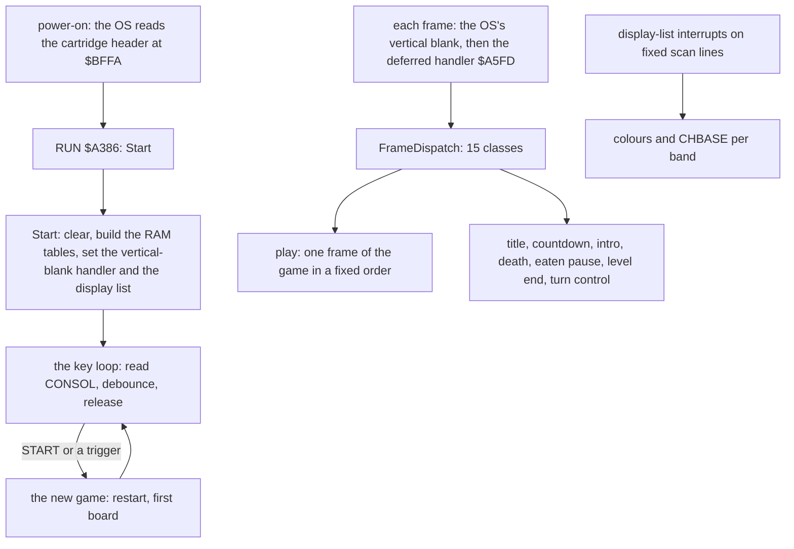

# 58 - The Original Software: Architecture (checklist stage 92)

GENERATED by `python -I tools/analyze_original_architecture.py --doc docs/58-original-architecture.md` from the ROM, the recursive trace of its code, the subsystem table of `24`, the contexts of `46`, the memory regions of `42` and the data regions of the labelling; the curated parts (what each region holds, the reading guide) are tables in the tool. Tests: `tests/test_original_architecture.py`.

Checklist stage 92: "Record the original program structure, memory layout, execution flow, and architectural characteristics." This chapter is the overview of the **original** (Pac-Man for the Atari 8-bit computers, the 8 KB cartridge, NTSC, Rev B OS); the C port's architecture is `48`. Every number below is computed from the ROM when the chapter is generated; the detail is in the chapters named in each section.

## 1. In one page

- **One 8 KB cartridge image** at `$A000-$BFFF` of an Atari 400/800 (6502 at 1.79 MHz, ANTIC, GTIA, POKEY; no other chip is touched). It holds **5,946 bytes of code** (2,925 instructions in 81 routines) and **2,246 bytes of data** (76 regions: streams that `Start` expands, tables, pictures, texts).
- **One program and one interrupt-driven frame.** The *main program* (`Start`, ending in the key loop) reads the console and starts games; **everything else is the vertical-blank handler** `$A5FD`, run once per frame by the OS's deferred-VBI mechanism: it is a 15-way dispatcher over the state of the game (title, countdown, intro, play, death, level end, ...), and the game itself is a state machine whose state lives in 20 variables (`34`, `38`). Two display-list interrupts change colours between screen bands (`35`).
- **All state is in RAM at fixed addresses**: 109 zero-page variables, a few buffers, the maze in four copies, the player-missile pages. There is no heap, no software stack and no code in RAM: every `JSR` and `JMP` target is in the cartridge except the 2 OS entry points (`$E45C`, `$E462`) (two stray writes of the original are listed in `42`).
- **Static control flow is the whole control flow**: 124 `JSR` and 55 `JMP`, **0 indirect jumps, 0 `BRK`**, and the stack holds only return addresses and 8 balanced push / pop pairs (`28`). The longest chain of calls is 6 routines deep (`VbiHandler`).
- **The machine is touched through 34 chip registers** and **2 OS calls** (`SETVBV`, `XITVBV`); no file, serial, network or PIA access (`45`, `46`).

## 2. Structure: the code

| Subsystem | What it does | Routines | Code bytes | Chapters |
|---|---|---|---|---|
| **Start-up and the main loop** (BOOT) | cartridge entry, the one-time set-up, the key loop (`$A4BA-$A559`) | 2 | 494 | 21 |
| **Data decompression** (DECOMP) | the helpers that expand the packed maze and charset streams at start-up | 5 | 76 | 12 |
| **Interrupts and display** (INT) | the vertical-blank and display-list interrupt handlers, display lists, the tunnel-edge clip | 7 | 363 | 06, 15, 16 |
| **The per-frame dispatcher** (FRAME) | `Sub_A6CC`: the deferred VBI routine that is the whole game in one: title states 1-4 and the game frame | 1 | 801 | 21 |
| **Title, status line, labels, high score** (TITLE) | the score row, the 1UP / 2UP labels, the title score clearing, the high-score compare | 6 | 158 | 19, 21 |
| **Game, board and level set-up** (BOARD) | new game, new board, level advance, the lives and level indicators, two-player turn switching, the maze copies | 20 | 878 | 14, 19, 20, 21 |
| **Pac-Man and the dots** (PAC) | Pac-Man's step, the dot and power-pellet pick-up, his animation phase | 4 | 500 | 20 |
| **Maze items** (MAZE) | power-pellet blink, the bonus item | 3 | 177 | 14, 15 |
| **Death** (DEATH) | the death sequence and animation | 2 | 279 | 20 |
| **Ghost AI** (GHOST) | state machine, steering, junction lookup, move delays, timers, drawing | 14 | 975 | 13, 17, 18 |
| **Ghost house and the eyes' return** (HOUSE) | waiting, leaving, the eaten ghost's way home | 7 | 343 | 18 |
| **Frightened and eaten ghosts** (FRIGHT) | power-pellet effects, the frightened clock, a ghost eaten and the pop-up pause | 4 | 568 | 18 |
| **Score** (SCORE) | BCD score addition, the extra life | 1 | 107 | 12, 22 |
| **Sound** (SOUND) | POKEY writes that are not inline (the dot, bonus and frightened sounds, clearing the registers) | 5 | 227 | 22 |

(Each instruction is counted once, for the routine with the smallest body that contains it: 5,946 of 5,946 code bytes.)

**Shape of the code.** 81 routines (65 are the target of a `JSR`, 66 distinct `JSR` targets with the OS's `SETVBV`; the rest are entry points, interrupt handlers and jump targets); 16 tail jumps between routines; 59 of the routines contain loops, in all 228 back edges; the addressing is mostly zero page (770 instructions) and immediate (651), with 31 indirect-indexed accesses `(zp),y` for the pointer-walking routines (`29`) and no `(zp,x)`; 615 conditional branches (21% of the instructions). The data tables are read with indexed absolute addressing (130 `abx`, 43 `aby`).

The call tree, every routine's inputs and outputs, and its subsystem and role are in `23` and `24`; the control-flow graph of each routine in `26`; the 6 loops with a second entry in `26`.

## 3. Structure: the data in the ROM

| Kind | Regions | Bytes |
|---|---|---|
| stream | 3 | 994 |
| bytes | 40 | 757 |
| shape | 21 | 201 |
| text6 | 7 | 92 |
| words | 4 | 42 |
| text | 1 | 9 |

The regions are named and described one by one in `12` (formats), `13`-`17` (the ghosts' patrols, the levels, the small tables, the ghost pictures and transitions), `15` and `47` (the resources and how a port installs them); the packed streams (maze, character sets, move-delay nibbles) are expanded into RAM by `Start`.

## 4. Memory layout

| Range | Region | Kind | An output of the game | Holds |
|---|---|---|---|---|
| `$0000-$00FF` | ZeroPage | state | no | the game's variables (109 variables in 184 of the 256 bytes: the 132 bytes an instruction names directly, `25`, and the rest of the arrays, reached by an index) and the OS's: clock, shadows of the chip registers |
| `$0100-$01FF` | Stack | state | no | the hardware stack: JSR / RTS, interrupts, 8 push / pop pairs; nothing else lives here (`28`) |
| `$0200-$02FF` | OsPage2 | os shadows | yes | the OS shadows the game writes: colours, display list, DMA, priority, `ATRACT`, `CH`; the stick, trigger and key values it reads; the interrupt vectors it sets (`33`, `35`, `42`) |
| `$0400-$041F` | PictureBuffers | picture buffers | yes | the 16 picture rows of Pac-Man (`$0400`) and of the ghost being drawn (`$0410`), copied into the player-missile pages (`42`) |
| `$0600-$07FF` | RamTables | tables | no | the tables `Start` builds from the nibble stream: move delays, the end phases of the frightened period, the routes (`12`, `14`) |
| `$0800-$0BFF` | OriginalMaze | maze | no | the maze of a new board as `Start` expanded it, never written again (`12`) |
| `$0C00-$0FFF` | MazeScreen | screen | yes | the working maze and the screen of the maze band: 23 rows of 40 (walls, dots, power pellets, the lives row, the level indicator, the bonus item, READY!) (`12`, `14`, `42`) |
| `$1000-$13FF` | SavedMaze1 | maze | no | player 1's maze while player 2 plays (`19`) |
| `$1400-$17FF` | SavedMaze2 | maze | no | player 2's maze while player 1 plays (`19`) |
| `$1800-$1BFF` | TitleCharset | character set | yes | the title character set: 20 glyphs of the PAC-MAN logo, written by `Start` (`12`) |
| `$1C00-$1FFF` | TitleScreen | screen | yes | the title screen (mode 6 and 7 rows) (`21`, `42`) |
| `$2000-$22FF` | StatusRows | screen | yes | the two status lines (mode 2): the 1UP / 2UP labels, the scores and the high score (`42`) |
| `$2300-$23FF` | PmMissiles | player-missile | yes | the missile page: Pac-Man's body and the pop-up score digits (`16`, `42`) |
| `$2400-$27FF` | PmPlayers | player-missile | yes | the four player pages: ghosts 0 to 3, one byte a scan line (`16`, `42`) |
| `$3000-$33FF` | GameCharset | character set | yes | the game character set: 101 glyphs (the maze pieces, the dots, the digits, the text), written by `Start` (`12`) |
| `$A000-$BFFF` | Rom | rom | no | the cartridge: code, data, the header at `$BFFA` (`07`) |
| `$D000-$D0FF` | Gtia | hardware | yes | GTIA: player and missile positions, the colour registers, `HITCLR`, `PRIOR`; the collision registers it is read for (`35`, `50`) |
| `$D200-$D2FF` | Pokey | hardware | yes | POKEY: the four sound channels, `SKCTL`, `IRQEN`; read for RANDOM (`22`, `33`) |
| `$D300-$D3FF` | Pia | hardware | no | never touched by the game (`45`) |
| `$D400-$D4FF` | Antic | hardware | yes | ANTIC: the display-list pointer, `CHBASE`, `PMBASE`, `NMIEN`, `WSYNC` (`35`) |

The OS's own areas (`$0300-$03FF`, `$E000`: the OS font the title text uses, `$D800-$FFFF`) are the platform's, not the game's (`06`, `47`). What each routine and each context reads and writes is in `23`, `42` and `46`; the 144 bytes of the zero page that are state, found by experiment, in `43`.

## 5. Execution flow

| Context | What runs | Instructions | Routines it calls |
|---|---|---|---|
| key | the main program: the key loop (`$A4BA-$A572`) | 87 | 0 |
| newgame | the new-game sequence the key loop starts (`$A477-$A4B8`) | 231 | 20 |
| vbi | the deferred vertical-blank handler `$A5FD`: the whole game frame | 2577 | 71 |
| dli1 | display-list interrupt, game screen (5 lines) | 44 | 1 |
| dli2 | display-list interrupt, title screen (5 lines) | 25 | 1 |

Five contexts share one CPU; they hand over through 12 variables with single-byte stores, and the one race the code has is one no game can reach (`46`, `34`). **A frame**, in order: the OS clock tick and the shadow registers, the handler (`FrameDispatch` chooses by `GameState`, `Paused`, `IntroRequest`, `CountdownActive`, `LevelComplete`, `PlayStarted`, `WaitState`, `DeathState`, `EatPause`: the 15 classes of `38`), and then the main program for the rest of the frame (the key loop's wait for the next clock tick). A play frame runs its routines in the order listed in `24` section 4.3 and `48` section 3.

**Start-up** (`37`): the OS reads the header (`RUN = $A386`, `INIT = $A6B4`, the flags `$00` and `$04`), jumps to RUN with the stack at `$FF`; `Start` clears the zero page (`$18-$3F` and `$80-$FF`), builds the tables in RAM from the nibble streams, expands the maze and the character sets, sets the display list and the handler vectors, and falls into the key loop. **Time** (`39`): the handler has about 16,100 cycles a frame on the game screen (19,750 on the title); a play frame costs 14,278 cycles at most in the heaviest case found, the static bound (32,049) could not be tightened.

## 6. Architectural characteristics

| Characteristic | What the original does | Evidence |
|---|---|---|
| Concurrency | one CPU, five interleaved contexts, no reentrancy, hand-over through 12 variables | `46` |
| State | 20 state variables, 68 transition rules, every one seen in the real game | `34` |
| Data-driven | 27% of the ROM is data; ghost behaviour, levels and sound are tables read by index; the level-dependent tables are indexed past their ends on boards above 15 (the original's behaviour, kept) | `14`, `44` |
| Pointers | 16-bit zero-page pointers walk the maze, the pictures and the streams; no pointer to code | `29` |
| Dynamic memory | none; every buffer is at a fixed address | `45`, `47` |
| Stack | 8 balanced push / pop pairs besides call and return; no stack-held data; the maximum depth is within 256 bytes | `28` |
| Indirect control flow | none: no indirect jump, no push-and-return trick; the call tree is complete | `23`, `28` |
| Timing | the frame is driven by the vertical blank; sound and the display lists run from the same frame; collision registers are read at the start of a frame | `38`, `39`, `50` |
| Operating system | the Atari OS Rev B supplies the clock, the shadow registers and the vertical-blank vector; the game calls 2 OS routines; the character set of the text lines is the OS's | `37`, `45`, `47` |
| Randomness | the POKEY RANDOM register is read at 3 places in the code, for ghost steering and the corner choice | `31`, `44` |
| Quirks that are part of the behaviour | the extra-life cell rule, the 8-bit ghost count, the unclamped frightened tables, two stray writes (`$D111`, 16 bytes of ROM), the race at `$A800` that no game can take | `34`, `42`, `44` |

## 7. Where to read more

| Topic | Chapters |
|---|---|
| Hardware, memory map, vectors | `06`, `07`, `35` |
| Binary: disassembly, labelling, control flow | `08`, `09`, `10`, `11`, `26` |
| Routines, call tree, relationships | `23`, `24` |
| Variables, locals, the stack, pointers, structures | `25`, `27`, `28`, `29`, `30` |
| Constants, algorithms | `31` |
| Data formats and tables | `12`, `13`, `14`, `15`, `16`, `17` |
| Subsystems: ghosts, frightened, Pac-Man, death, sound, title | `13`, `17`, `18`, `19`, `20`, `21`, `22` |
| Start-up and the main loop | `37`, `38`, `40` |
| Inputs, outputs, state, the interface to the machine, communication | `33`, `34`, `41`, `42`, `43`, `45`, `46` |
| Time budget | `39` |
| Collision geometry, resources | `50`, `47` |

The architecture of the **port** (the layers, the oracle chain, the layout of `src/c`) is `48`; how the C source is organised is `57`; how the port was shown to equal the original is `52`-`56`.
