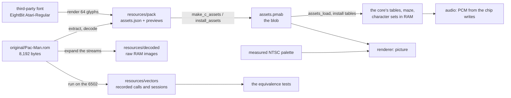

# 62 - Resources: the Catalogue (checklist stage 96)

GENERATED by `python -I tools/analyze_resources_docs.py --doc docs/62-resources-catalogue.md` from the asset pack (`tools/asset_pack.py`), the blob writer (`tools/make_c_assets.py`), the manifest of the originals and `.gitignore`; the formats by kind, the derived files and the relationships are tables in the tool. Tests: `tests/test_resources_docs.py`.

Checklist stage 96: "Catalogue extracted and reconstructed resources, their formats, origins, locations, and relationships." The project has **no resource that is not derived from the owner's ROM, except one third-party font**; this chapter lists them all. The format of the pack in full is `47`; the data regions one by one are `59` section 6; the data structures they fill are `60`.

## 1. How the resources relate

| From | By | To | What happens |
|---|---|---|---|
| `original/Pac-Man.rom` | `tools/asset_pack.py`, `tools/decode_streams.py` | the pack, the raw images | extract every non-code byte, decode the streams, label and decode the tables |
| the pack (`assets.json`) | `tools/make_c_assets.py`, `install_assets` | `assets.pmab` | the blob the C loads; made again from the ROM by the installer, never shipped |
| `assets.pmab` | `assets_load`, `assets_install_tables`, `assets_ram_image` | the core's tables, the maze, the character sets (`core/tables.h`) | installed into RAM at start-up |
| the OS font (`third-party/`) | `tools/asset_pack.py` | the pack's `font` key and the blob's `font` entry | 64 glyphs rendered to 8 x 8 for the text lines |
| `analysis/palette-ntsc-measured.txt` | `tools/make_c_palette.py` | `src/c/render/palette.[ch]` | the NTSC palette measured from the emulator (256 colours) |
| the blob's character sets, maze, font, the palette | `render/render.c` | the picture of a frame | ANTIC and GTIA as software |
| the sound-chip writes of the core | `audio/audio.c`, `pokey.c` | PCM | no sound is stored in the cartridge: it is code; only the start tune's two tables and two sweeps are data (`22`) |
| `resources/vectors/`, replays | the vector runner, `pacman_a8` | the pass / fail of every equivalence test | `52`-`56` |

## 2. The original materials

Never modified, never committed (`/original/` and `*.rom` are in `.gitignore`: they are copyrighted); a read-only backup and the manifest are kept (`03`). `python -I tools/verify_originals.py` checks them.

| File | Bytes | SHA-256 | What it is | Ignored by Git |
|---|---|---|---|---|
| `original/Pac-Man.rom` | 8,192 | `a99b2dd10b546d90...` | the cartridge image: the one subject of the project (`59`) | yes |
| `original/Decompilation steps.txt` | 16,051 | `1afa7d69b5463a23...` | the 100-stage checklist the work follows | yes |
| `original/reference-AtariAge-thread-291065.htm` | 225,063 | `3130f4de3c5108d2...` | a saved web page, evidence for the ROM's identity (`03`) | yes |
| `original/Atari OS Rev B (19xx)(Atari)(NTSC)[400-800].rom` | 10,240 | `63973d5e86b1ae5b...` | the Atari OS Rev B, NTSC: the reference of all measurements; the emulator needs it (not the port); the game takes only the clock, the shadow registers and two OS calls from it (`45`) | yes |

**Only the NTSC OS ROM is used** (the owner's decision of 2026-11-23). The folder also holds `Atari OS Rev B (19xx)(Atari)(PAL)[a800.zip MAME].rom`, left from the PAL sound verification of 2026-11-13 (register C-24 to C-26): it is not in the manifest, not checked and not needed by anything (the port builds and runs from the cartridge ROM alone; the PAL evidence stays in `analysis/`); it may be deleted.

## 3. Extracted from the ROM

**79 regions, 2,246 bytes: every byte of the cartridge that is not code** (the code is the other 5,946 bytes, `59`). Each is in the pack with its address, its kind and its bytes.

| Kind | Regions | Bytes | Format |
|---|---|---|---|
| stream | 3 | 997 | a packed stream `Start` expands into RAM: the character-set stream (run and literal bytes), the maze stream, the nibble stream of the move-delay and junction tables (`12`) |
| bytes | 40 | 797 | a table of bytes indexed by level, direction, ghost or step (`14`, `15`) |
| shape | 21 | 222 | a picture: one byte a scan line, bit 7 leftmost (a ghost 10 rows, Pac-Man's frames 10 rows, the star); drawn into a player-missile page (`16`) |
| text6 | 7 | 99 | ANTIC mode 6 screen codes: the low 6 bits are the letter, the top two the colour (`12`) |
| display list | 2 | 69 | an ANTIC display list: mode lines, blank lines, a load-memory-scan address, a jump and wait for vertical blank, the interrupt bit (`35`) |
| words | 4 | 46 | a table of 16-bit little-endian words (pointers to pictures) |
| text | 1 | 10 | ANTIC mode 2 screen codes (code + `$20` = ASCII), one byte a letter (`12`) |
| header | 1 | 6 | the cartridge header at `$BFFA`: RUN, the flags, INIT (`07`) |

### 3.1 The pictures (21 shapes)

| Shape | Address | Rows |
|---|---|---|
| `GhostShapeUp` | `$BAC0` | 10 |
| `GhostShapeDown` | `$BACA` | 10 |
| `GhostShapeLeft` | `$BAD4` | 10 |
| `GhostShapeRight` | `$BADE` | 10 |
| `GhostShapeFrightened` | `$BAE8` | 10 |
| `GhostEyesShape` | `$BAF2` | 10 |
| `PacShapeFull` | `$BAFC` | 10 |
| `PacShapeRight1` | `$BB06` | 10 |
| `PacShapeRight2` | `$BB10` | 10 |
| `PacShapeLeft1` | `$BB1A` | 10 |
| `PacShapeLeft2` | `$BB24` | 10 |
| `PacShapeUp1` | `$BB2E` | 10 |
| `PacShapeUp2` | `$BB38` | 10 |
| `PacShapeDown1` | `$BB42` | 10 |
| `PacShapeDown2` | `$BB4C` | 10 |
| `StarShape` | `$BC07` | 12 |
| `GhostScoreZeros` | `$BC13` | 12 |
| `GhostScore200Digits` | `$BC1F` | 12 |
| `GhostScore400Digits` | `$BC2B` | 12 |
| `GhostScore800Digits` | `$BC37` | 12 |
| `GhostScore1600Digits` | `$BC43` | 12 |

### 3.2 The text (8 strings)

| Name | Address | ANTIC mode | Text |
|---|---|---|---|
| `TextHighScore` | `$BDC7` | 2 | HIGH SCORE |
| `TextChangeDifficulty` | `$BDD6` | 6 | CHANGE DIFFICULTY |
| `TextPressStartTo` | `$BDE7` | 6 | PRESS START TO   |
| `TextCopyright` | `$BDF7` | 6 | (C) ATARI 1982 |
| `TextPlayerGame` | `$BFC6` | 6 | PLAYER GAME |
| `TextPressSelectFor` | `$BFD1` | 6 | PRESS SELECT FOR |
| `TextPressOptionTo` | `$BFE1` | 6 | PRESS OPTION TO  |
| `TextPlayGame` | `$BFF1` | 6 | PLAY GAME |

### 3.3 The packed streams

| Stream | Address | Bytes | Expands to |
|---|---|---|---|
| `CharsetStream` | `$A003` | 478 | type B stream (table-driven RLE, see ExpandData) -> RAM $3000, 808 bytes = 101 glyphs; CHBASE=$30 in DliHandler1 |
| `MazeMapStream` | `$A1E1` | 421 | type A stream (inline RLE in Start) -> RAM $0800, 920 bytes = 23 rows x 40 columns, the mode-4 rows of DisplayList1; copied to $0C00/$1000/$1400 |
| `TitleCharsetStream` | `$BE13` | 98 | type B stream -> RAM $1808, 160 bytes = 20 glyphs of the title character set (CHBASE=$18) |

## 4. Decoded and reconstructed

| Resource | What it is | Origin | Where |
|---|---|---|---|
| Game character set | 101 glyphs of 8 rows (ANTIC mode 4: 4 pixels of 2 bits a row), RAM `$3000` | expanded from the character-set stream | pack `charsets.game`, blob `charset.game` |
| Title character set | 24 glyphs in the RAM image of the title set (the stream's 160 bytes are the 20 glyphs of the PAC-MAN logo; codes from 1, glyph 0 is not in the ROM; `47`), RAM `$1808` | the title stream | pack `charsets.title` |
| Maze | 23 rows of 40 cells, 256 dots and 4 power pellets (screen codes of the game set) | expanded from the maze stream | pack `maze`, blob `maze` |
| Start tune | 64 notes of two voices (AUDF values), a step every 4 jiffies, and two frequency sweeps; **the other sounds are computed by code, not stored** | tables in the ROM | pack `tunes` |
| Colours | the 8 game colours (PCOLR0-3, COLOR0-3), the 4 title colours, the 4 display-list colours: Atari colour bytes (hue high nibble, luminance low) | tables in the ROM | pack `colours` |
| Tables | the 472 nibbles of the RAM tables at `$0600` and the nine nibble tables built from them (junction exits, move delays, routes ...) and 17 ROM tables | the nibble stream and ROM tables | pack `tables`, blob `ram_0600`, `rom_ba00` |
| Display lists | the game's and the title's, decoded into entries | ROM | pack `display_lists` |
| **The OS font** | the 64 glyphs (screen codes `$00-$3F`) the text lines use, 8 x 8, RAM `$E000`: **not in the cartridge** (ANTIC mode 6 and the status row read the OS ROM's set) | rendered from the open font below | pack `font`, blob `font` |
| The NTSC palette | 256 colours as the emulator shows them | **measured** from Altirra 4.40 (`analysis/palette-ntsc-measured.txt`), not from a formula | `src/c/render/palette.[ch]` (generated) |

## 5. Files made from them (derived, regenerated, not committed)

All of `/resources/` and `/build/` are in `.gitignore` (both ignored): they are derived from the owner's ROM and rebuilt by the commands below. A port needs only the ROM and the installer.

| File | What it is | Made by | Format |
|---|---|---|---|
| `resources/pack/assets.json` | the asset pack: all 79 regions with their bytes and the nine decoded views (schema 2) | `python -I tools/asset_pack.py --write` | JSON, `47` section 3 |
| `resources/pack/manifest.json` | the schema, the ROM's SHA-256 and the SHA-256 of every other file of the pack | the same | JSON |
| `resources/pack/charset_game.png`, `maze.png`, `sprites.png`, `text.png` | previews of the character set, the maze, the sprites and the text (not colour-accurate) | the same | PNG |
| `resources/pack/assets.pmab` | the asset blob the C port loads: 85 entries, 9,392 bytes | `install_assets` (C) or `tools/make_c_assets.py` | `PMAB`: magic, version, schema, entry count, the ROM's SHA-256, then entries (name, kind, address, size, bytes); `src/c/assets/assets.h` |
| `resources/decoded/*.bin` | the raw RAM images `Start` builds: the game character set (`$3000`), the title set (`$1808`), the maze (`$0800`), the nibble tables (`$0600`) | `python -I tools/decode_streams.py --dump` | raw bytes |
| `resources/vectors/*.vec` | the recorded calls of the original's routines and of whole sessions that the C is tested against (made from the Python port, which equals the ROM) | `python -I tools/make_vectors.py`, `make_app_sequences.py` | `PMVEC001`: header, then records of arguments, RANDOM values, the state before and after (`tools/vecfmt.py`) |
| `build/` (replays, state dumps, comparison files) | replays of games for the shell (`PMRP`), the C's per-frame state dumps, the logs of the comparisons with the ROM | `tools/make_replay.py`, `make_rom_fuzz_replays.py`, `make_rom_edge_replays.py`, `make_rom_bot_replay.py`, `run_regression.py` | `PMRP`: header, then one record of inputs (and RANDOM bytes) a frame (`src/c/shell/replay.h`) |

The C sources hold **no byte of the ROM**: `src/c/assets/rom_layout.[ch]` has only the layout (name, address, size, kind of the 79 regions), the ROM's SHA-256 and the font's glyphs; the tables, the maze and the pictures are installed at start-up from the owner's ROM (`47`, C-112, C-113).

## 6. Third-party material

| | |
|---|---|
| What | `EightBit Atari-Regular.ttf`, the Atari 8-bit character set as an outline font; its glyphs equal the Atari OS ROM's set bit for bit (provenance question, accepted by the owner on 2026-11-18, `49`) |
| Author | Steve Boswell (c) 2018 |
| Licence | SIL Open Font License 1.1 (third-party/EightBit-Atari-Fonts/OFL.txt) |
| Source | https://github.com/a8bit/EightBit-Atari-Fonts, commit `8b5a19f41f46fc93fe58455355b5bc0c31c31bda` |
| SHA-256 | `bd2b3397a1c3c6ef892e463ad821fb812ca00fb2d8768c4c30b57f7b74e5c278` |
| Location | `third-party/EightBit-Atari-Fonts/` (committed with its licence and upstream README: `third-party/README.md`) |

## 7. Evidence material

Not resources of the game, but resources of the project: what the measurements were made from and what they produced. All local to `analysis/` (the summaries and the small logs are committed; the screenshots (`.png`, `.jpg`), the recordings (`.wav`, except `start-tune.wav`) and the raw logs are ignored by `.gitignore`: checked).

| Kind | Where | What |
|---|---|---|
| Evidence summaries | `analysis/evidence-*-summary.txt` | the output of each audit, quoted by the register (`OPEN-VERIFICATION.md`) |
| Recordings | `analysis/*.wav` | the emulator's audio output, the references of the sound model and the audio of the port (`22`) |
| Screenshots | `analysis/*.png`, `*.jpg` | emulator captures: the references of the renderer (`42`, C-114) |
| Raw logs | `analysis/raw-logs/` | register and memory traces of the live sessions (`32`-`35`) |
| Palette | `analysis/palette-ntsc-measured.txt` | the measured NTSC palette |

## 8. What is not here

No resource is stored that the ROM does not hold: the sounds of the game are code; the colours come from the tables; the NTSC palette and the OS font are the two things the cartridge does not carry and the port needs (the measured palette is project work; the font is third-party). No PAL resource exists (NTSC only, `49`).
