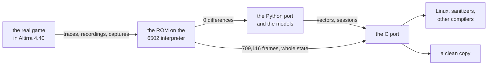

# 64 - Testing and Verification (checklist stage 98)

GENERATED by `python -I tools/analyze_testing_docs.py --doc docs/64-testing-and-verification.md` from the register `OPEN-VERIFICATION.md` (its counts and its open items), the test modules, the CMake tests, the evidence summaries and the ledger `56`; the claims table and the procedures are tables in the tool. Tests: `tests/test_testing_docs.py`.

Checklist stage 98: "Record testing procedures, results, compatibility information, known issues, and unresolved discrepancies." This chapter is the **map of the verification**: what was claimed, how each claim was checked, what came out, what it was checked on, and what is not verified. The register is the full list (every check that was skipped, partial or done with an aid, one line each); the numbered chapters hold the evidence.

## 1. The result in short

- **The C port equals the original ROM, frame by frame, in the whole state, the ordered sound-chip writes and the RANDOM reads: 709,116 frames, 0 differences** (`52`-`56`), and in the frame classes, the state variables and the outputs on 171,300 frames (`53`). Every difference found along the way had a cause and was corrected (`56`: 19 items, none a difference in what the game does).
- **The register holds 75 verification items (OV-nn): 67 closed, 7 of them closed as a documented limit, 8 open** (section 6), and 154 numbered results (C-nn). **122 evidence summaries** are kept in `analysis/`.
- **103 test modules with 880 test functions** in `tests/` (Python) and **43 tests** under `ctest` (C); every one passes (`run_regression.py`: ALL PASSED).
- **Nothing was verified on real hardware**: every measurement is against Altirra 4.40 (NTSC, Atari 800, OS Rev B), by the owner's decision (OV-01, OV-42b; C-27).

## 2. The chain of verification

Each arrow is a comparison that was made and shown to see a difference (a corrupted byte, RANDOM value, chip write or state variable is reported at the frame it was put in). The comparison with the ROM does **not** go through the Python port: the C and the interpreted ROM get the same inputs and the same RANDOM bytes.

## 3. What was claimed, how it was checked, what came out

| Claim | How it was checked | Result | Register | Chapters |
|---|---|---|---|---|
| The disassembly is the ROM | the listing assembles with ca65 / ld65; size and SHA-256 compared with the original; the recursive trace covers every byte once | byte-identical; 2,925 instructions, 5,946 + 2,246 bytes, no byte uncovered | C-10 | `09`, `10`, `59` |
| Every routine and instruction was observed | 36 live sessions of the real game in Altirra, traced instruction by instruction; the 5 never executed are dead paths shown from the code | 2,920 of 2,925 instructions; 79 of 79 routines entered; 124 of 124 `JSR` sites run | C-61, C-62, OV-59 | `32` |
| The data formats and tables are right | every byte of every region decoded by a tool and compared with the RAM the ROM's own `Start` builds on the concrete 6502 | byte-equal; 19 of 19 checks of the asset pack | C-90 | `12`, `47` |
| The 22 algorithms and 81 routines behave as documented | each algorithm written as a model and run against the ROM on the concrete 6502 over random states, the whole memory compared after every call | 0 differences in about 940,000 calls; every instruction executed | C-59, C-60 | `31` |
| The state machines are what the rules say | 68 rules written from the code, every transition of 20 sessions checked, every pair run on the interpreter, and proved by abstract interpretation | 0 transitions without a rule; 68 of 68 rules seen; 0 stores that no rule allows | C-64, C-65, C-66 | `34` |
| The interface to the machine is closed and complete | the 14 inputs read by 35 instructions; the whole game run twice with every undeclared external cell random | 0 differences in 3,000 runs; every chip write traced live (4.66 million, 0 outside the 71 sites) | C-67, C-88 | `35`, `45` |
| The timing fits the frame | the handler measured over 219,987 frames; static bound per class; heaviest play frame searched | never late; 12 of 15 classes proved; the play frame **not proved** (bound 2x the budget; the heaviest found 89%) | C-71 to C-82, OV-64 (limit) | `38`, `39` |
| The sound is the original's | register writes traced and the audio recorded in Altirra; a model of the POKEY compared by spectra | every one of the 31 write sites run; the model within 0.5% of the emulator's level; **phase** not matched | C-08 to C-23, C-115 | `22` |
| The collision geometry is the hardware's | 73,111 random scenes and 27,193 frames of real play compared with the real GTIA's registers in Altirra | 0 differences in all 16 registers | C-94, C-95 | `50` |
| The Python port equals the ROM | the port-form core and the application layer run beside the ROM on the concrete 6502, the whole state compared after every call or frame | 0 differences in 243,000 core calls, 8,500 frame runs and the application sessions | C-87, C-104 to C-107 | `44` |
| The C port equals the Python port | the recorded calls of the Python port replayed through the C (85 vector files, 21 ctest sets), every region of the World compared | 0 differences; the vectors are shown to see a wrong byte, RANDOM value and byte order | C-96 to C-111 | `51` |
| **The C port equals the ROM** | the C and the ROM run side by side on the same inputs and RANDOM bytes, the whole state, the ordered chip writes and the RANDOM reads compared after every frame | **709,116 frames, 0 differences**: the recorded sessions, random and edge games, games played on purpose, long games, a final sweep | C-122, C-123, C-125, C-126 | `52`-`56` |
| The C port behaves like the ROM | the frame classes, the changes of the 20 state variables and the handler's routine call counts compared | 171,300 frames, 0 differences; 46 of 55 routine counts equal, the 9 others explained by number | C-123 | `53` |
| The picture and the sound of the port look and sound like the original's | the renderer compared pixel by pixel with Altirra's captures; the sound by spectra | 7 of 12 captures exact everywhere, 212 pixels in 5 captures at moving objects; the pitch, level and timing of the sound, not its phase | C-114, C-115 | `42`, `22` |
| The port builds and plays the same on another system and compiler | clang and gcc at five optimisation levels, four language standards, Windows and Ubuntu, with the sanitizers; 13 games bit-identical | 59 of 59 Linux steps; 0 warnings; the same hash on every frame | C-117, C-118, C-124 | `54` |
| A clean checkout builds and passes | the instructions of `63` run on a copy with no derived file | 10 of 10 steps; 37 of 39 tests (2 need the emulator's logs) | C-134 | `63` |
| A later change does not break any of this | the regression run: build, `ctest`, 30 golden games with state / run / video / audio digests, the Python tests; shown to see a one-line mutation | passes in about 6 minutes | C-125 | `55` |

## 4. The procedures

| What | Command | Needs | Time | A pass means |
|---|---|---|---|---|
| Unit and integration tests of the C port | `ctest --test-dir build/c --output-on-failure` | the build; the ROM for the blob; the vectors (recipe C of `63`) for the vector sets | 10 s | 39 tests; a test whose data is missing is **skipped, never passed** |
| Python tests | `python -m unittest discover -s tests -p "test_*.py"` | the ROM; Pillow for some modules; the build for the C ones | 34 minutes for all 864 | every module OK; `tests.test_c_*` and the comparisons are the long ones |
| The regression run | `python -I tools/run_regression.py` | gcc or clang, CMake, the ROM, the vectors | 6 minutes | ALL PASSED; `--full` adds clang, the ROM comparison and Linux with sanitizers |
| The C against the ROM, frame by frame | `python -I tools/check_c_vs_rom.py REPLAY` | the build, the ROM, a replay with RANDOM bytes (`make_rom_*_replays.py`) | 1 to 4 minutes per 6,000 frames | `NO DIFFERENCE`; a difference is reported at the first frame with the bytes that differ |
| Behaviour: classes, state variables, paths | `python -I tools/check_behaviour.py REPLAY ... [--exe COVERAGE_BUILD]`; `--paths` for the routine counts | the same, and a `gcc --coverage` build for the paths | 25 minutes for 117,000 frames | 0 differences in classes and transitions; the call counts equal or explained |
| Games played on purpose / edge games / sweeps | `make_rom_bot_replay.py`, `make_rom_edge_replays.py` | the ROM played by a look-ahead player (tens of minutes per level) | - | the C equals the ROM on them (`53`, `55`) |
| Linux and sanitizers | `sh tools/build_test_posix.sh gcc build/posix-gcc [-fsanitize=address,undefined]` | WSL2 with gcc | 2.5 minutes | 59 of 59 |
| A clean copy | `python -I tools/check_clean_build.py` | git, the build tools, the ROM | 19 minutes (17 for the vectors) | ALL PASSED, 10 steps |
| The original's integrity | `python -I tools/verify_originals.py` | `original/` | 1 s | ALL OK |
| The live evidence | `tools/run_*.ps1` with `tools/*.cmd` | Windows, PowerShell, Altirra 4.40, the NTSC OS ROM, the ROM | minutes to hours per session | the evidence summaries of `analysis/`, the register |
| Regenerating a chapter | `python -I tools/analyze_*_docs.py --doc docs/NN-....md` | Python (Pillow for some) | seconds | the chapter's own test says it is current |

### 4.1 The C tests (`ctest`)

43 tests: `toolchain_check`, `world_check`, `vectors_make_identity`, `vectors_identity`, `vectors_broken_state`, `vectors_broken_random`, `vectors_byte_order_swapped`, `fs_sandbox`, `portability_scan`, `portability_scan_selftest`, `platform_check`, `assets_install`, `assets_check`, `audio_selftest`, `shell_selftest`, `constants_check`, `assets_install_nested_clean`, `assets_install_nested`, `frontend_check`, `menu_check`, `interp_check`, `slang_check`, `vectors_core_ref`, `vectors_core_ghost`, `vectors_core_pacman`, `vectors_core_score`, `vectors_core_draw`, `vectors_core_sound`, `vectors_core_frame`, `vectors_core_play`, `vectors_core_play_chain`, `vectors_gtia`, `vectors_gtia_world`, `vectors_run_frame`, `vectors_run_frame_chain`, `vectors_core_app_init`, `vectors_core_app_board`, `vectors_seq_app_board`, `vectors_core_app_frame`, `vectors_seq_app_frame`, `vectors_sessions`, `vectors_keyloop_states`, `vectors_power_on`.

### 4.2 The Python tests, by area

| Area | Modules | Test functions |
|---|---|---|
| the C port against its oracles | 19 | 134 |
| the documentation generators | 16 | 164 |
| the analysis of the binary | 11 | 79 |
| the models and the Python port | 18 | 198 |
| the sound and the emulator evidence | 16 | 147 |
| other | 23 | 158 |
| **all** | **103** | **880** |

## 5. What it was checked on (compatibility)

| Environment | Result | Chapter |
|---|---|---|
| Windows 11, gcc 14.2.0 and clang 19.1.1 (WinLibs), x86-64 | builds with 0 warnings under `-std=c99 -Wall -Wextra -Wpedantic -Wconversion -Werror`; all tests pass; the reference of every measurement | `54`, `63` |
| Ubuntu 26.04 in WSL2, gcc 15.2.0 | 59 of 59 steps; also with AddressSanitizer, UndefinedBehaviorSanitizer and LeakSanitizer; 13 games bit-identical to Windows | `54` |
| Optimisation `-O0 -O1 -O2 -O3 -Os`, standards C99 / C11 / C17 / C2x | the same hash on every frame; every source compiles | `54` |
| A clean copy of the project | builds, installs the blob from the ROM, runs, reproduces a golden game | `63` |
| The original under PAL timing and Altirra's built-in OS | the same game (sound verified; historical, the project now uses only the NTSC OS ROM) | `38`, `22`, C-24 to C-26 |
| **Not tried** | MSVC, macOS, 32-bit, big-endian, ARM, other C libraries, other compiler versions, the real front end (stage J), real hardware | OV-72, OV-01 |

## 6. Known issues and open items

**Open in the register** (`OPEN-VERIFICATION.md`):

| ID | What | Status |
|---|---|---|
| OV-75 | What stage J could not test (docs/67 section 4): a person playing it (feel, the speakers' sound: the measurement is of the signals and a loopback capture); | PARTIAL |
| OV-76 | One unexplained observation (docs/67 section 4): the first self test of stage J had 8,916 of 92,160 window pixels differing from the frame; | OPEN |
| OV-77 | What the pause menu and graphics options could not test (docs/68 section 3): one machine and one monitor (2560 x 1440, 100 % scaling: a monitor smaller than a resoluti... | PARTIAL |
| OV-78 | What the FPS option could not test (docs/69 section 6; | PARTIAL |
| OV-79 | What the CRT shaders could not test (docs/70 section 5; | PARTIAL |
| OV-80 | The speaker's sound above 5 kHz (docs/22, last section): the new output (the chip at 176.4 kHz, low-passed) is checked against the model's own render and by spectrum (... | PARTIAL |
| OV-71 | Execution paths were compared as routine call counts for the routines of the vertical-blank handler only (stage 87, C-123, `53` section 3). | OPEN |
| OV-72 | What stage 88 could not test (docs/54 section 1.3): macOS; | OPEN |

**Closed as a documented limit** (not verified, by decision or by the nature of the evidence):

| ID | What |
|---|---|
| OV-01 | Everything was verified on one emulator (Altirra 4.40, NTSC, Atari 800, OS-B). |
| OV-73 | Input races of the original: the ROM's answer to a console key that changes within a frame of its first being seen, while it is being handled, or in the frame a change... |
| OV-42b | No recording from a real Atari: the emulator's own audio path (mixer table, AC coupling, resampler, 0.5 gain) is the reference for every level and polarity check. |
| OV-49 | Bonus item without aids: eaten at levels 0, 1, 2, 6, 10 and 12 only; |
| OV-20 | Player 2 above the high score; |
| OV-23 | The human session pressed keys on a real keyboard (F2/F3/F4) and the log shows them acted on; |
| OV-64 | Stage 62: the fit of the handler's frames inside the measured budget (16,100 cycles on the game screen) is proved for 12 of the 15 classes; |

**The whole Python suite was run once** (2026-11-23): 864 tests in 33 minutes (`analysis/evidence-python-suite-summary.txt`); 2 failed, both generated chapters that were stale (`32`, `63`), regenerated; every other test passed. **Known issues of the tests themselves:** two of the 39 C tests (`vectors_gtia`, `vectors_gtia_world`) need the emulator's collision logs and are skipped on a clean copy; a C test whose derived data is missing is skipped, never passed; the comparison of quick console changes is not made (they are a race of the original, OV-73); the Python tests that use the asset pack need Pillow; the full vector generation takes about 17 minutes.

## 7. Unresolved discrepancies

**None between the C port and the ROM**: every difference found was explained and either corrected or recorded as a decision or a limit (`56`). What differs by decision or by the limit of the evidence (RANDOM from a model, NTSC only, the GTIA model, the picture at moving objects, the phase of the sound, no frame pacing, the input races, the quirks of the original kept) is the table in `56` section 3 and `61` section 5.2. The two open items of section 6 are comparisons not made, not differences found.

## 8. How to read the evidence

`OPEN-VERIFICATION.md` is the index: each **OV-nn** is a check that was skipped, partial or done with an aid, closed with a **C-nn** result that says what was run, on what, with what outcome and what it does not show. Each C-nn names its evidence file (`analysis/evidence-*-summary.txt`) and its test. The rule (the owner's, 2026-11-11): whenever a check is skipped, only partly done, done with an aid, or a result is unexplained, a line is added at once; nothing is called verified without it.
